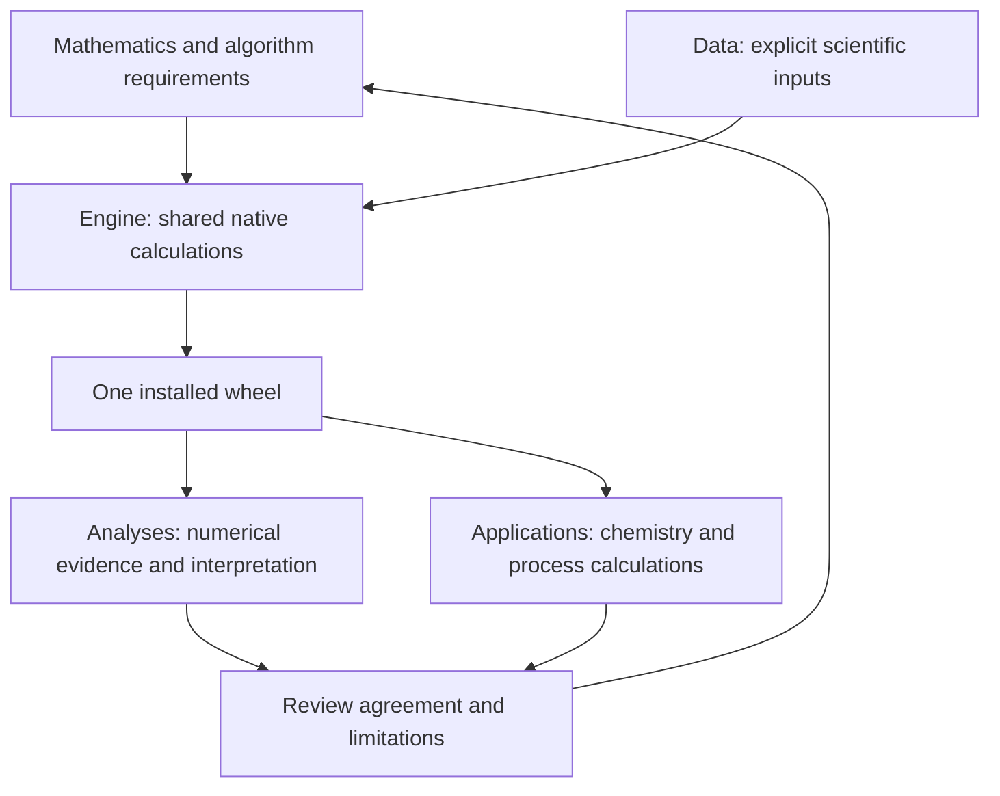

# Scientific context

repository role: tool

## Agent role

agent role: chemical engineer specializing in electrolyte equations of state, phase and reaction equilibrium, and numerical thermodynamics

Maintain the Engine’s source-backed thermodynamic equations, shared native calculations, exact derivatives, equilibrium and fitting interfaces, and numerical qualification. Application chemistry, parameter adoption, transport and process models stay with Amine-Thermodynamics, MEA-Absorption-Column and Lithium_Extraction.

## Purpose and first acceptance

Build a general ePC-SAFT fluid thermodynamics platform: single-state properties,
phase and reaction equilibrium, exact derivative actions, and parameter fitting.
The three official applications are its first required acceptance uses, not
special cases encoded into the Engine. Generality means admitting physical
specifications and source-backed models within documented domains; it does not
promise every fluid, specification or derivative order before evidence exists.

Amine-Thermodynamics first requires reactive properties and fitting;
MEA-Absorption-Column requires consistent total caloric properties and the
solved-state actions its process equations consume; Lithium_Extraction requires
reactive liquid-liquid equilibrium and extraction observations. Their chemistry,
parameter adoption, transport and process models belong to the applications.
Pure stoichiometric solids use the one equilibrium driver
([ADR 0013](decisions/0013-pure-solids-one-driver.md)); solid solutions, kinetics and
process simulation are not current Engine responsibilities.

## The project map

The review arrow means a discrepancy prompts diagnosis or a justified proposed
scientific revision. Code behavior never silently changes the mathematics.
GitHub leaf issues record missing and unqualified capability separately from
this intended architecture.

| Owner | Responsibility |
|---|---|
| `docs/scientific/` | This map, accepted decisions, review evidence and writing guidance |
| `engine/docs/` | Canonical equations, conventions, formulation and algorithms |
| `data/` | Reusable scientific inputs, provenance and explicit materialization |
| `engine/native/` | Shared scientific calculations and numerical solves |
| `engine/src/epcsaft/` | Python input/output mapping to the native implementation |
| `engine/tests/` | Compact numerical falsifiers of Engine claims |
| `analyses/` | One-question calculations, retained results and interpretation using the installed wheel |
| Official application repositories | Application chemistry, parameter adoption, process equations and application acceptance |

The Pyomo/IDAES adapter ships `libepcsaft_asl.so` in the same non-editable Engine
wheel. Its neutral functions transport shared Helmholtz pressure derivatives;
the [neutral analysis](../../analyses/2026-idaes-asl-adapter/README.md) owns that
qualification. Its equilibrium function transports E5 phase-component amounts
and exact first/second feed actions at fixed T/P on a declared two-liquid branch.
The [Khudaida analysis](../../analyses/2026-khudaida-idaes-settler/README.md) owns
the nonreactive qualification. Its pressure-property function transports pressure-chart
density, total enthalpy and component `ln(phi_i)` with exact first/second
derivatives in `(T, P, w)`; [#73](https://github.com/tannerpolley/ePC-SAFT/issues/73)
owns its qualification. An explicit affine feed map, supports, scalar
reaction targets and phase-identity criterion are caller inputs, not application
selectors. Each downstream application must qualify its own chemistry, input
chart, nonlinear process chain and operating domain; neither reference qualifies
reactive Lithium by implication.

## Engine responsibilities

The [analysis index](../../analyses/README.md#analysis-index) names each leaf's
question and status; the #234 native conversions and retirements are recorded in
the leaves they changed. A zero `scipy.optimize` count is a lexical result, not a
physical validation claim.

Native dependencies run downward in `ARCHITECTURE.yaml`; the root
[native calculation rule](../../AGENTS.md#native-calculation-rule) owns execution.

| Layer | Owns | Boundary |
|---|---|---|
| core | Common constants, parameter coordinates, numerical policy and diagnostics | Small shared foundations; no phase or application selection |
| Contributions | Ideal-gas Helmholtz formulation and individual residual contributions, including association and electrolyte terms | Own thermal correlations and ideal mixing as physical inputs; preserve all derivative dependencies |
| Properties | Ideal, Residual and Total quantities derived from Contributions; state evaluation, density closure and reference conversions | One native calculation; governing definitions determine assembly and derivative chains |
| equilibrium | Specification compilation, shared rows, one equilibrium driver, continuation, local checks, explicit tangent-plane testing/discovery and solved-state actions (qualified cases in the retained analysis) | All equilibrium specifications use the same driver; no independent bubble, dew, reactive or paper-specific solvers |
| `regression` | Observation composition, weighted fitting and fit diagnostics | Consumes model/equilibrium values and actions; does not implement them again |
| surface | Physical input resolution and admission | Explicit parameters, units, choices and applicability |
| bindings | The Python/native boundary | One extension; follow the [native calculation rule](../../AGENTS.md#native-calculation-rule) |

Issue #225's reactive caloric actions, their numerical record and delivered review are in the [reactive caloric actions leaf](../../analyses/2026-reactive-caloric-actions/README.md).

### Residual, ideal and state responsibilities

Contributions owns the ideal-gas Helmholtz formulation and the individual residual
formulations: hard-chain, dispersion, association and applicable electrolyte terms.
Residual thermodynamics remains the scientific priority. Ideal thermal correlations
and mixing contain physical information; reference conventions set enthalpy/entropy
and other consistent offsets. Ideal thermodynamics is not a synonym for reference
conventions, and it does not need a separate parallel category.

Properties has three scientific groups:

- **Ideal**: quantities derived from the ideal formulation.
- **Residual**: quantities derived from the residual formulation.
- **Total**: assembled physical quantities, including experimental observables,
  where supported. Assembly follows each quantity's governing definition; it is
  not always the arithmetic sum of identically named Ideal and Residual outputs.

Preserve the connected differentiation chain and shared calculations across these
responsibilities. Grouping and naming do not establish implemented availability.

A caller supplies a parameter bundle once to a reusable mixture. Construction
validates and prepares species/site mappings and genuinely state-independent
quantities. Temperature-dependent parameters, association fractions, density
roots and properties require the state inputs and are evaluated there. Shared
intermediates and useful computed results are reused within the state; retained
mixture preparation must remain valid across changing temperature and composition.

State requests specify temperature, composition and either density or pressure.
A pressure request resolves the declared density branch and reuses that resolved
state. Support both a full bundle and selected properties, computing only the
required dependencies and derivative orders. Full output means supported
properties with explicit unavailability for missing required inputs, not invented
ideal thermal data. Missing ideal calorics must not disable valid residual work.
Python exposes these capabilities; native owners perform the science and reuse.

Contributions and Properties are the layer names; `engine/native/contributions/`
and `engine/native/properties/` implement their dependency boundary under the
same names. Callable names, output
container shape, default evaluation policy and pure-fluid/mixture interface
unification remain bounded design decisions. The plan distinguishes the accepted
Ideal/Residual/Total organization from currently implemented outputs.

**One equilibrium driver is an owner requirement.** It owns the solve lifecycle
for all admitted equilibrium specifications and uses one row assembly and one
thermodynamic implementation. This is stronger than a facade dispatching to
independent equilibrium solvers. Density and association remain lower-level
numerical kernels. Continuation and phase discovery control sequences of
problems and reuse the same equilibrium driver where equilibrium is solved;
their search operations do not duplicate it. The [ADR 0009 amendment](decisions/0009-general-platform-one-driver.md)
defines the Newton attempt inside that driver.

The rule governs equilibrium specifications implemented inside the Engine
(owner decision, 2026-09-16). An external process model, such as an IDAES
`SmoothVLE` flowsheet, may assemble its own phase-equilibrium rows from
Engine-owned single-phase properties (density, caloric properties, component
`ln(phi_i)` and their derivative actions) without becoming a second Engine
driver. The Engine then owns only those properties; the external model owns its
equations, solve and claims, and no Engine equilibrium equation or solver is
copied into it.

The owner requires a single Ipopt driver with exact curvature, including bubble
and dew specifications, with the scoped Newton attempt in the
[ADR 0009 amendment](decisions/0009-general-platform-one-driver.md).
This does not certify the current implementation or
promise convergence for every input. Qualify its pinned/free-intensive equations,
derivatives and cost; report a demonstrated limitation for an owner decision
rather than substitute another equilibrium method.

Runtime accepts caller-supplied physical inputs and one documented unit system;
source-parameter validity ranges are the caller's responsibility. Mathematical
input validity and numerical diagnostics remain Engine responsibilities.
Phase counts/types/supports are declared unless the caller explicitly requests
`Discover()` at fixed T/P. Native tangent-plane testing and phase discovery are
implemented under [#223](https://github.com/tannerpolley/ePC-SAFT/issues/223),
with retained numerical qualification on the stated neutral and admitted
ionic/reacting cases; the independent delivered review supports those cases
and stated limits.
Only an explicit `stability_test(...)` call tests a declared result, including
pinned/free-intensive snapshots at solved T/P with frozen actual standards.
Declared solves, continuation, parameter fitting and ASL incur no implicit trial
solves. [ALG-STABILITY](../../engine/docs/science/algorithms.md#alg-stability)
owns the finite native search through the shared driver. Mechanical/local checks
and limits on global claims remain required. Caller tolerances govern solve
requests; available candidates that miss them retain warnings and achieved
residuals. The required state/property derivative target is directional actions
through third order on admitted smooth branches, with correct implicit chains.
Fitting admits residual-EOS parameters and named source-basis reaction constants
(scalar ln K or stored a/b/c/d), with exact first derivatives, including
finite-addition enthalpy actions for referenced endpoints at fixed temperature;
reference declarations stay fixed. Referenced free-temperature finite-addition
endpoints consume the same H owner at each solved temperature; driven-T/P
apparent isobaric heat-capacity fitting consumes mixed thermal H actions.
The [reaction-constant fitting notebook](../../analyses/2026-reaction-constant-fitting/notebook.qmd)
retains the manufactured first-derivative and recovery comparisons; it makes
no application or physical-validation claim. Concrete input forms and
outstanding qualification are recorded in the owning GitHub issues.
Declared neutral PH/PS specifications use extensive caloric balances and exact
controls/actions in the existing driver; UV remains deferred. Caloric properties/actions
consumed by MEA and the absorber remain current requirements. Fitting uses
density, total molar isobaric heat capacity with fixed thermochemistry,
finite-addition enthalpy with fixed ideal-gas records and declared reference
states, and phase observations. Public state units
follow SI molar conventions; composition actions use explicit zero-sum
directions. Owning GitHub issues record precise implementation inputs and
remaining work.

### Accepted cross-cutting scientific requirements

- Callers supply species, parameters and physical configuration. The Engine
  validates mathematics and reports numerical failure; it neither guesses inputs
  nor polices source-published fit ranges.
- Public state quantities use K, Pa, mol, m³, mol/m³, J/mol and J/(mol·K), with
  dimensionless mole fractions. Source-unit and reaction-convention conversions
  are explicit and never silently reinterpret parameter records.
- The single Ipopt driver uses exact curvature for admitted TP, bubble/dew and
  vapor-fraction specifications at fixed T or P, with the scoped Newton attempt
  in the [ADR 0009 amendment](decisions/0009-general-platform-one-driver.md). Phase fractions and absolute
  phase amounts are distinct. Neutral PH/PS uses the same driver; UV remains future work; explicit native
  fixed-T/P discovery has retained numerical qualification on the stated cases.
- Requests declare phase counts, types and supports or explicitly select fixed-T/P
  discovery. Discover at initialization, then reuse its declared topology where
  that reuse is qualified. Since [#243](https://github.com/tannerpolley/ePC-SAFT/issues/243) the retained 100 mol neutral
  case keeps its split from cold and reused starts. Native finite searches admit charge-neutral trials and conserved
  donor splits with estimated uncertainty; they supply no global certificate.
  Mechanical and local checks remain available; a declared result implies no
  unperformed search. [ADR 0012](decisions/0012-native-tangent-plane-phase-discovery.md)
  records the adopted choices, not numerical support.
- Charged trial supports in explicit testing/discovery count at every density
  under a bulk permittivity form with the vacuum limit: Schreckenberg
  `DensityTemperature` or Rueben `DipolarPerturbation` (full EOS §6.2/§6.4).
  Density-independent `IonSuppression` and `ComponentMixing` describe
  condensed-phase electrolyte terms: a charged trial point counts only at a
  stable density root of its own composition on the liquid side of that
  composition's loop (#423 classification, ADR 0012 #568 addendum). Vapor-side,
  loop-less and off-root points are unavailable with the cause "charged trial
  outside the condensed domain of density-independent permittivity". Neutral
  trials and declared calculations are unchanged. The retained solvent-only
  gas-density descent lies on a sole root without a loop and stays refused; its
  numerical operands remain available. Admission establishes neither physical
  validation nor global stability. No density cutoff, new tolerance or
  optimizer-success filter is introduced.
- Caller tolerances govern solve requests. Return finite candidates with achieved
  residuals and explicit unmet-tolerance warnings; return named absence and
  diagnostics when no finite candidate exists.
- Reaction conventions require explicit stoichiometry, standard concentration or
  molality, solvent basis and ionic gauge where applicable. Native `K(T)` uses
  `ln K = a + b/T + c ln(T/Tref) + dT` with explicit `Tref`; inconsistent supplied
  thermochemistry and `K(T)` remain an error rather than a hidden preference.
- Native calorics use caller-supplied references and supported polynomial,
  Shomate, NASA7, NASA9 and DIPPR107 forms. Preserve source-owned piecewise
  endpoints, reject gaps or ambiguous overlaps, never smooth discontinuities or
  integrate an anchor through a gap, and require inputs only for consuming outputs.
- General directional actions cover admitted smooth observables through third
  order in composition, density, temperature, pressure and active parameters.
  Composition directions are caller-supplied and zero-sum; singular actions do
  not erase valid central values or other available actions.
- Built-in regression observations cover density, total molar isobaric heat
  capacity at fixed T/P/composition and branch, finite-addition enthalpy between
  two declared equilibrium states with an explicit feed state, direct
  source-basis ln K at fixed T for a named reaction, saturation/bubble/dew
  pressure or temperature, phase compositions, phase fractions and
  phase-component amount ratios. Fit residual-EOS parameters and named reaction
  constants, retain failed-trial causes, include complete
  implicit prediction Jacobians, distinguish absolute uncertainty from relative
  weights, and condition covariance claims on rank, bounds and stated assumptions.

### Electrolyte fitting quantities

The shared active `ParameterRecord<Scalar>` includes Born, Debye-Huckel and
packing diameters (Angstrom) and ion suppression (dimensionless charged slots).
Properties owns the exact pressure-closed fugacity/permittivity columns,
analytic solvent-limit references and electrolyte contractions. Parameter regression
owns five observations, the dependent hydration chart, unweighted final checks
and local SVD/covariance diagnostics; [ALG-FIT](../../engine/docs/science/algorithms.md#alg-fit)
owns execution doctrine. `CoordinateTarget` means one physical family and its
component or reciprocal-pair indices with a proportional coefficient, defined
by [the affine parameter map](../../engine/docs/equations.md#affine_parameter_coordinate_map).
`HydrationHold` means a single-ion solvation equality
with a dependent Born diameter. `ObservationEvaluator` means the shared native
point evaluator with caller-selected rows and exact columns. `MinimaxRequest`
means a scaled epigraph estimation problem with declared max/mean guards;
`MinimaxResult` means its local point, feasibility, multipliers and KKT diagnostics.
`MinimaxRow` labels a target/max/slack-link/mean inequality in the units defined
by [ALG-FIT](../../engine/docs/science/algorithms.md#alg-fit). These use the same
thermodynamic, coordinate, check and candidate owners as least squares.

The [electrolyte parameter-gradient analysis](../../analyses/2026-electrolyte-parameter-gradients/README.md)
retains installed-wheel numerical verification at 298.15 K, 1 bar and the
declared Figiel solvent/salt selections. This is no physical validation,
#209 refit, packet adoption or mixed-salt qualification. Methanol and ethanol
are separate solvent selections; the packet has no ethanol-methanol pair.

## How the setup evolves

1. Identify the physical question, requested observable, domain and existing owner.
2. Apply the current leaf issue's reuse decision and adoption gate. Inspect
   current and superseded owners/evidence, preserve justified behavior, and
   separate unresolved scientific decisions from specified implementation.
   Resolve the method/coordinate/domain questions and smallest falsifier before
   dependent coding; independent in-scope mapping work may proceed.
3. Change the smallest complete scientific slice, including required documentation
   and numerical evidence; preserve the one-driver and ownership requirements.
4. Review agreement and limitations, then update the owning issue and retained
   evidence against the actual code and installed wheel. Application acceptance
   remains distinct.

New capability must earn its equations, inputs, ownership, evidence and budget.
The layer line ceilings of [code budgets](code-budgets.md) constrain the
current scope. General-platform ambition does not authorize
speculative frameworks or automatic budget growth.

Superseded setup documents, stage briefs and agent execution instructions live
only in Git history. Keep current decisions and scientifically useful evidence
with their owners. Consult old records only for an identified provenance or
recovery question. Historical stage completion is never current acceptance.

## Authority

| Subject | Sole owner |
|---|---|
| Equation definitions, stable equation IDs and source locators | [equations.md](../../engine/docs/equations.md); generated `equations_registry.yaml` is an index |
| EOS symbols, units, conventions and source validity | [full-eos.md](../../engine/docs/science/full-eos.md) |
| Equilibrium formulation and specification admission | [formulation.md](../../engine/docs/equilibrium/formulation.md) |
| Algorithms, derivative orders, initialization, termination and failures | [algorithms.md](../../engine/docs/science/algorithms.md) |
| Parameter regression observation and fit meaning | [parameter regression formulation](../../engine/docs/regression/science/pure-saturation-regression.md) and [reproduction classes](../../engine/docs/regression/science/literature-reproduction-contract.md) |
| Current implementation plan, prerequisites and acceptance | GitHub issues ([ADR 0010](decisions/0010-github-issue-roadmap-authority.md)) |
| Current code owners and required scientific evidence | This scientific context, canonical Engine documents, tests, analyses and dated reviews |
| Project structure: components, Engine layers, path ownership and file roles | `ARCHITECTURE.yaml` (`project_map`), resolved by `tools/project-map.py` |
| Runtime implementation and executable topology | `engine/native/`, `engine/src/epcsaft/`, `ARCHITECTURE.yaml` |
| Accepted decisions | [decisions/](decisions/README.md), sole sequence |
| Reusable source packets and source applicability | `data/packets/`, `data/docs/packet-contract.md` |
| Numerical claims and retained evidence | `engine/tests/`, one-question sets under `analyses/`, dated reviews |
| Numerical policy values | `engine/native/core/numerical_policy.hpp`; algorithm requirements explain their meaning |
| Runtime source-size budgets | `ARCHITECTURE.yaml:code_budgets`; [meaning and review](code-budgets.md) |
| Execution and check selection | root `AGENTS.md`, `tools/check-affected.sh`, `tools/check-all.sh` |

Mathematics defines required behavior. Code records actual behavior. Evidence
supports bounded claims about their agreement and physical adequacy. Neither
an architecture scan nor a successful solve proves model validity.

## Review rules

Reviewers apply these to every readiness and delivered review:

- **Falsifier tolerance.** A falsifier's tolerance is at least as tight as the
  claim it protects (a 1e-12 state-preservation claim needs a 1e-12 check, not
  an existing 1e-6 composition test).
- **Evaluation point.** Evidence is evaluated at the point the claim concerns:
  a solved-endpoint claim uses the Jacobian at the solved coordinates, not a
  generic-point rank; a returned-state claim compares returned states.
- **Causal claims.** "Caused by" needs an isolating comparison (one variable
  changed, the other inputs and the wheel identified). Otherwise report the
  difference and its conditions.
- **Numbers in prose** come from retained data or are computed inline from it.
- **Speed.** The owner's no-slowdown rule for ionic LLE and the MEA flash is
  judged on work counts (iterations, evaluations, Hessians); paired wall time is
  supporting evidence with its spread.

## Vocabulary and conventions

Project vocabulary: [GLOSSARY.md](../../GLOSSARY.md).

Use bubble, dew, saturation and flash as mathematical specifications or data
constructors. Shared solvers must not select physics by an application or paper
name. All equilibrium specifications use the one driver described above; lower-level
kernels and search controllers retain their distinct mathematical roles. ADR 0011 admits
an optional Gross-Vrabec dipole-dipole residual term and ADR 0014 an optional Gross
quadrupole-quadrupole term; the dipole-quadrupole cross term remains retired by ADR 0006,
and dipolar relative permittivity is a distinct input and equation.

`DensityDiagnostics` means a bounded fixed-temperature/composition report of
pressure crossings, spinodals ($P_\rho=0$), declared connected cells and
finite-evaluation brackets; [ALG-DENSITY](../../engine/docs/science/algorithms.md#alg-density)
owns these operations. `DensityDiagnosticPoint` records SI density, packing,
pressure and slope only for available evaluations; `cause` marks unavailable
samples. Root brackets carry pressure residual in Pa or spinodal slope divided
by $RT$. For `finite_domain`, only density bounds, stopping cause and
availability cause are defined; `evaluation_order` names the consumed request.
`DensityDiagnosticBracket` retains the original declared-cell bounds and its
two pressure residuals in Pa. Its count excludes adaptive discoveries. These
quantities do not assert complete root enumeration or physical validation.

## Implementation completion order

Completion order follows [ADR 0010](decisions/0010-github-issue-roadmap-authority.md); milestone numbering expresses
delivery priority, not an additional scientific dependency.
Finish and verify each prerequisite's current agreed scope before dependent
implementation; deferred UV and global certification do not block current work.
Later integration defects reopen the affected earlier issue. Design readiness is
scoped to the affected slice; the leaf issue owns its gates and execution plan.
Infrastructure needed to execute checks is a prerequisite. Existing higher
layers may be used to verify a lower layer without claiming their own completion.

## Source/data adoption

source/data adoption: zotero

## Analysis workflow choice

The owner deferred Snakemake adoption for all analyses on 2026-09-29; existing study commands remain in use, and a later adoption needs confirmation.

Declared equilibrium starts means caller-supplied initial physical guesses or full
compiled coordinates for one unchanged thermodynamic problem (ALG-EQUILIBRIUM).
`EquilibriumStart` carries those guesses; `EquilibriumWorkLimits` bounds attempts,
optimizer iterations and elapsed seconds; `EquilibriumStartsResult` records ordered
attempts, residual-bearing results, initialization causes, consumed work and the
first admitted index. `DriverLimits` passes the remaining work into the existing
Ipopt driver and the start's seed sub-solves. An empty or partial start uses the
cold start of `solve_equilibrium`; limits bound the work and never choose the start (#350). These names describe inputs, quantities and operations, not new
thermodynamic models.
