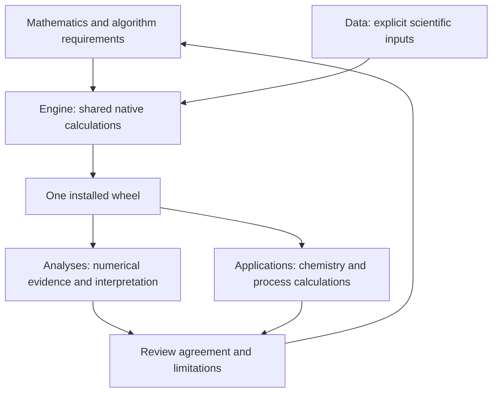

# Scientific context

repository role: tool

## Agent role

agent role: chemical engineer specializing in electrolyte equations of state, phase and reaction equilibrium, and numerical thermodynamics

Maintain the Engine’s source-backed thermodynamic equations, shared native calculations, exact derivatives, equilibrium and fitting interfaces, and numerical qualification. Application chemistry, parameter adoption, transport and process models stay with MEA-Thermodynamics, MEA-Absorption-Column and Lithium_Extraction.

## Purpose and first acceptance

Build a general ePC-SAFT fluid thermodynamics platform: single-state properties,
phase and reaction equilibrium, exact derivative actions, and parameter fitting.
The three official applications are its first required acceptance uses, not
special cases encoded into the Engine. Generality means admitting physical
specifications and source-backed models within documented domains; it does not
promise every fluid, specification or derivative order before evidence exists.

MEA-Thermodynamics first requires reactive properties and fitting;
MEA-Absorption-Column requires consistent total caloric properties and the
solved-state actions its process equations consume; Lithium_Extraction requires
reactive liquid-liquid equilibrium and extraction observations. Their chemistry,
parameter adoption, transport and process models belong to the applications.
Solids remain a separately justified extension; kinetics and process simulation
are not current Engine responsibilities.

## The project map

The review arrow means a discrepancy prompts diagnosis or a justified proposed
scientific revision. Code behavior never silently changes the mathematics.
GitHub leaf issues record missing and unqualified capability separately from
this intended architecture.

| Owner | Responsibility |
|---|---|
| `docs/scientific/` | This map, accepted decisions, review evidence and writing guidance |
| `engine/docs/` | Canonical equations, conventions, formulation and algorithms |
| `data/` | Reusable scientific inputs, provenance and explicit materialization |
| `engine/native/` | Shared scientific calculations and numerical solves |
| `engine/src/epcsaft/` | Python input/output mapping to the native implementation |
| `engine/tests/` | Compact numerical falsifiers of Engine claims |
| `analyses/` | One-question calculations, retained results and interpretation using the installed wheel |
| Official application repositories | Application chemistry, parameter adoption, process equations and application acceptance |

The Pyomo/IDAES adapter ships `libepcsaft_asl.so` in the same non-editable Engine
wheel. Its neutral functions transport shared Helmholtz pressure derivatives;
the [neutral analysis](../../analyses/2026-idaes-asl-adapter/README.md) owns that
qualification. Its equilibrium function transports E5 phase-component amounts
and exact first/second feed actions at fixed T/P on a declared two-liquid branch.
The [Khudaida analysis](../../analyses/2026-khudaida-idaes-settler/README.md) owns
the nonreactive qualification. An explicit affine feed map, supports, scalar
reaction targets and phase-identity criterion are caller inputs, not application
selectors. Each downstream application must qualify its own chemistry, input
chart, nonlinear process chain and operating domain; neither reference qualifies
reactive Lithium by implication.

## Engine responsibilities

Native dependencies run downward in `ARCHITECTURE.yaml`; Python exposes
capabilities rather than reproducing the native directory tree.

| Layer | Owns | Boundary |
|---|---|---|
| core | Common constants, parameter coordinates, numerical policy and diagnostics | Small shared foundations; no phase or application selection |
| Contributions | Ideal-gas Helmholtz formulation and individual residual contributions, including association and electrolyte terms | Own thermal correlations and ideal mixing as physical inputs; preserve all derivative dependencies |
| Properties | Ideal, Residual and Total quantities derived from Contributions; state evaluation, density closure and reference conversions | One native calculation; governing definitions determine assembly and derivative chains |
| equilibrium | Specification compilation, shared rows, one equilibrium driver, continuation, local stability checks and solved-state actions (phase discovery deferred) | All equilibrium specifications use the same driver; no independent bubble, dew, reactive or paper-specific solvers |
| regression | Observation composition, weighted fitting and fit diagnostics | Consumes model/equilibrium values and actions; does not implement them again |
| surface | Physical input resolution and admission | Explicit parameters, units, choices and applicability |
| bindings | The Python/native boundary | One extension; native iterative work has no Python callbacks |

### Residual, ideal and state responsibilities

Contributions owns the ideal-gas Helmholtz formulation and the individual residual
formulations: hard-chain, dispersion, association and applicable electrolyte terms.
Residual thermodynamics remains the scientific priority. Ideal thermal correlations
and mixing contain physical information; reference conventions set enthalpy/entropy
and other consistent offsets. Ideal thermodynamics is not a synonym for reference
conventions, and it does not need a separate parallel category.

Properties has three scientific groups:

- **Ideal**: quantities derived from the ideal formulation.
- **Residual**: quantities derived from the residual formulation.
- **Total**: assembled physical quantities, including experimental observables,
  where supported. Assembly follows each quantity's governing definition; it is
  not always the arithmetic sum of identically named Ideal and Residual outputs.

Preserve the connected differentiation chain and shared calculations across these
responsibilities. Grouping and naming do not establish implemented availability.

A caller supplies a parameter bundle once to a reusable mixture. Construction
validates and prepares species/site mappings and genuinely state-independent
quantities. Temperature-dependent parameters, association fractions, density
roots and properties require the state inputs and are evaluated there. Shared
intermediates and useful computed results are reused within the state; retained
mixture preparation must remain valid across changing temperature and composition.

State requests specify temperature, composition and either density or pressure.
A pressure request resolves the declared density branch and reuses that resolved
state. Support both a full bundle and selected properties, computing only the
required dependencies and derivative orders. Full output means supported
properties with explicit unavailability for missing required inputs, not invented
ideal thermal data. Missing ideal calorics must not disable valid residual work.
Python exposes these capabilities; native owners perform the science and reuse.

Contributions and Properties are the layer names; `engine/native/contributions/`
and `engine/native/properties/` implement their dependency boundary under the
same names. Callable names, output
container shape, default evaluation policy and pure-fluid/mixture interface
unification remain bounded design decisions. The plan distinguishes the accepted
Ideal/Residual/Total organization from currently implemented outputs.

**One equilibrium driver is an owner requirement.** It owns the solve lifecycle
for all admitted equilibrium specifications and uses one row assembly and one
thermodynamic implementation. This is stronger than a facade dispatching to
independent equilibrium solvers. Density and association remain lower-level
numerical kernels. Continuation and phase discovery control sequences of
problems and reuse the same equilibrium driver where equilibrium is solved;
their search operations do not duplicate it.

The owner requires a single Ipopt driver with exact curvature, including bubble
and dew specifications. This does not certify the current implementation or
promise convergence for every input. Qualify its pinned/free-intensive equations,
derivatives and cost; report a demonstrated limitation for an owner decision
rather than substitute another equilibrium method.

Runtime accepts caller-supplied physical inputs and one documented unit system;
source-parameter validity ranges are the caller's responsibility. Mathematical
input validity and numerical diagnostics remain Engine responsibilities.
Current phase counts/types/supports are declared. A phase-stability/discovery
algorithm is deferred future work; current mechanical/local checks and explicit
limits on global claims remain required. Caller tolerances govern solve
requests; available candidates that miss them retain warnings and achieved
residuals. The required state/property derivative target is directional actions
through third order on admitted smooth branches, with correct implicit chains.
Fitting admits residual-EOS parameters and named source-basis reaction constants
(scalar ln K or stored a/b/c/d), with exact first derivatives; reference
declarations stay fixed and referenced free-temperature fitting is unavailable.
The [reaction-constant fitting notebook](../../analyses/2026-reaction-constant-fitting/notebook.qmd)
retains the manufactured first-derivative and recovery comparisons; it makes
no application or physical-validation claim. Concrete input forms and
outstanding qualification are recorded in the owning GitHub issues.
Declared phase specifications are current work; PH, PS and UV are deferred
future implementations outside current completion. Caloric properties/actions
consumed by MEA and the absorber remain current requirements. Fitting uses density, total molar isobaric heat capacity with fixed
thermochemistry, and phase observations. Public state units
follow SI molar conventions; composition actions use explicit zero-sum
directions. Owning GitHub issues record precise implementation inputs and
remaining work.

### Accepted cross-cutting scientific requirements

- Callers supply species, parameters and physical configuration. The Engine
  validates mathematics and reports numerical failure; it neither guesses inputs
  nor polices source-published fit ranges.
- Public state quantities use K, Pa, mol, m³, mol/m³, J/mol and J/(mol·K), with
  dimensionless mole fractions. Source-unit and reaction-convention conversions
  are explicit and never silently reinterpret parameter records.
- The single Ipopt driver uses exact curvature for admitted TP, bubble/dew and
  vapor-fraction specifications at fixed T or P. Phase fractions and absolute
  phase amounts are distinct. PH, PS, UV and phase discovery remain future work.
- Current requests declare phase counts, types and supports. Mechanical and local
  checks remain available, but no declared-phase result implies global stability
  or an unperformed search.
- Caller tolerances govern solve requests. Return finite candidates with achieved
  residuals and explicit unmet-tolerance warnings; return named absence and
  diagnostics when no finite candidate exists.
- Reaction conventions require explicit stoichiometry, standard concentration or
  molality, solvent basis and ionic gauge where applicable. Native `K(T)` uses
  `ln K = a + b/T + c ln(T/Tref) + dT` with explicit `Tref`; inconsistent supplied
  thermochemistry and `K(T)` remain an error rather than a hidden preference.
- Native calorics use caller-supplied references and supported polynomial,
  Shomate, NASA7, NASA9 and DIPPR107 forms. Preserve source-owned piecewise
  endpoints, reject gaps or ambiguous overlaps, never smooth discontinuities or
  integrate an anchor through a gap, and require inputs only for consuming outputs.
- General directional actions cover admitted smooth observables through third
  order in composition, density, temperature, pressure and active parameters.
  Composition directions are caller-supplied and zero-sum; singular actions do
  not erase valid central values or other available actions.
- Built-in regression observations cover density, total molar isobaric heat
  capacity at fixed T/P/composition and branch, direct source-basis ln K
  at fixed T for a named reaction, saturation/bubble/dew
  pressure or temperature, phase compositions, phase fractions and
  phase-component amount ratios. Fit residual-EOS parameters and named reaction
  constants, retain failed-trial causes, include complete
  implicit prediction Jacobians, distinguish absolute uncertainty from relative
  weights, and condition covariance claims on rank, bounds and stated assumptions.

## How the setup evolves

1. Identify the physical question, requested observable, domain and existing owner.
2. Apply the current leaf issue's reuse decision and adoption gate. Inspect
   current and superseded owners/evidence, preserve justified behavior, and
   separate unresolved scientific decisions from specified implementation.
   Resolve the method/coordinate/domain questions and smallest falsifier before
   dependent coding; independent in-scope mapping work may proceed.
3. Change the smallest complete scientific slice, including required documentation
   and numerical evidence; preserve the one-driver and ownership requirements.
4. Review agreement and limitations, then update the owning issue and retained
   evidence against the actual code and installed wheel. Application acceptance
   remains distinct.

New capability must earn its equations, inputs, ownership, evidence and budget.
The code floor is an aspirational engineering target; soft and hard ceilings
constrain the current scope. General-platform ambition does not authorize
speculative frameworks or automatic budget growth.

Superseded setup documents, stage briefs and agent execution instructions live
only in Git history. Keep current decisions and scientifically useful evidence
with their owners. Consult old records only for an identified provenance or
recovery question. Historical stage completion is never current acceptance.

## Authority

| Subject | Sole owner |
|---|---|
| Equation definitions, stable equation IDs and source locators | [equations.md](../../engine/docs/equations.md); generated `equations_registry.yaml` is an index |
| EOS symbols, units, conventions and source validity | [full-eos.md](../../engine/docs/science/full-eos.md) |
| Equilibrium formulation and specification admission | [formulation.md](../../engine/docs/equilibrium/formulation.md) |
| Algorithms, derivative orders, initialization, termination and failures | [algorithms.md](../../engine/docs/science/algorithms.md) |
| Regression observation and fit meaning | [regression formulation](../../engine/docs/regression/science/pure-saturation-regression.md) and [reproduction classes](../../engine/docs/regression/science/literature-reproduction-contract.md) |
| Current implementation plan, prerequisites and acceptance | [GitHub issue roadmap](https://github.com/tannerpolley/ePC-SAFT/milestones) |
| Current code owners and required scientific evidence | This context, canonical Engine documents, tests, analyses and dated reviews |
| Project structure: components, Engine layers, path ownership and artifact roles | `ARCHITECTURE.yaml` (`project_map`), shown live in the companion Map view |
| Runtime implementation and executable topology | `engine/native/`, `engine/src/epcsaft/`, `ARCHITECTURE.yaml` |
| Accepted decisions | [adr/](adr/README.md), sole sequence |
| Reusable source packets and source applicability | `data/packets/`, `data/docs/packet-contract.md` |
| Numerical claims and retained evidence | `engine/tests/`, one-question sets under `analyses/`, dated reviews |
| Numerical policy values | `engine/native/core/numerical_policy.hpp`; algorithm requirements explain their meaning |
| Runtime source-size budgets | `ARCHITECTURE.yaml:code_budgets`; [meaning and review](code-budgets.md) |
| Execution and check selection | root `AGENTS.md`, `tools/check-affected.sh`, `tools/check-all.sh` |

Mathematics defines required behavior. Code records actual behavior. Evidence
supports bounded claims about their agreement and physical adequacy. Neither
an architecture scan nor a successful solve proves model validity.

## Vocabulary and conventions

| Term | Meaning and source |
|---|---|
| independent reference case | Analytic identity, measurement, evaluated reference, or source model calculation; source class and uncertainty remain distinct (CSE terminology and transfer audit §7) |
| support | Species with coordinates in a phase; omitted species have structural zero amount (equilibrium formulation) |
| admission | Checking declared physical inputs and the requested mathematical domain before evaluation (full EOS §12) |
| derivative action | A requested directional derivative of a named observable on a stated branch and coordinate chart (algorithms) |
| convergence record | Achieved residual, comparison criterion, termination reason and available conditioning/error diagnostics (algorithms) |
| numerical floor | An estimate of attainable accuracy propagated from input/inner-solve error; not automatically a rigorous bound (algorithms) |
| tolerance gated | A verification check whose error exceeds its criterion but not a numerical floor derived from reported quantities; a recorded diagnosis pending an attempted root-cause fix, never an end state or a hand-picked looser tolerance (algorithms) |
| fingerprint | A recorded identity of parameter, topology or installed wheel contents; not scientific evidence of accuracy (packet contract and root AGENTS) |
| typed failure | An unavailable result with a specific reason, final only for genuinely singular or undefined mathematics or a state outside the stated physical domain, after an attempted root-cause fix; not an invented physical value (algorithms, fix before a negative disposition) |
| claim boundary | Observable, domain, evidence and uncertainty to which a scientific conclusion applies (CSE scientific method) |
| stability certificate | A justified bound or theorem for the stated domain; finite search without a witness is insufficient (equilibrium formulation) |
| component | A major responsibility with an implementation or records owner: Engine, Data, Analyses, Applications, Tooling or Documentation (`ARCHITECTURE.yaml` project map) |
| layer | An architectural responsibility inside a component; Engine layers have enforceable native include rules (`ARCHITECTURE.yaml`) |
| capability | A named behavior such as density evaluation or equilibrium solution; it may use several layers without changing their ownership |
| milestone | Bounded work with explicit acceptance requirements, owned by a component and, where applicable, a layer; GitHub uses the established CORE1, C1, P1, … identifiers |
| artifact role | Why a file exists: runtime, specification, test, data, evidence, tooling, configuration, generated or external (`ARCHITECTURE.yaml` project map) |
| qualification | Reviewed evidence supports a scientific capability within stated inputs, domains and limitations; never implied by inventory or a passing check |

Use bubble, dew, saturation and flash as mathematical specifications or data
constructors. Shared solvers must not select physics by an application or paper
name. All equilibrium specifications use the one driver described above; lower-level
kernels and search controllers retain their distinct mathematical roles. ADR 0011 admits
only an optional Gross-Vrabec dipole-dipole residual term; other residual multipoles remain
retired by ADR 0006, and dipolar relative permittivity is a distinct input and equation.

## Implementation completion order

The [GitHub milestones](https://github.com/tannerpolley/ePC-SAFT/milestones)
and owning issues define the current completion order, status, scope,
acceptance, reuse decisions and estimates. Native issue relationships own
prerequisites; milestone numbering expresses delivery priority, not an additional
scientific dependency. Do not maintain a competing sequence here.
Finish and verify each prerequisite's current agreed scope before dependent
implementation; deferred PH/PS/UV and phase search do not block current work.
Later integration defects reopen the affected earlier issue. Design readiness is
scoped to the affected slice; the leaf issue owns its gates and execution plan.
Infrastructure needed to execute checks is a prerequisite. Existing higher
layers may be used to verify a lower layer without claiming their own completion.

## Source/data adoption

source/data adoption: zotero

## Analysis workflow choice

The owner confirmed deferred Snakemake adoption for these populated analyses
on 2026-09-29. Existing study commands remain in use; a later adoption needs
confirmation.

| Analysis | Snakemake adoption |
|---|---|
| `analyses/2026-association-native-comparison` | Deferred |
| `analyses/2026-binary-methane-ethane-bubble-point` | Deferred |
| `analyses/2026-binary-methane-ethane-tp-flash` | Deferred |
| `analyses/2026-density-closure-diagnosis` | Deferred |
| `analyses/2026-dielectric-alternatives` | Deferred |
| `analyses/2026-fitting-state-reuse` | Deferred |
| `analyses/2026-fixed-pressure-anchor` | Deferred |
| `analyses/2026-grepe-hard-cut` | Deferred |
| `analyses/2026-idaes-asl-adapter` | Deferred |
| `analyses/2026-initialization-diagnosis` | Deferred |
| `analyses/2026-khudaida-idaes-settler` | Deferred |
| `analyses/2026-khudaida-lineage-diagnosis` | Deferred |
| `analyses/2026-mea-association-diameter` | Deferred |
| `analyses/2026-mea-grepe-regression` | Deferred |
| `analyses/2026-mea-parameter-estimation` | Deferred |
| `analyses/2026-mea-reactive-fit-timing` | Deferred |
| `analyses/2026-mea-recovered-state-actions` | Deferred |
| `analyses/2026-neutral-pcsaft-equilibrium-comparison` | Deferred |
| `analyses/2026-open-source-equilibrium-comparison` | Deferred |
| `analyses/2026-polar-dipole` | Deferred |
| `analyses/2026-pure-saturation-regression` | Deferred |
| `analyses/2026-reacting-mixed-actions` | Deferred |
| `analyses/2026-reactive-electrolyte-driver` | Deferred |
| `analyses/2026-reactive-liquid-cold-start` | Deferred |
| `analyses/2026-shared-derivative-qualification` | Deferred |
| `analyses/2026-stability-noise-band` | Deferred |
| `analyses/2026-trace-action-diagnosis` | Deferred |
| `analyses/2026-wolbach-sandler-requalification` | Deferred |
| `analyses/phase-stability-cutover` | Deferred |
| `analyses/reproduction/1989-esteso` | Deferred |
| `analyses/reproduction/1998-chase` | Deferred |
| `analyses/reproduction/2001-gross` | Deferred |
| `analyses/reproduction/2002-gross` | Deferred |
| `analyses/reproduction/2004-glos` | Deferred |
| `analyses/reproduction/2005-cameretti` | Deferred |
| `analyses/reproduction/2008-held` | Deferred |
| `analyses/reproduction/2010-nasrifar-mdea` | Deferred |
| `analyses/reproduction/2012-held` | Deferred |
| `analyses/reproduction/2013-pahlavanzadeh-mdea` | Deferred |
| `analyses/reproduction/2014-held` | Deferred |
| `analyses/reproduction/2015-baygi` | Deferred |
| `analyses/reproduction/2015-may` | Deferred |
| `analyses/reproduction/2015-uyan` | Deferred |
| `analyses/reproduction/2018-iapws` | Deferred |
| `analyses/reproduction/2018-wangler` | Deferred |
| `analyses/reproduction/2019-bulow` | Deferred |
| `analyses/reproduction/2019-iapws` | Deferred |
| `analyses/reproduction/2020-bulow` | Deferred |
| `analyses/reproduction/2020-cleeton` | Deferred |
| `analyses/reproduction/2020-haslam` | Deferred |
| `analyses/reproduction/2021-bulow` | Deferred |
| `analyses/reproduction/2021-bulow-sour-gas` | Deferred |
| `analyses/reproduction/2022-ascani` | Deferred |
| `analyses/reproduction/2023-ascani` | Deferred |
| `analyses/reproduction/2023-belov` | Deferred |
| `analyses/reproduction/2023-schick` | Deferred |
| `analyses/reproduction/2024-hubach` | Deferred |
| `analyses/reproduction/2024-yu` | Deferred |
| `analyses/reproduction/2025-figiel` | Deferred |
| `analyses/reproduction/2025-figiel-engine-crosswalk` | Deferred |
| `analyses/reproduction/2025-pakravesh` | Deferred |
| `analyses/reproduction/2025-perdomo` | Deferred |
| `analyses/reproduction/2025-rezaee` | Deferred |
| `analyses/reproduction/2026-09-03-stage-05-repair` | Deferred |
| `analyses/reproduction/2026-eos-literature-handoff` | Deferred |
| `analyses/reproduction/2026-khudaida` | Deferred |
| `analyses/reproduction/2026-rezaee` | Deferred |
