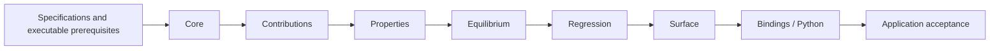
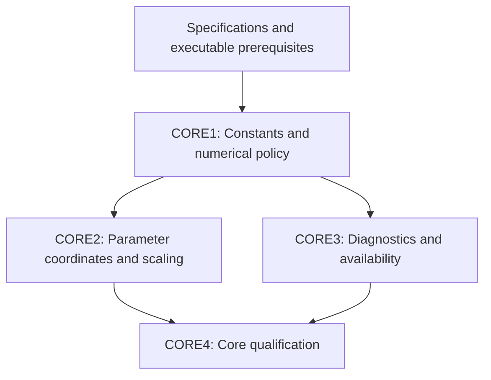
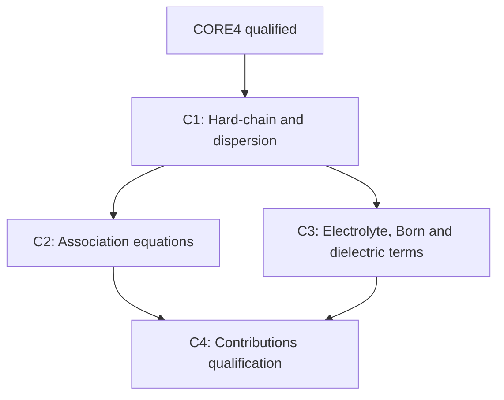
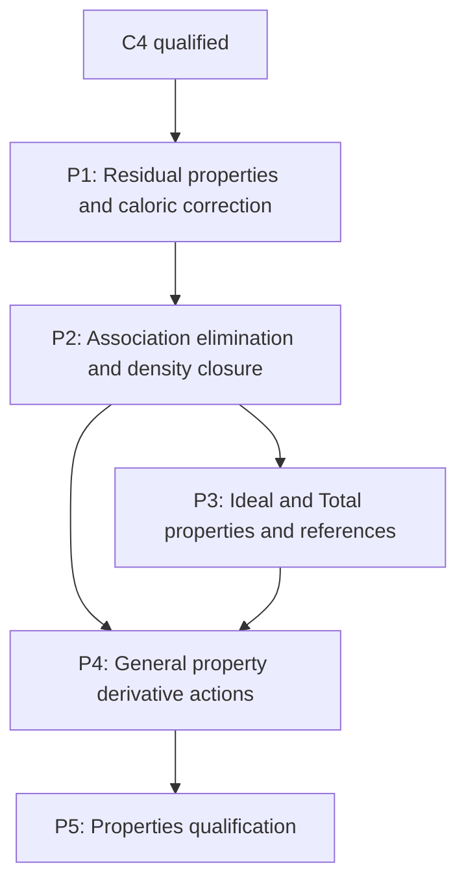
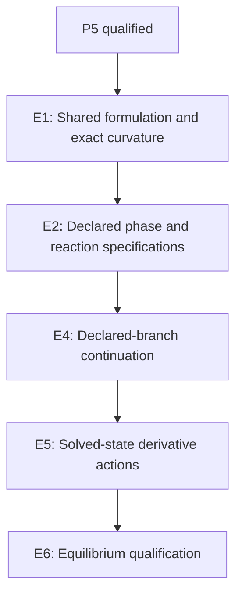
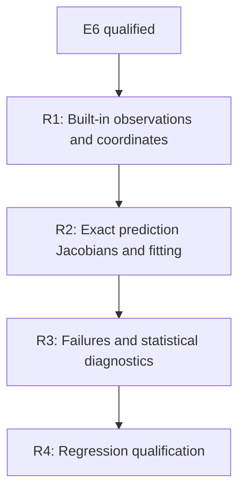
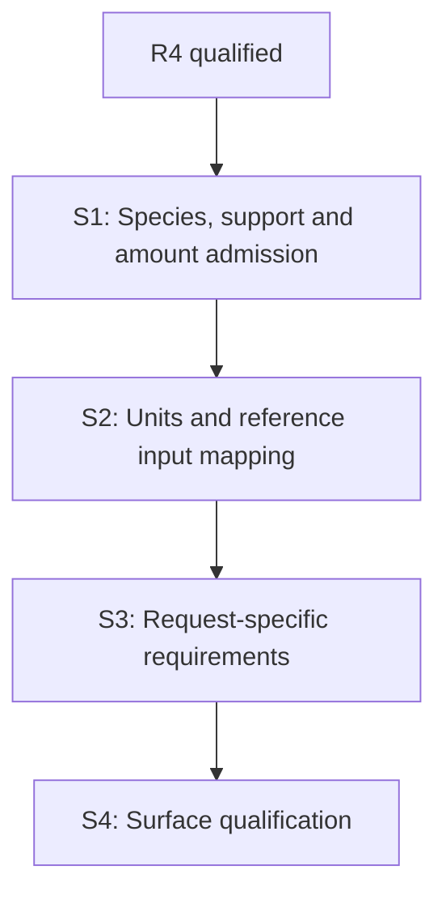
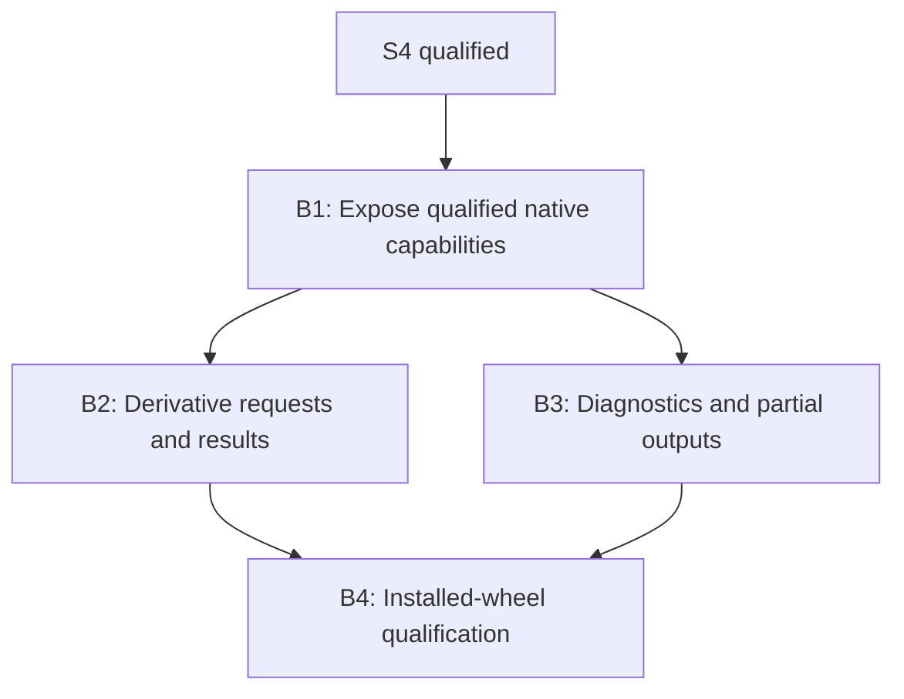
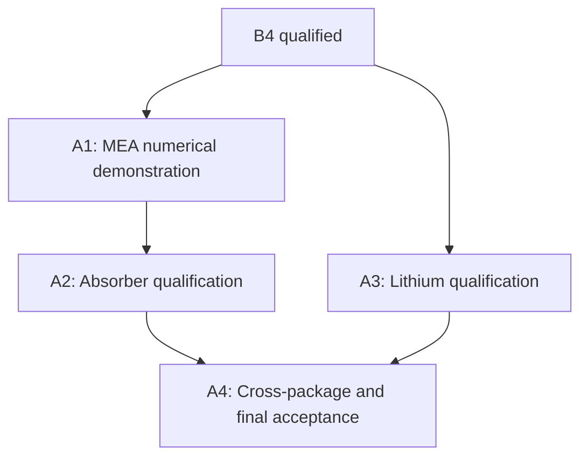

# Implementation plan

The generated summary below owns scientific qualification counts. The fast installed-wheel
baseline runs; the residual-energy correction passes its focused check, while
the weighted equilibrium-curvature check retains an unresolved failure. The milestone tables own qualification and effort; the current
execution queue owns the next work. Numerical records identify the exact inputs
and implementation they exercised and never serve as competing instructions.

## Official dependency-order progress — 2026-09-08

The owner requires completion in this order: **Core → Contributions → Properties →
Equilibrium → Regression → Surface → Bindings/Python → application acceptance**.
Finish and verify the agreed scope of each layer before implementing new
capability in the next. Design readiness is assessed for the affected slice. S0 build
and test identification is prerequisite infrastructure, not a competing feature
stage. Existing higher-layer code can exercise lower-layer checks; it does not
count as qualification of missing higher-layer features. Minimal wiring needed
to run a lower-layer falsifier is part of that lower-layer slice, not permission
to expand the next layer. If existing wiring cannot support verification, name
that dependency before declaring the layer complete.

Contributions owns contribution formulas;
association elimination/CppAD chains are qualified with Properties. Complete Properties
caloric properties/actions consumed by current applications before Equilibrium.
Current Equilibrium work covers declared phase/reaction specifications and
branch-local actions. PH/PS/UV and the phase-stability/discovery algorithm are
future work; neither blocks Regression or current application acceptance.
Declared-branch continuation remains E4; local stability and failure checks remain required.

### How progress and effort are counted

The milestone tables below are the sole editable progress record. `[ ]` means
pending or reopened, `[-]` active, `[!]` blocked, and `[x]` qualified complete.
Progress counts current-scope qualified milestones equally, not implementation
coverage or effort. The milestone reuse map separately identifies existing work;
unqualified does not mean unimplemented. Deferred work is listed outside the
counted rows and is not marked complete.
The rows below own current qualification; the reuse map identifies the existing
implementation separately.

Historical label mapping: former Core `C1`–`C4` are current `CORE1`–`CORE4`; former Contributions `P1`–`P4` are current `C1`–`C4`; former Properties `M1`–`M5` are current `P1`–`P5`. Historical reviews, equation IDs and numerical test identifiers retain their original labels.

Time estimates below are **legacy provisional Astra-equivalent elapsed ranges**, including repository inspection, design, tool/build execution, numerical
validation and independent review. They are subjective planning ranges, not
measured Astra throughput or human labor estimates. Assume one accountable lead
and the strict sequential layer order; independent reviewers may assist within
a layer. Concurrent agent-hours are not added to elapsed time. Owner response,
external source acquisition, usage-limit pauses and unavailable physical inputs
are excluded. Difficult numerical failures can exceed the upper estimate.
Before each slice becomes Ready, replace its remaining estimate from the
identified repair/transfer/addition and verification work in its issue. Record
actual active wall time without relabeling work by another model as measured
Astra performance; model/effort stays in task configuration. Do not count
unchanged implementation as work to rebuild. These uncalibrated totals are not
a delivery forecast. Never weaken science to meet an estimate. Relevance and
priority are 1–5 judgments; sequence governs even when a later easy fix is tempting.

<!-- roadmap-summary:start -->
| Layer | Qualified progress | Remaining Astra h | Measured actual h |
|---|---|---:|---:|
| Core | ██████████ 100.0% (4/4) | 0–0 | 6.75 |
| Contributions | ██████████ 100.0% (4/4) | 0–0 | 6.35 |
| Properties | ░░░░░░░░░░ 0.0% (0/5) | 8–24 | — |
| Equilibrium | ░░░░░░░░░░ 0.0% (0/5) | 10–30 | — |
| Regression | ░░░░░░░░░░ 0.0% (0/4) | 4–12 | — |
| Surface | ░░░░░░░░░░ 0.0% (0/4) | 2–6 | — |
| Bindings/Python | ░░░░░░░░░░ 0.0% (0/4) | 2–6 | — |
| Application acceptance | ░░░░░░░░░░ 0.0% (0/4) | 6–20 | — |

Total: **8/34 qualified milestones (23.5%)**; **32–98 remaining Astra hours**.
<!-- roadmap-summary:end -->

The summary is generated from the tables; do not edit its counts or estimates.
Relevance is 5/5 for every layer; priority is 5/5 for Core, Contributions, Properties,
Equilibrium and applications, and 4/5 for Regression, Surface and bindings.
The smallest pending milestone estimates identify easy completions, subject to
prerequisites. Preparation and excluded waits are additional to these estimates.

### Test-system preparation

The [read-only notebook design](test-system-design.md) defines the hard-cutover
boundary. Tests, checks, retained analyses, `ARCHITECTURE.yaml`, and this plan are
independent owners. A standard-library presentation reader projects them into a
Quarto site without collection, execution, retry, scheduling, or publication.
The pre-cutover [acceptance record](reviews/test-system-acceptance-2026-09-09.md)
remains historical evidence for the retained F1/F5 rows; it is not a current
notebook contract. This tooling work does not change any scientific milestone.

| Work | Status | Completion |
|---|---|---|
| Independent producers | Complete | Normal pytest, Meson, analyses, and readiness checks run without notebook modules or a viewer. |
| Retained results | Complete | Legacy F1/F5 values, inputs, dates, wheel provenance, and the established F5 disagreement remain readable and integrity-checked. |
| Quarto-native view | Complete | Quarto owns Map, Plan, Results navigation, render, preview, resource watching, and reload; [dated cutover evidence](reviews/notebook-cutover-2026-09-09.md). |
| Hard cutover | Complete | The custom server/browser app, collection inventory, recorder wrappers, managed execution, retries, recovery, aliases, and notebook-only harness are removed; [dated cutover evidence](reviews/notebook-cutover-2026-09-09.md). |

### Live Quarto companion

Run
`quarto preview . --host 127.0.0.1 --port 8766 --no-browser --render all --no-execute`
and open [the local notebook](http://127.0.0.1:8766). The root Quarto project has
Map, Plan, and Results pages. Its declared resources make Quarto 1.10.18 watch
`ARCHITECTURE.yaml`, this plan, ordinary test reports, and the retained result
manifest even though they are outside the page bodies. Generated HTML lives under
`build/companion/`.

The Map page derives components, descendant layers, files, roles, milestones, and
relevant recorded checks from the existing owners. Deleted tracked paths are
absent; unmapped and ambiguous existing paths remain explicit. The Engine section
includes every descendant layer's milestones and relevant checks. Tracked YAML,
shell, and other source links resolve to the current repository revision.

The Results page keeps execution outcome, production date, source/input freshness,
and scientific qualification separate. Historical values remain visible and the
complete retained F1/F5 tables remain downloadable when outdated. Missing,
corrupt, and interrupted records remain explicit. F1's historical pass and F5's
established failure do not qualify P1 or E1 or claim current code passed.

### What each signal establishes

| Signal | What it establishes |
|---|---|
| Implementation inventory (Map view) | Code or other assets exist and have an owner. |
| Milestone status (this plan) | Planned, active, blocked or qualified work against stated acceptance requirements. |
| Recorded execution and freshness (Results view) | A check passed, failed or could not run, and whether that record still applies to current inputs. |
| Scientific qualification | Reviewed scientific evidence supports the stated capability and domain. |

A file count, line count or passing test does not complete a milestone, and
tooling completion never inflates thermodynamic qualification. Native include
rules describe what may depend on what; milestone prerequisites describe which
work must be accepted before other work begins.

### Keeping this plan current

At start, inspect the live checkout and evidence, select the first eligible row,
and mark it active when its bounded design work begins. First apply the
[reuse map](#milestone-reuse-map) and record the required adoption decision in
the linked issue. Implementation requires that bounded Ready disposition and
current-scope layer prerequisites; a milestone title does not authorize a rewrite.
At completion or handoff, update that row's status, remaining range, accumulated
active elapsed hours, and evidence link. Use `—` for unmeasured time, never a
fabricated zero. The linked record must identify the date, inspected revision
and dirty changes, commands/results, wheel SHA-256 when numerical work uses it,
claim limits, independent review, and next action or blocker. Revalidate equations
and algorithms with code and evidence in the same scientific change.

A discovered defect reopens the affected row and any dependent completed rows;
block active dependents until repaired. Finish every current-scope row in a layer before the
next layer starts; deferred capabilities do not reopen or block current rows. Do not mark a row done from a build or readiness check alone.
Keep these scope requirements below; only the milestone tables own status.

Run `python3 tools/check-roadmap.py --write` after table updates, then
`python3 tools/check-roadmap.py`. Both normal check scripts run the latter before
any early exit or wheel build. It checks table structure, dependency order,
completion links and generated totals; it cannot establish scientific adequacy
or detect every stale claim. Every agent must inspect changed claim owners and
explicitly record revalidation or reopen their rows. No background service is
required. Recalibrate estimates using measured elapsed work at each handoff.

### Core scope

- Shared constants, parameter coordinates and numerical-policy owners exist.
- Verify constant meanings, units, bounds and tolerance provenance; correct inaccurate policy claims.
- Specify and qualify shared convergence/failure/conditioning information without hidden success or defaults.
- Verify parameter-coordinate identities and scaling needed by all later layers.
- Complete focused evidence, cost review and independent acceptance for the agreed Core scope.

### Contributions scope — ideal and residual Helmholtz formulations

- Contributions owns the ideal-gas Helmholtz formulation, including thermal correlations and mixing, and the individual residual contributions. Ideal thermal behavior is physical information; reference conventions set consistent offsets.
- Common residual contribution owners exist for accepted neutral/ionic formulations; residual work remains the scientific priority. Ideal formulation qualification remains part of the planned Contributions scope.
- Verify hard-chain/dispersion formulas and analytic low-density/reference identities.
- Verify association mass-action equations, sites and contribution support limits.
- Verify accepted electrolyte/Born/dielectric formulas and genuine singular limits; no retired polar additions.
- Complete contribution-level numerical evidence, duplication/cost review and independent acceptance.

### Properties scope — thermodynamic properties and states

- Shared EOS state/property and CppAD tape machinery exists. Residual thermodynamics is the scientific priority.
- Organize derived outputs as Ideal, Residual and Total. Ideal properties derive from the ideal formulation; Residual properties derive from the residual formulation. Total physical outputs use governing definitions, not a universal componentwise addition rule.
- Keep ideal thermal/mixing inputs distinct from reference offsets; both remain explicit where consumed.
- Prepare reusable state-independent mixture data once; evaluate state-dependent quantities only after T, density/pressure and composition are supplied.
- Support full or selected state properties with shared intermediate reuse and the minimum required derivative work; preserve explicit unavailable outputs.
- Density-root and infinite-dilution reference implementations exist.
- Correct and qualify residual calorics, association elimination and density branch/pressure chains.
- Complete reference conversions, selected thermal forms, total calorics and typed reaction correlations; compare old/rederived inputs.
- Qualify general smooth state/property actions through third order, parameter Jacobians, failures and cost with independent review.

### Equilibrium scope

- Shared specification compiler, rows and Ipopt driver exist.
- Qualify exact objective/constraint curvature and declared TP, reactive, bubble/dew, fraction/amount specifications.
- Preserve and qualify declared-branch continuation/disappearance and explicit failure behavior.
- Retain PH/PS/UV and phase-stability/discovery methods as future work outside current completion; preserve truthful local-versus-global claims.
- Qualify solved-state actions through third order, selected independent cases, performance and independent acceptance.

### Regression scope

- Adapt justified old native regression and built-in density/phase observations to existing producers; retain one current fitting owner.
- Preserve/adapt residual-EOS active/fixed/shared coordinates, transforms and bounds.
- Implement only observation forms consumed by the initial density/phase scope; broader equation definitions do not authorize unused expression machinery.
- Qualify exact prediction Jacobians including implicit equilibrium chains and manufactured recovery.
- Qualify weights, invalid-trial handling, rank and conditional uncertainty diagnostics.
- Complete real-data demonstrations, evaluation reuse/cost review and independent acceptance; reaction fitting remains outside initial Engine scope.

### Surface scope

- A shared physical-input/parameter builder exists.
- Qualify species/support/charge handling and explicit fraction-versus-amount semantics.
- Complete SI state inputs, coefficient conventions and explicit reference/reaction metadata mapping.
- Qualify request-specific missing inputs, caller tolerances and mathematical-domain failures without published-range policing.
- Verify all admitted capability inputs against native owners and complete independent acceptance.

### Bindings/Python scope

- One native extension and thin public mapping layer exist.
- Expose all qualified state/equilibrium/fitting inputs and distinct outputs without duplicate numerics.
- Expose composition directions, derivative orders and per-action availability with coordinate units.
- Preserve branches, residuals, unmet tolerances and valid partial results; no fabricated unavailable values.
- Pass actual installed-wheel numerical checks and independent boundary review within source/cost budgets.

### Application acceptance scope

- MEA: strongest retained parameter candidate demonstrates valid equilibrium and every required consumed output; predictive fine-tuning is separate.
- Absorber: qualify required calorics/actions, refined Case 3C, and resolve or explicitly disposition failed operating cases.
- Lithium: qualify declared reactive LLE and required observables; reaction calibration stays application-owned.
- Complete chosen declared-phase cross-package comparisons using identified non-editable wheels; discovery evidence is deferred and no global certificate is implied.
- Review all required capability evidence and equivalent-work performance; transfer draft changes only with owner authorization.

Easy wins are components of these requirements, not automatic checkmarks. The
analysis-script relocation is already complete infrastructure work and is not
counted again as scientific progress. Do not remove hard requirements merely
to improve the displayed percentage.

## Milestone estimates and dependency graphs

These are subdivisions of the existing layer estimates, not extra hours or new
runtime directories. Actual hours are recorded where measured; remaining ranges retain the
provisional baseline until the bounded reuse decision supports recalibration. Includes local
validation per milestone; each final qualification row covers integrated checks
and review without counting all validation twice. The scope lists above retain requirements; these rows alone own completion.

Solid arrows show required execution order. Every layer starts only after the
previous layer's qualification row passes, even where mathematical coupling is
weaker. Within a layer, branches identify work without a direct dependency;
the estimates conservatively sum one lead's work and assume no parallel speedup.
These are proposed scheduling dependencies, not C++ include statements. All
later layers may consume any qualified earlier owner.

### Core

| Milestone | Status | Remaining h | Actual h | Prerequisites | Required evidence | Record |
|---|---|---:|---:|---|---|---|
| CORE1 — Constants and numerical policy | [x] | 0 | 2.5 | Specifications and executable prerequisites | Verify units, physical bounds, tolerance meanings and extensive-objective multiplier scaling; preserve explicit provisional limits; retain falsifying evidence and independent final review. | [2026-09-10: C1 qualification](reviews/core-c1-2026-09-09.md); corrected evidence and independent `Ship` review passed; pinned F5 remains outside CORE1. |
| CORE2 — Parameter coordinates and scaling | [x] | 0 | 2.0 | CORE1 | Define and qualify common coordinate identities and dimensional scaling, including derivative coordinate transformations, with one-slot ownership for scalar coordinates. | [2026-09-10: C2 qualification after correction](reviews/core-c2-2026-09-10.md); supervisor correction closed by exact-one-index validation, red/value evidence, corrected installed-wheel gates, and independent `Supported` review. |
| CORE3 — Diagnostics and availability | [x] | 0 | 2.0 | CORE1 | Define residuals, termination and unavailable-result information; preserve typed nonfinite/domain/singular/infeasible/budget outcomes through existing producers; correct solver budget classification and reject nonfinite density candidates before publication; retain valid outputs, evidence and independent review. | [2026-09-10: C3 correction qualification](reviews/core-c3-2026-09-10.md); implementation tree `cb8302f`, installed wheel `f93b7c9a385fa5c53ab091636a8b7285ac906020b4daaad0dda5282172138ba7`, scripted producer harness removed, genuine current-wheel replays passed, density publication branches source-reviewed only, fresh independent `Supported` review passed; pinned F5 remains outside scope. |
| CORE4 — Core qualification | [x] | 0 | 0.25 | CORE2, CORE3 | Revalidate CORE1–CORE3 against one final installed wheel, inspect integrated residual/termination/availability behavior, measure equivalent-work cost against Core budgets, retain failures and claim limits, and obtain independent final acceptance. | [2026-09-10: C4 qualification](reviews/core-c4-2026-09-10.md); final wheel replay and cost review passed, with independent `Supported` acceptance; pinned F5 and source-reviewed density limits remain explicit. |

### Contributions

| Milestone | Status | Remaining h | Actual h | Prerequisites | Required evidence | Record |
|---|---|---:|---:|---|---|---|
| C1 — Hard-chain and dispersion | [x] | 0 | 5.0 | CORE4 qualified | Preserve existing hard-chain/dispersion kernels; qualify their formulas and analytic limits and finish the current explicit ideal thermal/mixing owner. | [2026-09-10: C1 qualification](reviews/c1-2026-09-10.md); 167 current-wheel comparisons, independent derivative replay, applicable fast gates and independent CSE/Ponytail review support the bounded native claim; pinned F5 remains excluded. |
| C2 — Association equations | [x] | 0 | 0.5 | C1 | Verify existing site topology, mass-action equations and scalar support limits; repair only a demonstrated discrepancy. | [2026-09-10: C2 qualification](reviews/c2-2026-09-10.md); 19 current-wheel scalar comparisons, independent mixed-site root and CSE/Ponytail acceptance passed; existing runtime and excluded implicit-support limits preserved. |
| C3 — Electrolyte, Born and dielectric terms | [x] | 0 | 0.55 | C1 | Verify existing electrolyte/Born/dielectric formulas, charge conventions and singular limits; add no new model. | [2026-09-10: C3 qualification](reviews/c3-2026-09-10.md); 29 corrected current-wheel scalar comparisons, bounded integral references and independent CSE/Ponytail acceptance passed; existing runtime and stated derivative/admission limits preserved. |
| C4 — Contributions qualification | [x] | 0 | 0.3 | C2, C3 | Integrated contribution reference checks, reuse/duplication/cost review and independent acceptance of preserved and corrected owners. | [2026-09-10: C4 qualification](reviews/c4-2026-09-10.md); all 215 retained comparisons agree on one final wheel; fixed-work cost, ownership/budget review and independent CSE/Ponytail acceptance passed, with stated Properties and pinned-F5 limits. |

### Properties

| Milestone | Status | Remaining h | Actual h | Prerequisites | Required evidence | Record |
|---|---|---:|---:|---|---|---|
| P1 — Residual properties and caloric correction | [-] | 1–3 | — | C4 qualified | Starting with zero runtime additions, preserve F1 and independently qualify residual `s`, `u`, `h`, `c_v` and conditioned `c_p` at fixed density or pressure as defined, including identities, low-density limits and explicit `c_p` unavailability. | [2026-09-10: plan review](reviews/properties-plan-2026-09-10.md) and [execution handoff](implementation-plan.md#properties-execution-handoffs--2026-09-10); planning active, Design Ready review pending. The [F1 correction](reviews/caloric-correction-2026-09-08.md) remains preserved evidence, not P1 qualification. |
| P2 — Association elimination and density closure | [ ] | 1–3 | — | P1 qualified | Resolve the zero-support association and density branch contracts, then repair only demonstrated gaps; qualify implicit residuals/conditioning, root count and identity, anchor/disappearance behavior, pressure closure and resolved-state reuse. | [2026-09-10: plan review](reviews/properties-plan-2026-09-10.md); see the P2 execution handoff below; design resolution and qualification pending. |
| P3 — Ideal and Total properties and references | [ ] | 2–6 | — | P2 qualified | Resolve the exact output/availability and reference-basis matrix, then adapt the qualified ideal correlations and justified old reference algebra into native owners; qualify Ideal/Residual/Total calorics, fixed-reference conversions and typed `K(T)` consistency. | [2026-09-10: plan review](reviews/properties-plan-2026-09-10.md); see the P3 execution handoff below; design resolution and qualification pending. |
| P4 — General property derivative actions | [ ] | 3–9 | — | P2, P3 qualified | Freeze the observable × coordinate × order matrix first; then reuse the common tape for balanced-composition, fixed-density/fixed-pressure and parameter actions, selected dependencies and requested smooth actions through third order without dense tensors or a second derivative engine. | [2026-09-10: plan review](reviews/properties-plan-2026-09-10.md); see the P4 execution handoff below; action matrix and qualification pending. |
| P5 — Properties qualification | [ ] | 1–3 | — | P4 qualified | On one final wheel, revalidate P1–P4; qualify repeated-state freshness, density/pressure route agreement, per-output availability, full/selected equivalence, equivalent accepted work, budgets and independent final acceptance. | [2026-09-10: plan review](reviews/properties-plan-2026-09-10.md); see the P5 execution handoff below; integration qualification pending. |

#### Properties execution handoffs — 2026-09-10

These blocks are the roadmap-level minimum for a worker issue; they do not
replace the required issue reuse decision or fresh independent pre-Build review.
Only P1 is currently eligible. A worker must not cross a named stop condition,
choose an unresolved scientific contract while coding, or start a later row.

##### P1 — Residual properties and caloric correction

- **Resolved:** use EqIDs `residual_entropy`, `residual_internal_energy`,
  `residual_enthalpy`, `residual_heat_capacity_cv` and
  `residual_heat_capacity_cp` on the current `(T, rho, x)` state owner. Preserve
  the corrected `u^r=-RT^2 a_T`, the existing contribution/Euler/pressure
  identities, fixed-density mathematical states and fixed-pressure stable-root
  requirement. For the central state, `c_p^r` is available only for finite
  positive `D=Z+rho Z_rho=P_rho/(RT)` and a finite quotient; adopt no additional
  universal cutoff. Qualify accuracy by a same-branch fixed-pressure ladder and
  retain near-zero positive `D` as conditioning stress outside the claim.
  Ideal/Total assembly, new public containers, density changes and general
  actions are P2–P4, not P1.
- **Build:** begin verify-only in `engine/tests/native/properties_checks.cpp`.
  Add the missing independent centered/refined temperature ladders for
  `c_v^r=(du^r/dT)_(rho,x)` and `c_p^r=(dh^r/dT)_(P,x)` on a declared pressure
  branch, plus the existing residual identities across neutral, associating and
  electrolyte owners. Change `engine/native/properties/helmholtz_model.cpp` only
  for a reproduced equation or availability defect; add no alternate evaluator.
- **Check:** retain `native.properties.f1` and `native.properties.m2`; record
  every ladder step and conditioning denominator, require refinement before
  selecting a case tolerance, and verify residual quantities approach their
  justified dilute limits. After rebuilding the sole wheel, run the focused
  `properties` native test and `bash tools/check-affected.sh HEAD`; run
  `bash tools/check-all.sh` for the final P1 candidate.
- **Stop condition:** return an unexplained ladder disagreement or branch change
  to Diagnose. Do not add a slope threshold without a separately justified
  dimensionless error basis, loosen a tolerance, reject the other outputs of a
  finite fixed-density state for mechanical instability, or mark P1 qualified
  from F1 alone.

##### P2 — Association elimination and density closure

- **Resolve first:** for exact-zero associating support, distinguish the regular
  unweighted mass-action Jacobian from the singular composition-weighted
  stationary representation required by ALG-ASSOCIATION; define which value and
  derivative actions remain available without a composition floor. For density,
  define `Unspecified`, `Vapor` and `Liquid` root selection, stable-root count,
  returned branch, anchor continuation and branch-disappearance behavior under
  ALG-DENSITY. Derive the fixed-pressure implicit chain from
  `P_rho`; no phase-equilibrium or global-stability claim enters this row.
- **Build:** repair only diagnosed gaps in
  `engine/native/properties/helmholtz_tape.hpp` and
  `engine/native/properties/density.cpp`. Preserve branch/count/conditioning on
  the native resolved state for later bindings, reuse the resolved density for
  all requested state work, and retain valid roots and partial outputs.
- **Check:** add zero/nonzero-support mass-action value and derivative-residual
  ladders with condition diagnostics; pressure residual/slope and implicit-chain
  ladders for one-root and multiple-root cases; vapor/liquid identity, ambiguous
  unspecified-root, warm-anchor replay and branch-disappearance cases. Preserve
  `native.properties.m8` and the current density diagnostics.
- **Stop condition:** return to Diagnose/Design if the unweighted defining
  Jacobian is itself singular, a tangent/spinodal root is needed, the bounded
  scan cannot establish the requested branch, or a proposed fix requires a
  composition floor, alternate density solver or phase search.

##### P3 — Ideal and Total properties and references

- **Resolve first:** publish one native output/availability matrix for Ideal,
  Residual and Total `h`, `u`, `s`, `c_p` and `c_v`, naming each governing
  equation, unit, standard pressure/density basis and required thermal inputs.
  Complete the fixed-`P0`/fixed-`rho0` conversion, four declared reaction-basis
  mappings, ionic gauge requirements, `K(T)` derivative meaning and the
  disposition of sourced total anchors affected by F1. Missing inputs disable
  only consuming outputs.
- **Build:** reuse `engine/native/contributions/ideal.hpp`, adapt only justified
  behavior from old `engine/src/epcsaft/thermochemistry.py`, and extend the
  current native Properties/reference owners. Keep all thermodynamic arithmetic
  native, one value per meaning, and retire adapted duplicate Python arithmetic;
  PH/PS/UV solves and reaction/reference fitting remain deferred.
- **Check:** for every admitted thermal form and interval, verify component and
  mixture anchor values, `dh/dT=c_p`, `ds/dT=c_p/T`, governing Total identities,
  pressure/density reference conversion and `K(T)` value/temperature derivative.
  Exercise missing-input, interval endpoint/gap/overlap, inconsistent
  thermochemistry/`K(T)` and residual-only availability paths.
- **Stop condition:** do not map an anchor or reaction convention whose source
  standard state is incomplete, infer an ionic gauge, integrate through an
  uncovered interval, substitute residual values for Total outputs, or copy
  thermodynamic calculations into Python.

##### P4 — General property derivative actions

- **Resolve first:** freeze a table whose rows are the qualified P1/P3
  observables and whose columns state `(T,rho,x;theta)` or fixed-branch
  `(T,P,x;theta)`, balanced composition directions, parameter directions,
  requested action order, required energy order, units and singular/unavailable
  behavior. Explicitly reconcile the “actions through third order” requirement
  with ALG-ACTIONS' higher energy-order requirements for calorics; an
  implementation worker must not infer that matrix.
- **Build:** reuse `engine/native/properties/helmholtz_tape.hpp` and justified
  pieces of old `engine/src/epcsaft/_native/derivatives.hpp` and
  `engine/tests/eos/numerical/test_fixed_pressure_composition_derivatives.py`.
  Implement only missing directional contractions, balanced-coordinate mapping,
  parameter Jacobians and dependency-driven full/selected evaluation. Preserve
  central values when an action is unavailable; add no dense tensor owner,
  second AD engine or cache hierarchy.
- **Check:** use independent directional step ladders for every admitted matrix
  cell, including direct versus fixed-pressure implicit chains, zero-sum
  composition directions, active/fixed parameter directions, mixed actions and
  singular branches. Verify selected output equals the same full-output field
  and does not perform unrelated derivative sweeps; preserve current M3–M5, M7
  and M9 checks where still applicable.
- **Stop condition:** return an action to Design when it needs an unspecified
  observable definition or energy order, crosses an interval/support/branch,
  has a singular defining Jacobian, or cannot meet the frozen numerical ladder.
  Do not normalize an unbalanced caller direction by silently choosing a
  compensating species.

##### P5 — Properties qualification

- **Resolved:** this is verify-only integration; it introduces no property,
  reference method, derivative representation or public API.
- **Check:** build one non-editable wheel and replay all still-applicable P1–P4
  falsifiers. Add only uncovered integration rows for changing `T`, composition
  and branch on one retained mixture; same-branch density/pressure route
  agreement; full/selected value and failure agreement; valid partial outputs;
  and repeated-state/tape freshness. Measure equivalent accepted work with
  `properties_floor`, inspect the Properties and total code budgets, retain all
  failures and claim limits, and obtain independent final-tree capability review.
- **Stop condition:** any failed owner-specific check reopens its earliest P1–P4
  row. Do not hide it in P5, repeat unaffected campaigns, add a new method, or
  proceed to Equilibrium until every current Properties row is qualified.

### Equilibrium

| Milestone | Status | Remaining h | Actual h | Prerequisites | Required evidence | Record |
|---|---|---:|---:|---|---|---|
| E1 — Shared formulation and exact curvature | [ ] | 2–6 | — | P5 qualified | Repair shared rows and full multiplier/objective-weighted curvature, including pinned cases; adopt justified old evaluation reuse without another solver. | — |
| E2 — Declared phase and reaction specifications | [ ] | 2–6 | — | E1 | Complete and qualify existing declared TP, bubble/dew, phase fractions/amounts and explicit-support specifications. | — |
| E4 — Declared-branch continuation | [ ] | 2–6 | — | E2 | Adapt declared-branch continuation around the existing driver; qualify following, disappearance and stopping without phase discovery. | — |
| E5 — Solved-state derivative actions | [ ] | 3–9 | — | E2, E4 | Adapt preserved ordinary higher actions to the current implicit owner; qualify first through third actions and consumed caloric actions on smooth declared branches. | — |
| E6 — Equilibrium qualification | [ ] | 1–3 | — | E5 | Integrated declared-phase cases, local checks, preserved actions, failure handling, cost and independent review; PH/PS/UV and discovery are deferred. | — |

### Deferred work

Owner decision 2026-09-10: these remain future capabilities and are excluded
from the current milestone count, estimates, dependencies and application
acceptance. Their equations, source references, test candidates and historical
failures remain available. Resume only on a new owner instruction.

| Future capability | Existing identity and reuse source | Resume condition |
|---|---|---|
| PH, PS and UV equilibrium specifications | **E3**, preserved thermal equations and old thermochemistry/enthalpy components | Owner selects a thermal-flash implementation; derive its balance/rank conditions and reuse current Properties and the one driver. |
| Phase-stability/discovery algorithm | Search portion formerly included in **E4**; old HELD/GREPE and retained negative cutover evidence | Owner selects explicit search work; use the common thermodynamics/driver and justify search claims. |

E4 now covers declared-branch continuation only. Current work still checks
mechanical density stability, declared-phase local feasibility/curvature,
coalescence, rank loss and failed/unavailable actions where applicable. Neither
a declared-phase solve nor an unperformed search is a global certificate.
Caloric properties and actions consumed by MEA/absorber remain in scope.

### Regression

| Milestone | Status | Remaining h | Actual h | Prerequisites | Required evidence | Record |
|---|---|---:|---:|---|---|---|
| R1 — Built-in observations and coordinates | [ ] | 1–3 | — | E6 qualified | Adapt old native observation/evaluator and coordinate logic to existing density/phase producers; preserve active/fixed/shared fields, bounds and transforms. | — |
| R2 — Exact prediction Jacobians and fitting | [ ] | 1–3 | — | R1 | Adapt valid old fitting/Jacobian/scaling logic to current property/equilibrium chains; independently verify manufactured parameter recovery. | — |
| R3 — Failures and statistical diagnostics | [ ] | 1–3 | — | R2 | Preserve useful old trial failures and diagnostics; qualify weights, rank, bounds and conditional covariance without obsolete orchestration. | — |
| R4 — Regression qualification | [ ] | 1–3 | — | R3 | Reuse retained real-data inputs and fit comparisons; qualify the integrated current fitter, reuse/cost and independent review. | — |

### Surface

| Milestone | Status | Remaining h | Actual h | Prerequisites | Required evidence | Record |
|---|---|---:|---:|---|---|---|
| S1 — Species, support and amount admission | [ ] | 0.5–1.5 | — | R4 qualified | Repair current species/site/support preparation and charge admission; preserve explicit fraction-versus-amount semantics. | [2026-09-08: scope clarified](CONTEXT.md#residual-ideal-and-state-responsibilities); not qualified. |
| S2 — Units and reference input mapping | [ ] | 0.5–1.5 | — | S1 | Extend current SI/coefficient/reference mapping using justified existing conversions for the four declared reaction bases. | — |
| S3 — Request-specific requirements | [ ] | 0.5–1.5 | — | S2 | Extend existing admission only for consumed inputs and requested outputs; preserve valid partial results and explicit domain failures. | [2026-09-08: scope clarified](CONTEXT.md#residual-ideal-and-state-responsibilities); not qualified. |
| S4 — Surface qualification | [ ] | 0.5–1.5 | — | S3 | Qualify existing/revised physical mappings against native numerical owners and independent review. | — |

### Bindings/Python

| Milestone | Status | Remaining h | Actual h | Prerequisites | Required evidence | Record |
|---|---|---:|---:|---|---|---|
| B1 — Expose qualified native capabilities | [ ] | 0.5–1.5 | — | S4 qualified | Extend the existing thin bindings to qualified native capabilities; preserve distinct physical outputs without duplicate numerics. | [2026-09-08: scope clarified](CONTEXT.md#residual-ideal-and-state-responsibilities); not qualified. |
| B2 — Derivative requests and results | [ ] | 0.5–1.5 | — | B1 | Adapt existing action mapping to requested directions/orders/units and per-output availability; retain the native derivative owner. | [2026-09-08: scope clarified](CONTEXT.md#residual-ideal-and-state-responsibilities); not qualified. |
| B3 — Diagnostics and partial outputs | [ ] | 0.5–1.5 | — | B1 | Preserve existing diagnostics and extend missing branch/residual/tolerance/partial-output mapping without fabricated values. | — |
| B4 — Installed-wheel qualification | [ ] | 0.5–1.5 | — | B2, B3 | Reuse installed-wheel numerical cases to qualify current parameter-to-state/equilibrium/regression behavior and selective/full agreement. | [2026-09-08: scope clarified](CONTEXT.md#residual-ideal-and-state-responsibilities); not qualified. |

### Application acceptance

| Milestone | Status | Remaining h | Actual h | Prerequisites | Required evidence | Record |
|---|---|---:|---:|---|---|---|
| A1 — MEA numerical demonstration | [ ] | 1–3 | — | B4 qualified | Adapt the current MEA evaluator and retained candidate; replay declared equilibrium and all consumed outputs/actions without a new fitting campaign. | — |
| A2 — Absorber qualification | [ ] | 2–7 | — | A1 | Preserve current refined Case 3C and process equations; repair caloric/action integration and disposition operating failures with numerical evidence. | — |
| A3 — Lithium qualification | [ ] | 2–7 | — | B4 qualified | Preserve the current declared reactive-LLE producer → surrogate → IDAES/PROMMIS route, adopted inputs and application reaction calibration; qualify current-wheel states/actions. | — |
| A4 — Cross-package and final acceptance | [ ] | 1–3 | — | A2, A3 | Selected declared-phase application comparisons, wheel identity, equivalent-work performance and independent final evidence review; no discovery gate. | — |

### Cross-layer scientific dependencies

The strict order adds scheduling constraints beyond these scientific dependencies:

| Consumer | Earlier results it consumes |
|---|---|
| Contributions | Core constants and declared numerical conventions |
| Properties | Contributions energy/site equations and Core coordinates/diagnostics |
| Equilibrium | Properties properties, reference thermochemistry, density closure and derivative actions |
| Regression | Properties predictions and exact parameter chains; Equilibrium solved observables/actions |
| Surface | Established input requirements of Properties, Equilibrium and Regression |
| Bindings/Python | Surface resolution and all qualified native result owners |
| Applications | Installed public wheel; absorber also consumes MEA-adopted parameter/reference data |

Core design uses the mapped consumers to establish the shared quantities they need. Verifying a
lower layer uses existing test/binding infrastructure; necessary minimal test
wiring is included in that layer's estimate. No new upper-layer feature work is
implicitly authorized. A discovered lower-layer defect reopens its milestone
row and blocks dependent acceptance until repaired.

The critical scientific uncertainties are Properties's high-order implicit chains
and reference calorics, Equilibrium's exact pinned curvature and higher actions,
and application-specific input sufficiency. Their ranges can grow; the total
must be revised rather than forcing milestone work to fit an old estimate.

## Current execution queue

Current stage: bounded Core CORE1 through CORE4 and Contributions C1 through C4
are qualified. P1 planning is active; implementation remains gated on its
linked issue reuse decision and independent Design Ready review. The read-only
companion presents ordinary execution records and retained historical evidence;
it is not an execution or integrity harness.
| Order | Task | State and completion condition |
|---|---|---|
| Preparation | Notebook cutover correction closeout | Complete: current ordinary reports remain inspectable, stale publications fail closed, and historical F1/F5 records remain separate and outdated. |
| 1 | Reconcile current documentation and live roadmap | Complete: one execution queue, slice-scoped gates, current application scope and Markdown-derived HTML; CORE1 qualification state is kept current. |
| CORE1-design | [Define bounded Core constants slice (#215)](https://github.com/tannerpolley/ePC-SAFT/issues/215) | Verify units and provenance, physical bounds, numerical tolerance meanings, consumers and falsifiers; record a scoped Ready review or exact correction. |
| CORE1-correction | Correct and requalify CORE1 | Complete: isolated regular/pinned Hessian evidence, recorded optimizer termination and tiny-feed KKT evidence, restored provisional-policy limits, used independent constant references, retained selected evidence, and passed independent `Ship` review. |
| CORE2-build | Implement and qualify bounded CORE2 slice | Complete: common coordinate identities, component/site-pair ownership, `Lij` tape propagation, derivative transformations, scalar exact-one-slot correction, installed-wheel falsifiers, retained evidence, and independent `Supported` review passed; public source-unit fitting coordinates and CORE3 remain outside scope. |
| CORE3-correction | [Correct and requalify bounded Core diagnostics and availability slice (#221)](https://github.com/tannerpolley/ePC-SAFT/issues/221) | Complete: preserve the accepted Ipopt and density publication runtime fixes, remove the scripted producer harness and its build registrations, rebuild, retain genuine current-wheel evidence, record source-reviewed density branch limits, and pass independent `Supported` review. |
| CORE4 | [Integrated Core qualification](reviews/core-c4-2026-09-10.md) | Complete: final-wheel CORE1–CORE3 replay, budget/cost review and independent `Supported` acceptance passed; pinned F5 and source-reviewed density limits remain bounded. |
| Delivery | [Independent greenfield repository (#3)](https://github.com/tannerpolley/ePC-SAFT-greenfield/issues/3) | Complete on 2026-09-10: private successor created with preserved history and accepted Core `cea695f` as `main`; both active Codex worktrees reconnected in place with verified unchanged files, indexes and HEADs; active association delivery moved. Scientific qualification is unchanged. |
| C1 | [Qualify hard-chain, dispersion and ideal Helmholtz formulation (#6)](https://github.com/tannerpolley/ePC-SAFT-greenfield/issues/6) | Complete on 2026-09-10: retained native formulas, explicit thermal inputs, off-normalized caller checks and independent CSE/Ponytail acceptance qualify the bounded C1 slice. Properties implementation and pinned F5 remain outside scope. |
| C2 | [Qualify association equations and support limits (#8)](https://github.com/tannerpolley/ePC-SAFT-greenfield/issues/8) | Complete on 2026-09-10: 19 independent scalar-equation/limit comparisons and CSE/Ponytail acceptance qualify the bounded existing association owner with zero runtime additions. The separate association experiments and Properties P2 implicit-support limits remain excluded. |
| C3 | [Qualify electrolyte, Born and dielectric formulas (#9)](https://github.com/tannerpolley/ePC-SAFT-greenfield/issues/9) | Complete on 2026-09-10: 29 retained scalar/reference comparisons, final-wheel replay and independent CSE/Ponytail acceptance qualified the existing contribution owners with no runtime additions. |
| C4 | [Integrated Contributions qualification (#13)](https://github.com/tannerpolley/ePC-SAFT-greenfield/issues/13) | Complete on 2026-09-10: final-wheel replay, retained-value agreement, bounded cost and independent ownership/acceptance review passed. Stop at Contributions; Properties and excluded failures remain pending. |
| P1-design | [Properties execution handoff](#p1--residual-properties-and-caloric-correction) | Active on 2026-09-10: publish the bounded verify-first issue, resolve the `c_p^r` conditioning basis, record the current/old reuse decision and obtain fresh independent Design Ready review before a Luna implementation worker changes code. |

Repository separation is a completed delivery prerequisite. It does not change
scientific milestone qualification; subsequent work follows the scientific
dependency order above and delivers to the independent repository.

### Gates and authority

| Gate | Required evidence | What follows |
|---|---|---|
| Slice definition and reuse decision | Concrete gap, current/old owners and revision, keep/repair/adapt/reject decision, preserved behavior, equations/inputs/domain, falsifier, exclusions and remaining effort | Review the bounded change |
| Design Ready / implementation handoff | Reuse decision and resolved method/domain/coordinate contract support a bounded build list and independent kernel checks; unresolved choices are excluded from dependent coding; applicable design review resolves findings | Implement only the specified portion; continue independent work within the slice |
| Execution checks | Identified non-editable wheel and relevant installed tests; equation index, architecture, budgets and input checks | Assess actual numerical evidence |
| Scientific qualification | Falsifier and preserved reference cases pass; tolerances/limits and failure behavior justified; independent final-tree review supports the claim | Mark the milestone qualified |
| Integration | Affected docs and evidence agree with code; focused reviewed changes and authorized Git delivery | Integrate the bounded change |
| Manuscript promotion, when requested | Investigator selects the reviewed result and intended use | Write for that use |

A milestone authorizes only the demonstrated gap between reusable, accepted
behavior and the required outcome. Before implementation, record one compact
reuse decision in the existing delivery issue:

| Existing owner or candidate at an identified revision | Keep / repair / adapt / reject | Exact remaining change and preservation check |
|---|---|---|

Populate it for every proposed replacement or added numerical responsibility.
Identify current callers, units/domain, the relevant old working diff, retained
independent references and known failures. Search the mapped current/old owner
and existing tests before calling behavior absent. A replacement needs a
reproducible defect, incompatibility with accepted requirements or measured
unnecessary cost; naming, style and file size alone do not justify it.

Admit old code only when its equations, inputs, derivative dependencies and
failure meaning match the accepted scope, and its relevant numerical behavior
can be preserved or corrected with an independent falsifier. Historical parity
is evidence only for justified old behavior, never the sole oracle. Keep one
current numerical owner and existing dependencies; extract useful science while
rejecting duplicate solvers/evaluators, application-selected physics, speculative
abstractions and unsupported certificates. Name each rejected candidate and its
reason in that same issue. Do not create another migration registry or harness.

For verify-only slices, begin with zero runtime additions. For repairs/transfers,
name the bounded change, supported behavior to retain and superseded path to
retire once callers move. Add missing capability only after documenting why the
existing owners cannot supply it. Unrelated findings stay outside the slice;
accepted scientific requirements remain binding unless the owner changes them.

Run the smallest independent kernel/caller falsifier first. After it passes,
complete the applicable installed-wheel gates and integrated checks, then refresh
the final evidence and live views. Reuse unaffected, identified evidence; repeat
passed checks only when changes invalidate them. Review the complete candidate
once per pass and return consolidated findings. After one substantive failed
correction of the same mechanism, reassess the algorithm and task model before
another full pass; do not compensate by loosening tolerances or adding ceremony.

A failed numerical comparison returns to diagnosis. An unresolved physical input
blocks only requests that consume it. Reviewers advise on the evidence; they do
not replace it. A fast check, hook, equation index or completed issue is not
scientific qualification. Use the installed CSE stages; do not create another
lifecycle registry. This private scientific package needs no inferred release,
compatibility, deployment or CI work.

### Design resolution and implementation handoff

A milestone may contain both unresolved scientific work and implementation
whose behavior is already specified. Separate them in the existing issue;
Design Ready applies to the bounded buildable portion, not an entire layer.
The [milestone reuse map](#milestone-reuse-map) identifies the current split.
Do not reopen settled equations or qualified work simply to fill a template.

**Resolve first when needed:** name the actual open question, the existing
source/owner and the observation that would distinguish the alternatives.
Use Research for unresolved authority/applicability and Diagnose for unexplained
numerical behavior. Establish the selected equations and stable representation,
independent coordinates/implicit dependencies, domain/branch and unavailable
behavior before asking an implementation worker to choose them while coding.
Routine file layout, local names and equivalent code choices remain with the
implementer; they do not need a scientific design cycle or user approval.

**Handoff for dependent implementation:** keep one concise block in the same
issue, with links rather than copied doctrine:

- **Resolved:** accepted method/representation, units/coordinates/domain,
  source and reuse decision; list any deliberately excluded open question.
- **Build:** exact behavior changes, existing owners/callers to edit, preserved
  behavior and superseded implementation to retire. No hidden algorithm choice.
- **Check:** smallest independent values/identities, tolerances and commands.
  For a new or repaired numerical representation, first demonstrate that the
  kernel resolves its motivating failure and relevant branch/replay behavior;
  production integration and full evidence refresh follow that result.
- **Stop condition:** the specific scientific assumption whose failure returns
  this portion to diagnosis/design; preserve independent implementation work.

For verify-only work with an accepted design, the existing equations, explicit
reference calculation and numerical cases are the handoff; no new prototype,
formal derivation or second planning document is required. For mixed work, proceed
with independent mapping/fixture/caller edits while an unrelated design question
is resolved, within the existing layer/slice order. Pause only code that depends
on an unresolved choice. An implementer who encounters a new scientific choice
reports it rather than guessing a method or silently weakening the check.

A complete handoff makes implementation bounded; it does not make every C++/AD
change trivial or remove review. Assign model/effort by the current activity:
unresolved scientific diagnosis/design and difficult independent acceptance need
strong reasoning; a cheaper implementation worker is appropriate when the
handoff is concrete. Preserve the owner's configured model choices. Estimate
remaining design, implementation and verification separately in the issue, then
update the existing milestone's total; add no new progress system or routine
model-switching ceremony.

### Parameter-driven state direction — 2026-09-08

The owner requires explicit residual and ideal thermodynamic responsibilities,
with reusable parameter preparation and full/selective state output. The current
Python Mixture retains parameters and one native model and supports T/rho/x or
T/P/x with branch/anchor inputs. Pure currently has a separate class. The present
native state evaluates through Hessian order and returns flat residual outputs;
selective requests and grouped ideal/residual/total outputs are not implemented.

The architecture map owns the intended preparation/evaluation boundary. P2 owns
pressure closure and reuse; P3 Ideal/Total properties and reference conversions; P4/P5
property dependencies, derivative work, reuse and numerical qualification; S1/S3
bundle preparation and request-specific requirements; B1–B4 the thin public API.
Core remains shared constants, units/coordinates, policy and diagnostics.

Useful proposed checks are analytic/independent derivative chains, full-versus-
selected numerical agreement, no stale state-dependent values after changing T
or composition, pressure/density route agreement on the same branch, and total
property identities with explicit ideal inputs. Review the actual existing tests
first; present new comparisons to the owner for selection. Experimental and
cross-model checks are optional where useful and supported, not mandatory for
every property. These proposals do not themselves add execution gates.

Package structure/installation checks remain separate execution checks; numerical
tests stay organized by capability. CppAD correctness means our complete recorded
and implicit chain, not a general test of the CppAD library. Structural checks
protect dependency direction and single ownership, not an arbitrary frozen file
layout. Downstream test setup is excluded from the present package-test task;
the clones consume the latest wheel. Retained application acceptance requirements
are not authorization to work on downstream tests now.

Contributions and Properties are the current category names. Properties contains
Ideal, Residual and Total. These names and scientific groupings are settled.
Unsettled details are the callable API names, default full/selective evaluation
policy, output container shape and whether to unify Pure with Mixture. The
existing internal directory/type identifiers do not define the visible categories.
No new cache hierarchy or extra runtime implementation is implied. Existing estimates remain
provisional pending that slice design; no qualification status changes here.

### Issue ownership and delivery choice

The plan owns scientific scope, dependencies and qualification. GitHub issues
own bounded delivery, discussion and design-review disposition; link each issue
to its milestone and the result evidence. Standalone issues are normal. A layer
parent is useful only for real decomposition: Core may have CORE1–CORE3 children and
CORE4 as its integrated acceptance checklist. Reviewer assignments, commands and
file edits belong inside the issue, not in additional subissues. Create later
issues when their scientific boundaries are clear.

The current checkout owns its independent Git directory. Its `origin` is the
private [tannerpolley/ePC-SAFT-greenfield](https://github.com/tannerpolley/ePC-SAFT-greenfield)
repository, whose `main` starts at accepted Core commit
`cea695fb7dc7754f79b9df7731e6d52ca8b93f9d` with history preserved. The original
`ePC-SAFT-project` checkout, remote, branches and unrelated worktrees remain
unchanged. Older Core/notebook issues and reviews retain their historical links
to `tannerpolley/ePC-SAFT`; they are not a second current delivery destination.

The two active Codex worktrees were reconnected without changing their paths or
working files: `9d0d` retains `codex/association-harness` at `29ba249`, and `ec1d`
retains detached `3636664`. Their staged, unstaged, untracked and ignored contents,
indexes, reflogs and Codex ownership metadata were preserved; both tasks verified
the new common Git directory and remote before resuming. These are migration
checkpoints, not integration or scientific acceptance of their ongoing work.
Association delivery now uses [issue #1](https://github.com/tannerpolley/ePC-SAFT-greenfield/issues/1)
and [issue #2](https://github.com/tannerpolley/ePC-SAFT-greenfield/issues/2), transferred
from old issues #217 and #222. Its [replacement draft #4](https://github.com/tannerpolley/ePC-SAFT-greenfield/pull/4) targets the new `main`;
reconciling the ongoing branch with the newer Core baseline remains with that
work's owner. Inactive old worktrees, including `278b`, remain with the original
repository. Keep downstream clones independent and real-application synchronization
separately authorized.
Draft PR delivery is the current user-level default; reviewed direct integration
is an available choice, not an adopted change.

### Task model and review cost

Model identifiers and reasoning effort belong in task configuration, not a
permanent hierarchy in this plan. Use the owner's current selection. Keep routine
coordination, inventories and evidence formatting small; reserve stronger
reasoning for unresolved scientific algorithms and independent acceptance. Apply
the design/implementation handoff and correction/escalation rules above. A
worker implementing a settled method does not need to redo scientific design;
unresolved methods are assigned separately. Short baton prompts point to
the current issue and scientific owners; they do not duplicate them.

## Required scientific choices

These are accepted requirements; qualification is recorded only in the milestone
tables. Resolve equivalent details autonomously and return only material
scientific conflicts or changes of scope to the owner.

| Subject | Owner choice |
|---|---|
| Completion | Qualify the layer scopes above and all three current application calculations. Remove superseded implementation when no required consumer remains. |
| EOS scope | Audit the full accepted scientific scope, not only current application calls. |
| Runtime inputs | The caller supplies species, parameters and physical configuration. The Engine does not track or reject published parameter validity ranges. Retain mathematical input checks and numerical failure information. Missing data is supplied/prepared outside the Engine; no guessed defaults. |
| Units | Public state inputs/outputs use K, Pa, mol, m³, mol/m³, J/mol and J/(mol·K), with dimensionless mole fractions. Arbitrary source-unit conversion stays outside the Engine. Reconcile EOS coefficient units and dimensional reaction conventions explicitly; this choice does not silently reinterpret existing parameter files. |
| Equilibrium | One Ipopt driver with exact curvature, including bubble/dew. Compose supported physical constraints internally; no user expressions or evaluator callbacks. Caller seeds and optional continuation are supported. |
| Specification milestones | Qualify TP, bubble/dew at fixed T or P, and vapor-fraction specifications at fixed T or P first. PH, PS and UV are deferred future work and are not required for current completion. Support both explicitly distinguished phase fractions and absolute phase amounts. |
| Phase count | Current requests declare phase counts, types and supports. Implementing phase-stability/discovery is deferred; never inject search into the current route. Preserve mechanical/local checks and report that global stability was not established. |
| Search claims | Future work: report actual bounded search and witnesses when implemented. For current declared-phase results, do not fabricate a search status or global certificate; retained historical witnesses remain evidence only for their original run. |
| Tolerances/results | Caller-selectable tolerances. Return available candidate values with warnings, achieved residuals and an explicit unmet-tolerance indication; do not silently label a missed tolerance as satisfied. When no finite evaluable candidate exists, return its absence and failure diagnostics without fabricated state values. |
| Reaction conventions | Support explicitly selected conventions with required conversion inputs. Do not infer a literature convention. Prepare activity-, mole-fraction-, molarity- and molality-based conventions. Require caller-declared stoichiometry, standard concentration/molality and solvent basis where applicable. Use the native temperature basis ln K = a + b/T + c ln(T/Tref) + dT, with explicit Tref and algebraic source/pKa conversion outside the Engine. Require an explicit caller ionic gauge where needed; no hardcoded hydronium convention. Exact standard-state definitions and conversion derivations remain design work. If supplied K(T) and species thermochemistry are inconsistent for a request consuming both, report the inconsistency rather than silently choosing one. |
| Calorics | Native thermal correlation forms with caller-supplied explicit references. Initial native forms are polynomial heat capacity in powers of `(T−Tref)` about an explicit reference temperature (including constant cp), Shomate, NASA7, NASA9 and DIPPR107; distinguish standard states, reference constants and temperature dependence. Preserve supplied piecewise forms with source-declared endpoint ownership; reject ambiguous overlaps and gaps, do not silently smooth discontinuities, and report affected unavailable derivatives at boundaries. Never integrate an anchor through an uncovered interval. Compare supplied and corrected caloric references before adopting inputs that depended on the erroneous residual-energy calculation. Agents may adopt corrected references after preserving sourced total-property anchors and standard states, identity checks and independent review. Require thermal inputs only for requests consuming them; missing total calorics must not disable otherwise valid TP/bubble/dew calculations. |
| State derivatives | General directional derivatives through third order for admitted smooth observables. Cover composition, density, temperature and pressure with correct independent-coordinate and implicit chains. Callers specify balanced composition directions summing to zero; the Engine must not silently select a compensating species. Preserve valid central values and actions when another action is singular/unavailable. |
| Fitting | Built-in observable composition, no caller evaluator functions. Initially fit only parameters entering residual-EOS contributions. Exact prediction Jacobians include implicit chains; higher parameter orders are deferred unless a concrete method demonstrates sufficient benefit. Reaction and reference-thermal fitting are deferred in Engine. Lithium apparent-reaction-coordinate calibration stays application-owned and consumes general equilibrium calls. |
| Initial fitting observations | Density, saturation/bubble/dew pressure or temperature, phase compositions and phase fractions. Caloric-observation fitting is future work; current property/caloric consumers remain required; this does not enable fitting reaction/reference coefficients. |
| Failed fit trial | Reject an invalid trial using supported optimizer behavior; retain its cause and never silently discard the failed observation. |
| Statistics | Distinguish absolute measurement uncertainties from relative weights. Covariance claims depend on rank, bounds and stated statistical assumptions. |
| Evidence | Use the mapped application calculations and every required consumed output/action. Agents may adopt case-specific numerical limits supported by conditioning, refinement and independent review; return unresolved scientific conflicts to the owner. Unapproved cross-model/experimental thresholds remain comparison-only. Retain justified case-specific numerical limits; changed defaults or new limits need conditioning/refinement evidence, never silent relaxation. |
| Performance | Measure equivalent accepted work, propose workload budgets, and remove wasted native computation. Estimate unavoidable evaluation/derivative/linear-algebra costs and compare actual profiles; distinguish a practical lower-bound estimate from a proven theoretical minimum. |

## Milestone reuse map

This is the implementation inventory, separate from qualification. **Verify**
means preserve the current owner and close evidence gaps; **repair** means fix a
demonstrated defect; **adapt** means transfer justified behavior into that owner;
**add** means implement only behavior absent from both usable implementations.
The two work columns distinguish unresolved decisions from specified coding or
verification. “None” means no open scientific choice identified for the stated
scope; it is not a new qualification or permission to skip checks. Later slices
recheck this inventory against their actual owner/evidence. Build work can proceed
only for the portion whose decisions and prerequisites are settled. Each linked delivery issue
must resolve the applicable candidates before Design Ready using the
[adoption gate](#gates-and-authority).

`old/` below denotes `~/Workspaces/Engineering/ePC-SAFT-project/`,
inspected at `4563c6a89f8837ebb1bc24408b7177fa8d209e9d`. This is a source locator,
not an installed dependency or a claim that all working files equal that commit.
At adoption, inspect the relevant working diff and pin the actual source and
result identities in the issue. `current/` denotes this checkout. Reuse retained
inputs and comparisons already under `analyses/` before copying them again.
The [transfer audit](reviews/transfer-audit-2026-09-06.md) supplies historical
F1–F5 diagnoses and E1–E12 evidence candidates, not current scheduling authority.

| Milestones | Existing implementation/reuse | Resolve before dependent coding | Build or verify once settled |
|---|---|---|---|
| CORE1–CORE4 | Verify only if affected: qualified `engine/native/core/` and linked Core records. | None for the qualified scope; revisit only an evidenced regression. | Preserve the accepted core owners and records; run only checks invalidated by a later change. |
| C1 | Keep qualified current contributions/helmholtz.hpp and ideal.hpp with the C1 record at 800ba8a; old residual/thermal implementations remain comparison sources. | None for the bounded qualified C1 slice at 800ba8a. A new failure would reopen only its affected claim. | Preserve the accepted residual/ideal kernels, anchors, interval and AD replay checks. No new implementation or repeat qualification for this planning revision. |
| C2 | Verify current `contributions/association.hpp` and contribution sum; old association cases supply additional comparisons. | No open scientific choice in the accepted scalar-equation design. Reference/unit/topology test errors are corrected against those equations; a demonstrated production defect needs bounded diagnosis. | Implement/correct the specified analytic mass-action, multiplicity, asymmetric topology and scalar-limit checks; retain zero runtime additions unless a defect is established. P2 owns implicit elimination. |
| C3 | Verify current `contributions/electrolyte.hpp` and `born.hpp`; reuse retained ionic/source cases. | No open model choice in the accepted formula-verification design. Establish the specified independent integral/reference and numerical error bound; diagnose an actual discrepancy before changing formulas. | Add the specified finite-size DH, two-region Born, unit and dielectric-limit comparisons to the existing suite. No new model, retired polar terms or unsupported derivative claim. |
| C4 | Verify existing Contributions cases and retained references. | No new algorithm. Select only integrated comparison or equal-accuracy cost gaps not already covered by applicable evidence. | Run the identified integration/cost checks and independent acceptance; reuse lower-slice records that still apply. |
| P1 | Verify current `properties/helmholtz_model.cpp` and `tests/native/properties_checks.cpp`; the F1 correction and residual `s/u/h` identities already exist. | Establish the missing `c_v^r` and fixed-pressure `c_p^r` ladders and the `Z+rho Z_rho` conditioning/unavailability basis. The residual-energy identity and F1 correction are settled. | Start with zero runtime additions. Retain the corrected evaluator; add the bounded caloric/limit comparisons and repair only a reproduced equation or availability defect. |
| P2 | Repair/verify current `properties/density.cpp` and `helmholtz_tape.hpp`; old pressure-closure/association cases. | Resolve regular zero-support association elimination versus genuinely nonsmooth ionic insertion, and the density branch/anchor/disappearance contract; derive the corresponding implicit pressure chain. | Implement the selected correction in the current tape/density owners; preserve valid roots, caller coordinates and state reuse; verify support and pressure-closure ladders. |
| P3 | Adapt old `engine/src/epcsaft/thermochemistry.py` and total-enthalpy consumer algebra into current Contributions/Properties; retain `infinite_dilution_reference.cpp`. | Finish source-pressure/density-reference conversions, four reaction-basis mappings, gauge/thermal consistency and required-input rules; decide the mapping of sourced total anchors after the residual correction. | Adapt justified old thermochemistry into current native Contributions/Properties; wire explicit Ideal/Total/reference outputs and K(T). Reject duplicate Python physics and erroneous anchors. PH/PS/UV solves remain deferred. |
| P4 | Adapt old `engine/src/epcsaft/_native/derivatives.hpp` and `engine/tests/eos/numerical/test_fixed_pressure_composition_derivatives.py` onto the current tape. | Freeze the observable × coordinate × action-order matrix, including the energy order required by caloric actions; settle full/selected dependencies and singular/unavailable behavior. | Adapt existing tape and old supported actions to that contract; add only missing contractions, selection/reuse and balanced-coordinate mapping. No second derivative engine or unjustified dense tensor. |
| P5 | Verify existing identity, pressure-closure and derivative cases on the combined Properties owner. | Select independent action ladders, branch cases and numerical/conditioning limits only where upstream evidence leaves a gap. No new property method by default. | Execute repeated-state, closure, availability and selective/full comparisons; review integration and equivalent-work cost. |
| E1 | Repair current `equilibrium/request_compile.cpp` and `gibbs_minimizer.cpp`; inspect old `engine/cpp/equilibrium/reactive_finite_phase.cpp` evaluation reuse. | Diagnose F5 and complete the weighted objective/constraint derivative chain for pinned/free intensives at arbitrary callback points; establish a correction against the focused Hessian ladder. | Repair the existing shared rows/Hessian owner and adopt justified point-evaluation reuse; preserve local checks and exact objective-factor/multiplier meaning. No alternate minimizer. |
| E2 | Repair/verify current compiler, stoichiometry, boundary starts and specification cases; old declared/reactive equilibrium examples. | Finish admissible declared specification combinations and their rank/support/amount semantics using the accepted formulation; resolve any cell the existing compiler cannot represent. | Map TP/bubble/dew/fraction/amount inputs to the existing compiler and shared driver, add missing admission/initialization and independent cases. No thermal flash or discovery prerequisite. |
| E3 (future) | Preserve old thermochemistry components and existing thermal test candidates. | Deferred: no design work now. On owner resumption, derive thermal balance/rank/reference requirements. | No current implementation or acceptance gate; preserve source equations and old thermochemistry components. |
| E4 | Adapt relevant old continuation/start behavior to current `phase_boundary.cpp` and shared rows. | Select the smallest justified declared-branch predictor/corrector and step-admission/stopping policy from existing work; define coalescence/disappearance behavior and supporting numerical limits. | Adapt that controller around current phase_boundary/shared rows and verify branch following. Do not import HELD/GREPE search or a second solver; phase discovery remains future work. |
| E5 | Adapt old `engine/cpp/equilibrium/solved_state_sensitivity.*`, `chemical_equilibrium*`, and `engine/tests/equilibrium/numerical/test_higher_actions.py` onto current `implicit_sensitivity.cpp`. | Complete the requested mixed implicit chains on fixed support/branch, observable-specific energy order and per-action availability; reconcile old A2/A3 and caloric action domains. | Adapt old supported actions to current implicit_sensitivity; reuse linear algebra/state work and verify independent action ladders. Preserve old unavailable third-enthalpy cases as limits until the required extension is supported. |
| E6 | Verify existing declared-equilibrium cases and applicable preserved actions. | No new equilibrium method. Resolve only uncovered reference-case, local-acceptance or equal-accuracy performance criteria. | Run the bounded declared-phase/action/failure integration checks and independent acceptance; no PH/PS/UV or discovery gate. |
| R1 | Adapt old `engine/cpp/regression/ceres_least_squares.*`, native EOS/equilibrium evaluators and numerical recovery/scaling cases; current regression is a placeholder. | Finish the initial observation/coordinate contract: physical quantity, state specification, units, parameter sharing/fixing and bounds/transforms; use the accepted density/phase scope only. | Adapt old native evaluator and coordinate mappings to current producers; implement the declared rows without unused expression machinery. |
| R2 | Adapt old `engine/cpp/regression/ceres_least_squares.*`, native EOS/equilibrium evaluators and numerical recovery/scaling cases; current regression is a placeholder. | Establish the complete physical-to-optimizer Jacobian/scaling chain and which qualified implicit prediction actions it consumes; resolve any unsupported chain before fitting integration. | Adapt the existing native fitting wrapper and valid Jacobian/scaling logic; wire observations, bounds and failures and verify manufactured recovery. No replacement optimizer by default. |
| R3 | Adapt old `engine/cpp/regression/ceres_least_squares.*`, native EOS/equilibrium evaluators and numerical recovery/scaling cases; current regression is a placeholder. | Specify the admitted absolute-uncertainty/relative-weight cases, rank/bound interpretation and conditional covariance availability; reuse the accepted statistical equations and resolve only missing cases. | Adapt old trial-failure and diagnostic handling, implement those branches and numerical rank/scaling checks; reject obsolete orchestration and unconditional uncertainty claims. |
| R4 | Reuse `analyses/2026-pure-saturation-regression/` inputs/results and manufactured recovery checks. | Choose the retained demonstration and any missing identifiability/holdout criterion. Historical fit success alone does not settle predictive acceptance. | Replay the existing fit inputs with the integrated current fitter, retain failed rows and assess reuse/cost and independent acceptance. |
| S1 | Repair/extend current `surface/parameter_builder.cpp`, `parameters.py` and feed mapping; inspect old admission/conversion cases. | No new physics once upstream support/charge rules are settled. Resolve only an uncovered species/site/feed mapping ambiguity that changes physical meaning. | Repair current selection, site preparation, explicit charge and amount/fraction admission; reuse existing topology and input owners. |
| S2 | Repair/extend current `surface/parameter_builder.cpp`, `parameters.py` and feed mapping; inspect old admission/conversion cases. | Consume P3’s settled reference/reaction-basis conversions; resolve any remaining source-unit/coefficient convention before its mapping is coded. | Implement the explicit SI/coefficient/reference transformations once in the current input owner and verify dimensional numerical cases. |
| S3 | Repair/extend current `surface/parameter_builder.cpp`, `parameters.py` and feed mapping; inspect old admission/conversion cases. | Derive the required-input/output availability matrix from qualified P3/P4/E5 owners; settle any unspecified full/selected default without inventing physical defaults. | Implement the agreed request selection/admission and per-output failure mapping; preserve valid partial values and use existing producers. |
| S4 | Verify current native-input and physical-unit cases. | No new numerical method. Identify only missing physical-input/conversion comparison coverage. | Execute the selected input-to-native numerical checks and independent mapping review. |
| B1 | Adapt current `native/bindings/`, `eos.py`, `equilibrium/problem.py` and `reference.py`; old output/action adapters are comparisons. | Settle the thin public naming/container and Pure/Mixture interface decisions still open in the plan; physical outputs and units come from qualified owners. | Extend existing bindings and Python mappings to those exact contracts; no compatibility framework or Python numerics. |
| B2 | Adapt current `native/bindings/`, `eos.py`, `equilibrium/problem.py` and `reference.py`; old output/action adapters are comparisons. | Consume P4/E5’s resolved direction/order/coordinate and availability contracts; resolve only an ambiguous public representation. | Map requests and returned actions/units through existing bindings; do not derive new thermodynamics in Python. |
| B3 | Adapt current `native/bindings/`, `eos.py`, `equilibrium/problem.py` and `reference.py`; old output/action adapters are comparisons. | Consume the established branch/residual/failure meanings; resolve only a missing public representation for a valid partial result. | Expose those diagnostics and partial outputs in the existing interface without fabricated success or values. |
| B4 | Reuse existing installed-wheel numerical checks and downstream call patterns. | No new API or scientific method. Select any missing end-to-end numerical coverage against actual application calls. | Reuse installed-wheel cases to verify current state/equilibrium/regression mappings, selective/full agreement and availability. |
| A1 | Adapt the current MEA clone's shared evaluator, state packet and selected candidate. | Resolve only source/reference or observation-basis ambiguity affecting the selected retained MEA candidate; use existing acceptance criteria or justify missing ones. A new chemistry/parameter campaign is outside the default slice. | Adapt the existing evaluator/wheel interface and replay declared speciation/VLE/heat and consumed actions; preserve failed holdouts and original inputs. |
| A2 | Adapt the current absorber clone's Case 3C, reactive adapter and Jacobian assembly. | Complete the actual Case 3C thermodynamic-to-column derivative/basis mapping and disposition of required modes/operating failures; settle missing caloric, conservation/refinement criteria before dependent edits. | Preserve column transport/discretization; adapt wheel/property/action interfaces and existing Jacobian assembly, then run node and column refinement checks. No Engine thermal-flash solver is needed. |
| A3 | Adapt the current Lithium clone's direct LLE producer, surrogate and IDAES/PROMMIS pipeline. | Reconcile current direct-producer output/action and local-acceptance meaning with its fixed topology, adopted inputs and calibration; resolve only inconsistencies affecting that bounded pipeline. | Adapt the existing direct LLE producer, rerun affected surrogate verification and connect existing IDAES/PROMMIS consumers. No new flowsheet, broad source campaign or discovery algorithm. |
| A4 | Reuse all three current application records and selected comparisons. | Agree any still-missing cross-application comparison/accuracy basis; carry the upstream declared/local claim limits rather than inventing a global certificate. | Use one identified wheel and retained application records for the selected comparisons, performance checks and independent final acceptance. |

Native paths in this table omit `engine/native/` when the current layer is clear.
Detailed old dependency/caller inspection belongs only to the selected slice.
A useful equation, algorithm or numerical case can be adopted without importing
its old surrounding abstractions. Negative results remain useful exclusions.

## Code and evidence map

| Requirement | Existing owner | Gap and numerical falsifier |
|---|---|---|
| Common residual energy and exact derivative chains; ALG-ASSOCIATION | `engine/native/contributions/helmholtz.hpp`, `association.hpp`, `electrolyte.hpp`, `born.hpp`; `engine/native/properties/helmholtz_tape.hpp` | Common tape exists. F2: weighted association elimination fails exact-zero associating support; E2 must separate regular mass action from the genuinely nonsmooth DH insertion Hessian. |
| EqID: `residual_internal_energy`, residual/total caloric identities | `engine/native/properties/helmholtz_model.cpp` | F1: missing T factor corrected 2026-09-08; focused ladder and mixture caloric identities pass. Broader P1 qualification remains pending. Total h/u must not be substituted by residual fields. |
| ALG-ADMISSION | `engine/native/surface/parameter_builder.cpp`, `engine/src/epcsaft/` | F3: neutral subset, charge defaults, source domains and ordinary electroneutrality incomplete; density-volume-temperature and dipolar-density permittivity families are specified but rejected by public builders; E2 plus explicit selected-support/domain cases. |
| ALG-DENSITY | `engine/native/properties/density.cpp` | Gradient scan and corrected reduced slope exist. F4: public branch/count not preserved; E3/E5 root multiplicity, disappearance and branch tests. |
| Equilibrium rows and ALG-EQUILIBRIUM | `engine/native/equilibrium/request_compile.cpp`, `gibbs_minimizer.cpp`, `phase_boundary.cpp` | Compiler/shared minimizer exist. F5 exact pinned Hessian and callback objective-factor weighting are incorrect. E12 directional weighted-gradient ladder at nonzero multipliers, obj_factor 0, 0.5 and 1, including free T/P away from seeds; zero curvature is not exact. Boundary seeds are not continuation. |
| EqID: `implicit_sensitivity`; ALG-ACTIONS | `engine/native/equilibrium/implicit_sensitivity.cpp` | A1 path exists with silent unavailable cases; E3 needs reasons/rank/linear residual and complete mixed chains. A2/A3 required by downstream uses are absent or unqualified; E10 independent action ladder. |
| EqID: `standard_pressure_density_conversion`; ALG-REFERENCE | `engine/native/properties/infinite_dilution_reference.cpp`; no complete common thermochemistry owner | E4/E7/E9: consistent fixed-P0 conversion, typed K(T), total properties and reference derivatives. Reaction gauge alone cannot supply absolute calorics. |
| ALG-FIT | `engine/native/regression/` placeholder; old native Ceres/evaluator implementations mapped above | Current integration absent; adapt justified existing fitting behavior before adding missing observation algebra; E9 property fits, fixed-coordinate zero derivative, domain failures, chain rules and conditional covariance. Extend active coordinates beyond the six present EOS families only with complete defining chains. |
| Stability/discovery (future) | No qualified current discovery owner; retained old search methods and cutover failure | Deferred by owner on 2026-09-10; not a current completion gate. Discover mapping incomplete/rejected. E8/E11: instability witnesses, declared-vs-discovered comparisons, charge/support and genuine bound meaning; local inner minima and exhausted search are not global proof. |
| Installed-wheel/application evidence | `tools/verify-installed-wheel.py`, `tools/check-all.sh`; three downstream repositories | Fast installed-wheel gate passes; see the S0 execution record below. The gate does not run the focused F1/F5 checks and does not qualify application calculations. |

The table names intended numerical falsifiers, not newly executed passing tests.
Existing compact checks live under `engine/tests/`; exact existing/proposed
case dispositions and the audit E1–E12 evidence identifiers are in the
[transfer audit](reviews/transfer-audit-2026-09-06.md). These identifiers describe
scientific evidence, not an additional execution sequence. In particular, audit
E3/E4 labels in this table are historical evidence IDs, not the current deferred
E3 milestone or the narrowed E4 scope. Do not infer implementation from
an EqID annotation or a source file's existence.

## Application scope and remaining scientific design

Use the three independent clones under `downstream/`; their README and each
`docs/coordination/greenfield-migration.md` own current consumer calls and run
inputs. MEA uses the strongest retained parameter candidate to demonstrate valid
equilibrium and consumed outputs; predictive fine-tuning is separate. Absorber
uses current refined Case 3C and requires its calorics/actions. Repair valid
in-scope operating failures; exclusion requires demonstrated physical or
mathematical inadmissibility and independent review.

Lithium uses the implemented ePC-SAFT producer → surrogate → IDAES/PROMMIS route,
including adopted topology, diluent/feed assumptions and application-owned
reaction calibration. New runs identify their actual inputs and installed wheel.
Reconciliation of old run identities and the seven source-readiness labels are
not prerequisites. Additional phase analyses, tie lines or pure-property studies
are required only for a calculation or expanded claim that actually consumes them.

The [milestone reuse map](#milestone-reuse-map) owns the per-milestone split
between unresolved design and specified implementation. Record its actual
resolution and handoff in the linked issue rather than maintaining another open
question list here. Qualification still compares the same inputs/supports,
starts, outputs/actions and branch; separate initialization from warm timings,
count evaluations and linear solves, and justify numerical limits. Failed solves
or omitted derivatives cannot count as speedups.

The [equilibrium candidates](../../engine/docs/equilibrium/test-candidates.md)
identify ethanol saturation, binary bubble/dew, zero-component flash, declared
VLLE, PR natural-gas and Phasepy ethanol/water comparisons. Thermal-flash and
phase-discovery candidates remain preserved future references. Cross-model deviations
remain distinct from numerical error; no universal percentage is adopted.

### Application setup changes before new-wheel runs

The absorber dependency/lock and integration checker select a prior cached wheel;
Lithium dependency/lock selects Engine from a Git revision. Their setup slices
must consume the selected non-editable wheel and record its identity before new
numerical runs. The MEA evaluator also pins an input wheel. These are concrete
installation changes, not demands to reconcile every previous calculation.
The unused MEA `require_regression_execution_admitted` helper needs caller review
and removal in its runtime slice if still unused. This documentation task does
not change dependency locks, integration checks or runtime functions.

## Numerical evidence and qualification

Useful retained evidence has a scientific purpose:

- [S0 execution](reviews/s0-baseline-2026-09-08.md): installed-wheel identity and
  executed fast checks; not qualification of the whole Engine.
- [F1/F5 numerical record](reviews/preparation-numerics-2026-09-08.md) and
  [step-ladder values](reviews/preparation-numerics-2026-09-08.csv): current
  unrepaired energy/curvature defects. Detection bars are provisional.
- [Conversion arithmetic](reviews/preparation-conversions-2026-09-08.md) and
  [values](reviews/preparation-conversions-2026-09-08.csv): reaction-basis and
  Khudaida combining-rule comparisons; not native-provider or source qualification.
- [Thermal/reaction derivations](reviews/preparation-doctrine-2026-09-08.md) and
  [consumer mapping](reviews/preparation-consumers-2026-09-08.md): inputs and
  scientific relationships used by the affected designs.

Every qualification identifies observable, inputs, units/basis, support, branch,
independent coordinates, reference/derivation and uncertainty. Its comparison
uses justified finite nonnegative absolute/relative limits with meaningful units
and scale, including near-zero expectations. Retain achieved values, errors,
commands, source/dirty-change identity and wheel identity in the numerical owner.
Preserve failures, unavailable results and unmet tolerances. A reference must
not be the same faulty producer used twice. Independent review checks both the
expectation and the observed agreement.

Keep numerical rows once in CSV/TSV or the existing result owner, with linked
interpretation. The live evidence view reads connected executable logs directly; retained scientific records remain linked evidence, not silently reused as current runs. Requalify
changed claims; do not infer current validity from an earlier successful run.
Reference measurements, evaluated-EOS values and digitized model curves retain
their different meanings. A reported zero without a detection bound is not an
exact mathematical zero or known censoring limit.

When implementing a slice, update this document and the affected scientific
owners in place. Remove superseded instructions, duplicated progress prose and
obsolete examples in the same change. Retain a dated record only while it
supports an identified scientific result, derivation, decision or diagnosis;
Git already preserves edit history. The roadmap renders this plan and retained
values, rather than copying decisions into HTML or another progress store.
