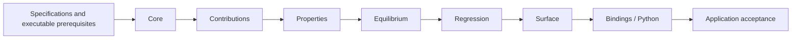
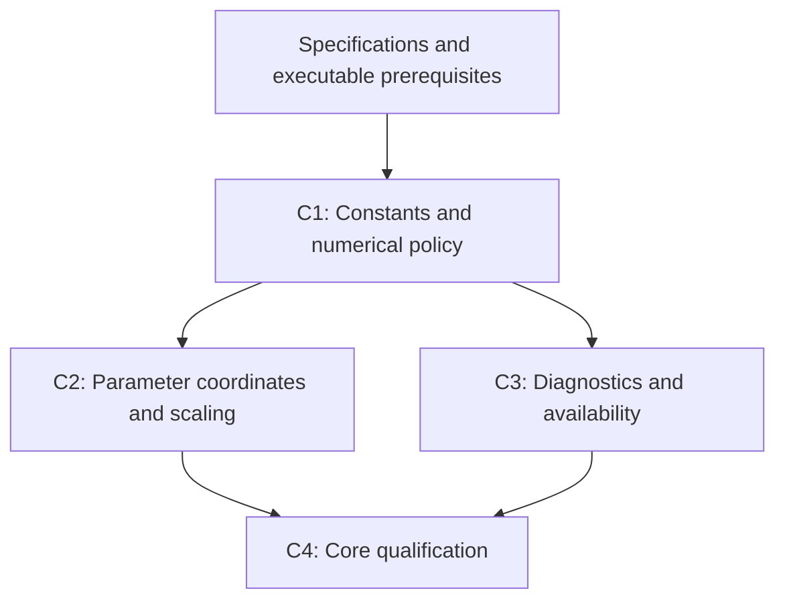
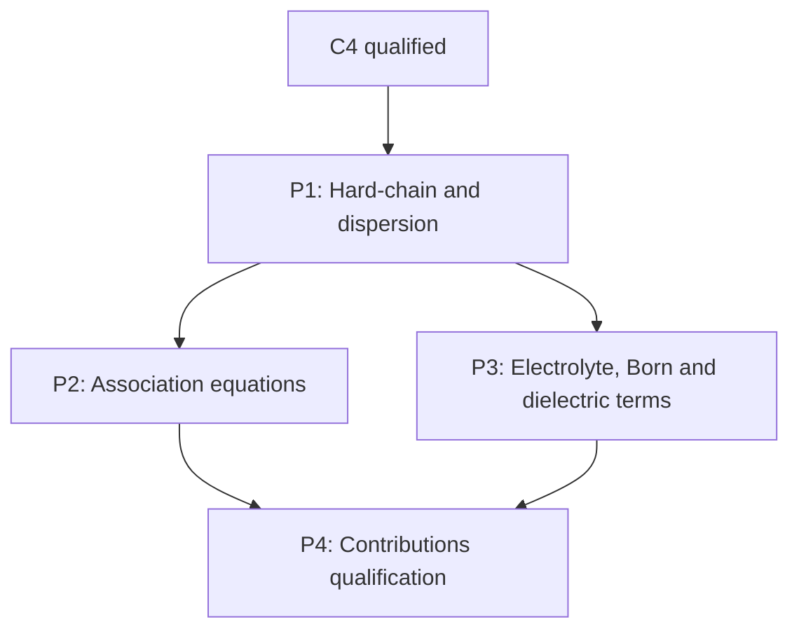
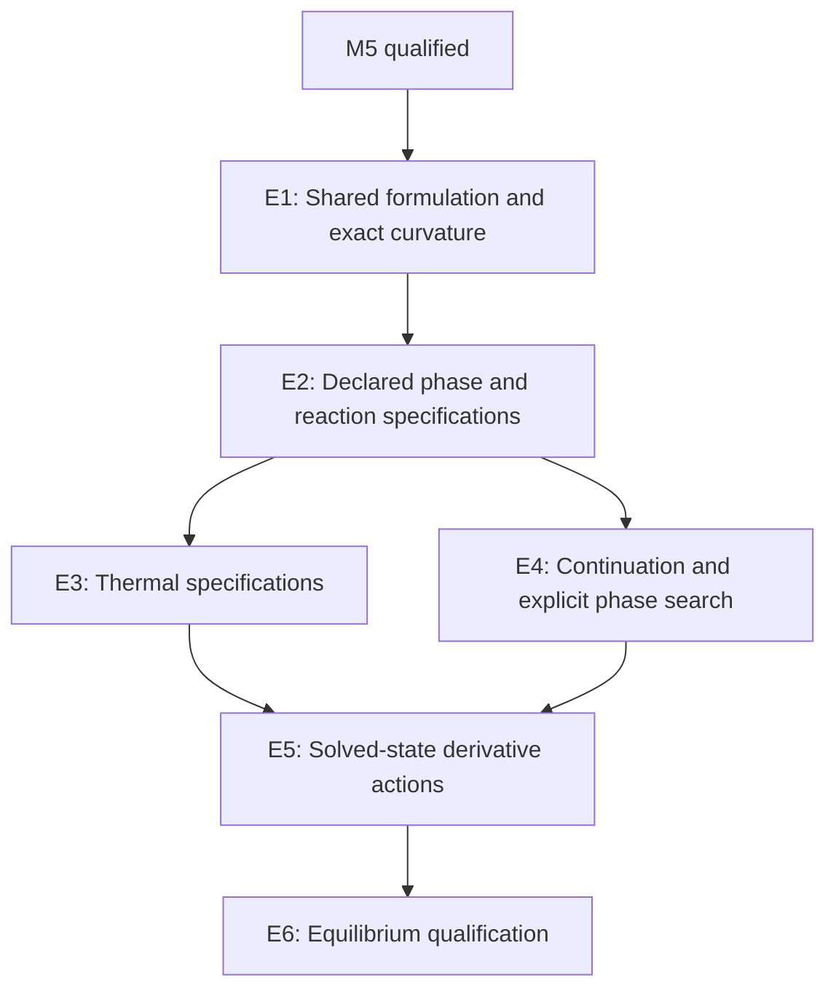
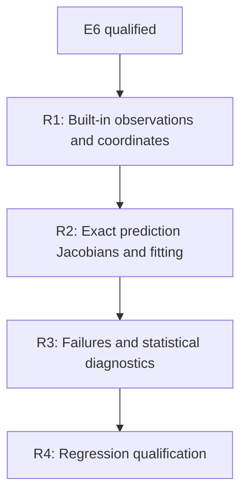
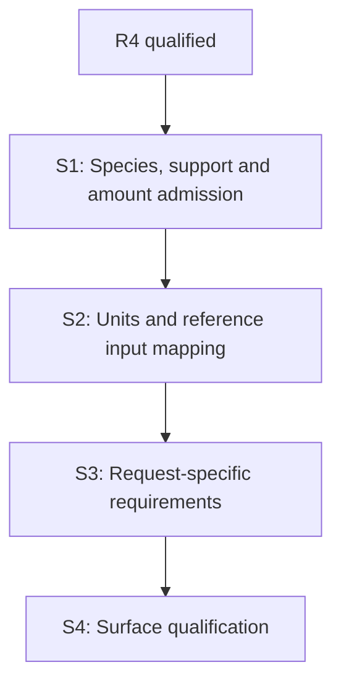
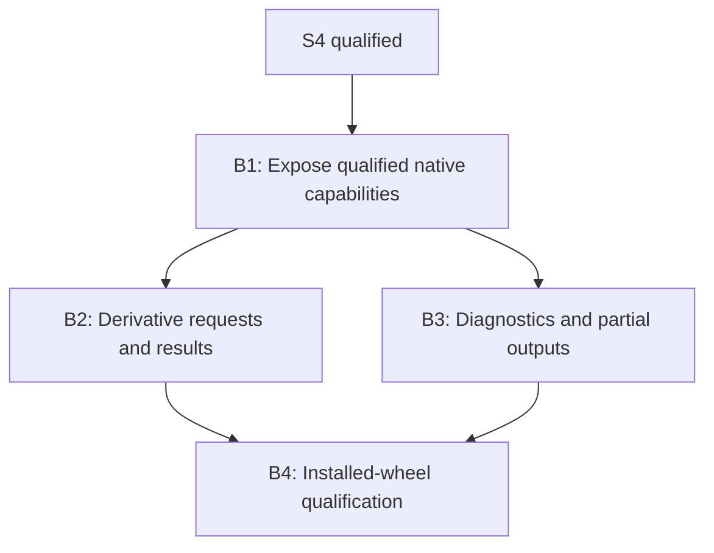
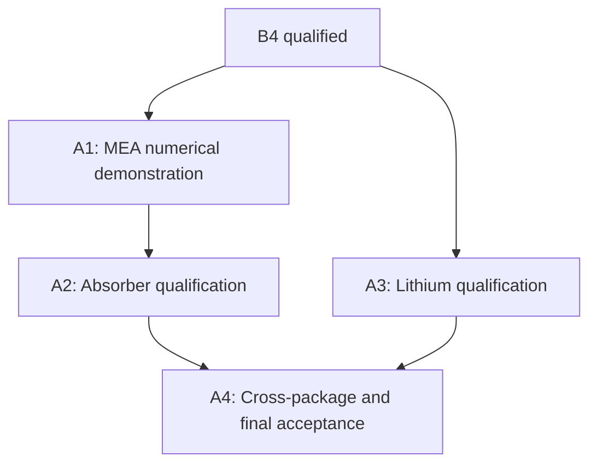

# Implementation plan

The generated summary below owns scientific qualification counts. The fast installed-wheel
baseline runs; the residual-energy correction passes its focused check, while
the weighted equilibrium-curvature check retains an unresolved failure. The milestone tables own qualification and effort; the current
execution queue owns the next work. Numerical records identify the exact inputs
and implementation they exercised and never serve as competing instructions.

## Official dependency-order progress — 2026-09-08

The owner requires completion in this order: **Core → Contributions → Properties →
Equilibrium → Regression → Surface → Bindings/Python → application acceptance**.
Finish and verify the agreed scope of each layer before implementing new
capability in the next. Design readiness is assessed for the affected slice. S0 build
and test identification is prerequisite infrastructure, not a competing feature
stage. Existing higher-layer code can exercise lower-layer checks; it does not
count as qualification of missing higher-layer features. Minimal wiring needed
to run a lower-layer falsifier is part of that lower-layer slice, not permission
to expand the next layer. If existing wiring cannot support verification, name
that dependency before declaring the layer complete.

Contributions owns contribution formulas;
association elimination/CppAD chains are qualified with Properties. Complete Properties
thermal properties before Equilibrium, and complete Equilibrium thermal
specifications before Regression. Within Equilibrium, phase specifications
precede PH/PS/UV; the thermal milestone is not deferred past that layer.

### How progress and effort are counted

The milestone tables below are the sole editable progress record. `[ ]` means
pending or reopened, `[-]` active, `[!]` blocked, and `[x]` qualified complete.
Progress counts qualified milestones equally, not effort or existing scaffolding.
No entire milestone has yet been qualified. Existing code is retained in the code/evidence map.

Time estimates below are **provisional active elapsed hours for Astra-led agent
work**, including repository inspection, design, tool/build execution, numerical
validation and independent review. They are subjective planning ranges, not
measured Astra throughput or human labor estimates. Assume one accountable lead
and the strict sequential layer order; independent reviewers may assist within
a layer. Concurrent agent-hours are not added to elapsed time. Owner response,
external source acquisition, usage-limit pauses and unavailable physical inputs
are excluded. Difficult numerical failures can exceed the upper estimate.
Recalibrate against measured Astra elapsed time after Core before using later
ranges as a schedule. Never weaken science to meet an estimate. Relevance and
priority are 1–5 judgments; sequence governs even when a later easy fix is tempting.

<!-- roadmap-summary:start -->
| Layer | Qualified progress | Remaining Astra h | Measured actual h |
|---|---|---:|---:|
| Core | █████░░░░░ 50.0% (2/4) | 0.5–1.5 | 4.5 (partial) |
| Contributions | ░░░░░░░░░░ 0.0% (0/4) | 2–6 | — |
| Properties | ░░░░░░░░░░ 0.0% (0/5) | 8–24 | — |
| Equilibrium | ░░░░░░░░░░ 0.0% (0/6) | 12–36 | — |
| Regression | ░░░░░░░░░░ 0.0% (0/4) | 4–12 | — |
| Surface | ░░░░░░░░░░ 0.0% (0/4) | 2–6 | — |
| Bindings/Python | ░░░░░░░░░░ 0.0% (0/4) | 2–6 | — |
| Application acceptance | ░░░░░░░░░░ 0.0% (0/4) | 6–20 | — |

Total: **2/35 qualified milestones (5.7%)**; **36.5–111.5 remaining Astra hours**.
<!-- roadmap-summary:end -->

The summary is generated from the tables; do not edit its counts or estimates.
Relevance is 5/5 for every layer; priority is 5/5 for Core, Contributions, Properties,
Equilibrium and applications, and 4/5 for Regression, Surface and bindings.
The smallest pending milestone estimates identify easy completions, subject to
prerequisites. Preparation and excluded waits are additional to these estimates.

### Test-system preparation

The [read-only notebook design](test-system-design.md) defines the hard-cutover
boundary. Tests, checks, retained analyses, `ARCHITECTURE.yaml`, and this plan are
independent owners. A standard-library presentation reader projects them into a
Quarto site without collection, execution, retry, scheduling, or publication.
The pre-cutover [acceptance record](reviews/test-system-acceptance-2026-09-09.md)
remains historical evidence for the retained F1/F5 rows; it is not a current
notebook contract. This tooling work does not change any scientific milestone.

| Work | Status | Completion |
|---|---|---|
| Independent producers | Complete | Normal pytest, Meson, analyses, and readiness checks run without notebook modules or a viewer. |
| Retained results | Complete | Legacy F1/F5 values, inputs, dates, wheel provenance, and the established F5 disagreement remain readable and integrity-checked. |
| Quarto-native view | Complete | Quarto owns Map, Plan, Results navigation, render, preview, resource watching, and reload; [dated cutover evidence](reviews/notebook-cutover-2026-09-09.md). |
| Hard cutover | Complete | The custom server/browser app, collection inventory, recorder wrappers, managed execution, retries, recovery, aliases, and notebook-only harness are removed; [dated cutover evidence](reviews/notebook-cutover-2026-09-09.md). |

### Live Quarto companion

Run
`quarto preview . --host 127.0.0.1 --port 8766 --no-browser --render all --no-execute`
and open [the local notebook](http://127.0.0.1:8766). The root Quarto project has
Map, Plan, and Results pages. Its declared resources make Quarto 1.10.18 watch
`ARCHITECTURE.yaml`, this plan, ordinary test reports, and the retained result
manifest even though they are outside the page bodies. Generated HTML lives under
`build/companion/`.

The Map page derives components, descendant layers, files, roles, milestones, and
relevant recorded checks from the existing owners. Deleted tracked paths are
absent; unmapped and ambiguous existing paths remain explicit. The Engine section
includes every descendant layer's milestones and relevant checks. Tracked YAML,
shell, and other source links resolve to the current repository revision.

The Results page keeps execution outcome, production date, source/input freshness,
and scientific qualification separate. Historical values remain visible and the
complete retained F1/F5 tables remain downloadable when outdated. Missing,
corrupt, and interrupted records remain explicit. F1's historical pass and F5's
established failure do not qualify M1 or E1 or claim current code passed.

### What each signal establishes

| Signal | What it establishes |
|---|---|
| Implementation inventory (Map view) | Code or other assets exist and have an owner. |
| Milestone status (this plan) | Planned, active, blocked or qualified work against stated acceptance requirements. |
| Recorded execution and freshness (Results view) | A check passed, failed or could not run, and whether that record still applies to current inputs. |
| Scientific qualification | Reviewed scientific evidence supports the stated capability and domain. |

A file count, line count or passing test does not complete a milestone, and
tooling completion never inflates thermodynamic qualification. Native include
rules describe what may depend on what; milestone prerequisites describe which
work must be accepted before other work begins.

### Keeping this plan current

At start, inspect the live checkout and evidence, select the first eligible row,
and mark it active when its bounded design work begins; implementation requires
the Ready disposition described below and its layer prerequisites.
At completion or handoff, update that row's status, remaining range, accumulated
active elapsed hours, and evidence link. Use `—` for unmeasured time, never a
fabricated zero. The linked record must identify the date, inspected revision
and dirty changes, commands/results, wheel SHA-256 when numerical work uses it,
claim limits, independent review, and next action or blocker. Revalidate equations
and algorithms with code and evidence in the same scientific change.

A discovered defect reopens the affected row and any dependent completed rows;
block active dependents until repaired. Finish every row in a layer before the
next layer starts. Do not mark a row done from a build or readiness check alone.
Keep these scope requirements below; only the milestone tables own status.

Run `python3 tools/check-roadmap.py --write` after table updates, then
`python3 tools/check-roadmap.py`. Both normal check scripts run the latter before
any early exit or wheel build. It checks table structure, dependency order,
completion links and generated totals; it cannot establish scientific adequacy
or detect every stale claim. Every agent must inspect changed claim owners and
explicitly record revalidation or reopen their rows. No background service is
required. Recalibrate estimates using measured elapsed work at each handoff.

### Core scope

- Shared constants, parameter coordinates and numerical-policy owners exist.
- Verify constant meanings, units, bounds and tolerance provenance; correct inaccurate policy claims.
- Specify and qualify shared convergence/failure/conditioning information without hidden success or defaults.
- Verify parameter-coordinate identities and scaling needed by all later layers.
- Complete focused evidence, cost review and independent acceptance for the agreed Core scope.

### Contributions scope — ideal and residual Helmholtz formulations

- Contributions owns the ideal-gas Helmholtz formulation, including thermal correlations and mixing, and the individual residual contributions. Ideal thermal behavior is physical information; reference conventions set consistent offsets.
- Common residual contribution owners exist for accepted neutral/ionic formulations; residual work remains the scientific priority. Ideal formulation qualification remains part of the planned Contributions scope.
- Verify hard-chain/dispersion formulas and analytic low-density/reference identities.
- Verify association mass-action equations, sites and contribution support limits.
- Verify accepted electrolyte/Born/dielectric formulas and genuine singular limits; no retired polar additions.
- Complete contribution-level numerical evidence, duplication/cost review and independent acceptance.

### Properties scope — thermodynamic properties and states

- Shared EOS state/property and CppAD tape machinery exists. Residual thermodynamics is the scientific priority.
- Organize derived outputs as Ideal, Residual and Total. Ideal properties derive from the ideal formulation; Residual properties derive from the residual formulation. Total physical outputs use governing definitions, not a universal componentwise addition rule.
- Keep ideal thermal/mixing inputs distinct from reference offsets; both remain explicit where consumed.
- Prepare reusable state-independent mixture data once; evaluate state-dependent quantities only after T, density/pressure and composition are supplied.
- Support full or selected state properties with shared intermediate reuse and the minimum required derivative work; preserve explicit unavailable outputs.
- Density-root and infinite-dilution reference implementations exist.
- Correct and qualify residual calorics, association elimination and density branch/pressure chains.
- Complete reference conversions, selected thermal forms, total calorics and typed reaction correlations; compare old/rederived inputs.
- Qualify general smooth state/property actions through third order, parameter Jacobians, failures and cost with independent review.

### Equilibrium scope

- Shared specification compiler, rows and Ipopt driver exist.
- Qualify exact objective/constraint curvature and declared TP, reactive, bubble/dew, fraction/amount specifications.
- Complete and qualify PH/PS/UV using Properties properties; retain consistent references and explicit failures.
- Complete continuation/disappearance and explicitly selected stability/discovery with truthful search claims.
- Qualify solved-state actions through third order, selected independent cases, performance and independent acceptance.

### Regression scope

- Implement built-in initial density/phase observations using existing producers.
- Implement residual-EOS active/fixed/shared coordinates, transforms and bounds.
- Qualify exact prediction Jacobians including implicit equilibrium chains and manufactured recovery.
- Qualify weights, invalid-trial handling, rank and conditional uncertainty diagnostics.
- Complete real-data demonstrations, evaluation reuse/cost review and independent acceptance; reaction fitting remains outside initial Engine scope.

### Surface scope

- A shared physical-input/parameter builder exists.
- Qualify species/support/charge handling and explicit fraction-versus-amount semantics.
- Complete SI state inputs, coefficient conventions and explicit reference/reaction metadata mapping.
- Qualify request-specific missing inputs, caller tolerances and mathematical-domain failures without published-range policing.
- Verify all admitted capability inputs against native owners and complete independent acceptance.

### Bindings/Python scope

- One native extension and thin public mapping layer exist.
- Expose all qualified state/equilibrium/fitting inputs and distinct outputs without duplicate numerics.
- Expose composition directions, derivative orders and per-action availability with coordinate units.
- Preserve branches, residuals, unmet tolerances and valid partial results; no fabricated unavailable values.
- Pass actual installed-wheel numerical checks and independent boundary review within source/cost budgets.

### Application acceptance scope

- MEA: strongest retained parameter candidate demonstrates valid equilibrium and every required consumed output; predictive fine-tuning is separate.
- Absorber: qualify required calorics/actions, refined Case 3C, and resolve or explicitly disposition failed operating cases.
- Lithium: qualify declared reactive LLE and required observables; reaction calibration stays application-owned.
- Complete chosen cross-package comparisons and separate discovery evidence using identified non-editable wheels.
- Review all required capability evidence and equivalent-work performance; transfer draft changes only with owner authorization.

Easy wins are components of these requirements, not automatic checkmarks. The
analysis-script relocation is already complete infrastructure work and is not
counted again as scientific progress. Do not remove hard requirements merely
to improve the displayed percentage.

## Milestone estimates and dependency graphs

These are subdivisions of the existing layer estimates, not extra hours or new
runtime directories. **Actual time taken is not yet measured**; every range is
remaining active Astra elapsed time under the assumptions above. Includes local
validation per milestone; each final qualification row covers integrated checks
and review without counting all validation twice. The scope lists above retain requirements; these rows alone own completion.

Solid arrows show required execution order. Every layer starts only after the
previous layer's qualification row passes, even where mathematical coupling is
weaker. Within a layer, branches identify work without a direct dependency;
the estimates conservatively sum one lead's work and assume no parallel speedup.
These are proposed scheduling dependencies, not C++ include statements. All
later layers may consume any qualified earlier owner.

### Core

| Milestone | Status | Remaining h | Actual h | Prerequisites | Required evidence | Record |
|---|---|---:|---:|---|---|---|
| C1 — Constants and numerical policy | [x] | 0 | 2.5 | Specifications and executable prerequisites | Verify units, physical bounds, tolerance meanings and extensive-objective multiplier scaling; preserve explicit provisional limits; retain falsifying evidence and independent final review. | [2026-09-10: C1 qualification](reviews/core-c1-2026-09-09.md); corrected evidence and independent `Ship` review passed; pinned F5 remains outside C1. |
| C2 — Parameter coordinates and scaling | [x] | 0 | 2.0 | C1 | Define and qualify common coordinate identities and dimensional scaling, including derivative coordinate transformations, with one-slot ownership for scalar coordinates. | [2026-09-10: C2 qualification after correction](reviews/core-c2-2026-09-10.md); supervisor correction closed by exact-one-index validation, red/value evidence, corrected installed-wheel gates, and independent `Supported` review. |
| C3 — Diagnostics and availability | [ ] | 0.25–0.75 | — | C1 | Define residuals, termination and unavailable-result information. | [2026-09-09: existing Core review](reviews/core-readiness-2026-09-09.md); gaps remain, not qualified. |
| C4 — Core qualification | [ ] | 0.25–0.75 | — | C2, C3 | Focused checks, cost review and independent acceptance. | [2026-09-09: existing Core review](reviews/core-readiness-2026-09-09.md); gaps remain, not qualified. |

### Contributions

| Milestone | Status | Remaining h | Actual h | Prerequisites | Required evidence | Record |
|---|---|---:|---:|---|---|---|
| P1 — Hard-chain and dispersion | [ ] | 0.5–1.5 | — | C4 qualified | Qualify hard-chain/dispersion formulas and analytic limits; establish the ideal-gas Helmholtz formulation with explicit thermal and mixing inputs. | [2026-09-08: Contributions scope](CONTEXT.md#residual-ideal-and-state-responsibilities); not qualified. |
| P2 — Association equations | [ ] | 0.5–1.5 | — | P1 | Qualify site topology, mass-action equations and support-limit mathematics. | — |
| P3 — Electrolyte, Born and dielectric terms | [ ] | 0.5–1.5 | — | P1 | Qualify accepted formulas, charge conventions and singular limits. | — |
| P4 — Contributions qualification | [ ] | 0.5–1.5 | — | P2, P3 | Contribution reference checks, duplication/cost review and independent acceptance. | — |

### Properties

| Milestone | Status | Remaining h | Actual h | Prerequisites | Required evidence | Record |
|---|---|---:|---:|---|---|---|
| M1 — Residual properties and caloric correction | [ ] | 1–3 | — | P4 qualified | Verify the residual-energy correction and thermodynamic identities. | [2026-09-08: caloric correction](reviews/caloric-correction-2026-09-08.md); F1 and native model checks pass; broader qualification pending. |
| M2 — Association elimination and density closure | [ ] | 1–3 | — | M1 | Qualify implicit kernels, support limits and pressure-to-density branch closure; reuse the resolved state. | [2026-09-08: scope clarified](CONTEXT.md#residual-ideal-and-state-responsibilities); not qualified. |
| M3 — Ideal and Total properties and references | [ ] | 2–6 | — | M2 | Derive Ideal properties from the ideal contribution and Total properties from the governing definitions; qualify thermal inputs, mixing, reference offsets and K(T) without treating physical ideal behavior as a reference convention. | [2026-09-08: scope clarified](CONTEXT.md#residual-ideal-and-state-responsibilities); not qualified. |
| M4 — General property derivative actions | [ ] | 3–9 | — | M2, M3 | Qualify CppAD and implicit chains, actions through third order and parameter Jacobians; selected properties reuse shared work and agree with full evaluation. | [2026-09-08: scope clarified](CONTEXT.md#residual-ideal-and-state-responsibilities); not qualified. |
| M5 — Properties qualification | [ ] | 1–3 | — | M4 | Independent identities/step ladders, repeated-mixture state changes, unavailable-input behavior, selective/full agreement, measured reuse/cost and review. | [2026-09-08: scope clarified](CONTEXT.md#residual-ideal-and-state-responsibilities); not qualified. |

### Equilibrium

| Milestone | Status | Remaining h | Actual h | Prerequisites | Required evidence | Record |
|---|---|---:|---:|---|---|---|
| E1 — Shared formulation and exact curvature | [ ] | 2–6 | — | M5 qualified | Qualify shared rows and complete multiplier/objective-weighted Hessians, including pinned cases. | — |
| E2 — Declared phase and reaction specifications | [ ] | 2–6 | — | E1 | TP, bubble/dew, phase fractions/amounts and explicit supports. | — |
| E3 — Thermal specifications | [ ] | 2–6 | — | E2 | PH, PS and UV with consistent references and balances. | — |
| E4 — Continuation and explicit phase search | [ ] | 2–6 | — | E2 | Branch following/disappearance; separately selected stability/discovery using the same driver. | — |
| E5 — Solved-state derivative actions | [ ] | 3–9 | — | E3, E4 | First through third actions on smooth fixed branches, not derivatives of discrete phase selection. | — |
| E6 — Equilibrium qualification | [ ] | 1–3 | — | E5 | Selected independent cases, residuals, failure handling, cost and review. | — |

### Regression

| Milestone | Status | Remaining h | Actual h | Prerequisites | Required evidence | Record |
|---|---|---:|---:|---|---|---|
| R1 — Built-in observations and coordinates | [ ] | 1–3 | — | E6 qualified | Density and phase observations, active/fixed/shared EOS fields, bounds/transforms. | — |
| R2 — Exact prediction Jacobians and fitting | [ ] | 1–3 | — | R1 | Compose property/equilibrium chains; manufactured parameter recovery. | — |
| R3 — Failures and statistical diagnostics | [ ] | 1–3 | — | R2 | Reject invalid trials; weights, rank, bounds and conditional covariance. | — |
| R4 — Regression qualification | [ ] | 1–3 | — | R3 | Real-data demonstration, reuse/cost analysis and independent review. | — |

### Surface

| Milestone | Status | Remaining h | Actual h | Prerequisites | Required evidence | Record |
|---|---|---:|---:|---|---|---|
| S1 — Species, support and amount admission | [ ] | 0.5–1.5 | — | R4 qualified | Prepare reusable parameter-bundle species/site mappings; verify explicit charge/support and fraction-versus-amount semantics. | [2026-09-08: scope clarified](CONTEXT.md#residual-ideal-and-state-responsibilities); not qualified. |
| S2 — Units and reference input mapping | [ ] | 0.5–1.5 | — | S1 | SI state units, coefficient units and four declared reaction bases. | — |
| S3 — Request-specific requirements | [ ] | 0.5–1.5 | — | S2 | Require only inputs consumed by requested properties; distinguish full/selected output availability, caller tolerances and mathematical validity. | [2026-09-08: scope clarified](CONTEXT.md#residual-ideal-and-state-responsibilities); not qualified. |
| S4 — Surface qualification | [ ] | 0.5–1.5 | — | S3 | Verify physical inputs against qualified native owners and review. | — |

### Bindings/Python

| Milestone | Status | Remaining h | Actual h | Prerequisites | Required evidence | Record |
|---|---|---:|---:|---|---|---|
| B1 — Expose qualified native capabilities | [ ] | 0.5–1.5 | — | S4 qualified | Expose reusable parameter-driven Mixture and native state/equilibrium/regression capabilities; explicit ideal/residual/total quantities without duplicate numerics. | [2026-09-08: scope clarified](CONTEXT.md#residual-ideal-and-state-responsibilities); not qualified. |
| B2 — Derivative requests and results | [ ] | 0.5–1.5 | — | B1 | Full/selective state requests, balanced composition directions, units, derivative orders and per-output availability. | [2026-09-08: scope clarified](CONTEXT.md#residual-ideal-and-state-responsibilities); not qualified. |
| B3 — Diagnostics and partial outputs | [ ] | 0.5–1.5 | — | B1 | Branches, achieved residuals, unmet tolerances and nonfabricated partial results. | — |
| B4 — Installed-wheel qualification | [ ] | 0.5–1.5 | — | B2, B3 | Verify the installed wheel through parameter-to-mixture/state numerical cases, full/selective agreement and repeated-state reuse; independent review. | [2026-09-08: scope clarified](CONTEXT.md#residual-ideal-and-state-responsibilities); not qualified. |

### Application acceptance

| Milestone | Status | Remaining h | Actual h | Prerequisites | Required evidence | Record |
|---|---|---:|---:|---|---|---|
| A1 — MEA numerical demonstration | [ ] | 1–3 | — | B4 qualified | Strongest retained fixed-parameter candidate; equilibrium and consumed outputs. | — |
| A2 — Absorber qualification | [ ] | 2–7 | — | A1 | Calorics/actions, refined Case 3C and disposition of operating failures. | — |
| A3 — Lithium qualification | [ ] | 2–7 | — | B4 qualified | Reproduce the existing ePC-SAFT producer → surrogate → IDAES/PROMMIS route with its adopted inputs and limits; application-owned reaction calibration. | — |
| A4 — Cross-package and final acceptance | [ ] | 1–3 | — | A2, A3 | Selected comparisons, explicit discovery, wheel identity, performance and final evidence review. | — |

### Cross-layer scientific dependencies

The strict order adds scheduling constraints beyond these scientific dependencies:

| Consumer | Earlier results it consumes |
|---|---|
| Contributions | Core constants and declared numerical conventions |
| Properties | Contributions energy/site equations and Core coordinates/diagnostics |
| Equilibrium | Properties properties, reference thermochemistry, density closure and derivative actions |
| Regression | Properties predictions and exact parameter chains; Equilibrium solved observables/actions |
| Surface | Established input requirements of Properties, Equilibrium and Regression |
| Bindings/Python | Surface resolution and all qualified native result owners |
| Applications | Installed public wheel; absorber also consumes MEA-adopted parameter/reference data |

Core design uses the mapped consumers to establish the shared quantities they need. Verifying a
lower layer uses existing test/binding infrastructure; necessary minimal test
wiring is included in that layer's estimate. No new upper-layer feature work is
implicitly authorized. A discovered lower-layer defect reopens its milestone
row and blocks dependent acceptance until repaired.

The critical scientific uncertainties are Properties's high-order implicit chains
and reference calorics, Equilibrium's exact pinned curvature and higher actions,
and application-specific input sufficiency. Their ranges can grow; the total
must be revised rather than forcing milestone work to fit an old estimate.

## Current execution queue

Current stage: C1 and bounded Core/C2 qualification are complete; C3 remains queued. The read-only companion presents ordinary execution records and retained historical evidence; it is not an execution or integrity harness.
| Order | Task | State and completion condition |
|---|---|---|
| Preparation | Notebook cutover correction closeout | Complete: current ordinary reports remain inspectable, stale publications fail closed, and historical F1/F5 records remain separate and outdated. |
| 1 | Reconcile current documentation and live roadmap | Complete: one execution queue, slice-scoped gates, current application scope and Markdown-derived HTML; C1 qualification state is kept current. |
| C1-design | [Define bounded Core constants slice (#215)](https://github.com/tannerpolley/ePC-SAFT/issues/215) | Verify units and provenance, physical bounds, numerical tolerance meanings, consumers and falsifiers; record a scoped Ready review or exact correction. |
| C1-correction | Correct and requalify C1 | Complete: isolated regular/pinned Hessian evidence, recorded optimizer termination and tiny-feed KKT evidence, restored provisional-policy limits, used independent constant references, retained selected evidence, and passed independent `Ship` review. |
| C2-build | Implement and qualify bounded C2 slice | Complete: common coordinate identities, component/site-pair ownership, `Lij` tape propagation, derivative transformations, scalar exact-one-slot correction, installed-wheel falsifiers, retained evidence, and independent `Supported` review passed; public source-unit fitting coordinates and C3 remain outside scope. |
| Next | Define bounded C3 slice | C2 is qualified for its stated native coordinate identities, pair/site ownership, derivative transformations, and smooth finite numerical fixtures; diagnostics/availability work remains separate. |

Local C1 design and validation are followed by slice-scoped Core work. Repository
creation, remote changes and issue publication are separate actions and do not
block this local scientific queue.

### Gates and authority

| Gate | Required evidence | What follows |
|---|---|---|
| Slice definition | Concrete capability/failure, equations, consumed inputs, units/domain, owner/callers and numerical falsifier | Design review |
| Design Ready | One fresh integrated reviewer for bounded supported work; scientific-basis and numerical-execution reviewers for material changes, with the lead resolving findings | Build that slice |
| Execution checks | Identified non-editable wheel and relevant installed tests; equation index, architecture, budgets and input checks | Assess actual numerical evidence |
| Scientific qualification | Falsifier and preserved reference cases pass; tolerances/limits and failure behavior justified; independent final-tree review supports the claim | Mark the milestone qualified |
| Integration | Affected docs and evidence agree with code; focused reviewed changes and authorized Git delivery | Integrate the bounded change |
| Manuscript promotion, when requested | Investigator selects the reviewed result and intended use | Write for that use |

A failed numerical comparison returns to diagnosis. An unresolved physical input
blocks only requests that consume it. Reviewers advise on the evidence; they do
not replace it. A fast check, hook, equation index or completed issue is not
scientific qualification. Use the installed CSE stages; do not create another
lifecycle registry. This private scientific package needs no inferred release,
compatibility, deployment or CI work.

### Parameter-driven state direction — 2026-09-08

The owner requires explicit residual and ideal thermodynamic responsibilities,
with reusable parameter preparation and full/selective state output. The current
Python Mixture retains parameters and one native model and supports T/rho/x or
T/P/x with branch/anchor inputs. Pure currently has a separate class. The present
native state evaluates through Hessian order and returns flat residual outputs;
selective requests and grouped ideal/residual/total outputs are not implemented.

The architecture map owns the intended preparation/evaluation boundary. M2 owns
pressure closure and reuse; M3 Ideal/Total properties and reference conversions; M4/M5
property dependencies, derivative work, reuse and numerical qualification; S1/S3
bundle preparation and request-specific requirements; B1–B4 the thin public API.
Core remains shared constants, units/coordinates, policy and diagnostics.

Useful proposed checks are analytic/independent derivative chains, full-versus-
selected numerical agreement, no stale state-dependent values after changing T
or composition, pressure/density route agreement on the same branch, and total
property identities with explicit ideal inputs. Review the actual existing tests
first; present new comparisons to the owner for selection. Experimental and
cross-model checks are optional where useful and supported, not mandatory for
every property. These proposals do not themselves add execution gates.

Package structure/installation checks remain separate execution checks; numerical
tests stay organized by capability. CppAD correctness means our complete recorded
and implicit chain, not a general test of the CppAD library. Structural checks
protect dependency direction and single ownership, not an arbitrary frozen file
layout. Downstream test setup is excluded from the present package-test task;
the clones consume the latest wheel. Retained application acceptance requirements
are not authorization to work on downstream tests now.

Contributions and Properties are the current category names. Properties contains
Ideal, Residual and Total. These names and scientific groupings are settled.
Unsettled details are the callable API names, default full/selective evaluation
policy, output container shape and whether to unify Pure with Mixture. The
existing internal directory/type identifiers do not define the visible categories.
No new cache hierarchy or extra runtime implementation is implied. Existing estimates remain
provisional pending that slice design; no qualification status changes here.

### Issue ownership and delivery choice

The plan owns scientific scope, dependencies and qualification. GitHub issues
own bounded delivery, discussion and design-review disposition; link each issue
to its milestone and the result evidence. Standalone issues are normal. A layer
parent is useful only for real decomposition: Core may have C1–C3 children and
C4 as its integrated acceptance checklist. Reviewer assignments, commands and
file edits belong inside the issue, not in additional subissues. Create later
issues when their scientific boundaries are clear.

The current checkout is a linked worktree of `ePC-SAFT-project`; its `origin`
points to the private `tannerpolley/ePC-SAFT` repository. Changing that remote
here affects shared Git configuration. An independent private successor is the
recommendation, pending owner selection; it requires an independent Git directory
and preserved dirty work, not merely changing `origin`. Keep downstream clones
independent and keep real-repository synchronization separately authorized.
Draft PR delivery is the current user-level default; reviewed direct integration
is an available choice, not an adopted change.

### AI model allocation proposal

AI model settings belong in task configuration. The following allocation is a
recommendation awaiting owner selection, not a permanent agent hierarchy.
Preserve any explicit model choice; keep one accountable writer per slice.

| Work | Recommended task model / effort |
|---|---|
| Accountable scientific implementation; Core and ordinary input/binding work | Astra High |
| Contributions, caloric references, implicit model derivatives | Astra Extra High |
| Exact equilibrium curvature, continuation, higher actions and implicit fit Jacobians | Astra Extra High |
| Independent scientific-basis review | Fresh Astra Extra High |
| Independent numerical execution and caller review | Fresh Sol High; Astra for difficult mathematical review |
| Bounded inventories, source tracing, command execution and documentation checks | Luna High |
| Application acceptance | Astra High; Extra High for coupled numerical diagnosis |

Use independent subtasks only where they improve evidence or speed. Max/Ultra
are not defaults. The current reconciliation uses explicitly requested Luna High
read-only inspections. Task configuration, not a prose role name, determines the
actual model and effort.

## Required scientific choices

These are accepted requirements; qualification is recorded only in the milestone
tables. Resolve equivalent details autonomously and return only material
scientific conflicts or changes of scope to the owner.

| Subject | Owner choice |
|---|---|
| Completion | Qualify the layer scopes above and all three current application calculations. Remove superseded implementation when no required consumer remains. |
| EOS scope | Audit the full accepted scientific scope, not only current application calls. |
| Runtime inputs | The caller supplies species, parameters and physical configuration. The Engine does not track or reject published parameter validity ranges. Retain mathematical input checks and numerical failure information. Missing data is supplied/prepared outside the Engine; no guessed defaults. |
| Units | Public state inputs/outputs use K, Pa, mol, m³, mol/m³, J/mol and J/(mol·K), with dimensionless mole fractions. Arbitrary source-unit conversion stays outside the Engine. Reconcile EOS coefficient units and dimensional reaction conventions explicitly; this choice does not silently reinterpret existing parameter files. |
| Equilibrium | One Ipopt driver with exact curvature, including bubble/dew. Compose supported physical constraints internally; no user expressions or evaluator callbacks. Caller seeds and optional continuation are supported. |
| Specification milestones | Qualify TP, bubble/dew at fixed T or P, and vapor-fraction specifications at fixed T or P first. PH, PS and UV remain required for final completion in a later thermal milestone. Support both explicitly distinguished phase fractions and absolute phase amounts. |
| Phase count | Default phase-equilibrium requests declare phase counts and types. Stability/search is a separate mode explicitly selected at the beginning, never automatically injected. |
| Search claims | Report the actual bounded search and witnesses. No witness is not global certification; universal certification is not the completion requirement. |
| Tolerances/results | Caller-selectable tolerances. Return available candidate values with warnings, achieved residuals and an explicit unmet-tolerance indication; do not silently label a missed tolerance as satisfied. When no finite evaluable candidate exists, return its absence and failure diagnostics without fabricated state values. |
| Reaction conventions | Support explicitly selected conventions with required conversion inputs. Do not infer a literature convention. Prepare activity-, mole-fraction-, molarity- and molality-based conventions. Require caller-declared stoichiometry, standard concentration/molality and solvent basis where applicable. Use the native temperature basis ln K = a + b/T + c ln(T/Tref) + dT, with explicit Tref and algebraic source/pKa conversion outside the Engine. Require an explicit caller ionic gauge where needed; no hardcoded hydronium convention. Exact standard-state definitions and conversion derivations remain design work. If supplied K(T) and species thermochemistry are inconsistent for a request consuming both, report the inconsistency rather than silently choosing one. |
| Calorics | Native thermal correlation forms with caller-supplied explicit references. Initial native forms are polynomial heat capacity about an explicit reference temperature (including constant cp), Shomate, NASA7, NASA9 and DIPPR107; distinguish standard states, reference constants and temperature dependence. Preserve supplied piecewise forms; do not silently smooth discontinuities, and report affected unavailable derivatives at boundaries. Compare supplied and corrected caloric references before adopting inputs that depended on the erroneous residual-energy calculation. Agents may adopt corrected references after preserving sourced total-property anchors and standard states, identity checks and independent review. Require thermal inputs only for requests consuming them; missing total calorics must not disable otherwise valid TP/bubble/dew calculations. |
| State derivatives | General directional derivatives through third order for admitted smooth observables. Cover composition, density, temperature and pressure with correct independent-coordinate and implicit chains. Callers specify balanced composition directions summing to zero; the Engine must not silently select a compensating species. Preserve valid central values and actions when another action is singular/unavailable. |
| Fitting | Built-in observable composition, no caller evaluator functions. Initially fit only parameters entering residual-EOS contributions. Exact prediction Jacobians include implicit chains; higher parameter orders are deferred unless a concrete method demonstrates sufficient benefit. Reaction and reference-thermal fitting are deferred in Engine. Lithium apparent-reaction-coordinate calibration stays application-owned and consumes general equilibrium calls. |
| Initial fitting observations | Density, saturation/bubble/dew pressure or temperature, phase compositions and phase fractions. Add caloric observations with the thermal milestone; this does not enable fitting reaction/reference coefficients. |
| Failed fit trial | Reject an invalid trial using supported optimizer behavior; retain its cause and never silently discard the failed observation. |
| Statistics | Distinguish absolute measurement uncertainties from relative weights. Covariance claims depend on rank, bounds and stated statistical assumptions. |
| Evidence | Use the mapped application calculations and every required consumed output/action. Agents may adopt case-specific numerical limits supported by conditioning, refinement and independent review; return unresolved scientific conflicts to the owner. Unapproved cross-model/experimental thresholds remain comparison-only. Retain justified case-specific numerical limits; changed defaults or new limits need conditioning/refinement evidence, never silent relaxation. |
| Performance | Measure equivalent accepted work, propose workload budgets, and remove wasted native computation. Estimate unavoidable evaluation/derivative/linear-algebra costs and compare actual profiles; distinguish a practical lower-bound estimate from a proven theoretical minimum. |

## Code and evidence map

| Requirement | Existing owner | Gap and numerical falsifier |
|---|---|---|
| Common residual energy and exact derivative chains; ALG-ASSOCIATION | `engine/native/contributions/helmholtz.hpp`, `association.hpp`, `electrolyte.hpp`, `born.hpp`; `engine/native/properties/helmholtz_tape.hpp` | Common tape exists. F2: weighted association elimination fails exact-zero associating support; E2 must separate regular mass action from the genuinely nonsmooth DH insertion Hessian. |
| EqID: `residual_internal_energy`, residual/total caloric identities | `engine/native/properties/helmholtz_model.cpp` | F1: missing T factor corrected 2026-09-08; focused ladder and mixture caloric identities pass. Broader M1 qualification remains pending. Total h/u must not be substituted by residual fields. |
| ALG-ADMISSION | `engine/native/surface/parameter_builder.cpp`, `engine/src/epcsaft/` | F3: neutral subset, charge defaults, source domains and ordinary electroneutrality incomplete; density-volume-temperature and dipolar-density permittivity families are specified but rejected by public builders; E2 plus explicit selected-support/domain cases. |
| ALG-DENSITY | `engine/native/properties/density.cpp` | Gradient scan and corrected reduced slope exist. F4: public branch/count not preserved; E3/E5 root multiplicity, disappearance and branch tests. |
| Equilibrium rows and ALG-EQUILIBRIUM | `engine/native/equilibrium/request_compile.cpp`, `gibbs_minimizer.cpp`, `phase_boundary.cpp` | Compiler/shared minimizer exist. F5 exact pinned Hessian and callback objective-factor weighting are incorrect. E12 directional weighted-gradient ladder at nonzero multipliers, obj_factor 0, 0.5 and 1, including free T/P away from seeds; zero curvature is not exact. Boundary seeds are not continuation. |
| EqID: `implicit_sensitivity`; ALG-ACTIONS | `engine/native/equilibrium/implicit_sensitivity.cpp` | A1 path exists with silent unavailable cases; E3 needs reasons/rank/linear residual and complete mixed chains. A2/A3 required by downstream uses are absent or unqualified; E10 independent action ladder. |
| EqID: `standard_pressure_density_conversion`; ALG-REFERENCE | `engine/native/properties/infinite_dilution_reference.cpp`; no complete common thermochemistry owner | E4/E7/E9: consistent fixed-P0 conversion, typed K(T), total properties and reference derivatives. Reaction gauge alone cannot supply absolute calorics. |
| ALG-FIT | `engine/native/regression/` placeholder | General observation algebra/fitting absent; E9 property fits, fixed-coordinate zero derivative, domain failures, chain rules and conditional covariance. Extend active coordinates beyond the six present EOS families only with complete defining chains. |
| Stability/discovery | No qualified current discovery owner | Discover mapping incomplete/rejected. E8/E11: instability witnesses, declared-vs-discovered comparisons, charge/support and genuine bound meaning; local inner minima and exhausted search are not global proof. |
| Installed-wheel/application evidence | `tools/verify-installed-wheel.py`, `tools/check-all.sh`; three downstream repositories | Fast installed-wheel gate passes; see the S0 execution record below. The gate does not run the focused F1/F5 checks and does not qualify application calculations. |

The table names intended numerical falsifiers, not newly executed passing tests.
Existing compact checks live under `engine/tests/`; exact existing/proposed
case dispositions and the audit E1–E12 evidence identifiers are in the
[transfer audit](reviews/transfer-audit-2026-09-06.md). These identifiers describe
scientific evidence, not an additional execution sequence. Do not infer implementation from
an EqID annotation or a source file's existence.

## Application scope and remaining scientific design

Use the three independent clones under `downstream/`; their README and each
`docs/coordination/greenfield-migration.md` own current consumer calls and run
inputs. MEA uses the strongest retained parameter candidate to demonstrate valid
equilibrium and consumed outputs; predictive fine-tuning is separate. Absorber
uses current refined Case 3C and requires its calorics/actions. Repair valid
in-scope operating failures; exclusion requires demonstrated physical or
mathematical inadmissibility and independent review.

Lithium uses the implemented ePC-SAFT producer → surrogate → IDAES/PROMMIS route,
including adopted topology, diluent/feed assumptions and application-owned
reaction calibration. New runs identify their actual inputs and installed wheel.
Reconciliation of old run identities and the seven source-readiness labels are
not prerequisites. Additional phase analyses, tie lines or pure-property studies
are required only for a calculation or expanded claim that actually consumes them.

Remaining design is attached to the affected milestones:

- M3: standard-state conversions, four reaction bases and consistent thermal
  references; compare supplied/corrected calorics before adopting residual-dependent
  references. Retained conversion arithmetic does not qualify physical conventions.
- M4/E5: direct-state and pressure-closed coordinate charts, balanced composition
  directions, implicit mixed actions through third order and per-action failures.
  Pressure and density are not independent coordinates of the same closed state.
- E1–E4: weighted objective/constraint curvature for pinned/free intensives,
  well-posed shared specifications, initial states, continuation and explicitly
  requested search. All use the single equilibrium driver.
- R1–R3: observation meaning, weights, active/fixed/shared coordinates, bounds,
  exact implicit Jacobians, rank and conditional uncertainty. Reaction fitting
  remains application-owned.
- Each qualification row: independently justified reference cases, numerical
  limits and equal-accuracy performance. Compare identical inputs/supports,
  starts, outputs/actions and branch; separate initialization from warm timings,
  count evaluations and linear solves, and remove measured duplicate work.
  Failed solves or omitted derivatives cannot count as speedups.

The [equilibrium candidates](../../engine/docs/equilibrium/test-candidates.md)
identify ethanol saturation, binary bubble/dew, zero-component flash, declared
VLLE, PR natural-gas and Phasepy ethanol/water comparisons. Cross-model deviations
remain distinct from numerical error; no universal percentage is adopted.

### Application setup changes before new-wheel runs

The absorber dependency/lock and integration checker select a prior cached wheel;
Lithium dependency/lock selects Engine from a Git revision. Their setup slices
must consume the selected non-editable wheel and record its identity before new
numerical runs. The MEA evaluator also pins an input wheel. These are concrete
installation changes, not demands to reconcile every previous calculation.
The unused MEA `require_regression_execution_admitted` helper needs caller review
and removal in its runtime slice if still unused. This documentation task does
not change dependency locks, integration checks or runtime functions.

## Numerical evidence and qualification

Useful retained evidence has a scientific purpose:

- [S0 execution](reviews/s0-baseline-2026-09-08.md): installed-wheel identity and
  executed fast checks; not qualification of the whole Engine.
- [F1/F5 numerical record](reviews/preparation-numerics-2026-09-08.md) and
  [step-ladder values](reviews/preparation-numerics-2026-09-08.csv): current
  unrepaired energy/curvature defects. Detection bars are provisional.
- [Conversion arithmetic](reviews/preparation-conversions-2026-09-08.md) and
  [values](reviews/preparation-conversions-2026-09-08.csv): reaction-basis and
  Khudaida combining-rule comparisons; not native-provider or source qualification.
- [Thermal/reaction derivations](reviews/preparation-doctrine-2026-09-08.md) and
  [consumer mapping](reviews/preparation-consumers-2026-09-08.md): inputs and
  scientific relationships used by the affected designs.

Every qualification identifies observable, inputs, units/basis, support, branch,
independent coordinates, reference/derivation and uncertainty. Its comparison
uses justified finite nonnegative absolute/relative limits with meaningful units
and scale, including near-zero expectations. Retain achieved values, errors,
commands, source/dirty-change identity and wheel identity in the numerical owner.
Preserve failures, unavailable results and unmet tolerances. A reference must
not be the same faulty producer used twice. Independent review checks both the
expectation and the observed agreement.

Keep numerical rows once in CSV/TSV or the existing result owner, with linked
interpretation. The live evidence view reads connected executable logs directly; retained scientific records remain linked evidence, not silently reused as current runs. Requalify
changed claims; do not infer current validity from an earlier successful run.
Reference measurements, evaluated-EOS values and digitized model curves retain
their different meanings. A reported zero without a detection bound is not an
exact mathematical zero or known censoring limit.

When implementing a slice, update this document and the affected scientific
owners in place. Remove superseded instructions, duplicated progress prose and
obsolete examples in the same change. Retain a dated record only while it
supports an identified scientific result, derivation, decision or diagnosis;
Git already preserves edit history. The roadmap renders this plan and retained
values, rather than copying decisions into HTML or another progress store.
