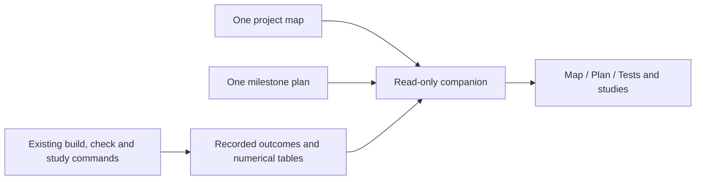

# Lightweight companion cleanup and project restructuring

Date: 2026-09-09. Combined source audit, scope correction and restructuring brief.
The owner wants a lightweight notebook that shows recorded results and current
project organization, with matching folder names and connected milestones.
This document supersedes the earlier restructuring-only brief at the same path.
It specifies cleanup; it does not perform runtime deletions, folder renames or
service changes. The [current context](CONTEXT.md),
[architecture](../../engine/ARCHITECTURE.yaml) and
[implementation plan](implementation-plan.md) remain the current owners until
their coordinated revision. No scientific milestone is qualified here.

## Intended result

Make the repository, architecture map, roadmap and live companion use the same
names and ownership hierarchy. A reader should be able to select a component or
layer and see its purpose, actual files, capabilities, milestones, evidence and
remaining work. Every file and folder must be accounted for without maintaining
a handwritten entry for every file.

The owner explicitly requests physical directory names to match the accepted
Contributions and Properties names. Finish the rename through its real callers;
display aliases alone do not meet this requirement. Preserve the useful existing
organization and simplify competing definitions as the new map is introduced.

## Audit conclusion and scope correction

The work expanded from a project/results viewer into a custom execution,
environment-verification and recovery system. That expansion explains much of
the code and the tests: continuous execution required locking and retry rules;
strict later verification required runtime probes and caches; multiple nested
recorders required abandoned-attempt recovery; reviews then exercised those
new failure paths. Correctness within that expanded design does not establish
that the design is appropriately small for the requested viewer.

The earlier design explicitly required much of this behavior, including live
environment verification and a separately controlled automatic worker. This
cleanup therefore needs a coordinated revision of
[test-system-design.md](test-system-design.md), not deletions beneath unchanged
promises. The planning/integration decision to accept the expanded scope is the
primary issue. This inspection does not establish model-specific fault or assign
the accumulated work to the latest Luna workers.

At 2026-09-09 17:35 UTC, eleven inspected files contained **7,678 physical lines**,
including comments and blank lines. The main task was still modifying this area;
these counts describe an inspected snapshot, not a frozen-tree acceptance or
net additions by a particular agent.

| Inspected code | Physical lines |
|---|---:|
| `tools/test_records.py` | 1,339 |
| `tools/run-numerical-evidence.py` | 1,392 |
| `tools/check-test-system.py` | 1,858 |
| `tools/numerical-inventory.py` | 470 |
| `tools/pytest_recording.py` | 575 |
| `tools/record-command.py` | 169 |
| `tools/test-worker.py` | 255 |
| `tools/serve-roadmap.py` | 410 |
| `tools/companion-data.py` | 371 |
| `docs/companion/companion.js` | 733 |
| `tools/check-all.sh` | 106 |

This is not a whole-repository audit or a claim that all 7,678 lines are waste.
Native reporting helpers, numerical test migrations and build scripts outside
this count also serve the system. Line count identifies the scale of the problem;
the findings below identify actual removal or ownership opportunities.

### Recommended lightweight boundary

Normal build/check/study commands produce results. Existing thin native and
pytest reporters retain those results. The companion reads the project map,
milestone plan and recorded evidence, then presents them. Its persistent local
service serves the viewer; starting it or opening a page does not start tests.

Automatic refresh of the display remains useful. Automatic execution on source
edits is a different capability: the recommended cleanup removes it from the
viewer and retires the custom watcher if that automation is no longer required.
This is an explicit proposed scope reduction, not permission to silently remove
an automatic-execution requirement that the owner elects to retain. If retained,
keep its necessary behavior checks and account for its cost separately from the
notebook. Do not introduce another scheduler or service framework to replace it.

Show the recorded outcome, execution time and whether the inspected source and
wheel match that run. Keep freshness distinct from the outcome. Where the
environment has not been rechecked, say so rather than claiming fully verified
current applicability. Moving verification out of each HTTP refresh must revise
the corresponding display promise; provenance at execution time remains intact.

### Ranked findings and cleanup actions

Line locators below refer to the inspected snapshot; function names identify the
code if the active task moves lines. Each action includes its owner and a small
preservation check. Conditional reductions are not counted as completed work.

1. **replace:** the server starts and supervises `test-worker.py`, which adds source watching, generation scheduling, coalescing, retry and process recovery; make the existing server a viewer, retain persistent viewer startup through its current systemd unit, and remove the worker plus its server/projection/UI wiring if adopting the reduced execution scope; verify that viewer startup launches no test process and ordinary check commands still publish visible results. **255 worker lines plus caller reductions are candidates, conditional on retiring automatic execution.** [server](../../tools/serve-roadmap.py), main block near line 370; [worker](../../tools/test-worker.py), `watch` and `_run_once_owned`; [service unit](../../tools/systemd/epcsaft-companion-greenfield.service).

2. **replace:** live snapshot construction calls `display_status`, which reaches installed-runtime/dependency verification through `freshness`; keep detailed build/run provenance with the existing preparation and execution owners, and make display refresh read recorded evidence plus bounded source/wheel freshness; revise the stronger current-applicability promise before removing repeated probes or their cache; verify that changed sources, missing results and unverified environments cannot appear as a new verified pass. **Removal size unresolved; build/run checks must be distinguished from display-only checks.** [snapshot](../../tools/serve-roadmap.py), `companion_projection` near line 174; [identity and freshness](../../tools/test_records.py), `artifact_identity`, `verify_artifact_identity`, `freshness`; [existing promise](test-system-design.md#identity-criteria-and-completeness-invariants).

3. **delete:** the integrity harness includes worker-process helpers and a worker restart/coalescing exercise for the scheduler in finding 1; remove those checks and declarations only when their subject is removed, retaining shared failure, timeout, numerical-record and incomplete-output checks; verify the retained checks pass and their inventory contains no retired declarations. **204 function-body lines are specifically worker-oriented candidates; the additional 331-line coalesced-failure function mixes concerns and needs extraction, not blanket deletion.** [harness](../../tools/check-test-system.py), `worker_process_code` through `check_worker_coalescing_and_restart`, lines 1253–1471; `check_coalesced_failure_gate`, lines 1479–1809.

4. **delete:** `_inputs` has no caller in the inspected tooling/test sources and `_number` is called only by `_inputs`; remove these obsolete text-input helpers, retaining the live JSON comparison parser and `_native_fields`, which still parses native case events; verify a representative native record preserves inputs, operands and criterion. **28 function-body lines removable.** [runner](../../tools/run-numerical-evidence.py), `_number` at line 89 and `_inputs` at line 107.

5. **replace:** `check-all.sh` uses background PID arrays, a worker counter and a second wait loop with `max_workers=1`; use one foreground `run_check` that records and prints each result and accumulates failure while still running all selected checks; verify identical selected commands and a nonzero final result when any command fails. **Approximately 25–35 net lines removable.** [gate](../../tools/check-all.sh), lines 39–99.

6. **dedupe:** `check-affected.sh` runs roadmap, budget and equation checks before handing full-gate changes to `check-all.sh`, which repeats them; decide full versus selective execution before executing shared checks and let one selected entry point own each invocation; verify full and selective selections still run every required check once. **Fewer duplicate executions; net line reduction not estimated.** [affected selection](../../tools/check-affected.sh), lines 36–69; [full gate](../../tools/check-all.sh), initial recorded commands.

7. **dedupe:** `check-roadmap.summarize` and `companion-data.plan_projection` independently parse the same milestone table, while projection currently discards prerequisite and evidence links; expose the existing parser's rows once and derive validation, summary and presentation from them, carrying the links needed by the map; verify one changed milestone appears consistently in the summary and notebook. **Approximately 20–40 duplicated parsing lines may be removable; replacement must be measured.** [roadmap parser](../../tools/check-roadmap.py), `summarize` at line 19; [projection](../../tools/companion-data.py), `plan_projection` at line 53.

8. **investigate:** `/coverage`, `/render`, `/source` and `/artifact` have server implementations but no live-companion or documented caller in the inspected current files; check supported scripts and actual user links, then remove unused endpoints, their alternative Markdown rendering and their dedicated self-checks, retaining Quarto and the source/result links the new Map view needs. **Roughly 40–70 lines are candidates; external/local callers are not established.** [server](../../tools/serve-roadmap.py), `render`, `coverage`, `Handler.do_GET`, `self_test`.

9. **investigate:** run finalization and interruption handling appear in the shared runner, direct pytest integration and command recorder, with nested lock/attempt markers and store reconciliation; preserve supported direct invocations, then reuse one existing final-record publication path where semantics match, deleting only redundant lifecycle branches; verify direct pytest, the normal gate and native execution retain failures and incomplete attempts without reviving an older pass. **No safe deletion total established; deleting recording from direct invocations is not an acceptable shortcut.** [runner](../../tools/run-numerical-evidence.py), `_run_record`; [pytest](../../tools/pytest_recording.py), `_direct_terminal`; [command recorder](../../tools/record-command.py), `main`; [store](../../tools/test_records.py), `reconcile_attempts`.

10. **prevent:** the current design's expanding live-verification and recovery promises repeatedly generate implementation and synthetic test work; replace those superseded promises with the reduced viewer/execution boundary in the current design and instructions, and require a demonstrated reader or scientific need for each retained field, wrapper and check; verify the normal development commands and notebook still meet the agreed use. **Prose and code reductions follow the accepted scope; no new audit checker, status registry or framework.** [test-system design](test-system-design.md), [project instructions](../../AGENTS.md), [implementation plan](implementation-plan.md).

### What must remain

- Actual numerical operands, units, physical inputs, comparison criteria,
  reference provenance, uncertainty, derivative ladders and useful failures.
- One non-editable Engine wheel and the build/run checks needed to know which
  installed implementation produced a result. A timestamp alone is insufficient.
- Stable test and parameter-case identities, thin native/Python reporting, and
  distinction between planned, executed, incomplete and unavailable evidence.
- Atomic publication, result-file integrity, safe file access and enough
  interruption handling that an incomplete attempt cannot look like a new pass.
- Clear offline/stale indications, readable tables, source navigation, and
  persistent viewer startup. None requires a new database or frontend framework.
- Scientific tests. The harness is not a deletion target merely because it is
  large: remove the unnecessary behavior first, then its exclusive tests.

Keep retained scientific evidence and independent application repositories out
of the cleanup sweep. Ignored output is not automatically disposable. Old review
logs and temporary probes can be removed only after checking for unique useful
evidence and exact task ownership; this audit authorizes no bulk purge.

## Minimal target flow

Reuse the current record files and native/Python reporters while simplifying
their callers. Do not replace the whole implementation or invent a second
result format. Add the project map to the smaller viewer after removing obsolete
responsibilities. The architecture below defines that map.

## Vocabulary

| Term | Meaning |
|---|---|
| Project | The complete thermodynamics effort, including Engine and its supporting components and applications. |
| Component | A major responsibility with an identifiable implementation or records owner: Engine, Data, Analyses, Applications, Tooling or Documentation. |
| Layer | An architectural responsibility inside a component. Engine layers have enforceable native dependency rules. |
| Module | A cohesive implementation unit within an owner; it can contain several files. |
| Capability | A named behavior, such as density evaluation or equilibrium solution, which may involve several layers. |
| Milestone | Bounded work with explicit completion requirements, owned by a component and, where applicable, a layer. |
| Artifact role | Why a file exists: runtime source, specification, test, input data, retained evidence, tooling, configuration or generated output. |
| Qualification | Reviewed evidence supports a scientific capability within stated inputs, domains and limitations. |

Use **Component → Layer → Milestone** for the Engine roadmap. A small supporting
component may own milestones directly; do not invent empty layers just to make
every branch equally deep. Files belong to architecture owners, not to milestone
folders. Milestones link to the files and evidence they affect.

Replace the plan's use of “sublayer” for C1, C2 and similar rows with “milestone.”
For example, C1 is the constants and numerical-policy milestone within Core;
C4 is integrated Core qualification, not another implementation layer. Keep
existing milestone IDs and evidence links where their meanings remain valid.

## Components and physical organization

| Component or map group | Existing locations and intended treatment |
|---|---|
| Engine | `engine/`: one runtime distribution, native implementation, Python interface, Engine specifications and numerical verification. |
| Data | `data/`: reusable inputs, provenance, materialization and packet validation. |
| Analyses | `analyses/`: existing scientific question sets, calculations, retained results and interpretation. Keep meaningful existing study names. |
| Applications | The three official independent repositories; `downstream/` contains their local migration drafts. Show repository boundaries and wheel-consumption relationships explicitly. |
| Tooling | Shared build, check and evidence machinery in `tools/`; Engine-specific tooling remains in its existing Engine locations. A small explicit path rule can identify the companion server and projection tools separately. |
| Documentation | `docs/scientific/` for project records and `docs/companion/` for the live presentation. Engine equations stay in `engine/docs/`, with links from the project records. |
| Workspace configuration | Root and hidden configuration, including `.codex/`, `.serena/` and IDE settings. Account for their purpose without exposing credentials or dumping local configuration into the browser. |
| Generated and external artifacts | `build/`, environments, caches, third-party build inputs and version-control internals. Summarize their roots, producer or external owner; do not enumerate dependency files as project implementation. |

The last two rows are inventory groups, not scientific components requiring
qualification milestones. “Everything tracked” means ownership and disposition
are visible; it does not mean putting environments or generated files into Git.
Untracked project source must still appear in the map. Independent application
repositories need their own inventory boundary, not recursive treatment as
Engine source or a silent synchronization with the official repositories.

## Engine layers and rename scope

| Layer | Target implementation location | Responsibility |
|---|---|---|
| Core | `engine/native/core/` | Constants, coordinates, numerical policy and diagnostics. |
| Contributions | `engine/native/contributions/` | Ideal and individual residual Helmholtz formulations. |
| Properties | `engine/native/properties/` | State evaluation, Ideal/Residual/Total quantities, density closure and derivative chains. |
| Equilibrium | `engine/native/equilibrium/` | Shared equilibrium assembly and driver, continuation, stability and solved-state actions. |
| Regression | `engine/native/regression/` | Observation composition, fitting and fit diagnostics. |
| Surface | `engine/native/surface/` | Physical input construction, resolution and admission. |
| Bindings/Python | `engine/native/bindings/` and `engine/src/epcsaft/` | Native-language translation and public Python input/output interfaces. |

Rename `engine/native/physics/` to `engine/native/contributions/` and
`engine/native/model/` to `engine/native/properties/`. Also align layer-labelled
test files and build targets: `physics_checks` → `contributions_checks`,
`model_checks` → `properties_checks`, `model_floor` → `properties_floor` and
`model_support` → `properties_support` where those names denote layer ownership.

Update includes, Meson sources and variables, architecture keys, budget keys,
checkers, runner discovery, suite selectors, artifact identity, documentation,
live labels and affected instructions in the same migration. Remove obsolete
category alias mappings once the actual identifiers agree. Budget values and
scientific definitions do not change because their keys are renamed.

Use semantic inspection rather than global replacement of the words “physics”
or “model.” A mathematical model, model-versus-reference operand, or a type such
as a Helmholtz model can remain accurately named. Preserve recorded historical
identities and provenance; explicitly account for any declaration-ID changes
and rerun affected checks instead of relabelling old evidence as current.

Surface is the Engine input boundary; the browser interface is the Live
companion. Bindings and Python remain distinct implementation groups beneath
their shared roadmap heading. Python stays organized by public capability and
does not need to mirror native layers. No additional folder renames are implied
without a concrete terminology mismatch.

## One persistent map and one progress owner

Proposed implementation: promote `engine/ARCHITECTURE.yaml` to root
`ARCHITECTURE.yaml`, extending the existing declaration to cover the project.
Move its existing content and update consumers; do not maintain both files.
Its Engine section retains dependency rules, packaging invariants and the sole
numeric budget definitions.

The map adds only information needed by the checker and live view:

- Components and layers: identifier, readable name, purpose, parent and owned paths.
- Path ownership and artifact roles, using directory-prefix defaults and a small
  set of explicit overrides for shared locations.
- References to existing specifications or documentation, and existing declared
  dependency rules where they have a real meaning.
- Explicit generated, external and independently owned repository boundaries.

Each project file resolves to one primary owner and one artifact role. A more
specific path rule overrides a broader one; equally specific conflicts and
unmapped project paths are reported in the map. Missing classification makes the
map incomplete; it does not by itself block an unrelated scientific calculation.
Shared tests, specifications and tooling
can belong to their common component and link to several supported layers.
Do not duplicate a file merely to make ownership look exclusive.

Derive file lists and counts from the filesystem. Do not add per-file metadata,
a database, a graph framework or a second generated inventory that must be edited.
Generate a compact snapshot through the retained companion reader. Report
mapping gaps plainly; an incomplete inventory must not look complete. Do not
build a file-by-file change-impact graph or make file discovery execute tests.

Keep `docs/scientific/CONTEXT.md` as the explanation of purpose, scientific
responsibilities and vocabulary. It should reference the structural map instead
of repeating editable path tables. Keep `implementation-plan.md` as the single
milestone/status owner. Render both into the companion; browser state owns
neither structure nor progress. Update all pointers as part of the migration.

## Roadmap connection and progress meaning

Group the plan by the map's components and layers. Each milestone needs a stable
ID, owner, concrete outcome, prerequisites, acceptance requirements, status and
links to its relevant implementation and evidence. Retain effort estimates only
where they are useful. Use existing evidence declarations and requirement links;
do not create a parallel evidence registry or require one test per file.

Every Engine layer has milestones for its required capabilities and integrated
qualification. Supporting components also expose real outstanding work, such as
test-record integrity or data provenance, with appropriate completion checks.
Do not invent milestones for every directory or populate a task list simply to
fill the tree. The map shows existing assets even when no work is open on them.

The roadmap should visibly distinguish:

| Signal | What it establishes |
|---|---|
| Implementation inventory | Code or other assets exist and have an owner. |
| Milestone status | Planned, active, blocked or completed work against stated acceptance requirements. |
| Recorded execution and freshness | A check passed, failed or could not run, and whether that record applies to current inputs. |
| Scientific qualification | Reviewed scientific evidence supports the stated capability and domain. |

A file count, line count or passing test does not automatically complete a
milestone. Tooling completion must not inflate thermodynamic qualification.
Show component progress with its own meaning and keep scientific qualification
separate; do not combine unlike work into one misleading project percentage.
Preserve the selected scientific completion order and valid existing evidence.

Keep architecture dependencies separate from scheduling prerequisites. The
native include rules describe what may depend on what; roadmap edges describe
which work must be accepted before other work begins. A capability can use
several layers without changing their primary ownership.

## Connected live views

Extend the existing local companion with **Map**, **Plan** and **Tests & studies**
views. Reuse its rendering, refresh and evidence readers after the cleanup above.

Selecting a component or layer should expose:

- Its purpose, implementation locations and relevant dependency relationships.
- Expandable files grouped by module or artifact role, with source links.
- Its milestones, acceptance requirements, remaining work and linked evidence.
- Relevant current or outdated test/study records and explicit coverage gaps.

The same component/layer selection should carry across the views. Start with a
readable tree and compact tables; search and filters refine that same inventory.
A large interactive dependency graph is unnecessary for the initial version.

Revise the current test-system-design prohibition on showing file paths: source
navigation is explicitly useful in the Map view and milestone details. Keep
scientific result tables focused on their quantities and meanings. Raw logs,
secrets and implementation fingerprints need not enter the normal presentation.

## Implementation sequence and acceptance

1. At a stable main-task boundary, establish the exact source/evidence baseline
   and adopt the lightweight scope in the existing design. Resolve whether
   automatic execution remains a requirement before deleting the watcher. Keep
   the actual numerical record format and retained scientific values.
2. Remove the confirmed dead helpers and serial-job scheduling scaffolding;
   eliminate repeated full/selective gate work and consolidate plan parsing.
3. Apply the selected larger reductions: detach execution from viewer startup,
   remove the watcher if retired, narrow refresh-time verification with honest
   freshness labels, and remove only the harness checks made obsolete. Verify
   the retained recording and viewer behavior before adding the map.
4. Move the existing architecture declaration to its project-wide home and rename
   Contributions/Properties directories and layer-labelled callers coherently.
   Update current documentation, includes, checkers and build/discovery inputs.
5. Connect milestones to component/layer owners and add the derived Map view.
   Carry source, prerequisite and evidence links between Map, Plan and Tests.
   Keep current scientific qualification distinct from implementation inventory.
6. Run focused preservation and live-view checks, measure the final retained
   footprint and costs, and remove superseded instructions and this migration
   brief once its durable content is incorporated in the current owners.

Completion requires the following concrete observations:

- Every in-scope project file has one owner and role; unmapped, missing and
  ambiguous paths are visibly accounted for, not silently omitted files.
- Components, layers, folders, suite names and active category keys agree.
- Milestone owners and source/evidence links resolve. Existing qualifications
  retain their meaning; unsupported work remains explicitly unqualified.
- Adding, moving or removing a file beneath a declared owner updates the live
  map without a frontend edit. Result-read failure and service disconnection
  remain visible. Recorded outcomes remain inspectable with their date and
  explicit limitations; they are not relabelled as newly verified results.
- Selecting Core connects its actual sources and specifications to C1–C4 and
  relevant evidence. A shared recording tool appears under Tooling rather than
  being forced into Core, and generated artifacts appear under their boundary.
- A fresh non-editable Engine wheel builds after the path migration; affected
  installed checks and numerical preservation checks run. Existing numerical
  failures remain failures; naming changes do not alter tolerances or formulas.
- The recorded F1/F5 operands, criteria and complete derivative rows survive
  cleanup, including the established F5 failure. Test outcome recording remains
  complete for the retained native, pytest and shell entry points.
- The viewer displays a representative pass, failure and incomplete result,
  source-change indication, missing/unreadable results and offline recovery.
  Under the proposed reduced scope, viewer startup launches no tests. Keep one
  small meaningful check for each retained failure behavior; do not reconstruct
  the retired worker simulator through new abstractions.
- The implementation report separates runtime/tooling, numerical tests and
  integrity-harness line changes, and reports actual check/refresh times. A
  reduction claim needs a before/after measurement, not a new arbitrary budget.
- Current owners and live views agree, with one structure declaration, one
  progress owner and no compatibility directories or duplicate file inventory.

## Removal estimate and unresolved evidence

**net:** approximately **53–63 lines** are immediately removable from two files
for the unused helpers and serial scheduler. Retiring automatic execution has
an additional **459-line gross candidate**: the 255-line worker and 204 lines of
its dedicated test/helper bodies, before caller cleanup or any needed
replacement. The mixed 331-line failure check is not included in that total.
Parser consolidation and unused HTTP handlers may remove more, but their
estimates must not be added as verified savings. No defensible whole-system
deletion total has been established.

The physical reorganization moves two source directories, four named native
test/support files and the architecture declaration, with their callers; moves
are not deletions. Unique numerical values, criteria and provenance remain with
their current scientific owners. Outstanding investigations are the retained
automatic-execution requirement, build/run versus display-only identity checks,
external callers of old HTTP endpoints and genuinely duplicate finalization
branches. This report creates no runtime changes and claims no completed cleanup.

This brief is a cleanup and migration specification, not another permanent project map.
Once implemented, fold its durable terminology and behavior into the existing
owners and remove the superseded brief rather than maintaining parallel policy.
