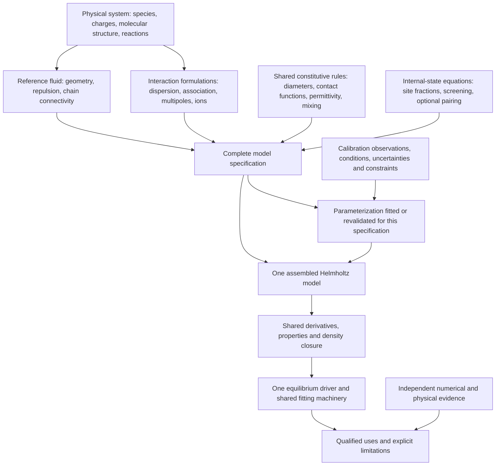

# Modular thermodynamic model specifications

Prepared 2026-09-10 against checkout `0ae7806`. This document set retains
the source synthesis and compatibility discussion. Execution and completion
are owned by [issue #23](https://github.com/tannerpolley/ePC-SAFT/issues/23)
and its leaf issues; accepted physics is owned by the ADRs below.

> The tool should let you select a coherent set of contributions, supply
> parameters fitted for that set, and reuse the same thermodynamic machinery.
> The selectable object is a complete model specification, with individual
> contribution choices inside it.

The intended experience is **select a formulation, select a compatible
parameterization, supply the state, and request properties**. A researcher can
inspect and alter the formulation explicitly. The tool explains the changed
parameter compatibility and evidence coverage. Convenience does not imply that
every combination of available contributions is a validated equation of state.

## Reading map

| Document | Question answered |
|---|---|
| [Physics and family map](physics-and-families.md) | Which molecular effects are modeled, how did the families develop, and which choices are alternatives? |
| [Illustrated family atlas](family-tree-guide.md) | A five-page TikZ PDF expanding the tree with 56 primary publication records and a clickable DOI index. |
| [Model specification and compatibility](model-specification.md) | What exactly is selected, how are parameters tied to it, and how is double counting assessed? |
| [Derivatives and qualification](derivatives-and-evidence.md) | What can shared machinery automate, and what numerical and physical evidence remains necessary? |
| [Electrolyte paper comparison](electrolyte-comparison.md) | What do Yang, Bülow, Figiel, Rueben, Biazi and related papers actually contribute and establish? |
| [Program issue #23](https://github.com/tannerpolley/ePC-SAFT/issues/23) and leaves #25–#29 | How is this introduced, with concrete outputs and acceptance gates? (The issues own the plan.) |
| [Annotated references](references.md) | Which primary sources and exact locators support the discussion, and where does interpretation begin? |

Read the first three documents for the architecture, the comparison for the
scientific motivation, and the owning issues for execution. References use
stable DOI links and Zotero keys rather than machine-specific PDF paths.

## One model, several distinct responsibilities

Four questions remain separate:

1. Which physics, approximations and chemical description are selected?
2. Which parameters belong to that selection?
3. Are the selected equations evaluated and differentiated correctly?
4. Where do independent observations support useful predictions?

Answering one does not establish the others. In particular, automatic
differentiation does not establish experimental validity, and a good fit does
not uniquely identify a microscopic interaction mechanism.

## Relationship to current work

[Issue #23](https://github.com/tannerpolley/ePC-SAFT/issues/23) and its
leaf issues #25–#29 own the implementation plan and qualification gates.

Current equation definitions remain in [Engine equations](../../../../engine/docs/equations.md),
conventions in [full EOS](../../../../engine/docs/science/full-eos.md), and methods in
[algorithms](../../../../engine/docs/science/algorithms.md). Equations below explain
the proposal and source comparison. They are not competing Engine definitions.

[ADR 0003](../../adr/0003-explicit-parameter-inputs.md) already requires explicit
physics and forbids paper/application names from selecting runtime behavior.
[ADR 0011](../../adr/0011-optional-dipole-dipole-term.md) admits the optional
Gross–Vrabec dipole–dipole residual term with its own compatible parameters.
Other residual multipoles remain retired under
[ADR 0006](../../adr/0006-retire-residual-polar.md). Dipolar permittivity remains
a distinct input and equation; admission does not qualify arbitrary combinations.

The existing Engine remains one installed wheel with one thermodynamic
implementation and one equilibrium driver. Applications retain their chemistry,
parameter adoption and process models. No plugin framework, new installation,
runtime source import, or second solver hierarchy is needed to express this plan.

## Evidence status

This is a source synthesis and proposed design, not a new numerical comparison.
Published aggregate errors are explicitly distinguished from heldout prediction
and from this repository's bounded numerical evidence. The family map covers
the branches relevant to the discussion; it is not an exhaustive history of
every SAFT variant. Unsettled physical combinations remain research questions.
