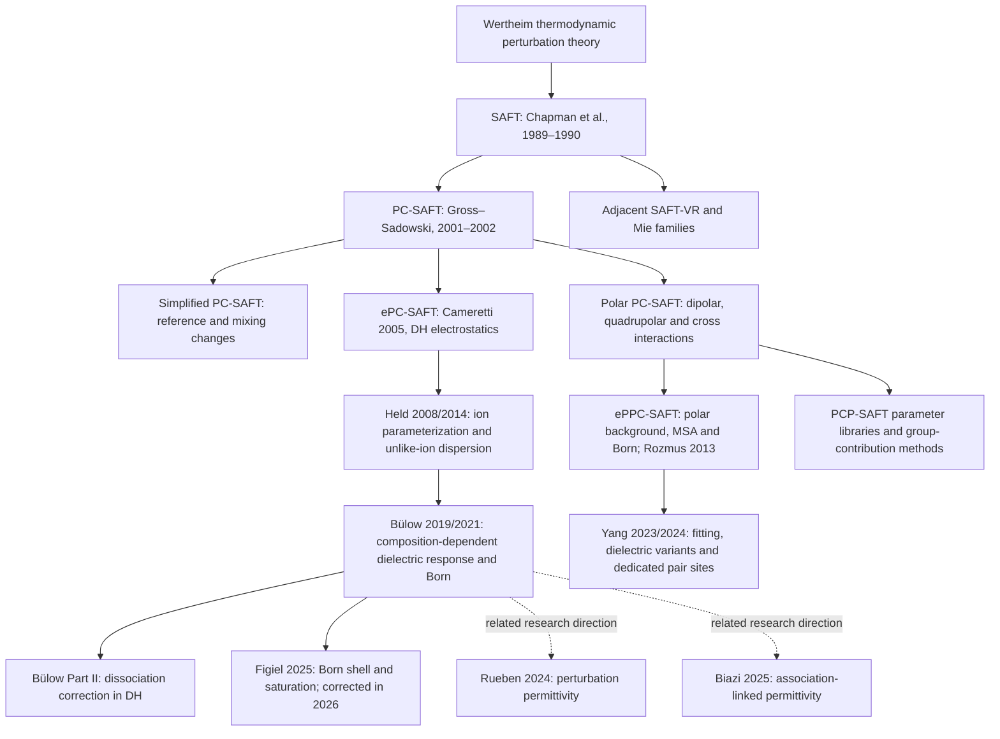

# Physics, contributions and model families

[Proposal overview](README.md) · [Specification](model-specification.md) · [References](references.md)

## Why additive contributions still require a coherent model

Molecular interactions motivate contributions, but contributions are
approximations within a statistical-mechanical model. They are not disjoint,
independently measurable boxes of energy. Even for an additive potential

$$
U=U_0+U_1+U_2,
$$

the canonical free-energy difference generally obeys

$$
A-A_0=-k_BT\ln\left\langle
\exp[-\beta(U_1+U_2)]\right\rangle_0
\ne \Delta A_1+\Delta A_2,
\qquad \beta=(k_BT)^{-1}.
$$

Here the average is over the reference ensemble, and each isolated
$\Delta A_i$ would be defined relative to that same reference. This is a
statistical-mechanical identity and explanatory derivation, not a new EOS.
Correlations create cross-effects; a cumulant expansion, for example, contains
the covariance of the perturbations. SAFT approximates these effects through
its reference fluid, perturbation expressions, association assumptions and
effective parameters. Modularity must preserve those relationships.

## Interaction-to-contribution map

| Physical effect or responsibility | Candidate descriptions | Compatibility implication |
|---|---|---|
| Excluded volume and molecular shape | Hard spheres, chain connectivity, original or simplified PC-SAFT reference treatment | Select a consistent reference package; hard-chain energy already includes its hard-sphere part. |
| Nonspecific attraction | PC-SAFT dispersion with compatible pair mixing rules | Effective dispersion parameters may absorb omitted polar or short-range ionic effects. |
| Hydrogen bonding | Wertheim association with explicit site types, multiplicities and edges | Topology, bond strength and cross-association rules are model assumptions. |
| Cross-association without self-association | Donor-only or acceptor-only sites; induced association | Absence of pure-component self-association does not imply absence of mixture association. |
| Permanent multipoles | Dipole–dipole, quadrupole–quadrupole and dipole–quadrupole terms | Distinct interactions can coexist; alternative formulations of the same interaction are not automatically additive. |
| Long-range ion correlations | Debye–Hückel (DH), mean spherical approximation (MSA), other electrolyte theories | Normally alternative descriptions of the same responsibility. |
| Ion solvation | Direct Born, shell-only Born, shell plus dielectric saturation | Alternative formulations with different parameter interpretation and shared dielectric inputs. |
| Short-range ion–solvent structure | Effective dispersion, explicit association, a declared solvation model | Coexistence is possible in a derived and jointly calibrated model; overlap needs examination. |
| Ion pairing | Dedicated Wertheim sites, Bjerrum association, explicit chemical species | Choose a coherent representation and define its coupling to screening and balances. |
| Dielectric response | Empirical mixing/decrement, density–temperature correlation, perturbation or association-based response | A shared constitutive relation, not necessarily an additional Helmholtz term. |
| Chemical reactions | Species balances, standard chemical potentials and reaction equilibrium | Part of the chemical/equilibrium description, not another residual attraction term. |

Kleiner–Sadowski explicitly treats compounds that do not self-associate but can
hydrogen-bond with water or alcohols. A blanket rule that removes their mixture
sites would remove the intended physics. [Kleiner2007](references.md#kleiner2007)

An ionic compound also has no universal association status. Figiel's bounded
parameterization gives its ions no sites; Yang's gives ions solvation and
pairing sites. The difference is a selected model, not a property implied by
the word “ion.” [Figiel2025](references.md#figiel2025), [YangPair2024](references.md#yangpair2024)

## Branching development

Arrows summarize conceptual connections, not exact inheritance of every
equation, parameter or software implementation. A newer paper does not
supersede all earlier branches. “Polar PC-SAFT,” “PCP-SAFT” and “ePPC-SAFT” are
insufficient identities without their precise equations and parameterization.

| Development | What changes | Design consequence |
|---|---|---|
| Wertheim/Chapman | Association and chain formation within perturbation theory | Reuse the general site mathematics where its assumptions hold. |
| Gross–Sadowski 2001/2002 | Hard-chain reference, dispersion and associating-system treatment | Reference/contact/dispersion choices form a consistent package. |
| Simplified PC-SAFT | Reference and mixing approximations | A formulation alternative, not a correction term to add to original PC-SAFT. |
| Gross 2005; Gross–Vrabec 2006; dipole–quadrupole work | Explicit multipolar perturbations | Select which interactions are present and identify missing cross terms. |
| Cameretti 2005; Held 2008 | Electrolyte extension and ion parameters | Retain full dissociation and dielectric assumptions with the parameters. |
| Held 2014 | Revised short-range ionic allocation, including cation–anion dispersion | Added ionic association may overlap with already fitted effective attraction. |
| Rozmus 2013 and Yang | Polar/electrolyte combined model with MSA and Born | A separate full formulation from Figiel's DH branch. |
| Bülow 2019/2021 | Dielectric concentration dependence, Born and optional dissociation correction | The derivation stage and derivatives of shared inputs matter. |
| Figiel 2025/2026 | Solvation-shell and saturation treatment with corrected Born expression | Use the corrected equation and keep fitted size/shell parameters attached. |
| Rueben/Biazi | Different constitutive models for dielectric response | Numerical admission and experimental qualification are separate steps. |
| Esper 2023 and group-contribution approaches | Parameter estimation or construction | Parameter-generation methods are not new intermolecular forces. |
| Lafitte 2013 SAFT-VR Mie | Variable-range potential and its reference/perturbation expressions | An adjacent EOS core, not a Mie attraction to append to PC-SAFT dispersion. |

The corresponding primary sources and reading locators are in the
[reference catalog](references.md). The history motivates selectable complete
formulations; it does not establish arbitrary cross-family compatibility.

## Prioritize by a measured deficiency

| Need | Candidate direction | Evidence needed before adoption |
|---|---|---|
| Better temperature behavior | Temperature-dependent solvent properties and interactions; full derivative chains | MIAC and density across temperature, plus caloric observations where available. |
| Better density/pressure behavior | Correct the neutral solvent first; consider density-dependent permittivity | Density increments, compressibility, pressure closure and mixed derivatives. |
| Better solvent-composition transfer | Compatible dielectric mixing and ion–solvent interactions constrained by transfer/solvation | Pure-solvent endpoints and independent mixed-solvent predictions. |
| Specific hydration effects | Association-linked dielectric response | Joint MIAC, density and dielectric agreement. |
| Ion-pair behavior | Dedicated pair sites or another coherently derived treatment | Pairing-sensitive evidence as well as bulk thermodynamics outside the fitting set. |
| Polar organic solvents or gases | Selected dipole, quadrupole and cross-association formulations | Revalidated pure and mixture properties with compatible parameters. |

Improved numerical derivatives cannot repair a physically inadequate model.
Conversely, a new physical term cannot repair a broken derivative or density
branch calculation. Diagnose the actual deficiency before expanding the model.
