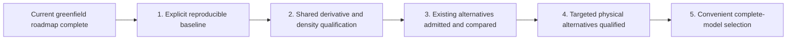

# Five-step roadmap after greenfield completion

[Overview](README.md) · [Specification](model-specification.md) · [Evidence requirements](derivatives-and-evidence.md)

**State: deferred proposal; implementation not started.** All five steps below
belong to a future program. None is inserted into current milestone accounting,
the active execution queue, estimates or generated progress. Completion of this
document set is documentation delivery, not completion of any future step.

## Entry condition and execution discipline

Finish the [current greenfield roadmap](../../implementation-plan.md), including
its required application acceptance, before activating this program. At that
point, inspect the actual delivered code, source corrections and numerical
evidence. Use this proposal as the starting rationale rather than assuming its
2026-09-10 availability inventory is still current.

Create a bounded issue for the first selected scientific slice, with its
equations, physical inputs, domain, independent falsifiers, justified tolerances,
outputs and code budget. Complete the applicable CSE design review before
implementation. Consequential mathematics, solver and derivative work requires
independent scientific and execution review. This proposal is not that future
Ready disposition; implementation readiness is intentionally unassessed.

Preserve one installed non-editable Engine wheel, explicit parameter inputs,
one thermodynamic owner and one equilibrium driver. Use the existing Data and
Analyses owners. Promote results into qualification only after evidence and
review; a build, selector inventory or readiness check does not qualify science.

## Step 1 — Make the delivered baseline explicit and reproducible

**Question.** Can the delivered Figiel calculation be completely specified and
reproduced without relying on a paper name, hidden default or source checkout?

**Work.** Capture its exact corrected equations, reference and dispersion rules,
solvent/ion topology, separate diameter meanings, Born/shell/dielectric choices,
state-dependent coefficients, units, reference conventions and parameter
sources. Attach the selected specification to the existing parameter and
provenance records, with fixed versus fitted roles and calibration conditions.
Reconcile other already supported complete formulations only as needed to
avoid encoding Figiel-specific runtime behavior.

**Outputs.** A complete baseline specification; a compatible identified
parameterization; a mapping to existing admission, Contributions and data
owners; and a bounded reproduction of the delivered baseline's retained values
and derivative claims. Publish tolerances and source uncertainties before runs.
Do not duplicate published parameter tables into another catalog.

**Acceptance.** Explicitly selecting the baseline preserves its numerical
results within the agreed numerical tolerances on the same states and branches.
An independent reader can identify the exact equations, parameters, reference
states and evidence. Missing source information remains visible rather than
being filled by an inferred coefficient.

**Limits and handoff.** This establishes reproducibility, not expanded empirical
validity. Step 2 inherits the exact baseline and its remaining derivative/domain
limitations. No new physical contribution is needed for this step.

## Step 2 — Finish shared derivative and density qualification

**Question.** Does the assembled model retain every internal-state, dielectric,
temperature, density, composition and active-parameter dependency in the state
and equilibrium quantities actually requested?

**Work.** Reuse valid qualification from completed greenfield work. Close only
remaining gaps relevant to modular selection, beginning with pressure-closed
derivatives and coupled state dependencies. Preserve the selected density
branch and distinguish a poorly conditioned root from wrong mathematics.
Extend association evidence to any newly consumed physical topology rather
than extrapolating the synthetic neutral campaign.

First inspect pure-solvent density behavior at the intended temperatures and
pressures. Separate that baseline error from salt-induced density increments
before interpreting the difference as missing ionic physics. Use the complete
Helmholtz derivative chain for reference conversions and observable construction.

**Outputs.** Numerical falsifiers for the affected derivative actions and
limits; pressure-closure and branch evidence; a property/domain/order matrix;
and a diagnosis of any neutral-solvent density limitation. Retain homogeneous
numerical rows once in CSV/TSV with compact provenance and failure metadata.

**Acceptance.** Independent values, derivative identities and directional
checks support the claimed orders on the declared regular branches, including
state-dependent shared inputs and active parameters. Requested pressure-closed
observables meet their justified tolerances. Higher-order or boundary failures
remain explicit; unqualified derivatives do not become implied by a selector.

**Limits and handoff.** Exact derivatives of a model do not prove its physical
accuracy. Step 3 receives reusable numerical machinery and a trustworthy
baseline for comparing existing alternatives. A negative density result can
define the next scientific question without forcing a new ionic term.

## Step 3 — Expose existing alternatives before adding new formulas

**Question.** Which already specified/native dielectric alternatives can be
admitted coherently and compared using the same observations?

**Work.** Reinspect public admission and native availability at activation.
At the current snapshot, native permittivity forms include ion suppression,
component mixing, density–temperature correlation and dipolar perturbation;
the latter two are specified but rejected by public builders. Public labels
for ion-fraction, ion-specific and solvent-only suppression already reduce to
a shared native equation. Preserve this reuse rather than multiplying formulas.

Admit only the smallest justified missing form, including its full parameter
records and derivatives. Build complete comparison specifications. Retain a
fixed-parameter sensitivity diagnostic separately from revalidated/refitted
variants. Compare on common MIAC, density, dielectric and appropriate
solvation/transfer observations with explicit calibration/validation partitions.

**Outputs.** Explicit complete selections for the bounded alternatives;
public-input-to-native coverage; parameter compatibility records; and one
common-data comparison with property-resolved errors, uncertainty, failures and
limits. Existing native code is an implementation asset, not evidence of broad
scientific qualification.

**Acceptance.** Each selected form has complete admitted inputs, correct units
and derivative dependencies, source/limit checks and independently assessed
experimental behavior. Qualify only the supported property/domain combinations.
An alternative may remain a numerically qualified research choice if physical
validation is inconclusive; do not market it as a validated replacement.

**Limits and handoff.** The comparison identifies a concrete deficiency and
whether an existing formulation addresses it. Step 4 begins only with a
specific physical question supported by this assessment, not a desire to fill
every menu slot.

## Step 4 — Introduce targeted physical alternatives

**Question.** Does a particular new physical description improve the observed
deficiency jointly across the important observables?

**Candidate slices.** These are alternatives to prioritize, not a commitment
to implement all of them.

| Candidate | Main motivation | Decision that must be resolved first |
|---|---|---|
| Yang-style dedicated solvation/pair sites | NaCl temperature curvature and finite-concentration bonding | Complete hybrid versus full ePPC-SAFT reproduction; pairing-to-screening feedback and parameter refit. |
| Biazi-style association/permittivity coupling | Hydration-sensitive dielectric response over wider aqueous conditions | Association partition, coupled internal state, chosen dielectric equation and joint fit. |
| Selected residual multipoles | Polar solvents/gases with an identified deficiency | Exact dipole/quadrupole/cross formulation, compatible base parameters and a reviewed revision of ADR 0006. |
| Alternative electrostatics or pairing | A deficiency not resolved by the preceding choices | DH versus MSA or Bjerrum derivation, overlap, domain, chemical representation and derivative requirements. |

**Work.** For each chosen slice, settle source equations and assumptions first.
Reuse the existing association mathematics when changing site topology. Treat
full Yang reproduction as its full reference/polar/MSA/Born/NAHS/parameter
specification, not as merely adding pair sites. Revalidate or refit every
affected parameter, including shared effective base parameters when needed.

**Outputs.** One complete candidate specification and identified parameterization;
reviewed mathematical and physical compatibility rationale; independent
numerical qualification; and a comparison against the preserved baseline on
common fitting and heldout data. Document missing pairing-sensitive observations
or unidentifiable parameters instead of deriving microscopic certainty from MIAC.

**Acceptance.** The candidate meets its numerical claims and improves the
predeclared target without unacceptable regressions in the other required
observables. The study defines those tradeoffs and tolerances before fitting.
Evidence supports only its stated species, solvent, concentration, temperature,
pressure and derivative domains. An unsuccessful candidate is a useful retained
negative result and need not become a supported default.

**Limits and handoff.** Monovalent salt success is not automatic multivalent,
amine or extraction acceptance. Adjacent Mie families and broad chemical scope
need their own justification; they are not prerequisites for completing this
roadmap. Step 5 receives explicit selections with honest compatibility and
evidence records.

## Step 5 — Make selection easy once compatibility is visible

**Question.** Can a user choose and deliberately modify a complete model while
understanding parameter compatibility and which claims remain supported?

**Work.** Use the existing input builder and data materialization route. Offer
convenient complete starting selections, show their contributions and shared
rules, and match compatible parameterizations. A paper name may be a display
label; expansion produces explicit equations and physical inputs. Deliberate
research variants remain expressible with new model identity and clear inherited
evidence limits. Do not silently substitute a different contribution or coefficient.

**Outputs.** A minimal selection path and worked examples for an unchanged
baseline, a supported alternative and a deliberate research variant. Show
selected formulation, parameterization, state, requested observable, numerical
diagnostics and relevant validation scope. Keep detailed provenance accessible
without forcing scientific implementation details into every user interaction.

**Acceptance.** Each example expands into the same explicit inputs used by its
qualified numerical calculation. An unchanged selection reproduces its baseline;
a deliberate change identifies affected parameters and claims. Missing required
mathematical input produces a precise diagnostic. Exploration outside empirical
fit ranges remains possible under current policy, with applicability information
retained in the data/analysis layer.

The same state, property, equilibrium and fitting machinery is reused. No
paper-name dispatch, hidden runtime catalog or separate equilibrium solver is
introduced. Selection convenience is accepted only after its underlying
scientific capabilities are established.

## Sequence and completion boundary

The future program is complete when its selected bounded scope has explicit
model/parameter identities, applicable numerical and physical evidence, reviewed
limitations and a usable selection path. It does not require every literature
variant or every molecular fluid. At each activation or handoff, record actual
status and evidence in the then-authoritative future execution plan; until then,
this proposal remains separate from the current plan.

## Decisions deliberately reserved for activation

| Decision | Evidence that should settle it |
|---|---|
| Exact specification fields and versioning | Delivered parameter schema and the first bounded alternative's consumed inputs. |
| First physical addition | Common-data deficiency remaining after steps 2–3. |
| Which coefficients remain fixed in a variant | Source meaning, sensitivity/identifiability and validation, not convenience. |
| Validation data and tolerances | Available independent observations, source uncertainty and intended use. |
| Pairing feedback and chemical representation | A coherent derivation with complete derivative and reference conventions. |
| Residual polar scope | Concrete use, selected equations and reviewed ADR decision at step 4. |
| Effort and code budget | Fresh inspection of completed greenfield code and the selected scientific slice. |

These are future design choices, not questions blocking the requested
documentation. No implementation permission or numerical readiness is inferred
from retaining this roadmap.
