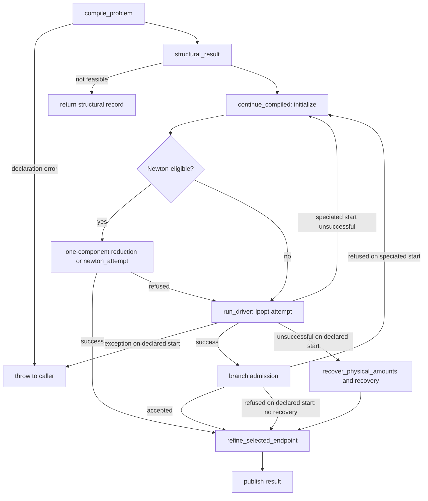

# Scientific algorithms

These methods consume the [equation definitions](../equations.md),
[EOS conventions](full-eos.md) and [equilibrium formulation](../equilibrium/formulation.md).
Algorithm IDs below are stable references.
Sections state required methods; not every required action is available yet.
The [limits page](https://tannerpolley.github.io/epcsaft/limits.html) lists what the installed package supports.
PH/PS uses the caloric specifications below, including charged and source-referenced
reacting declarations through the anchored completion of ALG-REFERENCE; neutral critical-equation
candidates and phase envelopes use ALG-EQUILIBRIUM; UV remains future work. The
explicit native fixed-T/P discovery and tangent-plane testing path in
ALG-STABILITY has retained numerical qualification on the stated neutral and
admitted ionic/reacting cases, within the retained limits.
Declared-branch continuation and mechanical/local checks remain required.

See [ideal mole-fraction and molarity specifications](#ideal-mole-fraction-and-molarity-specifications)
for the ideal-liquid specialization.

## ALG-ADMISSION

Inputs are ordered components, explicit charges, source-backed coefficients,
units, fixed topology, source domains, state/specification and requested actions.

```text
resolve only selected components, pairs and sites
check required records, units, topology and mathematical domain
check physical charge/balance constraints for ordinary states
intersect known source applicability domains; retain unknown applicability
label requested extrapolation separately from physical validation
reject missing physical inputs; never substitute a coefficient or charge default
```

Unconstrained composition differentiation uses an explicitly declared extension
of the energy. It does not authorize charged physical states. Parameters fixed
by the request have zero derivatives; dependent combining-rule outputs carry
the chain from independent coefficients. Discrete topology is not fitted.

## ALG-VIRIAL

For a neutral declaration, evaluate `neutral_virial_coefficients` directly
with the shared residual contribution equations and `Taylor<2, double>`
in molar density, seeded with coefficients (0,1,0). Temperature, composition
and evaluated thermal parameters stay fixed. Return the linear coefficient
as B and twice the quadratic coefficient as C. No finite density, pressure
root, or numerical differentiation is used.

At the exact zero-center Taylor endpoint, shared density-independent
composition moments cancel the removable hard-sphere singularity. Positive-
density evaluation retains its existing arithmetic and operation order. The internal Taylor packing check admits its zero
center; ordinary homogeneous states still require strictly positive density.
At that endpoint for the selected polar family, factor a2=r U and a3=r² V before evaluating
r U²/(U-r V). Decide absent polar support independently of density. A zero
pair coefficient on active support with unresolved Padé limit is a named
numerical refusal, never a fabricated zero coefficient.

Association starts at the exact vacuum solution X=1. At each order k=1,2,
evaluate the existing mass-action rows with the unknown order-k coefficients
zero, then set all site coefficients to minus those row coefficients.
The central site Jacobian is exactly the identity. Replay the completed
site series through the shared association Helmholtz expression. There is
no additional nonlinear solve or tolerance. The finite-density stationary
association and its error estimates retain their existing owners.

Reject any declaration containing a nonzero species charge, even if that
species has zero composition. Validate temperature, normalized nonnegative
composition, evaluated geometry and association strengths, and retain named
nonfinite coefficient failures. Outputs are B (m³/mol) and C (m⁶/mol²).

The same series, with every coefficient and the temperature and mole fractions
carrying one further forward-mode layer along a direction (dT, dx), returns the
exact directional derivatives dB and dC. The composition direction sums to
zero, so total amount stays fixed; dT = 1 gives d/dT, and a unit pair
e_i − e_j gives ∂/∂x_i − ∂/∂x_j. The value arithmetic is that of the request
without a direction, so B and C are unchanged.

## ALG-CALORICS

Evaluate one explicitly selected source correlation on its declared domain.
Use its own integration constants and pressure standard; do not infer a common
anchor, source interval or continuity at a join. For piecewise inputs, require
adjacent intervals to meet at one explicitly owned endpoint, reject overlaps and
gaps, and return the owned branch value with cross-join derivatives unavailable
when the branch is discontinuous. Differentiate smooth correlations on the same
selected interval; reselect the source interval when a temperature leaves it. Missing
thermal inputs make only consumers of those inputs unavailable.

Ideal and Total calorics consume one component interval vector in installed EOS
component order and one explicit $P_0$. Ideal $h,u,s,c_p,c_v$ follow their
registered equations; Total values add the existing residual fields at the same
state. Missing thermal input leaves residual outputs intact and makes only Ideal
and Total consumers unavailable. An owned endpoint has a value, but a derivative
that would cross an undeclared join is unavailable. No total value falls back to
its residual part.

For the centered polynomial, evaluate $C_p=\sum_k a_k(T-T_{ref})^k$ and anchor
$h$ and $s$ at the supplied $T_{ref}$. The constant term uses the exact
$a_0\log(T/T_{ref})$ identity. No insertion derivative at a zero composition
amount is promised.

For each nonzero degree $k\geq1$, let $\Delta=T-T_{ref}$ and
$u=\Delta/T_{ref}$. Accumulate the entropy contribution as
$a_k|\Delta|^k$ times a dimensionless moment, multiplying the coefficient
before each power. This avoids the artificial overflow of $T_{ref}^k$ or
$|\Delta|^k$ before a small coefficient is applied. It does not cure an
ill-conditioned sum of distinct polynomial terms or a genuinely unrepresentable
result. The constant logarithm uses `log1p(u)` near the anchor and a difference
of positive logarithms away from it, avoiding overflow/underflow of $T/T_{ref}$.

For $0\leq u<1$, use
\[
\frac{I_k(u)}{u^k}=\frac{u}{1+u}\sum_{j\geq0}t_j,\qquad
 t_0=\frac1{k+1},\qquad
 \frac{t_{j+1}}{t_j}=\frac{u}{1+u}\frac{j+1}{k+j+2},\qquad
 I_k(u)=\int_0^u\frac{z^k}{1+z}\,dz.
\]
The ratio is at most $1/2$. With $b$ binary significand digits, retain the
initial term and $b+2$ updates; the relative geometric tail is below $2^{-b-2}$.
For $u\geq1$, use $J_0=\log(1+u)$ and
$J_p=1/p-J_{p-1}/u$ through $p=k$. Its error multiplier $1/u\leq1$
avoids the unstable near-anchor forward recurrence. Form $1/u=T_{ref}/\Delta$
and the initial logarithm from positive temperatures so an overflowing ratio
need not be formed in this branch.

For $u<0$, write $v=-u$ and $c_k=\exp(-1/k)$. Below $c_k$, use
\[
\frac{I_k(-v)}{v^k}=(-1)^{k+1}v
 \sum_{j=0}^{N-1}\frac{v^j}{k+j+1},\qquad
 N=(b+2+\lceil3\log_2(k+1)\rceil)(k+1).
\]
Evaluate this positive series by backward Horner summation. The omitted sum
is bounded by $v^N/[(k+N+1)(1-v)]$; since $v\leq\exp(-1/k)$,
$v^N\leq\exp(-N/k)$. Differentiating the positive-term geometric majorant
bounds differentiated tails as well; the degree-dependent margin suppresses
these through the third order tested here. Floating-point rounding remains
separate from this truncation estimate.

At and above $c_k$, use the finite logarithmic tail
\[
\frac{I_k(-v)}{v^k}=(-1)^{k+1}
 \frac{-\log(T/T_{ref})-\sum_{p=1}^k v^p/p}{v^k}.
\]
Here $v^k\geq e^{-1}$ and the numerator is at least $e^{-2}/2$, as seen
by retaining terms $p=k+1,\ldots,2k$ in the logarithmic remainder. Thus neither
the normalization nor a vanishing remainder amplifies roundoff as in a
fixed crossover independent of degree. Use the positive-temperature logarithm
even when subtraction rounds $v$ to one. Finite-precision summation error still
depends on degree and conditioning; the evidence qualifies its recorded cases.

Source coefficients, degree and interval ownership are immutable during a tape's
lifetime. Every temperature-dependent representation choice uses scalar
conditional expressions with finite clamped arguments in its inactive branches.
No recording-time value extraction or temperature-dependent loop count is used.
The same tape replays on its selected smooth source interval, including across
these arithmetic representation changes and the reference. Selecting another
physical source interval remains a separate admission operation.

## ALG-PARAMETERS

Packet loading reads bounds from `packet.toml` domains when present, otherwise
from the parameter document. Each packet's bounded solutes are intersected with
its materialization component selection, then mapped into the final model.
Native Surface admission converts pressure bounds to pascal.
`Mixture.outside_domains(x, T=..., P=...)` compares declared bounds using the
supplied temperature and pressure, `molality_activity_conversion`,
`molality_ionic_strength` and the all-ion sum in `ion_suppressed_bulk_permittivity`.
It skips absent solvent/solute comparisons. The same check runs after the
calculation on the returned states. Directly constructed and fitted parameters
carry no packet bounds.

The solvent membership and normalization for `solvent-mole-weighting` are
fixed parameter entries, retained through selection, reordering, fitting-worker
transport and optimizer identity. `bulk_relative_permittivity` owns the sum or
quotient; it reuses the existing component laws and automatic differentiation.


`BornDiameter`, `DebyeHuckelDiameter` and `PackingDiameter` own positive
Angstrom values in charged component slots. `IonSuppressionCoefficient` owns
one dimensionless charged-slot value; a common C ties all declared charged
slots in the existing affine chart. `DielectricVolume` (m^3/mol) and
`DielectricTemperature` (K) own one neutral-component slot each and are admitted
only under the density-temperature permittivity (EqID:
`density_correlated_bulk_permittivity`); an L/mol coordinate takes target
coefficient 1e-3. Their values use `ParameterRecord<Scalar>`
with the other active families. Charges, masses, formulation choices and Born
correction/solvation factors remain fixed. No cross-family factor tie is added.

Resolve source values into documented native units before constructing active
coordinates. Native units are dimensionless for segment count, `k_ij`, `l_ij`,
and association volume; Angstrom for sigma; and Kelvin for dispersion and
association energy-over-k. An active scalar owns one native slot for a scalar
family, both reciprocal row-major off-diagonal slots for an unordered
unlike-component `k_ij` or `l_ij` pair, or the corresponding association
site-pair slots. A distinct association site pair owns both reciprocal slots;
a same-site association pair may own its one diagonal slot when active.
Component diagonal interaction slots remain fixed. The coordinate is linear in
every owned slot, with unit derivative; no implicit log or normalization is
applied.

For `p_native = s_p p_source`, apply
`dF/dp_source = s_p dF/dp_native` and
`d2F/(dp_source dq_source) = s_p s_q
d2F/(dp_native dq_native)`. Active pair derivatives sum the two raw
reciprocal-slot derivatives. The pure packing coefficient has no `k_ij` or
`l_ij` dependency under `packing_coefficient_parameter_derivative`; their
energy and cross-diameter dependencies remain on the common Helmholtz tape.

At native State publication, mandatory contribution, residual caloric,
mechanical, solved-site and available chemical-potential values must be finite.
Declared bulk permittivity must also be finite. A failed central energy or
mandatory value throws a named calculation refusal with temperature and molar
density, including when derived properties were not requested. Earlier numerical
causes remain intact. Present optional values are finite; a computed nonfinite
optional is absent with an indexed `Nonfinite` reason in `unavailable_properties`.
Native pressure-closed parameter columns contain optional entries in unchanged
active-parameter order. Missing prerequisites propagate their original causes
into dependent columns and sample/reference fitting actions; an unavailable
fitting action rejects the observation before Jacobian consumption. Existing
thermochemistry and component admission reasons retain their meanings.

## ALG-ASSOCIATION

Optional `trace(diagnostics=True)` observes existing mass-action iterations as
`association_iteration`: residual infinity norm, accepted Newton damping (zero
for non-Newton updates), pivot ratio (NaN without Newton), and Newton selection.
Its reason retains the analytic start, Newton cause or `Newton`; terminal convergence remains
on the span alone. `association_derivative_failure` observes the existing LU
at derivative admission: site count, rank, largest/smallest absolute pivots and
pivot ratio, with the singular or ill-conditioned cause. It performs no second
factorization.

The shared model retains at most two most-recently-used thermodynamic recordings,
keyed by composition support, electrolyte predicates, selected thermal intervals
and residual/ideal output availability. Parameters and thermal source data remain
immutable within that model. Switching recordings never reuses a numerical state:
each caller refreshes the point, site fractions, Taylor coefficients and required
site factorization under the existing model lock. A miss records the shared EOS
before replacing the older entry. This bounded reuse avoids rebuilding on every
aqueous/organic phase switch; it does not change the association solve below.

Use EqID: `association_mass_action`, EqID: `association_helmholtz` and the
implicit mass-action identities in full EOS §5. Declare initialization and
iteration budget; use Newton's method on the admitted site domain, with
step control that keeps site fractions in (0,1]. Accept only a finite residual
meeting the declared criterion. Return nonconvergence, domain escape or a
singular defining Jacobian explicitly; the last iterate is not success.

When the declared mask contains one reciprocal off-diagonal edge $A$–$B$,
let $q=\widehat\rho x_{i(B)}\nu_B\Delta_{AB}$ and
$r=\widehat\rho x_{i(A)}\nu_A\Delta_{BA}$. Relabel the sites so $q\ge r$.
Eliminating $X_B$ gives $rX_A^2+(1+q-r)X_A-1=0$. With $c=1+(q-r)$, the
positive root is $X_A=2/(c+\operatorname{hypot}(c,2\sqrt r))$ and
$X_B=1/(1+rX_A)$. Other sites have $X=1$. This is the two-population reduction
of Chapman1990 Eqs. (15) and (22), with the symmetric 2 (1:1) root in
[Avlund 2011, §2.2](https://orbit.dtu.dk/files/5455364/978-87-92481-35-1_Ane_S_gaard_Avlund_Onefile.pdf).
Admit the rounded root at the existing site domain and residual criterion.
If it fails either check, continue from the original Newton start. The
implicit derivative equations use the admitted root.

For a general Newton correction, let $J=F_X$ and $D=\operatorname{diag}(X)$.
For nonnegative couplings, $D^{-1}JD$ is strictly row diagonally dominant
with margin at least one. Hence $\|J^{-1}\|_\infty\le1/\min X$ on the site
domain. A full-pivot Schur complement has its inverse in a submatrix of the
permuted $J^{-1}$, which bounds its largest entry below by $\min X/n$ for
$n$ sites. Growth bounds the largest full pivot above by
$2^{n-1}\max_{ab}|J_{ab}|$. Try partial pivoting when the ratio of these
bounds clears twice the existing relative pivot cutoff. This skips the
column pivot search for well-scaled Newton systems. Full pivoting on the
original matrix handles other systems, refused partial pivots, and
nonfinite partial corrections. It also retries a partial correction that
would block the step at a site fraction of one. Endpoint derivatives retain their full-pivot
admission and diagnostics.
After a floor-limited solve, retry once with full pivoting from the original
site fractions. The retry uses the same residual target and iteration budget.

For the energy evaluation, use the shared bonded products
$q_A=\widehat\rho\sum_B x_{i(B)}\nu_B X_B\Delta_{AB}$ and
$F_A=X_A(1+q_A)-1$. The published association contribution is the
stationary potential
$$
L=\sum_A x_{i(A)}\nu_A\left[-\log1p(q_A)+\frac{X_Aq_A}{2}
+\log1p(F_A)-F_A\right].
$$
It equals the documented association energy on the mass-action root and
its stationary extension off the root. The old raw expression differs by
$\sum_A x_{i(A)}\nu_A F_A/2$ at an achieved finite residual. Keep the
$\log1p(F_A)-F_A$ term for the site Hessian and error estimates; no second
stationary correction is applied. The same scalar expression supplies double,
automatic differentiation and Taylor evaluation, without recovering a bonded
fraction by subtracting a rounded site fraction from one.

For the first update, form $q_a=\sum_b K_{ab}$ at $X=1$, with
$K_{ab}=\widehat\rho x_{i(b)}\nu_b\Delta_{ab}$. Keep that start when
$\max q_a\le1/\texttt{ASSOCIATION_JACOBIAN_CONDITION}=10^{13}$.
Above this scale, let $r_a$ be the common computed $q_b$ of all partners with
$K_{ab}>0$, if they are exactly equal; otherwise use $r_a=q_a$ (also for an
empty row). With $c=1+(q_a-r_a)$ and $d=\operatorname{hypot}(c,2\sqrt{r_a})$,
the initial estimate is $2/(c+d)$ for $c\ge0$ and $(d-c)/(2r_a)$ otherwise.
This is the positive root of the two-population mass-action reduction;
it is an estimate for a heterogeneous graph. A finite estimate in $(0,1]$
replaces the first update and consumes one of the existing fifty iterations.
An inadmissible estimate is discarded and the original first Newton/substitution
step runs from $X=1$, without clamping or an extra budget. Later iterations,
residual criterion and implicit derivative admission are unchanged. Detailed
capture names the admitted update `analytic association start`. The estimate
is outside the thermodynamic recording and is never differentiated.

```text
solve site mass-action values outside the reusable thermodynamic recording
form partials of the defining equations at the converged value
solve the implicit linear equations for each requested derivative action
include those derivatives in the common energy differentiation
verify derivative backward error and report conditioning
```

An equivalent stationary elimination is allowed only on its regular domain
and must reproduce those identities. A weighted association Hessian may lose
rank at zero species amount although the unweighted mass-action Jacobian does
not. Do not add composition floors to hide this defect. AD dynamic parameters
supply updated values, not automatically derivatives with respect to themselves;
association values and independent physical coefficients require their actual
implicit/explicit chains.

Phase Hessian orders differentiate only V, the positive amounts and T when it is
free (`PhaseHessian`; `IsothermalPhaseHessian` omits T). Fixed controls, absent
species and active parameters stay in the physical array layout as uncomputed
padding, not physical zero derivatives; full `Hessian` requests keep every
coordinate. Site partials of the requested columns use the smaller of forward
coordinate sweeps and reverse site-output sweeps, never the full tape Jacobian;
one unweighted factorization and its multiplier solve supply the implicit
gradient and Hessian, and each Hessian entry contracts the row coordinate's
site tangent in O(sites). The association gradient floor is the maximum over
the requested columns only, so it bounds exactly the gradient entries computed.

Optimize each recorded Helmholtz tape once with
`optimize("no_cumulative_sum_op")` before evaluation. CppAD retains conditional
expressions and their selected branches while skipping unused branch work;
cumulative-sum operators are disabled. Atomic dependencies retain CppAD's
dependency rules; no user-defined atomic functions occur in this recording.
Optimization discards Taylor coefficients, so a new tape's first evaluation
recomputes order zero. See CppAD's [optimization documentation](https://cppad.readthedocs.io/stable-2025/optimize.html)
and [conditional expressions](https://cppad.readthedocs.io/stable-2025/CondExp.html#optimize).

Reuse order-zero Taylor coefficients only on the same tape at a byte-identical
full input, including site fractions and active parameters. A changed input
recomputes order zero; a replacement tape starts without cached coefficients.
Positive-order sweeps recompute the requested directions while preserving order
zero. This changes neither the implicit derivative equations nor their admission
criteria.

### Declared pathway blocks

A declared pathway block or symmetric reactive-site correction
(`pathway_weighted_association_helmholtz`) keeps the stationary summands above,
weighted by $\beta_A\in\{1,w,\bar w\}$, and removes $X_R\ell_R$ of each corrected
site $R$. The weighted blocks remain stationary, but the correction does not:
its site gradient is
$$
g_A=\frac{\partial (N a^{assoc})}{\partial X_A}=-\beta_A N x_{i(A)}\nu_A\frac{F_A}{X_A}+N h_A,
$$
where $h$ differentiates $-\beta_R X_R\ell_R$ with
$\partial\ell/\partial X|_q=x\nu(q/2-F/X)$ and $\partial\ell/\partial q=-x\nu X/2$,
exact off the root too. Each formula that assumes a stationary energy uses this
signed gradient and the coupled site defects instead, only when blocks are
declared; models without them keep the existing arithmetic bit for bit:

- Taylor density coefficients solve one more site order, because the order-$N$
  energy coefficient needs $X_N$.
- The density-coefficient floor is $\sum_A |g_{1,A}e_{0,A}|+|g_{0,A}e_{1,A}|$,
  with the coupled defects $J_0e_k=-r_k-\sum_{l\ge1}J_le_{k-l}$, in double and
  wider arithmetic alike.
- The exact-gradient floor of a requested column is
  $\sum_A|s_A e_{0,A}|+|\mu_A r_{1,A}|+\lVert J_0^{-T}s\rVert_1\,\phi$, with
  $J_0e_0=-r_0$, $\mu=J_0^{-T}g_0$, $s=g_1-J_1^T\mu$ read from the Lagrangian
  sweep, and $\phi$ the solve's achieved residual or its floor, whichever is
  larger, bounding each $r_0$ component. Amount columns of a state
  Hessian are swept for it, and the floor is the maximum over the swept columns.
- Coefficient error estimates keep the first coefficient's actual sensitivity to
  $X_0$, use no stationary substitution, and add the same allowance
  $\lVert J_0^{-T}\,\partial c_1/\partial X_0\rVert_1\,\phi$.
- Both are local first-order estimates with a worst-sign allowance for the
  achieved residual, not rigorous enclosures. In the checked case (state Z, a
  requested association tolerance of 0.1) the observed gradient error,
  1.3086e-3, is about 20% above the first-order estimate without the allowance,
  1.0920e-3. The complete estimate divided by the observed error is 8.53 for the
  gradient floor (1.1164e-2 / 1.3086e-3) and 8.58 for the coefficient estimate.
- The isothermal two-component Hessian shortcut is not used.
- Contribution-resolved fugacity terms add the implicit site chain, the complete
  residual gradient less the fixed-site terms, to the association term.

The weight $w$ is a CppAD conditional expression in $z$, so a tape stays valid
on both sides of $z=0$.

### Independent state arrays

A declared state array evaluates each row sequentially through the scalar
`state` or `state_at_pressure` owner. Scalar temperature/density/composition
admission and electroneutrality apply per row; pressure rows have no preceding
row anchor. The collection retains the complete State or a typed exception
category, unchanged cause and available convergence records for each row in
input order. Property columns gather stored values without evaluating again.

CppAD calling slots become reusable only after all thread-local destructors finish.
The bounded future registry retains its shared states for the process lifetime,
so an external AMPL host can unload the library before delayed thread-exit
notifications release their references. Model and tape storage still follows
same-thread destruction; this retention does not retain evaluated models.

A failed scalar state evaluation that touches the tapes discards its cached current
and previous replay tapes after local mutex guards unwind. Each recording site arms
its own abort guard only after `CppAD::Independent` succeeds and disarms when ADFun takes
ownership. Thus failure cleanup cannot abort an unrelated recording. Successful
rows retain the scalar tape reuse and derivative work. Association observation
scopes restore the previous owner on unwinding. Pressure-series thread-local
vectors are cleared before use, double site factorizations recomputed, and
coefficient buffers overwritten by their existing owner; no cross-row seed or
additional density search is introduced. Allocation and unrelated programming
errors propagate rather than becoming ordinary row refusals.

## ALG-DENSITY

A pressure-series preparation reuses the composition-moment owner for the
fixed-temperature/composition packing moments, mean segment count and dispersion pair moments,
and prepares the dispersion polynomial coefficients once. Every density still
passes packing-fraction admission. General differentiation charts evaluate the
same expressions in their original recording order, retaining their temperature,
composition and parameter dependencies.

Detailed capture emits `density_scan_input` (T/K, P/Pa, lower/upper density in
mol/m3, interval count), `density_scan_point` (density, reduced residual,
pressure slope, linked), and `density_scan_skip` (density, attempted node, zero
link) with the originating association cause. `density_scan_failure` retains a
terminating non-association cause. `anchor_failure` retains the offered density
and original exception; `anchor_cold_retry` also gives the reference rung.
These records observe the existing scan and retry decisions.

At each failed grid node, the shared cold/local scan keeps the attempted ordinal,
density in mol/m3 at seventeen significant digits, and the entire original cause.
It continues the declared grid only for a primal `ConvergenceFailure` whose
criterion is `ASSOCIATION_RESIDUAL`. Any other `std::exception` propagates
unchanged when no earlier interruption exists; after an interruption it is
appended and terminates the scan with the combined refusal. An interrupted
scan throws `density scan interrupted by association` before slope searches,
cell processing or branch selection. It returns neither density nor stable-root
count; capture-disabled calls retain every visited failed-node cause in the
exception. Unvisited nodes after a terminal exception are not claimed evaluated.
The same rule applies to the local anchor scan. Pressure actions and fitting
predictions retain the complete cause as density unavailable, and required
equilibrium initialization fails. Existing optional attempts can discard a
refused scan without certifying its roots. An uninterrupted finite scan keeps
its existing search meaning, not exhaustive root enumeration.

Inputs include T, composition, target pressure, admissible packing interval,
root-selection request, numerical policy and declared search budget.

State construction evaluates the full Helmholtz gradient and every row of the
T, V and active-parameter Hessian columns. Uncaptured and ordinary Core capture
omit unused composition columns. Diagnostic capture retains the complete Hessian
payload; only complete Hessian evaluations emit the `hessian` trace event.

For one neutral, nonassociating component with exactly unit mole fraction and
fixed parameters, State obtains
its residual gradient and Hessian from the shared volume-series owner. Three
scaled linear directions, T, V and T+V, give E, E_T, E_V, E_TT, E_TV and E_VV
by algebraically exact second-order polarization, subject to floating-point
rounding. Euler homogeneity supplies E_n=(E-V E_V)/n,
E_Tn=(E_T-V E_TV)/n, E_Vn=-V E_VV/n and E_nn=V² E_VV/n².
Temperature-dependent geometry and pair laws carry the Taylor temperature.
The existing State owner assembles all caloric and response quantities from
these entries. Mixtures, thermal association, ideal-only declarations and
active parameter columns retain the taped calculation; higher-order actions
retain their existing derivative owners. The thermal chart also retains the
tape when the shared hard-sphere zeta_2 cubed product is below the smallest
normal scalar value, or volume squared is unrepresentable; these arithmetic
limits preserve relative dilute caloric coefficients without a density cutoff.
Fixed-T pure requests use the same
Euler projection without computing thermal entries.

Density closure evaluates normalized Taylor coefficients of the shared residual
Helmholtz equations in volume at fixed temperature and composition. Order two
supplies pressure and slope; order three adds pressure curvature. Association
uses the primal mass-action solve and one checked Jacobian factorization for
its implicit coefficients. The stationary association potential eliminates the
highest site coefficient. Temperature and composition stay double in this
chart; tape calls retain their differentiated scalar dependencies. Gradient and
Hessian diagnostic requests still use the tape. Per-thread buffers hold scratch
only, with no model or request cache.

Every unanchored request checks the liquid side first, then locates the
vapor root when requested or when a sibling is needed; other liquid requests
check vapor existence. An explicit vapor request without an actual sibling
stops liquid location once a strict pressure bracket has positive slope and
positive curvature at both endpoints, retaining the deciding endpoint's fold
separation check and the same locating proposals. Under the assumed shape,
this convex bracket contains one stable crossing. The vapor bracket must lie
strictly below it. Only the vapor root is refined and published when both
sides exist; the unrefined liquid bracket is private existence evidence.
If vapor is absent, liquid location resumes fully before publishing its sole
root. Selected-liquid, unspecified and actual-sibling requests retain full
liquid location. Anchored requests retain their independent local search.
Retained evaluation counts
qualify reduced work; quiet-host timing remains open. Removing refinement
samples does not guarantee detection of every otherwise observable shape
contradiction or evaluation failure. Sampled curvature and slope order test consistency with
one interior minimum of the pressure slope. They do not prove this shape.
On a concave pressure interval, the pressure tangents bound pressure from above;
on a convex interval they bound it from below. Their envelope can exclude the
corresponding crossing only with the existing pressure separation. A negative
slope is a loop witness. A positive intersection of tangents to the slope cannot
exclude a negative dip. This unresolved exit, unresolved order comparisons,
degenerate or failed samples, and an exhausted structured-search budget hand the
request to the inherited scan. A resolved sampled contradiction instead abandons
the shape inference and inserts a finite local subdivision into that scan.
The original evaluation failure remains in the observation; the scan retains
its association-connectivity and failure rules.

For density-ordered samples $a,b$, let $r=RT$, $q=P_\rho$ and $c=P_{\rho\rho}$.
The single `DENSITY_STRUCTURE_ROUNDOFF` policy owns
$g=16\epsilon/(1-16\epsilon)$, using binary64 epsilon conservatively in place of
unit roundoff. At an existing order exit, compute

$$E_q=g(2r+|q|),\qquad E_c=g\left(|c|+\frac{4(r+|q|)}{\rho}\right).$$

A contradiction is resolved when $c_a>E_{c,a}$ and $c_b<-E_{c,b}$, or when both
curvatures have the same resolved sign and the existing density-spacing filter
applies: $q_b-q_a>E_{q,a}+E_{q,b}$ on the concave side, or
$q_a-q_b>E_{q,a}+E_{q,b}$ on the convex side. Equality, overlapping intervals,
unresolved curvature signs and arithmetic outside the finite normal range
remain recoverable at that same exit; structured inference does not continue.
The unchanged `DENSITY_SLOPE_SEPARATION` controls slope inspection, not resolution.

With $a_2=2\,\mathrm{energy.c[2]}$, $a_3=6\,\mathrm{energy.c[3]}$,
$u=a_2/\rho^2$, $v=a_3/\rho^4$ and $w=2a_2/\rho^3$, the existing conversion is
$q=r(1+u)$, $c=-r(v+w)$. Its cancellation-aware norms satisfy
$r(1+|u|)\le2r+|q|$ and
$r(|v|+|w|)\le|c|+2r|w|\le|c|+4(r+|q|)/\rho$.
The rounding-factor count reserves nine for conversion, five for replacing and
evaluating norms, and two for comparison. The arithmetic model and product
bound $\gamma_n=nu/(1-nu)$ follow
[Higham (1993), pp. 784–785, Eq. (1.2) and the bound preceding Eq. (2.3)](https://nhigham.com/wp-content/uploads/2023/10/high93s.pdf);
these norm inequalities and their application here are a derivation.
One `Sample` boolean is set from the
existing conversion intermediates only when all are finite and normal. Only
order-exit classification reads it; false keeps the recoverable scan fallback.
No coefficients are reconstructed and no additional pressure evaluation occurs.
The radii concern local assembly conditional on the returned Taylor
coefficients; they do not enclose complete EOS or implicit association error.

After a resolved contradiction, retain its density-ordered sample pair and all
already evaluated samples. Intersect that interval with the admitted cold domain
or the anchor's original local window. An empty intersection still abandons the
shape inference and scans the unchanged window. Otherwise start with
`DENSITY_BRACKET_INTERVALS` equal log-density cells, including the exact interval
ends and existing samples, then bisect each cell geometrically. Old nodes are
reused exactly. No enumeration cache, subdivision or pressure evaluation is
added before a resolved contradiction.

Evaluate all local mesh nodes before processing cells. Reuse the same scan-node
ownership, fold bisection and safeguarded Newton refinement. Local fold bisection
finishes the sampled slope transition, retaining its final endpoints and stable
side, rather than stopping after a pressure bracket. Retain signed pressure
crossings, signed slope transitions and exact-node owners in density order;
negative-slope pressure crossings are evidence only. A negative-slope cell that
rises through the target remains unresolved. Exact positive-slope node roots and
strict upward crossings use the existing closure criterion. Do not use the
single-minimum quadratic exclusion or the exact-midpoint shortcut locally.

Require agreement on two successive nested partitions, first possible at the
40/80-cell levels before inserted existing samples. Each fine crossing or fold
must have the same coarse parent cell or exact boundary owner, with the same
ordered signs and multiplicity. Counts or nearby root densities alone do not
establish identity. If the partitions disagree, subdivide again. A resolved
zero-crossing interval may agree. Keep the ordinary cold/local mesh outside the
interval, insert the exact interval ends, and process each complementary cell
once. Boundary-node roots have one owner; approximate density merging is not
used. Keep a negative-slope witness from the combined finite search.

Enumeration has a chosen aggregate cap of
`DENSITY_BRACKET_INTERVALS * DENSITY_MAX_ITERATIONS` = 2,400 **new pressure
evaluations**, checked before every uncached evaluation in the shared evaluator,
including fold and Newton helpers and unsuccessful attempts. A finer mesh is not
started unless all missing nodes can fit in the remainder. Existing per-bracket
limits also apply. This resource cap is composed from existing policy values;
it is neither a convergence guarantee nor a bound on pre-contradiction work,
complementary scanning, association iterations or wall time.

Unresolved helper work, cap exhaustion, adjacency before agreement or pressure
closure, nonfinite evaluations, association interruptions, tangent-pressure
ambiguity, or nonunique anchor admission raises `DensityStructureError`. It
retains the original T/P/sample operands and rounding radii, intersected interval,
last attempted cell count, resolved stable count, enumeration evaluations and
remaining cause. A successful local partition never erases an unresolved
complement. There is no cold retry or conditional single-loop polishing after
contradicted enumeration. Ordinary rows retain the sole-root polishing path.

Cold Vapor and Liquid requests select the lowest and highest resolved stable
roots; multiple stable roots make Unspecified ambiguous. A sole root retains
count one and Unspecified. A requested actual sibling contains the opposite
resolved root and its own convergence record. An anchor requires exactly one
stable root in its whole original window, keeps its requested branch and has no
global root count. Required species/reference admission retains its existing
witness decisions, stated as admission by a finite search rather than proof of
branch absence.

This is finite-search numerical resolution. Two nested meshes can both miss an
arbitrarily narrow pair of folds or crossings; exact point derivatives do not
bound derivatives between samples. Root counts describe the resolved stable
roots within the admitted bounds and inherited complementary scan. They do not
certify all EOS roots, Gibbs stability, composition stability, or physical phase
validity for cold decane or any additional phase.

Required shared density closure, the first neutral-reference anchor, a
parameter-observation column and a required boundary-phase vapor anchor retain
the complete typed refusal before any cold retry. Pressure-action batches carry
one native boolean derived from the exception's C++ type beside the complete
cause. Optional initializers and the Newton attempt retain their existing
fallback and mandatory final admission.

Under the same conditional shape, an anchored root's window edge facing the
slope minimum certifies positive slope throughout the window when that edge
has the root's curvature sign and positive slope. The root, both final refinement
endpoints and their bracket stay inside the local window. Every unproved case
uses the inherited local scan. This is local uniqueness only; caller branch
admission and corrected-density checks still apply. The existence count and an
actually located sibling are separate: an existence-only result never invents
another root density. Sole-root metadata and the scan's negative-slope witness
retain their existing meanings. Finite sampling cannot certify arbitrary
multi-loop completeness; resolved contradictions use the local subdivision above.

A neutral reference trace at system pressure first tries the compile-time
pure-solvent liquid density as an anchor for its pure-solvent point: the
anchored solve must find a locally unique stable root in its window. An anchored
failure other than `DensityStructureError` falls back to the cold scan and its
branch admission; later trace points
anchor on the previous point as before. Like those points, an anchored success is
admitted by local uniqueness and skips the global scan and its failure checks.

Identical unanchored T/P/composition requests for vapor and liquid may share one
bounded search and its stable-root list: the sibling is the opposite extreme
stable root, or the same unbranched root when only one exists. Anchored requests
cannot supply a sibling. Boundary initialization shares its two feed requests;
changed phase compositions still resolve their own roots with the same checks.
Pure two-density branch admission reuses both stable roots of that shared search
without anchored re-solves, retaining the corrected-density, positive-slope,
residual, root-count, branch-order and displacement checks.

```text
scan deterministically in log density within the admitted packing domain,
    keeping the reduced pressure residual and analytic pressure slope
at a positive sampled local minimum of the slope, search by golden section:
    a negative-slope sample exposes a loop and joins the connected cells;
    a positive quadratic-model minimum estimate stops the search;
    exhausted work or a collapsed bracket without resolution is a failure
own an exact stable scan-node root once, keeping its adjacent cells connected
per cell, discard a negative-slope interval unless its pressure rises through
    the target; bisect such a cell toward the crossing until a stable sample
    splits it into two fold cells (an exact stable root there is its one root);
    exhausted work or adjacent densities without one is a failure
bisect any slope sign
    transition to adjacent representable densities or an exact slope zero,
    stopping early at a stable sample whose pressure passes the target
if no stable sample brackets the target and it is within the existing
    reduced-residual tolerance of that turning-point pressure, report an
    unresolved spinodal
trim the cell to its positive-slope side and refine each strict pressure
    crossing once with the existing safeguarded Newton method
select by declared branch policy and return the stable-root count
```

Outside a resolved contradicted interval, the inherited scan assumes one mechanical loop per isotherm, with one interior
minimum of `P_rho`. A second high-density loop can leave the stable liquid
interval inside one cell whose end slopes are both negative, as for cold
propylene. When that cell's pressure rises through the target, the mean
value theorem requires a positive slope somewhere inside it, not one stable
interval. Midpoint bisection toward the crossing, stopping at floating-point
adjacency, exposes a positive slope or fails the search rather than returning
an incomplete root list. `DENSITY_MAX_ITERATIONS` bounds these hidden-crossing
midpoints per suspect cell, not the whole density search; the fold cells it
splits off have their own bisection budgets. An exact stable root at a midpoint
is taken as the cell's one root, which assumes the cell holds one stable
interval. This does not qualify arbitrary multi-loop isotherms: a
negative-slope cell whose end pressures lie on one side of the target can still
hide a pair of crossings. In the single-loop case, once a negative-slope sample
exposes the loop, its two
turning points partition the connected domain into increasing, decreasing
and increasing pressure intervals. Each increasing interval contains at most
one pressure root. Exact stable scan nodes and strict crossings have separate
ownership; two approximate Newton results are never counted or merged to
decide root identity. Association failures break scan connectivity.

Fold bisection uses the existing `DENSITY_MAX_ITERATIONS` budget and stops at
floating-point adjacency, retaining the stable-side endpoint. Pressure increases
monotonically across the stable side, so a stable bisection sample whose
residual has passed the target by more than `DENSITY_ROOT_RESIDUAL` already
brackets that side's unique root; the fold itself is resolved only when no such
sample appears, which is exactly the case needed to show that no root exists.
A cell whose stable end is already past the target by more than
`DENSITY_ROOT_RESIDUAL` R T rho_upper in pressure (vapor side above it, liquid
side below it) is rootless on that side
without any fold bisection, since the stable pressure only moves further away
toward the fold. It does not
estimate a fold from pressure-residual coincidence. Without such a stable sample, a
target indistinguishable from a fold pressure at `DENSITY_ROOT_RESIDUAL` is
explicitly unresolved,
including a true tangent root; this is numerical unavailability, not physical
nonexistence. The root residual tolerance is unchanged. Refinement retains both bracket endpoint
pressure evaluations and chooses the endpoint with smaller `|P_calc - P_target|`
(the upper endpoint on a tie) as the safeguarded Newton origin and publication
point. Its own reduced residual, exact derivative, association floor and
amplification accompany the result. For an approximate root, both
`|r| <= tolerance` and `(rho_upper - rho_lower) |dr/d rho| <= tolerance`
apply at that endpoint, with a finite, nonzero derivative. Here
`r = (P_calc - P_target)/(rho R T)` and
`Z_target = P_target/(rho R T)`, so relative pressure error is `|r|/Z_target`;
the reduced-residual tolerance alone does not bound that relative error.
Once the residual passes, the next sample is a quarter radius past the Newton
root toward the far bracket end; midpoint bisection remains the fallback when
that sample leaves the strict bracket. Selecting the better endpoint as origin
can change the Newton trajectory and evaluation count. Thus the represented
crossing lies within the returned local-sensitivity radius
`tolerance |d rho/d r|`; an exact numerical zero is a separate stop. This
bracket witness is needed because a small residual alone does not make the
first-order radius a density-error bound near a fold. It does not bound
floating-point error in EOS evaluation itself.

The quadratic slope estimate is evaluated only on a sampled local-minimum
bracket. It is a bound for the interpolating quadratic, not for the EOS:
a narrower unsampled dip with greater curvature is not excluded. Near a
critical point the pressure is locally cubic in density, not in log density,
so that limit does not make the interpolation exact. Search completeness
therefore remains bounded by the declared scan and supported shape; no
global stability or complete root enumeration is claimed.

An unspecified request with multiple resolved stable roots is ambiguous.
A genuine sole root remains unlabelled. Its side is read from the stored
negative-slope sample of the same scan (single-loop case): below the sample
it is vapor-side, above it liquid-side, and with no sample it stays unlabelled; no
evaluation, density cutoff or tolerance is added. Liquid references (the
neutral trace, the ion-free ionic solvent reference, its pure solvent and the finite
electrolyte-activity state) refuse a consumed root on the established vapor side;
pure-species overrides retain their own branch admission, and unused reference states do not cause refusal. Fit observations keep the unlabelled root and its count. An anchored request uses the same
partition and counting method within its existing local window and keeps the
requested branch only after local uniqueness is established. It returns the sole
stable root already refined by that local scan, with its own convergence record,
combined anchor/refinement iterations and all density evaluations; it does not
publish the seed merely because its reduced residual passes. That window
does not establish uniqueness outside itself or global branch persistence;
a failed anchor must not silently switch to an unrelated cold root.

Fixed-composition density diagnostics use caller-declared, strictly increasing
positive nodes inside the packing admission cap. They reuse the pressure and
exact pressure-slope evaluator and the bounded adaptive slope search above.
The declared strict pressure-crossing brackets are recorded before adaptation;
extra adaptive samples and resolved crossings never change that count.
Each unavailable node carries its cause and breaks connectivity. Exact node
zeros have one owner; roots are not merged by approximate density distance.

The diagnostic pressure roots include negative-slope crossings. A spinodal
solves $P_\rho=0$ on the connected declared isotherm. Sign brackets are bisected
with caller-declared density/log-width limits and evaluation/time budgets;
exact numerical zeros are reported separately. Pressure residuals have units
Pa; spinodal residuals are $P_\rho/(RT)$, dimensionless. Budget exhaustion
retains resolved rows and the current unresolved bracket. A pressure within
the existing reduced-residual tolerance of a spinodal is reported as an
unresolved tangent pressure root. Negative-slope diagnostic roots do not enter
ordinary stable-branch selection or pressure inverse actions. The inverse
$d\rho/dP=1/P_\rho$ is singular at a spinodal. Canonical pressure, packing and
association equations and derivative orders remain unchanged.

An optional finite-domain search declares a known finite anchor, larger search
cap and `Gradient`, `PressureSlope` or `Hessian` evaluation request. Native
doubling and bisection retain the last finite/first unavailable densities and
cause separately from the geometric packing cap. It reports only the first
finite-to-unavailable transition reached from the anchor; later finite islands
are not excluded. Reaching the declared search cap without failure means only
that this interval remained finite. A finite-evaluation boundary is not a
spinodal or a thermodynamic singularity by definition. These finite scans do
not establish all roots or physical nonexistence.

## ALG-EQUILIBRIUM

All admitted specifications use the one equilibrium driver required by the
[project map](../../../docs/scientific/CONTEXT.md). Compile balances, supports,
pins and free intensives from data. An omitted phase support is every component,
restricted in a vapor to the zero-charge components. Explicit charged Vapor support
is admitted under `DensityTemperature` or `DensityTemperatureSusceptibilitySuppression`, retaining its kind, ionic coordinates
and intensive electroneutrality even at zero pinned amount. `DipolarPerturbation` charged Vapor is refused pending separate numerical
qualification despite its vacuum limit; density-independent forms retain their
condensed-domain refusal. This is a numerical declaration capability, with physical
vapor applicability unvalidated. Supports are admitted
before any reference calculation; an omitted support keeps its full declared width for
supplied guesses and starts. A compile-time declaration error propagates to the caller
from every entry, including declared starts and continuation endpoints. The balance basis $B$ spans the left null space
of the reaction stoichiometry in echelon form (unit pivots, coefficients below
$\sqrt{\epsilon}$ set to zero), so each row counts one conserved moiety. The pivots
are the species taking part in the most reactions, ties by declaration index, each accepted
while the remaining species keep the full reaction rank on the exact stoichiometry: shared species ($\mathrm{H^+}$, a carrier) become pivots and each reaction's
peripheral species stays off them, so a trace moiety such as $\mathrm{Li^+}+\mathrm{LiA}$
is one row. The rule is structural, so the basis is the same along a feed path. An
orthonormal SVD basis, or echelon pivots holding both $\mathrm{Li^+}$ and $\mathrm{LiA}$,
mixes that moiety into rows of major species, whose rounding then limits its balance and
makes the action Jacobian ill-conditioned in proportion to $N_{\mathrm{feed}}/u_{\mathrm{Li}}$
(equilibrated condition 9.6e10 and 1.1e10 against 345 and 276 at 1e-8 and 3e-10 mol/L Li).
Before positive charts or rank checks, cache the existing amount bounds on the
operative supplied basis, including stability trials. For ordinary reacting
declarations, an apparent LP zero proposes a full-component nonnegative conserved
functional. Verify its zero feed contraction and every original reaction
contraction with native error-free dot products. Only a verified certificate
removes a species; an unresolved apparent zero cannot prove absence. Reduce state
balances by independent echelon row operations while retaining their full feed
columns and the discarded inventory restrictions. Full reaction/reference
completion precedes restriction. For a pinned-zero support intersecting the
certified absent set, evaluate admission on its effective support after removal:
require a nonempty support of individually uncharged species, exactly two
opposite liquid/vapor phases, fixed positive T, free P, one zero pin and one
free amount. Apply the existing support and supplied-guess restriction, retaining
original declared widths for physical starts. Otherwise keep
`zero_inventory_incipient_support` with its species, phase and domain reason.
The formulation's emerging-phase limit on the same exact face owns this domain;
trial chemistry does not establish a global physical-inventory certificate.
Numerical qualification checks the reduced Jacobian at the solved endpoint,
separate mechanical branches and the unchanged raw/classified residual criteria.

### Execution of one solve

This is the call order of one `solve_equilibrium` request on current source; the
include dependencies between layers are a separate view in the
[project map](../../../docs/scientific/CONTEXT.md#dependency-view-and-scientific-owners).
Symbols are in `engine/native/equilibrium/gibbs_minimizer.cpp` unless named otherwise.



```text
solve_equilibrium(model, request, start)
  if request.discovery: return discover_phases(...)            # ALG-STABILITY, phase_stability.cpp
  compiled = compile_problem(model, request)                    # request_compile.cpp; declaration errors throw
  try_solve_compiled(compiled, start)
    structural = structural_result(compiled)                    # balances, rank, feasibility record
    if not compiled.feasible: return structural
    if compiled.ideal: return run_driver_once(generic_point)     # ideal mole-fraction model: one cold attempt; generic_point is in request_compile.cpp
    result = continue_compiled(...)                             # an exception becomes result.failure
      initial = speciated_start: no start, reactive, fixed T, free P,  # attempt 0, when it applies
                with zero-pinned phases; solved at the seed pressure
             | boundary_start (phase_boundary.cpp) or start_point(previous result)  # attempt 1, or after attempt 0 fails
      if newton_eligible or free_amount_newton_eligible:
        fast = one_component_two_density_attempt (one_component_two_density.cpp) | newton_attempt
        if fast.success: return refine_selected_endpoint(fast)
      result = run_driver(initial, Attempt::Cold, warm)
        run_driver_once: GibbsMinimizer (Ipopt) on CompiledSystem rows
          (CompiledSystem::prepare, jacobian, hessian in row_evaluation.cpp),
          stop classification, polish, publish_candidate
        a failed warm attempt falls back once to a cold attempt
      if attempt 0 is unsuccessful: repeat from the declared start (attempt 1)
      if result.success: check_density_branches (phase_boundary.cpp) | admit_null_mode
        refused: the record is kept; attempt 0 repeats from the declared start (attempt 1);
        a refusal on either attempt switches off the physical-amount retry and the neutral recovery
      result = recover_physical_amounts(result)                  # reacting PhaseDisappeared or exhausted budget
      PhaseDisappeared at fixed T, P: vanished_phase_stability (phase_stability.cpp) names the phase
      neutral recovery (Retry::Source): recovery_stability (phase_stability.cpp),
        then recover_from_source (phase_boundary.cpp)
    one-component two-density eligible and failed: recover_from_source (phase_boundary.cpp)
    critical declaration and failed: recover_critical
  solve_compiled rethrows result.failure; otherwise the result is published
```

Attempts record their work in `StageWork`, which reports it on the returned result.
A recovery appends its cause to the original message rather than replacing it.

### One-component two-density reduction

The general driver and native prepared `CompiledSystem.solve_saturation()` entry
reuse this single reduction/refinement owner. The prepared entry uses the same
eligibility predicate and falls back to the general entry for an explicit
options file or an ineligible declaration. Previous-result, optimizer-transfer
and bounded calls retain their existing general entry points. Rejection retains
an owned failed result and continues once from the original start, adding its
work once without replacing the fallback's own endpoint or linear diagnostics.
After this complete cold calculation fails, both entries use the same bounded
pure recovery in the source-recovery owner described below. Successful cold
calculations return before any source declaration or allowance is constructed.
The bulk snapshot retains optional absence until a record is evaluated and an
owning reference to the complete result. Phase pressures are evaluated natively
at the actually exported densities. Direct pure-state evaluations retain inner
first observations in evaluation order, including rejected trials and wider
arithmetic; typed exceptions also retain their terminal record. Allocation
failure propagates.

An ordinary compiled declaration with one neutral nonideal component, fixed
positive T, free P, two liquid/vapor supports {0}, one free amount and one
zero-pinned amount uses the exact two-density reduction inside the existing
driver. Other Newton exclusions remain effective. The existing start owner,
full-row assembly, topology/local checks, branch admission and immutable-start
Ipopt fallback retain their responsibilities. Complete preparation remains the
owner of solved-state actions; the limited isothermal preparation supplies only
energy and amount/volume derivatives and their homogeneity reconstruction.

At unit phase amount, let $E=A^r/(RT)$, $v=1/\rho$,
$Z=1-vE_v$, $K=P_\rho/(RT)$, $u=\ln\rho$ and $r=\rho_V/\rho_L$.
The reduced pressure row is $(P_L-P_V)/(RT\rho_L)$ and the chemical row is the
difference of the full chemical rows after eliminating their common standard
term and multiplier. EqID `one_component_two_density` defines the rows and exact Jacobian. Their log-density Jacobian retains the derivative of the
liquid pressure scale. The full rows still determine the caller criterion.

Before the first correction, one ideal-vapor substitution $u_V\leftarrow u_V+F_\mu$
moves the vapor log density by the chemical row $F_\mu=\ln f_L-\ln f_V$; for an ideal
dilute vapor $\partial F_\mu/\partial u_V=-1$, so it removes the leading ideal-vapor
discrepancy of the loop start. It is an initial guess only. It is kept when the
coordinate test admits it and its reduced maximum row is strictly lower; otherwise the
loop start stays, and the correction loop, full-row convergence, density ordering,
branch admission and optimizer fallback are unchanged. The coordinate test reads the
point alone: finite coordinates, both packing fractions admitted, and a strictly
positive vapor pressure.

The prospective double endpoint retains the compulsory fresh full correction.
Its corrected endpoint starts the polish residual history. Further exact
undamped double corrections continue within the same work limits until the
next log-density correction is at most `EQUILIBRIUM_POLISH_CORRECTION`, or
the reduced residual reaches its evaluation floor or stops decreasing.
The extended-precision engagement check follows this double polish.
The same equilibrated full-pivot factorization supplies correction and inverse
row sums by solving unit right-hand sides and undoing both scales. Define
$I=\|J^{-1}\|_\infty$, $\kappa=\|J\|_\infty I$ and
$E_u=I(\|F\|_\infty+\eta_q)$, in the original two rows and log densities.
The residual floor is
$$
\eta_q=\epsilon_q\max\left\{
1+|v_LE_{v,L}|+r(1+|v_VE_{v,V}|),\
|u_L-u_V|+|E_L|+|E_V|+|v_LE_{v,L}|+|v_VE_{v,V}|
\right\}
+\max\{v_Lg_L+rv_Vg_V,\ v_Lg_L+v_Vg_V\}.
$$
Here $g_p$ estimates the error in the unit-amount residual-energy volume
gradient, with units mol/m³. Its pressure-row and chemical-row factors differ.
The estimate is local and first order, with no rigorous global-error claim.

The double association path retains its admitted site solve, factorization and
existing gradient floor. The extended instantiation refines values and implicit
coefficients in affine volume and amount directions against the shared wide
mass-action residual. It reuses the admitted double full-pivot factorization as
a preconditioner and retains the achieved linear defect. Values and coefficients
stay wide. Each coefficient order is refined until its residual meets working
epsilon times its coefficient scale, within its own association budget; order
zero continues the starting solve's iteration count. Where refinement would
stop, at that budget or after an update that leaves the sites unchanged, a
residual within $n_{\mathrm{sites}}$ times working epsilon times the scale that
failed to halve on the last update has stagnated at the rounding floor: it is
accepted, and the result names the stop ("stagnated at rounding floor" or
converged). Nonfinite or out-of-domain sites, rank loss, or a residual above
that bound when refinement stops refuse the calculation with their cause.

For $q=(V,n_1,\ldots,n_c)$, use dimensionless affine paths
$q(t)=q_0+t s_i e_i$ and sums of two such directions, with $s_V=V_0$ and
$s_{n_i}=1$ mol. Let $w_a=n_{i(a)}\nu_a$, $r_k=[t^k]F(q(t),\widetilde X(t))$
be freshly evaluated achieved residuals after the last coefficient update,
and $J_k=[t^k]F_X(q(t),\widetilde X(t))$. The coupled remaining correction is
$$
J_0e_0=-r_0,\qquad J_0e_1=-r_1-J_1e_0,\qquad
J_0e_2=-r_2-J_1e_1-J_2e_0.
$$
The stationary association potential has derivative
$\mathcal A_{X_a}=-w_a r_a/\widetilde X_a$. For
$b_a=w_a r_a/\widetilde X_a$, the local gradient estimate is
$$
E_1=\sum_a\left(|b_{a,1}e_{a,0}|+|b_{a,0}e_{a,1}|\right),\qquad
b_{a,1}=\frac{w_{a,1}r_{a,0}+w_{a,0}r_{a,1}
-w_{a,0}r_{a,0}\widetilde X_{a,1}/\widetilde X_{a,0}}{\widetilde X_{a,0}}.
$$
Here $w_{a,1}=\nu_a s_{n_i}\mathbf1_{i(a)=i}$ on an amount path and zero on
a volume path; $w_{a,2}=0$. The gradient error is $E_1/|s_i|$. Second-coefficient
verification uses $E_2=\sum_a\sum_{k=0}^2|b_{a,k}e_{a,2-k}|$,
$2E_2/s_i^2$ for a diagonal Hessian entry and
$(E_2^{i+j}+E_2^i+E_2^j)/|s_i s_j|$ for a polarized mixed entry.
These are local linearized-defect estimates, excluding higher correction terms
and parameter/source uncertainty; they are not rigorous enclosures.

Properties retains each achieved direction-specific gradient error beside its
matching derivative. Chemical defining rows consume $e_{\mathcal A_{n_i}}$;
pressure rows consume $|V|e_{\mathcal A_V}$; balance and normalization rows have
zero association inner error. No separate first-order energy-value error is
added to these rows. The cheap double precision decision instead consumes the
existing cached double gradient floor, with the same pressure factor $|V|$,
without coefficient replay, another site solve, EOS evaluation or density work.
The shared row floor remains the componentwise
$\max\{\gamma_n|J|h,\eta_{\rm inner}+\epsilon S\}$, with its existing row scaling
and physical projection. Arithmetic error remains separate from achieved inner
error; a tiny inner estimate is not the total floating-point error.

Refinement engages once when the double estimate or its actual correction
exceeds `TWO_DENSITY_FORWARD_ERROR`, the 1e-10 log-density target. It repeats the shared Helmholtz,
temperature/geometry, polar and association arithmetic in the selected wider scalar
(defined in `engine/native/core/wider_scalar.hpp`; see ALG-REFERENCE), using
the existing Newton damping and bounds and remaining work limits. No fluid or
temperature selector is used. After a fresh full correction, the reduced rows
must meet the unchanged criterion and either both correction and estimate meet
EQUILIBRIUM_POLISH_CORRECTION, or the residual is at most the estimated floor
and the correction is at most $I\eta_q$. The estimated log-density intervals
must remain separated, $u_L-u_V>2E_u$. Existing branch admission still decides
whether the two phases are numerically resolved.

The exported double coordinates are prepared and checked again, with no
subsequent double Newton correction. Re-evaluation at the actually exported
double densities gives
$E_u=I(\|F_{\rm exported}\|_\infty+\eta_q)
+\|u_{\rm exported}-u_{\rm internal}\|_\infty$;
$\operatorname{expm1}(E_u)$ is the relative-density error estimate.
The result's linear_solve_diagnostics reports the row norm, floor, inverse norm,
condition estimate, coordinate forward-error estimate, working significand bits
and extended correction count. A rejected attempt is identified explicitly on
failure and is retained in trace evidence; its estimate is absent from a
successful fallback state's diagnostics. If the selected wider scalar has no more
significand bits than `double`, the admitted double result remains, with its actual estimate, 53 bits,
zero extended corrections and the reason additional precision was unavailable.
An estimate above 1e-10 does not claim that density accuracy.

For neutral, nonreacting mixtures, the selected ordinary target endpoint has a
separate precision decision. Eligibility requires a
square two-phase liquid/vapor feasibility cell at fixed temperature and free
pressure, one free phase amount and one exactly zero-pinned phase, more than
one component, and no caloric, critical, envelope, azeotrope, discovery, source
reference, ionic, reaction or solid equations. Association is admitted through
the shared coefficient/error owner above. Ordered starts and external coordinate
correctors retain their methods. Ordinary previous-result starts are included;
permission to search for a recovery source is a separate decision. A terminal
recovery result is included because it supplies the ordinary target endpoint.
Intermediate Newton, Ipopt, source-search and continuation candidates cannot
activate this mixture correction.

At the selected point, use its retained prepared derivatives and matching rows
and Jacobian. The shared physical error radius is the maximum of pressure error
relative to $P$, log-density and log-packing errors,
absolute composition errors, and phase-amount errors relative to feed amount.
An available finite radius above `MIXTURE_FORWARD_ERROR` ($10^{-7}$), with more
long-double significand bits than double, triggers the shared correction body
once. Singular or nonfinite estimates retain their cause and cannot trigger as
finite estimates. Without extra precision, retain the admitted double endpoint,
its own estimate and actual working bits with the unavailable-precision reason.
The pure-fluid `TWO_DENSITY_FORWARD_ERROR` target above remains $10^{-10}$.

Wide coordinates remain wide through all corrections. Use full-pivot rank and
finite-row/Jacobian/direction checks independently of the free-amount Newton
predicate; require every trial to stay in the finite admitted box. The ordinary
post-Ipopt double damping fractions remain $(1,1/2,1/4)$; pre-Ipopt Newton
attempts and wide correction also try $1/8$. Above the caller's row criterion, require strict raw-row contraction,
including the existing decreasing-ratio rule during extension. Below the
criterion, the bounded full-correction exception does not establish convergence:
fresh rows, the physical-radius target, and either a sufficiently small scaled
correction or the achieved-floor correction condition must all pass. Rank loss,
nonfinite data, unavailable estimates, no representable progress, no admitted
trial or spent iteration/evaluation/deadline limits retain their specific cause
and attempted work.

Export once to double. Re-evaluate the actually exported point in wide arithmetic
and include internal-to-export coordinate displacement and output rounding in
its estimate. Repeat the ordinary raw/classified-row, finite-bound, feed/zero-pin,
phase-order/topology, local-stability and density-branch admission. Replacement
requires all these checks and the returned physical-radius target; otherwise
retain the already admitted original endpoint with its own estimate and all
attempted work and first failures. Optional observation preserves a stored wide
returned-point estimate. A rejected attempt's estimate cannot describe the
retained original endpoint.

Untriggered states retain pre-refinement arithmetic, outputs, iteration count
and thermodynamic/density work. The fixed preservation inventory is independent
of the trigger. The forward-error notebook retains numerical verification on
fixed inputs; it establishes neither physical validation nor a complete-call
speed claim.

Repeated public solves and accepted continuation/envelope correctors may reuse the
previous Ipopt endpoint's primal coordinates and equality/bound multipliers when
the ordered model, phase, support, balance-basis, row and coordinate layout is
unchanged. The tuple belongs to the equilibrium driver and is separate
from any Newton-polished returned state. Correctors retain their tangent-predicted
primal point. With $a=1/N_{feed}$ and amount chart $S_i$, equality multipliers
are stored as $a\lambda$ and bound multipliers as $a u_i z_i/S_i$, where
$u_i=N_{feed}$ for phase-amount coordinates and one otherwise; the next solve
reverses these transformations using its own feed total and chart.
Ipopt's documented warm-start initialization uses primal and multiplier
pushes of `EQUILIBRIUM_WARM_PUSH` and monotone barrier `EQUILIBRIUM_WARM_MU`
(the manual's *Warm-Starting Capabilities via AMPL*). Nonfinite operands, changed
layouts, fixed bounds, or equality/bound multipliers above Ipopt's effective
scaled cap refuse transfer. An explicit options file keeps the existing
primal-only route. Restoration or a failed warm attempt permits one primal-only
fallback within the same iteration/time budget; all attempted work is retained.
Density-branch admission runs once at its existing caller. Rejected corrector
steps disable transfer until a new state is accepted. Fit observations and fit
trials do not opt into multiplier transfer; there is no shared solver cache.

Check structural
counts/rank, construct declared feasible starts, then solve the same intensive
rows using the required common energy. Recompute achieved residuals and phase
distinctness at the returned point; optimizer termination alone is insufficient.
See [equilibrium initialization by declaration](#equilibrium-initialization-by-declaration)
for start construction, its precedence and declaration-specific exclusions.

A fixed-temperature mixture bubble solve with an admitted start and one
increased neutral feed amount can opt into branch-end classification with
`branch_end_work_limit`. The classifier has its own allowance and starts
from the admitted source after the target attempt refuses, including when
the target spends its `work_limit`. A failed source admission or feed
predictor leaves the refusal in place. The classifier follows the
liquid–vapour solution in log vapour density, with the increased feed amount
as a coordinate and the bubble rows unchanged. Corrected points bracket a
loading fold, the loss of positive vapour pressure–density slope, or the
loss of declared vapour admission under the finite density search. A
classified result reports the condition, witness feed amounts in path
order, and estimated limiting feed and pressure. The target state and
pressure remain unavailable. The sampled interval describes this followed
branch at the chosen resolution.

The shared driver invokes [neutral recovery](#neutral-recovery) only within
its declared eligibility and budgets.

Caller-declared ordered starts share one thermodynamic problem and the same driver.
A start contains physical composition, packing, amount and free-intensive guesses,
a previous result, or a complete compiled-coordinate vector. Complete vectors
skip generated initialization. Physical composition vectors use the completed
declared supports: validate their original length and finite fractions in [0,1], then apply the
same species restriction as compilation before checking surviving coordinates.
Physical guesses that supply every composition, packing, free amount and free
intensive are used as given. Otherwise the start runs the plain solve's [cold start](#equilibrium-initialization-by-declaration)
and then replaces every supplied coordinate. A supplied composition is
not speciated over and skips the finite-phase sub-solve. The problem's own guesses
act exactly as in the plain solve. Work limits bound the work but never select the start, so
an empty start under limits that are not exhausted returns the plain solve's state and work.
Invalid initialization is an individual attempt cause. The first available state
meeting the native row, topology and density-branch checks is selected; subsequent
starts remain unattempted. No best-residual or Gibbs comparison selects another root.
Aggregate attempts, optimizer iterations and steady-clock elapsed time bound the
ordered search. Remaining iterations and time enter the shared Ipopt options and
callbacks, of the seed sub-solves too; polish and final admission check the same deadline.
The driver does not run once the sub-solves exhaust the iterations, and the plain
solve's retry after a failed seeded attempt is not repeated. The default attempt
limit, `EQUILIBRIUM_MAX_ITERATIONS` (200), covers all of an attempt's stages together,
whereas the plain solve gives each driver run its own 200; a default start therefore
differs from the plain solve once its stages add up to more than 200 iterations. A bounded inner
kernel may finish after its deadline: elapsed time and overrun remain visible,
and a post-deadline state is unavailable. Elapsed exhaustion is a controller cause,
not a relabelled numerical stop: the common classifier retains its
nonfinite/converged/floor/budget priority and the native optimizer termination.
Measured rows that already meet the criterion can therefore remain numerically
converged with success false and no published state after deadline rejection.
This finite search establishes neither uniqueness nor global stability. Ordinary
solve initialization retains its rules. The retained declared-start falsifiers
and default-solve cost (private research repository)
qualify the bounded inputs stated there.

Public solves also apply the continuation owner's density-branch admission to
each returned phase. A cold pressure closure selects its declared liquid or vapor
root and refuses a sole root that ALG-DENSITY's stored negative-slope sample places
on the other side, an anchored closure establishes local uniqueness, and the corrected density
must lie in that anchor's window with positive pressure slope. Failure clears the
state and retains the optimizer and row diagnostics. Continuation uses the same
predicate with its own anchors and retains its `branch_lost` cause; its internal
corrector does not independently reselect a cold branch. This is declared-branch
admission, not global phase discovery, and inherits ALG-DENSITY's finite-search
limits.
Retain `solver_status` alongside the convergence stop, residual, and
failed-attempt initialization/termination details. The optimizer
stops on amount-weighted rows, which bounds an intensive trace row only by
`tau N_feed/(N_p x_i)`; after a success, acceptable-point, tiny-step, restoration-failure,
iteration-budget or time-budget stop, `EQUILIBRIUM_POLISH_STEPS` Newton steps on
the unweighted rows with the exact Jacobian close that gap. Further steps continue
only while the raw row maximum exceeds the caller's row criterion and each step's raw
contraction ratio (after/before) is strictly below the previous accepted step's,
under a separate polish cap of `EQUILIBRIUM_MAX_ITERATIONS` steps. In Newton's quadratic region the ratio falls toward zero; a constant or
rising ratio means the iterate lies outside it, so polishing stops. From a
box-limited start with raw rows near 10, the nominally unloaded MEA liquid (CO₂
4.9e-13, H₃O⁺ 1.6e-12) needs four steps, and three left every ionic row near
−1.8e-9 z_i² under a 7.6e-12 classified residual. Raw rows that meet the criterion
need no further polishing. A strictly raw-residual-decreasing proposal that reaches
the caller's raw-row criterion is admitted without the decreasing-ratio test.
Best-point selection, freshly classified rows and the solved-state action criterion
remain independent checks. Unfinished explicit stability trials alone may continue
with the bounded adaptive damping in ALG-STABILITY; declared solves retain the
contraction-ratio policy above. Each step must reduce the raw row maximum at a
positive finite composition of every supported species; exact absence is the
compiled support. No composition cutoff applies, so the polish reaches
positive roots below the optimizer box and below `EQUILIBRIUM_BOX_FLOOR`
(for example MEA at loading 1e-6, 318.15 K, CO₂ 1.1e-21).
For a stalled cold Gibbs minimization, ALG-TERMINATION can nominate a supported
species for a separate polish in the same chart. The optimizer box is unchanged.
For each nominee replace the chemical row by $\ln x_{pi}-\ln x_h=0$, with
$x_h=2^{-511}$ (`EQUILIBRIUM_HELD_FRACTION`). Read the physical chemical row
$a_{pi}$ at the polished point. Release a nominee with $a_{pi}\leq0$.
One release round retains its last accepted iterate and requires each released
raw row to meet the caller's criterion. A remaining held cell must retain a
positive row and pass the physical product in EqID
`fluid_species_amount_complementarity`, using the actual returned fraction.

On the returned classified system, the scaled infinity norm of the first-order
response of the other primal coordinates to a unit perturbation of $\ln x_h$
must be at most `EQUILIBRIUM_POLISH_CORRECTION`. The response solve requires a
finite Jacobian, full rank and the implicit linear-solve check. A phase with two
or more held dielectric solvents is hold-dependent when its permittivity uses
a solvent ratio. This includes normalized solvent mole and volume weighting.
The reduced-Hessian projection still includes held coordinates. A negative
direction can therefore refuse even a stationary classified point. The response
describes only the linearized dependence at the point. The held species' root
remains unresolved below the hold. The result carries its phase, species,
fraction, chemical row, complementarity product and response. The response is
unavailable if its solve did not produce a checked value.

The nominal pair product is $x_h^2=2^{-1022}$, the smallest normal double.
The chemical row's logarithm is above its clamp for $V_p<2^{511}$ m³/mol.
$N_px_h$ is normal for $N_p\ge 2^{-511}$ mol. $N_px_h^2$ may be subnormal.
Continuation refuses a supplied or internally computed held seed by name.

A trace moiety row is taken relative to its own size in the polish's progress
measure, admission, stops, Newton system and forward-error bound, and in the
classified residual. Its size $s_k$ is the larger of the moiety's feed
inventory $\sum_i |B_{ki}| n^{\mathrm{feed}}_i$ and the magnitude
$\sum_p N_p \sum_i |B_{ki}| x_{pi} + \sum_s |\beta_{sk}| n_s$ of the terms the row
sums at the current point, both divided by $N_{\mathrm{feed}}$. When
$0 < s_k \le$ `EQUILIBRIUM_TRACE_MOIETY_FRACTION` $=10^{-6}$, the threshold of
The trace-species definition, the row and its Jacobian row are divided by
$s_k$. A feed-normalized trace row (9.86e-18 at 1e-13 mol) otherwise lies below
the rounding of the O(1) rows, so the raw maximum cannot fall and an available
correction is discarded. Row equilibration leaves the Newton direction unchanged
in exact arithmetic; the optimizer's constraints and the exact derivatives of a
solved state are unchanged. The term magnitude keeps a row that cancels large
solution-side amounts, such as carbon in a loaded MEA liquid, at the size its
rounding allows. A trial's progress is measured with the sizes of its step's
start point, the divisors of that step's Newton system. A size that crosses the
threshold between the point and its trial otherwise rescales the row by about
$10^6$, so a contracting step reads as growth. In the sodium acetate + HMF
two-liquid case, the proton moiety $\mathrm{H^+}+\mathrm{HAc}-\mathrm{OH^-}$
at $s_k\approx 10^{-6}$ stalled at 5e-8 this way. Best-point selection and the
classified residual keep each point's own sizes.
Before evaluating a trial, a fresh undamped correction may terminate polishing
when the current point is the stored best point, its classified maximum is within
the unchanged caller criterion, and every free phase amount is positive.
Let $D$ be diagonal with positive free phase amounts in mol, free $T$ in K,
free $P$ in Pa, and unity for log compositions, log packing fractions and
multipliers in RT units. The numerical-policy owner sets
$\varepsilon_x =$ `EQUILIBRIUM_POLISH_CORRECTION` $=10^{-12}$.
The scaled correction must satisfy $\|D^{-1}\delta\|_\infty\le\varepsilon_x$.
The original Newton factorization must have full numerical rank and finite
$\delta$. With $A=JD$, the transpose factorization must also have full
numerical rank, and its Eigen reciprocal-condition estimate $\widehat{rcond}_\infty(A)$
must give a finite positive denominator in

$$
\|D^{-1}\delta\|_\infty +
\frac{\|J\delta+r\|_\infty}
{\widehat{rcond}_\infty(A)\,\|A\|_\infty}
\le \varepsilon_x.
$$

Here $J\delta=-r$; the matrix norm is the induced infinity norm. Eigen's
1-norm estimate on $A^T$ supplies the infinity-norm condition estimate.
The solve-admission calculation runs only when the correction-size guards
would permit the shortcut. A nonpositive free phase amount disables it;
amounts are scaled by their own phase amount, never by feed total.
Detailed `polish_correction` capture records the scaled infinity norm, its
controlling chart coordinate, maximum feed-relative free-amount correction,
forward estimate, classified maximum, current-best and positive-amount guards,
checked Newton rank (−1 when not checked), and shortcut decision. The scaled
norm includes each free amount relative to its own phase. Payloads are built
inside `Scope::observe`; `polish_stop` names a successful correction stop.
This local estimate does not certify total state error or every raw row within
the caller criterion. Normalizing compositions and converting packing to density
can amplify a chart correction, the condition number is estimated, and later
Newton corrections are not bounded by the current correction. Paired installed-wheel
comparisons qualify state preservation only on their stated inputs.
If any guard fails, the existing polish trials and best-point selection continue.

Try fractions 1, 1/2 and 1/4 of each Newton direction, stopping at the first
admissible raw contraction; a rejected direction ends polishing. Among the
optimizer start and accepted physical iterates, return the point with the lowest
classified residual, breaking ties by lower raw residual.
The classified residual may rise at an intermediate step through nonlinear
curvature; requiring it to decrease at every step can reject a direction that
resolves trace chemical equilibrium within the step budget.
Selecting the best classified point prevents degradation of the optimizer
result or loss of a stricter caller tolerance attained along the path.
For eligible calls entering `solve_compiled`, the [ADR 0009 amendments](../../../docs/scientific/decisions/0009-general-platform-one-driver.md)
apply the same exact-Jacobian Newton iteration from the existing start before
constructing Ipopt. The fast path retains square feasibility cells with one liquid and
one vapor, one zero-pinned and one free amount, exactly one free intensive,
and no discovery, reaction, ion, caloric, critical or envelope condition.
It adds square stationarity systems at fixed positive T/P with two free
amounts, liquid/liquid or liquid/vapor phases, and identical supports equal to
the retained positive-feed support of at least two components. Every model
charge must be zero. Source-reference conversion, diagnostic options and
optimizer-state transfer exclude this added domain, as do the other
exclusions.

For discovery declarations, the same free-amount attempt extends to one
free fluid phase on exactly the positive-feed support and to the existing
admitted two-phase support structure. Non-ideal square fixed-positive-T/P
systems alone qualify; ions, reactions, source-reference conversion, solids,
caloric, critical, envelope, azeotrope, diagnostic-options, vapor/vapor and
three-phase declarations remain excluded. One shared operation owns the
attempt and density-branch admission. A rejected attempt leaves the original
seed for unchanged Ipopt. Discovery retains all donor, objective-decrease and
final phase-set checks. Its work map counts actual Ipopt calls separately from
`declaration_newton_attempts`, retaining rejected-attempt work too.

The free-amount attempts check the finite seed against the actual physical
primal box and topology before preparing iterations, then requires finite
Jacobians/corrections and full numerical LU rank. Finite amount bounds from
`GibbsMinimizer::get_bounds_info` are multiplied by the existing amount chart;
infinite bounds retain their meaning. Candidate boxes precede preparation.
The free-amount attempts permit a trial whose raw rows already meet the caller criterion
past the falling-contraction-ratio test. The feasibility iteration remains unchanged.
In both domains, once the raw criterion is met, one compulsory full exact
correction uses a fresh Jacobian and solve. The corrected point must meet the
fresh classified criterion. At Newton box checks, log-composition overshoots
within four ulps of physical x=1 are snapped to zero, using four successive
`nextafter` steps above one (8.881784197001248e-16 in log coordinates), then
re-prepared. Every other bound and criterion remains unchanged.

A returned point must end before the cap, satisfy the box and unchanged
classified rows without a floor allowance, and pass topology, local checks
and density-branch admission. Free-amount points also pass the existing exact
reduced-Lagrangian-Hessian check on the balance/normalization tangent space;
chemical and pressure stationarity rows are not primal constraints. The
existing reconstructed extensive-objective multipliers below apply, including
`-N_feed lambda_j` for material rows. Rank and strict positive reduced
curvature refuse degenerate amount splits, including equal-composition
azeotropic splits; composition equality alone is not phase coincidence or a
global stability test.

Otherwise, including on admission failure or exception, unchanged Ipopt runs
from the original start and retains attempted work and the shared budget.
A stationarity Newton return keeps `solver_status` `SUCCESS`; the existing
`newton_fast_path` trace and its accepted outcome identify Newton. The feasibility Newton path retains
`NEWTON_CONVERGED`. Both have zero optimizer iterations, optimizer Hessian
callbacks and regularization amplification.
Zero constraint multipliers of row-count length apply only to feasibility
cells. Stationarity cells still evaluate exact final Gibbs curvature. Evaluations count
Newton prepared points, while trace steps separately report Newton work.
Solved-state actions consume the same coordinates and rows. Declared starts,
continuation correctors, stability trials and caloric seed sub-solves retain
Ipopt alone.

The explicit charged density-temperature Vapor correction uses the log
charge row and exact log-coordinate Jacobian in EqID `tangent_plane_trial_balance`.
The same pair governs Newton correction, contraction, damping, best-point
selection, stopping and the local forward estimate. Classification retains
both the original physical criterion and the log-charge criterion. Endpoint
physical and numerical ranks are recorded separately; full numerical rank is
necessary on this path, including trial polishing. Ipopt callbacks, physical
duals and solved-state derivative actions retain their physical equations.
Only for `refine_trial && !compiled.log_charge_rows.empty()`, admit the starting
point before best-point retention and each otherwise merit-admissible proposal
through `check_density_branches` with empty anchors and `initial=true`. The
inspection copy subtracts the log of each phase's supported-coordinate sum
from its log coordinates at unchanged packing. It neither repairs charge nor
changes the raw proposal. The existing declared root, convergence, positive
slope, density window and phase-order checks own admission. A rejected
proposal retains its typed cause and enters the existing damping/recovery;
a rejected starting point returns an unresolved attempt with its rows and work.
The same work/deadline limits apply. Ordinary solves, Liquid and neutral trials,
and supplied-point evaluation skip this inspection and its root work.
This representation does not qualify relative trace derivatives.

Acceptable-point, tiny-step and budget stops use the same polish; a budget stop at an
unattainable request would otherwise return the optimizer's last iterate. A selected
point whose classified rows meet the caller criterion is accepted after any
non-error optimizer stop (success, acceptable point, tiny step, square feasible point,
restoration failure or budget); invalid-number, diverging, step-computation and infeasibility stops stay
unavailable, and a floor-limited point also needs optimizer success. A failed Ipopt
initialization, a fatal application return (invalid problem or option, exception,
memory, internal error) or an unassigned status is not a stop: it leaves no
candidate to classify and is recorded `infeasible` like an unrun structural solve
(or `left_domain` when the fallback start's reference is unavailable), even when the
fallback start's rows meet the criterion. Its `solver_status`
carries both exact Ipopt names, e.g. `UNASSIGNED; Initialize returned Invalid_Option`,
so a solver failure stays distinct from a `LOCAL_INFEASIBILITY` stop; the message repeats them. One non-error rule gates the polish, row classification and acceptance. No additional step or
relaxed criterion is used. Recompute diagnostics at the selected point, and
apply the unchanged caller criterion and all final physical/branch checks.
A feasibility cell carries chemical and pressure rows as optimizer equality
constraints. Its log-composition lower bound is therefore the representability limit,
the smallest normal double: the all-free optimizer box or a composition cutoff would exclude valid
trace roots before a successful optimizer stop can reach polishing (a reactive bubble point
whose trace root lies at 2.4e-24 stopped `infeasible` under the former 1e-20 bound). That bound
moves feasibility-cell values at rounding level with no work change, except conditioning-limited
near-critical solves; the measured moves are retained. In all-free cells a warm start below the box
is pulled back into it by the optimizer's bound push and re-recovered by the polish.
The retained MEA 050 case exercises rejection of a full step and acceptance of
a half step without relaxing the requested tolerance. The returned extensive-objective constraint multipliers are
reconstructed at the returned point from the row multipliers: a material row
`(B n - b)/N_feed` carries `-N_feed lambda_j`, a charge row `sum z x` carries
`-n_p phi_p`, and a free-amount phase's normalization row is zero because the
objective and material rows obey joint extensive homogeneity in the phase's
amount, composition and volume. Together with stationarity in its free amount,
this gives zero normalization multiplier; the reduced-Hessian certificate uses these values at the returned
point, and the optimizer's own multipliers remain a trace probe. A feasibility problem keeps the optimizer's constraint multipliers
over every row; its equality-root qualification does not assert a Gibbs minimum.
The reconstruction assumes no active
variable bound at the returned point and residual potentials that depend on
composition and molar volume only. The charge-row scaling `-n_p phi_p` is
qualified by independent extensive-objective stationarity and public ionic
chemical potentials at Khudaida Figure 2 point 1 with 1 and 10 mol feeds
(`test_trace_reliability.py`); application-specific ionic qualification remains
open. The per-phase charge row is met to the absolute row tolerance
(`EQUILIBRIUM_ROW_RESIDUAL`, 1e-10, unless the caller sets `row_tolerance`). In a phase whose
ion content lies far below that tolerance, the row does not fix how the trace ions divide
between cations and anions. Only their electroneutral combinations, which the phase-equilibrium
rows fix, are determined: for example the mean-ionic pair. Individual ion amounts and
single-ion quantities of such a phase (single-ion activity, phase pH) are then undetermined
and are not results. In the Ascani 2022 acetic acid + water + toluene reproduction, the toluene
liquid returned Ac⁻ at a mole fraction of about 1e-21 and H⁺ at about 1e-36, while the mean-ionic
balance held to 2.2e-10. The Ipopt driver
scales its extensive Gibbs objective by `1 / feed_total` internally; this
preserves the minimizer while keeping objective derivatives on the same
numerical scale as the normalized material-balance rows. It accepts Ipopt's
tiny-step or restoration-produced acceptable-point termination only when the
recomputed residual meets the declared equilibrium criterion. Neither status
alone establishes success; final topology, curvature and branch admission still
apply. Ipopt unscales
final constraint multipliers before the
TNLP callback receives them, and the Engine preserves that original extensive
Gibbs-objective meaning.
The compiled preparation enforces each phase's packing domain
[`PACKING_FRACTION_FLOOR`, `PACKING_FRACTION_CEILING`], so Ipopt cuts back a step
that leaves it. The floor is the smallest positive normal double, a coordinate
floor rather than an evaluability promise: whether the Helmholtz calculation is
representable is decided by its own finite-value checks, which refuse the state
with no result. For N-(2-aminoethyl)ethanolamine vapor at 300 K the measured limit is
η ≈ 1e-146 to 1e-150 (solved at 1e-146, refused at 1e-150). A Gibbs minimization of exactly one declared phase leaves ln η
unbounded in the optimizer, because the barrier of bounds on ln η pushes a
near-spinodal liquid off its branch; for such a solve the packing domain
is a hard refusal that names the phase. Every multi-phase
solve and every feasibility cell keeps ln η bounds at the separate box floor
`PACKING_FRACTION_BOX_FLOOR` (1e-12), so a phase below it is unreachable there: their barrier acts as a
trust region on liquid density, and without it mid-dome methane/ethane flashes
fall to the trivial solution or exhaust the iteration budget, and the envelope's
critical-straddle corrector lands on the trivial solution. Those solves can
still show the barrier bias near a liquid spinodal; a near-critical declared
liquid inside a multi-phase declaration is not covered. Removing the barrier
changes some single-phase outcomes: identical-isomer isomerisation started at its
symmetric stationary point (a Gibbs maximum along the reaction) now refuses as not
positive definite instead of escaping to a minimum through the barrier's
perturbation, the outcome the retained test already designates.

<a id="equilibrium-amount-step-retention"></a>

Phase amounts enter the Gibbs objective linearly. At fixed composition and density
the amount–amount second derivative is zero, so only the amount–composition,
amount–density and constraint couplings of the full Newton system limit how much
material one step moves between phases. At the retained MEA point (loading 0.2556,
318.15 K, 3699.08 Pa) one step from the feed start moved 140 mol into the vapor
against an 86.7 mol feed. Ipopt's own fraction-to-boundary rule ($\tau\ge0.99$;
Wächter and Biegler, 2006) left 1% of the liquid, its composition drained to an
ion-bearing state and the solve ended "phase V vanished". Every optimizer trial
point is therefore refused unless, for each free phase amount with $b-l>0$,

$$x-l\ge\kappa_N\,(b-l),\qquad \kappa_N=\texttt{EQUILIBRIUM\_AMOUNT\_STEP\_RETENTION}=0.1 .$$

Here $b$ is the current amount in the original-variable block of the regular or
restoration iterate, $l$ is its active lower bound and $x$ is the trial amount.
All three use the optimizer coordinate $y_p=n_p/S_p$ defined below. A positive per-column
scale preserves the inequality, so it reads the same in mol. Along one shrinking
direction $d$ this is $\alpha\le(1-\kappa_N)(b-l)/(-d)$: a fraction-to-boundary rule
with $\tau_N=0.9$ on the free amounts only, the tighter of Ipopt's $\tau$ and 0.9
applying to a shrinking amount. It adds no constraint, bound or amount floor and
starts no solve. Interior stationary points are unchanged, but the basin a solve
reaches can change. A refusal is an evaluation error, not an exact step cap:
ordinary backtracking halves the step, soft restoration repeats the refused point up
to three times before full restoration, and a refusal can suppress a second-order
correction or end a watchdog attempt. Refused objective callbacks count as
evaluations; refused constraint callbacks do not. The rule keeps the distance from
the relaxed bound positive, not the amount: with $b=10^{-9}$ and $l=-10^{-8}$ (units of $S_p$),
$x=-8.9\times10^{-9}$ is admitted, and the topology, balance and density checks
still decide the returned state. Measured on the amount itself ($x\ge\kappa_N b$) the
rule refuses every step toward the barrier optimum, which lies between the relaxed
bound and zero: the neutral binary liquid at 0.8 times its dew pressure then stops
at the 200-iteration budget instead of "phase L vanished" (E4-C pin). Along accepted steps with one fixed $l$ and no rollback,
$N_m-l\ge\kappa_N^m(N_0-l)$, so reaching $q=\epsilon_N N_{feed}$ with $l<q<N_0$ takes
at least $\lceil\log[(q-l)/(N_0-l)]/\log\kappa_N\rceil$ accepted steps. That is a lower
bound on steps; the added iterations have no upper bound. Genuine disappearances keep
their classification at a cost: C3 (NaCl liquid, water-only vapor) 27 to 97
iterations in both phase orders, the neutral liquid case 42 to 50, the neutral vapor
case 120 to 113, and E4-C reaches the same 0.6075 with 2,172 to 2,181 optimizer
callbacks. Over the 58 MEA family points accepted by both starts, 12 need more of
some work component (worst 49/69/50 to 145/446/144) while the sums fall from
2778/4388/2835 to 1866/3479/1922. The Ipopt 3.11.9 qualification trace found the identified base
and active bound at all 16,161 admissions over 2,540 callbacks, including restoration
and watchdog rollback. The value 0.1 is provisional. On stock Ipopt 3.14.20, the intermediate callback reads the current amounts and lower
multipliers with `get_curr_iterate` and the corresponding complementarity products
with `get_curr_violations`. For positive lower multiplier $z_L$, dividing the product
by $z_L$ gives the active slack $b-l$, including Ipopt's numerical slack adjustment.
A changed amount whose slack is unavailable is refused. Both regular and restoration
watchdog rollbacks are disabled for free-amount solves so the saved base applies to
each subsequent trial.

The caller's inner tolerance sets `constr_viol_tol`. With free amounts the bound
relaxation factor is zero for nonreacting multiphase objective solves and
$10^{-12}$ for the other objective solves, including single-phase stability trials. Feasibility solves use $10^{-8}$ except for
MA57 with free pressure, which uses unrelaxed bounds throughout. MUMPS feasibility solves recalculate equality multipliers.
MA57 free-pressure feasibility solves use adaptive barrier updates, with the
existing monotone policy for warm starts. Coalesced phases on a singular cold
step enter the existing source recovery. A stalled nonfatal restoration on a
reacting primary attempt can enter the existing physical-mol retry. At 265.95 K five methane/ethane starts
needed 523 recovery evaluations apiece with unrelaxed bounds on MA57. With
relaxed bounds each exhausted its 2,048-evaluation allowance.

<a id="equilibrium-start-amount-scaling"></a>

The primary Ipopt attempt measures each free phase amount of a Gibbs minimization in units of its own start amount: it works in $y_p=n_p/S_p$ with
$S_p=\max(n_p^0,\epsilon_N N_{\mathrm{feed}})$, $\epsilon_N=$`PHASE_DISAPPEARANCE_AMOUNT`$=10^{-8}$,
fixed for one solve after every start owner has run; every other coordinate keeps unit one,
and feasibility cells keep physical coordinates. The callbacks return $S\nabla f$, $J S$ and
$S H S$ at the physical point $n=Sy$. Objective, constraints and their multipliers, starts,
bounds, Ipopt options, polish, classification, continuation and sensitivity are unchanged.
In mol the solve was conditioned by the feed size. Ipopt starts every bound multiplier at the
constant `bound_mult_init_val` 1, so in feed-relative units $q=n/N$ the initial amount bound
multiplier is $z_q=N z_n=N$, while composition and packing multipliers do not depend on $N$.
This mismatch is demonstrated but no experiment has isolated it as the sole cause; what matched
across feeds was the normalized iteration-0 start, not the iteration-1 point. In start-amount
units the feed-scaled declaration matrix passes at 1, 100 and 10,000 mol with feed-independent
optimizer iterations. The unit was chosen empirically, as the only qualified candidate
that also adds no key-solve iterations: feed-relative $n/N$ passes the matrix but raises the
MEA flash iterations; other order-one multiples of the
start add key-solve iterations or swap the neutral phase labels; Ipopt's gradient-based
`nlp_scaling` does not scale variables; user variable scaling would conflict with the guard
above; `mu-based` bound-multiplier initialization is untested. The floor regularizes the
coordinate scale only. It does not clamp $n$, add an amount bound or classify a predictor as
vanished, and a below-cutoff predictor does not establish physical disappearance (a
continuation corrector can predict an amount at or below zero; without the floor E4-C stops
nonfinite at path 0.6075). The floor is homogeneous in the feed, so the iteration is invariant
under positive feed scaling except for the $\max(1,N_{\mathrm{feed}})$ dual-tolerance clip
below 1 mol and Ipopt's absolute `compl_inf_tol`. C3 still refuses its vanished vapor; its
convergence category is now `stalled` instead of `converged_to_floor`.

For a reacting Gibbs declaration whose selected primary attempt is rejected by `run_driver_once` for `PhaseDisappeared` after its existing non-error stop decision, stops non-error with its iteration budget exhausted, or stalls after a nonfatal restoration failure, the shared driver may make one additional invocation with physical-mol amount coordinates, $S=I$. `check_topology` alone owns disappearance classification. An exhausted attempt qualifies without it: whether its last, unconverged iterate classifies a phase as vanished depends on last-bit arithmetic (one retained MEA case classified a vanished phase on some platform builds and not on another). Successful attempts, nonreacting declarations, feasibility cells, solids, critical candidates, error/fatal stops and other admission refusals do not enter this recovery. Ordinary solves rebuild the original declaration's start after their existing attempts; discovery uses its conserved declaration coordinates and spends another declaration-solve slot; explicit starts and continuation use their declared or predicted coordinates. The physical-mol invocation carries no optimizer multipliers and uses the same equations, exact derivatives, options, polish and physical admission. It never restarts from a vanished endpoint and never retries itself. All caller limits remain shared and are checked again after preparation. Retain primary, preparation and recovery work, each counted once, and both causes on failure, including exceptions: an ordinary result reports their sum, while each discovery declaration record keeps its own invocation's work and the discovery total sums the records; an unavailable public result has no usable physical-state arrays. If discovery has no new raw endpoint, retain its primary point only for a budget-permitted conserved removal and keep the failed invocation's raw-point record empty. Remaining disappearance is returned to the existing caller; recovery supplies no physical-absence or global-stability conclusion.

The one Ipopt driver uses exact weighted Lagrangian curvature for every admitted
specification, including pinned/free-intensive and incipient bubble/dew cases.
Its exact Hessian callback must obey EqID: `weighted_lagrangian_hessian` at
arbitrary callback points, objective factors and optimizer multipliers. The
objective factor scales objective curvature only. Pinned nonlinear pressure and
potential constraints retain their underlying curvature when an objective is
constant; a zero multiplier makes that constraint’s weighted term zero, without
removing the required constraint Hessian. Root and limited-memory equilibrium
replacements are not admitted, and a specification that cannot be represented
by this shared exact-curvature formulation is unavailable with a named
diagnostic. Derive all required third energy derivatives on the declared regular
domain; lifting variables does not automatically remove that requirement. This
is a capability requirement, not a claim that the current implementation
satisfies it.

<a id="ipopt-diagnostic-options"></a>
The shared Ipopt driver ignores an incidental `ipopt.opt` in the working directory.
For deliberate diagnostics, set `EPCSAFT_IPOPT_OPTIONS_FILE` to an options-file path;
the driver passes that path to `Initialize` for both exact-Hessian equilibrium and
limited-memory parameter fitting. A nonempty path must name a readable regular
file; otherwise the driver reports an error naming the variable and path before
initialization. An unset or empty variable disables file loading.
Relative paths resolve from the working directory. The named file can override
the driver's solver options, including iteration limits; unset the variable after
the experiment. Iterate logging can use `output_file <log-path>` and
`file_print_level 12` in that file.

The same owner chooses Ipopt's linear solver once per loaded native library.
`EPCSAFT_IPOPT_LINEAR_SOLVER=mumps`
or `ma57` forces a solver; any other nonempty value, or a forced `ma57` that
cannot load, is an error at the first Ipopt solve or `_core.linear_solver()`
call, before that solve starts; a solve the free-amount Newton path finishes
never reads the variable. Otherwise Ipopt's own HSL loader
opens `EPCSAFT_HSL_LIBRARY` (unset or empty: `libhsl.so` on the runtime linker
path), and the driver uses MA57 with AMD ordering (`ma57_pivot_order 2`) when
that library provides it, and MUMPS otherwise. MA57 runs with its own scaling
(`ma57_automatic_scaling yes`, ICNTL(15)) because, unscaled, a trace moiety row
reads as dependent; an options file can override it. HSL is user-supplied under its
own licence and is never bundled; work whose results used MA57 acknowledges
"HSL, a collection of Fortran codes for large-scale scientific computation. See
https://www.hsl.rl.ac.uk/". An options file still overrides the choice. Each
equilibrium and minimax result's `linear_solver` reads back the solver Ipopt
ran (empty when the Newton path finished without Ipopt), and
`_core.linear_solver()` records the process choice that fits and predictions use.

The caller supplies one dimensionless row tolerance per solve request; the
named `EQUILIBRIUM_ROW_RESIDUAL` policy is its only default. That value alone
classifies the recomputed rows; the Ipopt `tol`, `acceptable_tol` and
`constr_viol_tol` settings are the resolved request
times `EQUILIBRIUM_INNER_TOLERANCE_FACTOR`, because the
recomputed row maximum tracks the optimizer tolerance and overshoots it by a
hair when both coincide. A feasibility cell (pinned amount, caloric or critical
condition: constant objective, followed by the exact Newton polish) stops at the criterion itself; the polish, not an
inner decade, removes the overshoot.
The shared Ipopt option owner sets the absolute unscaled `dual_inf_tol` to
that inner tolerance times $\max(1,N_{\mathrm{feed}})$, with feed total in mol. It computes this factor once from the
existing objective factor $1/N_{\mathrm{feed}}$; the scaled overall `tol`
and material-row tolerance retain their values. The parameter-fitting call's
objective factor is one, so its dual stop retains its value. Ipopt's
counter-based acceptable stop remains disabled (`acceptable_iter=0`).
Both the inner target and its feed-scaled dual target must be finite and positive;
an unrepresentable combined request is rejected before Ipopt initialization.
The result's `solver_settings` reports consumed `tol`, `acceptable_tol`,
`constr_viol_tol`, `dual_inf_tol` and `bound_push` after any diagnostic file is read.
Newton-only results have no consumed Ipopt settings. No starts, bounds,
barrier settings, complementarity tolerance or iteration budget change.
A caller-valued criterion is owned
by the convergence record so copies into results, traces and exceptions keep
it alive. The result reports `requested_tolerance_met` exactly as recomputed
residual ≤ requested tolerance whenever a finite residual exists; an available
floor-limited state may miss the request and keeps its state with a warning.
At a generic rank point with neutral species present and suppression denominator
$D$ below `RANK_PROBE_PERMITTIVITY_DENOMINATOR`, compilation scales the charged
weights by a common factor to bring $D$ to that margin. The solve starts come
from the existing initialization rules.
A declaration's generic-point Jacobian is tested with Eigen full-pivot LU after
dividing each nonzero column by its infinity norm; zero columns remain zero.
The default relative pivot threshold is unchanged. This removes dependence on
free-variable units up to floating-point rounding, without rescaling equations.
A structurally square declaration whose normalized Jacobian loses rank
returns `NOT_RUN` with `Stop::infeasible`, an unmeasured residual, no
criterion and the row, unknown, rank and nullity counts, before any start or
optimizer work. Within one solve the driver prepares each distinct callback
point once and reuses its phase evaluation for rows, Jacobian, gradient and
curvature; the weighted constraint curvature is recombined when the optimizer
multipliers change, and the final row certification is a fresh evaluation.
Optimizer callbacks, multiplier recovery and Newton polishing prepare phase
Hessians only (ALG-ASSOCIATION); their rows, Jacobian, gradient and curvature read
only V, support-amount and free-T entries. The final certification, solved-state
sensitivities, lever Jacobians and boundary checks use full preparation, so the
certified floor and reduced-Hessian certificate keep every coordinate.
That fresh final preparation also supplies the reduced-Hessian certificate;
only the coordinate width is reduced to the primal chart, without reevaluating
the same phase energies separately for its Jacobian and Hessian.
The certificate decides on inertia, not on the raw eigenvalue. In the log
chart a trace species' direction has curvature of order its amount `n x_i`, so
on a trace state the smallest eigenvalue of `Z^T H Z` falls below the Hessian's
own rounding: in the packet-3 MEA liquid with CO2 at `x ≈ 1e-15` it is about
`1e-13`, while `||H|| ≈ 2.5e3` (the volume coordinate) and `eps ||H|| ≈ 5e-13`,
so its computed sign is noise. Let `H = H_g + H_c` be the objective and
multiplier-weighted constraint curvatures, whose composition diagonals cancel at
stationarity, `S = |H_g| + |H_c|` their split magnitude and
`D = diag(S)^{-1/2}` (1 where `S_ii = 0`, which includes every free phase-amount
coordinate, so `kappa(A D)` and the band depend on the amount unit). The substitution `z = D y` maps the
tangent space `A z = 0` onto `A D y = 0`, so the reduced Hessians of `H` and
`D H D` are congruent and have the same inertia (Sylvester's law);
equilibration changes the conditioning only. A first-order rounding model
bounds each assembled entry by `|dH| <= n eps S`. By Weyl's inequality with an
orthonormal nullspace basis this moves the smallest equilibrated eigenvalue by
at most `n eps ||D S D||`. The basis from the singular value decomposition of
`A D` lies within an angle `eps kappa(A D)` of the exact one, which adds
`2 eps kappa(A D) ||D H D||`. The band is

$$
\tau=\varepsilon\left(n\,\lVert DSD\rVert_F+2\,\kappa(AD)\,\lVert DHD\rVert_F\right),
$$

where Frobenius norms bound the spectral norms from above. `lambda_min(D H D) > tau`
certifies the strict local minimum, and `< -tau` rejects it ("not positive
definite"). A value inside `|lambda| <= tau` is the typed `Stop::singular`
outcome ("is indeterminate"), with no state: at working precision the inertia
is unresolved. `reduced_hessian_minimum` stays the unscaled smallest eigenvalue,
the physical log-chart curvature (`N x_B` for a trace isomer). Its sign carries
information only above its own rounding. The band is a first-order estimate,
not a rigorous bound. It covers rounding of the assembled Hessian and nullspace,
but not cancellation inside the objective curvature sum. The returned point's
own solve error is a separate term. Let `d = -J^{-1} F` be the next Newton
correction of the full row system at the returned point `x`: the full-pivot LU of
the numerical rows, with free pivots set to zero when `J` is rank deficient. Its
first-order effect on the certificate needs third Lagrangian derivatives, so the
certificate is recomputed at `x + d` with `D` held at its `x` value and the
weights taken from the moved multipliers and amounts:

$$
e=\left|\lambda_{\min}(x+d;\,D(x))-\lambda_{\min}(x;\,D(x))\right|.
$$

That costs one preparation, so a cheap estimate gates it:
`G = ||D S D||_F (||d_primal / s||_inf + ||w(x + d) - w(x)||_inf / ||w(x)||_inf)`,
with `s` the polish's coordinate scale (phase amounts, free T and P) and `w` the
constraint weights. Only where `|lambda_min(D H D)| <= tau + G` is `e` evaluated;
elsewhere `e = 0` and no work count changes. The margin is `tau + e`, the two
terms reported separately: above it the point is stable, below its negative "not
positive definite", otherwise indeterminate. A nonfinite `d`, or a corrected point
that preparation refuses, gives `e = +inf`. A caloric mixture recertifies its
fixed-T,P problem rebuilt at `T + dT`, with no weight term in `G`; the (U,V)
certificate has none either. The gate assumes that `D H D` changes by at most its
own size per unit scaled coordinate. Measured `e/G` is at most `1.4e-3` over 150
MEA liquid states and `1e-7` to `7e-5` at near-degenerate states. `e` covers one
correction and compares its endpoints only: it can miss a crossing whose endpoints
agree within the margin, and can mark a same-sign pair indeterminate. Take two
identical ethane pseudo-species with an isomerisation at 200 K and 5 MPa, at the
`k_ij` where the symmetric state's curvature vanishes. At `k_ij = 0.12810288983397305`
a returned point with row residual `1.6e-14` has equilibrated minimum `+2.6e-13`
against `tau = 5.7e-15`, but `||d_primal / s||_inf = 3.5e-4`, `G = 1.7e-3` and
`e = 1.2e-8`: indeterminate, not stable. Along `x + t d` its curvature is negative
between `t ≈ 0.003` and `0.008`. At `k_ij = 0.12810288983397294` a point with
`-8.9e-14` has `e = 1.0e-7`: indeterminate, not rejected. The ionic liquid-liquid
and unloaded-MEA key solves and the 150 MEA states skip the recertification by at
least seven decades. Diagnostic
residual summaries reuse the certified row values. For a no-site EOS Hessian,
each unit-direction `Forward(1)`/`Reverse(2)` sweep supplies a Hessian column;
the first sweep's even entries supply the gradient, including active-parameter
coordinates. The initial value sweep and the association implicit chain remain
unchanged; a separate no-site first-order reverse sweep is unnecessary.
Standard-state terms carry exact value, first and second temperature
derivatives from the reaction target owner; no affine shortcut is assumed.
For an ordinary free-amount cell the chemical rows are not optimizer constraints: they are
recovered from the objective gradient `N x_i mu_i` through least-squares balance
multipliers, so their unscaled residual is bounded only by the dual tolerance
divided by `N x_i` and diverges where a phase or a fraction vanishes. The driver
therefore classifies the free-amount route by the KKT-scaled stationarity
residuals `N_p x_i mu_i / N_feed` and `N_p / N_feed` times the pressure row (the
first-order conditions in the solved chart), keeps
the unscaled rows in `residuals` as diagnostics, and classifies a feasibility cell by
its unscaled rows, which are its constraints. In both routes a trace moiety row is
classified relative to its size $s_k$ (polish, above). Species thermochemistry attached to a
model is compared with every target kind, including scalar `K` and affinity,
and the comparison is skipped where the temperature leaves a species interval.

A converged state carries no certificate that each phase is locally stable.
For a neutral nonreacting liquid/vapor pair with an incipient phase pinned at
zero amount, the driver applies each phase's necessary local stability
condition to a state it would otherwise accept. This is the Gibbs
criterion in the Helmholtz form of the `critical_equations` sources
(Heidemann–Khalil 1980; Michelsen 1980). The bulk and incipient phases are both
checked, each at unit amount, so the pinned zero amount never weights the
matrix. With `Q = F_nn` at (T, V), the ideal `delta_ij/n_i` plus the prepared
residual Hessian, `D = diag(sqrt x)` on the phase's support, and `C` its
supported species count, the state is refused as `local phase instability`
(naming the phase, `lambda_min` and `b`) when

$$
\lambda_{\min}(DQD)<-b,\qquad b=\lVert DQD\,v-\lambda_{\min}v\rVert_2+C\,\varepsilon\,\lVert DQD\rVert_F ,
$$

with `v` the normalized eigenvector. A value inside the band is unresolved and
admitted; no positive margin is required. A nonfinite matrix or failed eigensolve
refuses the state as `phase spectrum unavailable`, not as instability. The band covers eigenvalue rounding
only, not error in the returned state or the equation of state. Associating
mixtures are admitted with this band alone: the 12 MEA–water bubble and dew
states checked have `lambda_min` 0.88 to 1.28, but near-critical associating
states, where `|lambda_min|` approaches the association residual floor, are
untested. The check follows the convergence
and `phases_coincide` classification on every route through the driver: plain
and explicit starts and continuation correctors. Charged and reacting cells need their
admissible perturbation subspaces first and are not checked. Positive curvature
certifies neither global stability nor another solution's absence, and a
refusal does not say that no bubble point exists. On the equimolar neutral
`bubble_at` returns of a retained design review, near-trivial states have negative `lambda_min`
and genuine bubbles positive by orders of magnitude beyond the band.
E4-D pins the 260 K, 2.02606 MPa guess, which returned the trivial state as a success.

TV adds `extensive_volume_specification` to the same constant-objective feasibility driver at fixed T and free P. It admits declared neutral nonreacting free fluid phases without caloric, solid, critical, envelope or amount-pin conditions. The row sums N_p v_p, using the exact shared packing geometry; its target control is total volume in m³, including the moving denominator. The returned physical potential is A/(RT), with fixed-inventory species reference terms. The optimizer objective remains constant.

TV physical admission evaluates the existing Hessian of A+P*V_tot directly on phase primal coordinates at solved P*, retains material multiplier weights and restricts to the material, normalization and total-volume tangent. Pressure and chemical-dual coordinates are excluded; chemical and EOS stationarity rows are excluded from the physical constraint matrix. The existing congruent equilibration, eigensolve and uncertainty band apply. Pure coexistence retains both free amounts and the volume constraint; no ordinary TP compilation or flat-curvature bypass is used. Each phase also receives the existing neutral local phase-matrix and density-branch checks. A homogeneous result has rho=N_feed/V_spec and x=z, and represents a locally admitted declared candidate. Exact phase-boundary states use the corresponding single-phase declaration. Neither a declared root nor a finite fixed-T/P tangent-plane search proves global stability. A finite TP donor split need not conserve V and is not TV descent evidence.

The native seed owner evaluates a homogeneous state at its specified density, or reuses one fixed-T/P seed on the declared pair. Pure two-phase starts use the existing fixed-T saturation cell and the volume lever rule. Auxiliary work shares the caller limits and retains its cause. Exterior pure-coexistence targets require a single-phase declaration. Exact first volume-target actions and straight continuation use the same defining rows and control geometry; actions across phase appearance remain unavailable. UV adds `internal_energy_j` [J] to the existing volume condition with both T and P free (`extensive_internal_energy_specification`). Only one or two declared neutral nonreacting free fluid phases are admitted, with complete ideal thermochemistry in a smooth interior of every consumed interval. Missing records, outside-interval temperatures and exact interval endpoints are refused; no extrapolation or displacement supplies an unavailable derivative. H/S targets, pins, solids and phase discovery are excluded.

The shared caloric assembly evaluates u=h_ideal-RT-RT² a_T and the same volume row, including free-T packing derivatives and moving normalizations. The existing constant-objective feasibility driver solves all rows together; there is no outer T/P inversion. The returned physical potential is -S_tot/R. Positive phase isochoric heat capacities, mechanical and neutral local phase checks accompany the reduced entropy Lagrangian curvature. Its physical tangent retains T and the inventory, normalization, U and V constraints, excluding P, chemical duals and stationarity rows. The shared Hessian assembly holds T*, P* and physical chemical potentials fixed, converts the reduced chemical gauge through the record owner, and includes normalization multipliers. Its scaling retains the separate thermodynamic and weighted-constraint magnitudes before cancellation, using the existing eigensolve and rounding band. Pure coexistence has no fixed-TP flat-curvature bypass. This is local declared-phase qualification, not a global entropy certificate.

UV initialization reuses TV's exact homogeneous density or one fixed-T/P auxiliary pair. Pure seeds fix T and use the existing saturation calculation. An interior seed-volume lever supplies amounts; an exterior seed volume preserves the original positive split, since the final T is unknown. Failed auxiliary work retains its cause and original start under the shared limits. The PH/PS temperature scan and sensible-heat update do not apply. Exact first U/V actions and continuation retain the same defining-row factorization. Energy directions use J, volume directions m³; free T/P are outputs. Interval edges, disappearing phases and singular branches have no differentiable continuation claim.

PH/PS adds one extensive caloric row to the same feasibility driver (k + e > 0).
Its objective is constant; all chemical, pressure, material and caloric rows
are constraints, with exact optimizer-weighted curvature. Actual pins retain
their distinct amount meaning. H/S values use E1, Jacobians E2, curvature E3
and third solved-state actions E4. The analytic geometry differentiates ideal
calorics, amounts, raw T, packing and moving feed normalization; residual energy
contractions remain with Properties. The target controls are H [J] and S [J/K],
with partial rows −1/(N_feed RT) and −1/(N_feed R), including their higher chains.
A nonzero absent-condition control is invalid; zero is permitted for either kind.
A source-referenced declaration, or one with record-less supported species, takes
the ideal part from the anchored Gibbs columns of ALG-REFERENCE, computed at each
prepared point through T order three with a source reference (four without) and
composed as a local Taylor polynomial in T, P and the active parameters. Row
series add pressure and parameter columns on first need; a motion that reads an
unavailable column is refused with its cause. The row uncertainty propagates the
anchored g and g_T numerical errors. Such a cell admits at most one EOS-parameter
direction and no reaction-law direction in an action, since its g carries one
parameter coordinate and its row has no source-law shift. The seed takes the
anchored ideal part with the frozen residual fields, and its temperature admission
is the anchored completion itself.

An ordinary fixed-T seed uses the same driver and frozen C_f = Σ N_p cp,p:
T1 = T0 + (H_spec − H0)/C_f, or T1 = T0 exp((S_spec − S0)/C_f).
Only finite positive C_f and an admitted T1 change the seed. Pure two-phase
seeds instead use the pinned-zero saturation cell at P and the caloric lever
rule; an exterior target requires a caller-declared single phase. An auxiliary
failure retains its cause and the caller start; there is no outer retry. The seed
alone stops after `EQUILIBRIUM_CALORIC_SEED_ITERATIONS` (20) Ipopt iterations, within
any caller limits; one without a state by then is discarded like any failed seed.
A discarded mixture seed whose feed at $(T_\mathrm{seed}, P)$ has no liquid-side density root (two stable roots,
or a sole root denser than its negative-slope density) would start both phases near the feed at vapor
density, and the caloric row is then met by sensible cooling onto the trivial solution. The start
instead is the fixed-$T$ generic start at the first $T_j=0.95^j\,T_\mathrm{seed}$ (`COOLING_RATIO`) whose
feed has a liquid side and which every caloric record admits, with no second seed. No such $T_j$,
or a feed density solve that fails during the scan, keeps the start at $T_\mathrm{seed}$. Pure fluids keep
their saturation seed.
A start outside the declared phases' coexistence region otherwise spends 48–200
iterations on a seed that cannot succeed; converged seeds took 4–14.

Regular PH/PS qualification restricts the returned coordinates to a diagnostic
fixed-TP Gibbs chart, recovers its physical chemical duals and computes the
existing reduced inertia without another solve. Pure coexistence instead has
an interior lever-fixed equality root with distinct positive mechanical slopes,
pressure/chemical equality and conserved amounts. Its fixed-TP Gibbs split is
analytically flat: strict curvature and ordinary equilibrium Cp are unavailable.
Neither qualification establishes global stability. Straight continuation carries
H/S targets and controls through the same native predictor and corrector.

Declared-branch continuation follows one straight dimensionless path `s` in
`[0, 1]` between two problems with identical declarations. Fixed intensives
and resolved feed amounts may move, or a parameter-only path moves physical
EOS/Born coefficients as `theta(s) = theta0 + s (theta1 - theta0)` while T/P/feed
and all declarations remain fixed. `parameter_targets` uses the ordered active
coordinates of the supplied model; empty targets select the intensive/feed path.
Both paths use the same controller. Parameter trials rebuild the model from its
immutable base records and fixed thermochemistry; each compiled problem and
branch check uses that trial model for its complete lifetime. Accepted
`parameter_values` retain the physical coefficients. Born `c_dielectric` and
`ionic_region_relative_permittivity` are active scalars in the shared parameter
record; the latter must be positive. The tangent includes the full direct,
packing, association and source-reference parameter chain. A singular tangent
stops this straight path; it establishes neither a turning point nor absence of
an endpoint solution. Held-composition charts and arclength are outside this method. The controller predicts each step
from the implicit tangent (EqID: `implicit_sensitivity`: the first row
coefficient along the lever at the fixed state, the directional series of
ALG-ACTIONS, so source references carry their T/P chains), corrects with the same Ipopt driver seeded by the
full predicted coordinate vector (a predicted free amount below zero is
projected onto its bound, the disappearance boundary the bound-constrained
corrector then reports; a log mole fraction above zero is projected onto its
corrector bound zero; every other coordinate outside its
domain is a rejected left-domain step), and accepts a state only when the driver
accepts it, every recomputed row meets the caller `row_tolerance`, the
candidate-topology predicate reports no event, and each corrected phase density
shares the anchored locally unique root window (`DENSITY_ANCHOR_LOG_WINDOW`) of
its cold declared root at `s = 0` or of the previous accepted density
afterwards, with a positive corrected pressure slope. On a parameter path the
density at the predicted coordinates also witnesses the branch: a step's
density change can exceed the window while its predictor error does not.
Intensive and feed paths keep the previous-density window alone, which also
limits their step near a critical point, where a long step's corrector can
exhaust a recovery's work. Finite step failures
(left domain, stalled, missing anchored root) halve the step from the last
accepted coordinates up to the caller's retry allowance and minimum step;
invalid paths, nonfinite operands, infeasible solves, a singular implicit
tangent at the accepted state (halving cannot change it), typed
disappearance/coalescence and a corrected density outside the branch window
are terminal. A path that ends at the minimum step or the retry allowance
reports `turning_point` instead when the squared path component of the unit
tangent, $w = 1/(1 + \lVert dy/ds \rVert^2)$, extrapolated linearly in `s` from
the last two accepted states, reaches zero no later than the first failed
attempt from the last accepted state. Near a quadratic turning point (fold) of
the declared branch, $w$ is linear in `s` and vanishes at the fold, so the
accepted prefix ends within one attempted step of it; the message carries the
extrapolated `s` and the step failure it replaces. The method does not
pass the fold. Passage through a critical point between consecutive accepted
states, where every nonzero component of a pair's inter-phase difference vector
(delta ln eta and each delta x_i) changes sign, is that pair's coalescence:
terminal `phases_coalesced` with the pair named and the swapped state retained
as the last result, never a relabeled continuation.
A partial prefix is never target success, a step or budget limit
is never a topology event, and every attempt is retained by the existing Core
trace scopes. Reusing only an initial seed is not continuation. The result is
a declared local branch, not a discovery or global-stability certificate.

### Polish and endpoint trace records

Detailed capture emits `polish_direction` (undamped correction infinity norm,
controlling coordinate, raw/classified defects before, extension, prior accepted
contraction ratio) and `polish_coordinate` (coordinate, phase, component, value),
whose reason names its chart quantity and units. `polish_trial` adds raw/classified
defects after, damping, acceptance, extension, prior ratio and trial index, retaining the actual rejection or preparation cause. Missing
trial quantities are NaN. `polish_stop` retains raw/classified defects, step and
the exit cause. Ordinary capture keeps the existing `polish_step` records.

`solved_endpoint_jacobian` reports defining-row count, solved-chart width, rank
and the scaled infinity-norm condition estimate after all deadlines, branch
admission and attempt selection. For the canonical defining residuals $F$ and
their exact Jacobian $J$, the endpoint calculation uses
$A=\operatorname{diag}(r)\,J\operatorname{diag}(h\odot c)$.
The physical coordinate scale $h$ is one for log and multiplier coordinates,
the feed total for free phase and solid amounts, $P$ for a free pressure,
which must be finite and positive or the estimate refuses with
`nonpositive_or_nonfinite_pressure`, and $\max(|T|,1\ \mathrm{K})$ for a free
temperature. The pressure scale is the componentwise rounding level of a
floating-point coordinate. The power-of-two
scales $c$ and then $r$ are the solved-state action's column-then-row
equilibration, applied to $J\operatorname{diag}(h)$. The rank decision is made on
this equilibrated matrix, removing the scale imbalance responsible for the false
deficiency in the qualified dilute-vapor case. `rank` and `threshold` (Eigen's relative pivot
cutoff) are those of $A$; `condition` is $\|A\|_\infty\|A^{-1}\|_\infty$,
`inverse_norm` is $\|A^{-1}\|_\infty$ and `backward_error` is normwise in $A$,
none of them a norm of the unscaled Jacobian or its inverse.

The canonical row floor is
$$
\eta_i=\max\!\left(\gamma_n\sum_j|J_{ij}|h_j,
u_i+\epsilon t_i\right),\qquad
\gamma_n=\frac{n\epsilon}{1-n\epsilon},
$$
where $n$ is the solved-chart width, $\epsilon$ is the working-precision machine
epsilon, $u_i$ is the row's propagated inner error and $t_i$ its term scale.
Numerical row equilibration transports this floor by the absolute row scale.
The shared linear calculation combines the Newton correction, propagated row
floor and compensated linear defect through the exact physical-output
derivatives. Output estimates also include returned-versus-mapped displacement
and rounding. Temperature, pressure, amounts and compositions use absolute
radii; positive density and packing use log radii, exported to absolute radii
with `expm1`. Structural constants have no added rounding contribution.

Detailed capture or an explicit post-hoc request computes these estimates.
Unavailable rows, singularity or nonfinite projection retain their cause;
unresolved composition, amount, packing or phase-separation domains prevent a
conditional comparison. Source-reference chemical and first-thermal rows use
the local estimate described in [ALG-REFERENCE](#alg-reference); its returned
method annotation preserves the separate reference-replay precision and limits.
The retained notebook (private research repository)
records the comparison coverage and limitations.

The native comparison first requires the original admission, residual, branch,
phase and inventory conditions and applies the ordinary allowance. Beyond it,
an estimated-error pass requires available, resolved estimates at both
endpoints, at least one absolute radius above that allowance, and a difference
no larger than the sum of radii in the quantity's chart. Positive density and
packing use log differences. Strict comparisons retain the ordinary allowance.
An ordinary pass never consults error estimates.

Default recorded rank may be structural or an existing solve decision; it is
not a continuously measured endpoint condition number. Failed detailed
inspection retains its cause and unavailable rank/condition. These local
linear estimates depend on coordinates and are no rigorous nonlinear error
bound or stability certificate. Their isolated EOS work is excluded from solve/search work
counts, but may update model caches/counters and adds uncapped time before return.
Detailed capture can advance finite deadlines; untimed returned-state identity
is qualified separately. Disabled capture adds no numerical work or clock reads.

Diagnostic records use ordinary construction and copies. Allocation failure
while constructing, copying or retaining a record propagates normally; it has
no incomplete-record fallback. An Ipopt log-open refusal leaves the solve
unchanged and sets `capture.trace.incomplete` with `ipopt_log_error`.
Trace-only containers and strings are constructed inside `Scope::observe`
or Core's initializer-list `probe` overload. The source rule in
`tools/check-engine-architecture.py` guards known eager-temporary and
named-local payload patterns during `check-affected`.
Nested native work captures forward detailed records once with remapped
parents. Python declares capture and reads/serializes completed records only.

See the specification appendix for [cooling-onset dew](#cooling-onset-dew),
[critical-equation candidates and phase envelopes](#critical-equation-candidates-and-phase-envelopes),
and [pure stoichiometric solids](#pure-stoichiometric-solids).

The saturation-loading search declares a positive increasing grid with
both interval endpoints. It solves ordinary free-pressure bubble nodes in order,
starting cold and then carrying the preceding admitted physical state with
element potentials initialized anew. For a saturation-capped addition, a failed
node started from its predecessor is retained and the same declared node is
solved cold within the remaining work allowance. Fit trials with identical EOS
parameters can retain the model’s reference series and derivative tapes while
fitting new reaction coefficients.
Native pressure estimates resolve signs; native exact feed actions and the
augmented defining-row loading projection establish sampled local regularity.
Each strict sign bracket or pressure-uncertain node event receives one bounded
affine-loading correction through the same driver. A bracket uses its midpoint
and lower-node state; a node event uses that node and its adjacent-node span.
There is no scalar inversion, grid refinement or outer retry.

One existing recovery work envelope covers all grid, seed, fallback and
correction calls, including driver attempts. Candidate comparison uses all
loading, T/P and declared-order phase/state operands with their own native
estimates and zero comparison allowance. Every pair in a duplicate group must
agree; multiple strict brackets refuse independently of candidate deduplication.
Candidate corrections/comparisons precede the sampled slope audit. All nodes
and required events must be examined, with one admitted root group and no
refusal, before publication of a full-interval root. A capped addition examines nodes
through the first pressure event or the first loading at or above its source
cap. With no event through the cap, the endpoint is the source cap and the
saturation loading is unavailable. A sampled slope reversal is relevant to this
decision in a cell that brackets the target or when a participating node’s
pressure interval includes the target. For two resolved pressures below target,
a positive left slope and a negative right slope indicate an interior maximum.
Its pressure estimate is the intersection of the two endpoint tangents. With
pressure mismatches $r_L,r_R<0$, exact loading slopes $s_L>0>s_R$ and cell
width $h$, the estimate reaches the target when $-r_L/s_L+r_R/s_R\le h$.
Equality also refuses the row with `unresolved_slope_reversal`. The tangents
bound the pressure from above throughout a concave cell. In a cell with an
inflection their intersection supplies only a screening estimate.
“Unique within the declared search” excludes
between-node and undiscovered-branch claims. EqID `finite_addition_enthalpy`
owns the heat, moving denominator and switch derivative.


### Fixed-temperature declared-phase Hessians

Ordinary declared-phase row preparation may evaluate the residual Hessian in
volume and occupied amounts by second-order Taylor polarization through the
shared isothermal residual. The initial domain is neutral, nonpolar binary
PC-SAFT with positive amounts, no active parameter coordinates and two or four
association sites. Non-associating phases retain taped extraction because the
polarized Hessian did not preserve their declared-branch stopping decisions. Temperature-dependent inputs are evaluated at the
requested temperature. Composition directions use the scalar-generic
`composition_moments`; fixed-composition isotherm moments are not inputs to
composition derivatives. The pure homogeneous projection remains its owner.

The taped phase prefix still supplies the energy, gradient, central association
sites, requested-column site sensitivities, rank observations and first failure.
The gradient floor retains the maximum requested-column absolute site-sensitivity
sum multiplied by the achieved site residual/floor. The Taylor recurrence uses
those exact central sites and factorization without another central site solve;
only Hessian extraction changes. Full, thermal, active-parameter and unavailable
charts keep the taped calculation. Final full preparation and existing
publication/curvature sharing remain unchanged.

The declaration carries its calculation origin into compilation before any
generic-point evaluation. Discovery, stability and recovery descendants retain
the discovery origin through copies and recompilation and always use taped
phase derivatives. Removing a discovery option from a local declaration does
not turn it into an ordinary declared calculation.


## ALG-STABILITY

The explicit native tangent-plane test and fixed-T/P discovery
reuse `CompiledSystem`,
`run_driver`, density/association owners and exact CppAD value/derivative chains.
No production finite differences or Python search loop is admitted. One second minimizer is admitted: the native Michelsen trial minimizer below, for all-neutral, non-reacting systems only. It
changes no acceptance check. The [formulation](../equilibrium/formulation.md#discovery-and-global-claims)
owns physical admission and claim meaning; EqID: `tangent_plane_distance` owns
the reduced molar objective. The analysis (private research repository)
retains numerical qualification on the stated neutral and admitted
density-dependent ionic/reacting cases, explicit density-independent
charged-search refusals and unchanged declared work. Method adoption is recorded in
[ADR 0012](../../../docs/scientific/decisions/0012-native-tangent-plane-phase-discovery.md).

Explicit `stability_test` calls retain diagnostic root-side evidence and
structural support and composition/volume comparisons for indeterminate trials
before `stability_measure` returns unavailable. Comparisons refer to the
conservation-repaired stability candidate, including zero-pinned phases and
original retained volumes. The candidate identity uses the returned classified
rows, including any held equations. The chemical potentials, plane and Gibbs
energies use the physical composition at the hold. Direct discovery, recovery and vanished-support
searches do not request this enrichment. Anchor refusal retains partial
quantities and its cause without changing trial evidence. Existing ordered
`split_checks` supply Gibbs changes and paired extensive errors. Search kind
and composition proximity alone do not establish physical phase identity.

`StabilityReport.descent` reports `resolved_descent` if any recorded trial is a
witness. A completed, nonempty optimized search with every trial decided and
no witness reports `no_witness`. All remaining reports return `undecided`.
`StabilityReport.undecided` indexes trials with neither a witness, an evaluated
point, nor a successful optimizer that found no resolved descent. Supplied
points and refined grid reports do not establish the optimized finite-set
no-witness result. A finite bank gives no global stability certificate.

`StabilityOptions.plane_value_errors` requests per-trial uncertainty on the
explicit Full optimized report. Each finite `tpd_over_rt` then carries
`numerical_plane_value_error_over_rt` and `plane_value_error_estimate_over_rt`,
both dimensionless per mole of trial phase. The complete estimate also includes
the declared standard uncertainties. Both estimates share the fitted scalar's
calculation and the solved-state row uncertainties. The request defaults to
false. Trials that never evaluated their energy, or whose parent row estimates
are unavailable, have neither key.

### Stability requirements in parameter fitting

A declared stability observation consumes this same Full optimized trial search.
It adds no trial schedule or thermodynamic owner. The reported signed measure
is the raw minimum $\tau$ on a resolved descending branch, and zero on a
completed search with no witness. The raw minimum and its numerical uncertainty
remain separate: reported zero is no certificate of a nonnegative exact distance.
A parent refusal, incomplete or empty schedule, unsuccessful final trial
optimizer, or undetermined trial evidence makes the requirement unavailable.
A retained descending witness does not waive these availability conditions.
Final fit acceptance fails on a witness in any requirement, even when its
scalar is unavailable. An unavailable scalar leaves the candidate usable only
as retained values and leaves acceptance unavailable if no requirement or
other fit check has already failed. The in-fit cost uses the scalar.

The original parent standards and conserved-plane multipliers precede supported
amount repair. Their exact fitted-coordinate actions follow the defining-row
recurrence and shared factorization of ALG-ACTIONS. Trial composition is held
fixed for the envelope action; pressure stationarity cancels the trial-volume
response. The EOS partial, actual standard/reference/source-law actions, parent
density and speciation response, and conserved-plane response all contribute.
Parent row uncertainty is projected through the same admitted linear system;
trial energy, plane contraction roundoff, feasibility, declared standard
uncertainty and donor/plane discrepancy remain numerical estimates in the reduced
molar basis. Split errors retain their extensive basis.

Repeated stationary trials use the existing composition and volume coincidence
rule. When plausible minima span different supports, every pair must coincide
on a resolved anchored density side and have equal or nested supports.
Each reconstructed endpoint must satisfy its existing chemical and pressure
row criterion, with a separate primal–dual value check. Removing trace species
and renormalizing must preserve composition, charge and compiled moieties at
their arithmetic tolerances. The absolute contribution of this projection to
the frozen standard-minus-plane term must fit within the paired numerical
value estimates. Distinct minima with overlapping value intervals remain
unresolved ties. Pivot-only reconstruction leaves stationarity unqualified.

For a coincident group spanning different supports, the exact fixed-support
actions must agree in every pair. Compare the linearized reduced-value gap
over one optimizer unit, or over the supplied native input direction, with the
sum of the two numerical value estimates, excluding declared standard
uncertainty. A refused action leaves the independently admitted value
available. The raw minimum, uncertainty and descent witnesses remain in the
report. Between-evaluation changes retain both optimizer coordinate vectors,
both minimizing trials, both classifications and the event kind in the fit
result. Each admitted local action applies at its evaluated point. The resolution transition
may jump from negative $\tau$ to zero at nonzero $\tau$; no smoothing is used.
These are finite-search numerical requirements, without a global certificate
or physical-validation claim.

### Explicit calls and solved snapshots

`Discover()` dispatches natively before declared compilation, only at fixed
positive T/P. A legacy unknown-topology indicator is not permission to search.
`stability_test(...)` tests an accepted declared result without addition/removal.
Retain and verify model and complete physical declaration identity. At solved
T/P freeze actual standards, reference transfers and gauge. All-free chemical
multipliers are recovered; pinned multipliers are primal. Pinned/free-intensive
snapshots release amount pins for a fixed-T/P Gibbs-descent diagnosis, not for
following the original feasibility path. Only positive amounts supply donors.
Discovery with free intensives remains outside this method.

Declared solves, continuation, parameter fitting and ASL perform zero trial
solves, except caller-declared stability penalty observations under ALG-FIT and a public fixed-T/P flash without a caller start whose
first Ipopt run ends with coalesced phases runs the Full trial set once on its
lower-objective single-phase declaration before [neutral recovery](#neutral-recovery)
(owner, 2026-11-03). A completed search without a descent means "no witness in the
recorded trial set", never a global certificate: a split outside the finite trial
set is not excluded, and a refused solve does not run recovery, so a case recovery
could have solved can be refused. The same public flash, when both amount-chart
attempts end with a vanished phase, solves the declaration without that phase and,
only if it succeeds, tests it with one explicit trial of the vanished phase's kind and
declared support (its existing seeds, no default trial set) under an allowance built
like recovery's; the parent and trials are charged to it and to the result's work, and
the report is `result.vanished_phase_stability`. The split stays refused and the
message adds one of: the parent's failure ("surviving declaration unresolved"); "no
descent against <kind> trials of support {…} in this finite search: minimum TPD/RT =
<raw>; not a stability certificate"; a resolved descent with its TPD/RT; or "<kind>
trial search unresolved" for an unresolved, incomplete or budget-limited search. The
TPD/RT is the raw minimum over resolved trials, not clipped at zero. Calls outside these exceptions preserve callback
arithmetic/order and counted work; the exception adds the search's work and, on a
refusal, omits recovery's. Returned
solved-state actions use the fixed discovered declaration without searching.
Qualification must compare the retained before/after declared numerical values
bit-for-bit, with identical iteration/evaluation/Hessian-call counts under the
same compiler, dependencies, inputs, options and thread limits. Report explicit
discovery/test wall time (median of three same-machine runs), driver roles and
trial counts separately; no universal wall-time threshold is inferred.
Explicit native searches own scoped numerical work counters. Nested searches
share the request's counters and publish interval differences. The density owner
charges every entered root solve, including failures. Each energy owner charges
its evaluation once, also charging a density evaluation while inside a root
solve. Reused samples are not evaluated or charged again. Request totals include
initialization, reference work and declarations once; round reports count only
their own interval. Exceptions restore the enclosing counting interval and density
depth. Detailed diagnostic traces retain their scopes and failure causes independently.
Non-detailed capture now exposes spans and events previously hidden by the internal
counting capture. No solver decision or work count reads the ambient trace. Declared calls retain
their existing scopes and perform no trial work.

### Explicit fast discovery

`Discover(mode="full")` is the default, including `phases="discover"`.
`Discover(mode="fast")` selects one reduced round at fixed positive T/P,
without reactions, solids, supplied-point evaluation or explicit trial supports.
Ordinary `stability_test` rejects this mode. Selection is native and applies
identically to ordinary and prepared requests.

Keep the full initial declarations: Liquid then Vapor for a neutral union,
Liquid only for a charged union, retaining the admitted lower-G parent.
For an all-neutral union use one near-pure Liquid start per positive-feed
species in native order, then one ideal-Vapor start. Each near-pure start
assigns 0.99 to its selected species and distributes 0.01 over the other
species in proportion to the parent feed; a singleton is exactly one.
The Vapor composition uses the existing shifted exponential of the frozen
chemical plane minus the standard term. This finite family follows FeOs
0.10.1 `stability_analysis` and Michelsen (1982), Part I, Eqs. 13–19, 25–27.

For a charged union keep the charge-neutral positive base and one near-pure
start per neutral species on the union Liquid support, near-pure Liquid
starts on the neutral-only support, and one ideal-Vapor neutral-only start.
There are at most 2n₀+2 starts before deduplication, where n₀ is the number
of fed neutral species. Use the existing reconstruction and constrained trial
driver for every support in an ionic system, retaining normalization, charge
and the complete transformed multiplier contraction. Perdomo (2025), §3.1
Eq. 22 and §3.3 Eqs. 37–40, supplies the constrained criterion; these starts
do not establish coverage of the constrained space.

Retain root/seed deduplication, failed trials and every existing finite
conserved-descent and uncertainty check. Stop at the first resolved descent,
then attempt one added declaration from its conserved split using the shared
solver, exact Newton eligibility, original-start driver fallback, branch and
local-state admission, and extensive uncertainty-qualified Gibbs decrease.
Do not recover through another declaration, remove phases, retry an alternate
addition or test the flashed endpoint. Declaration and trial budgets still
count all actual work; no numerical limits are reset.

`DiscoveryRecord.mode` records the selection. For fast results, `termination`
is `admitted_two_phase` for an admitted split, `no_admitted_split` only for
an exhausted, available schedule without a resolved split, or `incomplete`.
An incomplete result has no usable public state arrays; the candidate and
attempts retain their diagnostics. Without an admitted initial parent, the
entire trial search and its start families are recorded as unsearched; a zero
declaration budget retains its exhaustion cause without counting an attempt.
Unavailable trials or unresolved finite
descent prevent a successful parent result, but do not invalidate a later
independently admitted split. `StabilityReport.completed` is false on early
stopping. `unsearched` records omitted start families, remaining scheduled
seed identities, alternate additions, post-flash stability and three-or-more
phase topologies. Salt-rich minima, remote splits and a third phase may be
missed. No component-order invariance or global stability follows.

`Discover(mode="fast-tested")` is opt-in and keeps round 1 exactly as `fast`.
Only after an admitted split it runs `test_snapshot` once on that endpoint with
the Full default trial set (the call Full's second round and `stability_test`
make) and the remaining trial budget, and appends the report to `rounds`. The
check flags only: it adds, removes and retries nothing, so the returned split
is the fast split, and no second stability search exists. Any resolved descent
among the evaluated trials, complete or not, or a negative tangent plane with
unresolved finite descent gives `success=false`, `termination=descent_after_split`
and a cleared state, while `record.candidate` keeps the split. A completed check
without either keeps the state, reports `admitted_two_phase` and drops
`post-flash stability` from `unsearched`. An incomplete check (a user trial
budget; no work limit reaches it) with neither keeps the state and `unsearched`, with
"post-flash check incomplete" in the message; this differs from Full, which
reports an incomplete round as failure. Full may reach a different two-phase
endpoint (donor-slope order, `recover_physical_amounts`); fast-tested tests the
fast split, not Full's. Not flagged means no witness in that finite trial set,
not a global stability certificate. `stability_test`, `stability_measure` and
fitting observations reject this mode as they reject `fast`.

### Unfinished optimized trials

When an optimized trial reaches the shared driver fallback, the stability
search grants trial refinement. This includes explicit Full, the Full measure
used by fitting observations, the enabled second pass over condensed refusals,
Full discovery, Fast discovery including charged nonreacting feeds, both
Fast-tested passes, and the bounded searches before neutral recovery and after
vanished-phase rejection. Every proposal of this polish limits its damping to
$\alpha \leftarrow \min(\alpha, L/\max|\Delta|)$ over the supported log mole fractions
and log packing fraction. Here $L$ = `EQUILIBRIUM_TRIAL_LOG_STEP` = $\ln 101$ is an
empirical retention policy, equal to $\ln(1+f/\tau)$ for the $10^{-8}$
composition box and $10^{-10}$ row criterion; no accuracy bound follows from
that identity. At a rejected correction, recovery
starts only if the best classified point still exceeds the existing row criterion.
A row-acceptable trial, including a curvature refusal, keeps its original result,
unless the end-point rule below returns the optimizer's end point.
Supplied-trial evaluation performs no optimization and grants no permission.
The scoped charged density-temperature Vapor trial also requires the normalized
declared-root inspection specified in ALG-EQUILIBRIUM before retaining the
starting point or accepting a merit-admissible correction. Rejection keeps
the raw iterate and uses the same damping and recovery limits below.

Recovery continues the same exact-row Newton loop on the same supported problem,
with fixed T/P and frozen standard/plane shift. It starts with damping scale $a=1$
and tries at most $a,a/2,a/4$ per correction. A prepared proposal must strictly
decrease the raw row maximum; the falling-ratio extension condition is suspended
only within this recovery. After accepting damping $\alpha$, set
$a=\min(1,2\alpha)$. If all three proposals fail, keep the current point and set
$a=a/8$ for the next correction. Entering recovery and unsuccessful corrections
consume slots in the original `EQUILIBRIUM_MAX_ITERATIONS` cap: at most 200
corrections and 600 candidate proposals, without a new solve or reset of work.
Existing deadline/evaluation limits, raw-row and correction stops remain; a
nonfinite direction or no representable progress stops recovery with its cause.
Recovery also stops ("recovery stalled") at the start of correction $k$, before
the next Jacobian, when both the raw and classified row maxima forecast a
miss. For each current maximum $q_k$, the forecast is
$q_k(q_k/q_{k-5})^{(K-k)/5}$, where $K$ is
`EQUILIBRIUM_MAX_ITERATIONS`. Both forecasts must be defined over the same
`STALL_WINDOW` of five consecutive damped corrections and exceed the row
criterion $\tau$. A correction is damped when it accepts no proposal or a step
fraction below the log-step limit $\min(1,L/\max|\Delta|)$. Acceptance at that
limit or a nonfinite classified sample clears the shared window. The forecast
controls recovery work. The polish returns its best classified point and the
final admission still uses its evaluated rows.

The shared driver keeps the best classified point and the unchanged final
row/curvature admission. The polish solves interior stationarity rows without
the optimizer's composition box, so it can leave the optimizer's end point for a
stationary point of another basin. The trial therefore returns the optimizer's
end point instead of the polished point when all four hold, tested in this order:
the optimizer exit is optimal (Ipopt `SUCCESS`); the polished point is not
coincident with the end point (a mole fraction or the log packing fraction
differs by more than `PHASE_COINCIDENCE_DISTANCE`, checked without a model
evaluation); the end point's tangent-plane distance is negative (one native
evaluation, counted in the trial's work); and the polished distance is not
lower. A negative distance at a feasible point is sufficient for descent, so
the kept end point is classified like a stalled polish's returned start: not
converged, with the unchanged donor slope and finite split. At any other
optimizer exit the end point is not shown to satisfy the trial's rows and the
polished result stands. Reaching a cap confers no success; detailed diagnostics
retain the cap or no-progress cause even if the best point passes final admission.
The existing positive-support charge reconstruction and reevaluated finite descent
then consume the returned raw point. Reconstruction does not revise optimizer
success. `StabilityTrial.composition` is that reconstructed composition and the
trial's state composition; `optimizer.mole_fractions` remains the raw optimizer
point, electroneutral only to the row criterion, and is not a property-state input.
This finite local refinement provides no global-stability certificate.

### Supplied trial points

`StabilityOptions.evaluate_supplied_trials` defaults to false. When true,
`stability_test(...)` requires a nonempty explicit `trials` family and keeps
its entries in caller order, including repetitions of a support/label pair.
Each full-species `composition_guess` is that entry's only seed. Require exact
structural zeros outside its support and finite positive supported entries;
apply EqID: `electroneutral_trial_reconstruction` before the log chart and
again after preparation. The returned composition is the point passed to
shared `phase_energy`, with unit trial amount and the frozen candidate plane.
No driver, composition minimization, descent classification or finite split
runs. `discover_phases` rejects this option before a declaration solve.

A supplied `packing_guess` provides eta, subject to the unchanged packing
domain; it is a coordinate replay and need not close pressure or certify a
branch. Without it, the unchanged density owner selects the Liquid/Vapor root
at the initially reconstructed seed. Both cases retain the chart's log/exp
rounding, reconstruct composition and preserve packing when computing molar
volume. No second root solve or different-root fallback follows reconstruction.
The existing quantity maps report actual `packing_fraction`,
`molar_density_mol_m3`, `pressure_row` and `input_reconstruction_l1` (the total
input-to-evaluated L1 displacement). `reconstruction_l1` still measures only
the final reconstruction. Raw residuals describe the supplied chart with its
unsolved generic multipliers. Optimizer-only dual/objective quantities are
absent. Omitted or false options preserve the ordinary search outputs.

Every available point calls the existing donor arithmetic, including
nonnegative TPD, and returns after its slope, correction and uncertainty
estimates. With a positive full-support donor its evidence is `evaluated`;
without one it is `evaluated_without_positive_donor`, with the cause
`no_positive_full_support_donor` and absent donor estimates. Packing,
reconstruction, density and energy failures retain unavailable ordered rows
and their causes, including `nonpositive/nonfinite trial composition` and
`stability point outside packing domain`. Under density-independent
permittivity the condensed-side check below applies at the supplied packing; a
refused charged point is an unavailable row with its cause. `completed` means the ordered evaluations were exhausted,
including unavailable rows; a trial budget can leave the sequence incomplete.
No stability or instability conclusion follows from supplied-point evaluation.

`prepare_supplied_trials(model, T, trials)` prepares an immutable ordered set for
one model object and one bit-identical temperature. Every entry declares its
support; composition and packing retain their exact values and multiplicity.
Assign the set to `StabilityOptions.prepared_trials` to select supplied evaluation.
A set cannot accompany `trials`, enter discovery or `stability_measure`, or be
used in a fitting stability observation. Each parent still admits its supports
against the fed and reaction union and the ionic signs. An otherwise admissible supplied point
outside that union retains its position with `not_applicable` evidence. The
other points still run. The supplied family is available when all requested
points have evaluated. Without a specified packing, a point retains the
density side reported by its pressure root. A supplied packing that passes a
charged-phase root check retains the certified side as well. Evaluated points without a known
side share the unspecified-side minimum. The combined prediction applies the
observation’s standard-term uncertainty to both families.

Preparation stores the seed reconstruction, raw chart point,
final reconstruction and molar volume, a charged vapor point's own state, and
the final energy derivatives and association diagnostics. Their stages have one
owner shared with list evaluation. Evaluation replays each product or failure
only at its original statement: packing and budget admission precede compilation;
raw coordinates, residuals and final composition precede pressure admission;
energy quantities follow it. A later stored failure cannot replace an earlier
pressure refusal. Entries without supplied packing, or whose preparation system
could not compile, retain their seed and finish their work separately per parent.

A call compiles one trial system per kind and support, using the first entry
that compiles successfully. Each entry retargets its declared feed, neutral-feed
admission, normalization and balances. The reconstructed feed is nonnegative,
vanishes outside the declared support, and sets the balance right-hand side.
It therefore witnesses feasibility for each subsequent supplied point. Species
maxima enter the optimizer boxes only in a minimized trial. The raw point takes pressure and the fixed standard term from the
parent's compiled system before row evaluation. Pressure-root admission, reduced
energy assembly, the candidate plane and donor arithmetic remain per parent.
The optimized search uses the same final reconstruction and energy owners with
fresh records and unchanged evaluation order.

Work is charged where it runs. The set's `work` contains preparation; each report
contains only its call. Replayed stages charge nothing. On the nine-species MEA
reference with association, preparation and fresh list evaluation charge six
energy evaluations per available entry plus one generic-point evaluation per
compiled kind and support. Preparation also evaluates energy for points a later
parent may refuse on pressure. Prepared reports charge candidate work, one
compilation per kind and support, pressure-root work and entries finished per
parent. Trial invocation counts and trial-budget meaning remain unchanged.
A caller obtains total work by adding preparation and report counts. This reuse
provides numerical equivalence, not physical validation or a stability proof.

### Supports, seeds and trial solves

Let U be fed species plus all reaction participants and U₀ its neutral subset.
Let A be the species certified absent by the verified nonnegative conserved
inventory certificate of ALG-EQUILIBRIUM, recorded in the compiled parent's
`removed_species`. Generated trial supports use U∖A.
Initial discovery candidates are one free phase on U, Liquid, and also Vapor
when U is neutral. For reactions, first construct the existing positive
charge-neutral base on U, then run the unchanged ideal-solution speciation
sweeps. A zero-fed reaction participant remains on the required support unless certified absent; its
feed fraction is not an admissible log-chart seed. Record all initial attempts
and retain the accepted lower-G candidate; shared branch admission refuses a
candidate whose sole root lies on the other side. This preparation belongs only to
discovery; declared initialization remains unchanged.
Trial defaults are (U∖A,Liquid), (U₀∖A,Liquid), (U₀∖A,Vapor), deduplicating identical
pairs. Omit empty default U₀∖A with an explicit no-neutral-species diagnostic.
Caller support/label entries **replace** defaults and limit the tested domain;
they do not restrict the initial union candidate. An omitted caller support
resolves on U∖A (its neutral subset for Vapor) by the ALG-EQUILIBRIUM support rule, which also refuses explicit empty
supports. Explicit ionic Vapor follows the ALG-EQUILIBRIUM admission rule. Reject empty caller lists, species outside U and one-sign
ionic supports.

Charged Liquid supports are admitted under every declared bulk-permittivity form.
`DensityTemperature`, `DensityTemperatureSusceptibilitySuppression` and
`DipolarPerturbation` reach $\epsilon_r\to1$ as $\rho_m\to0$ (full EOS §6.2/§6.4).
Their admitted charged trials count at every density. Explicit charged Vapor
must match its own
lowest stable pressure root after reconstruction, before energy/donor evaluation,
including supplied packing. The root must meet `DENSITY_ANCHOR_LOG_WINDOW`, the
existing pressure-root residual criterion and positive finite corrected slope.
A sole root established on the Liquid side is refused; a sole root without loop
evidence retains `Unspecified` admission. The generic sibling-root fallback is
unchanged for existing callers. Default trial families, discovery initial
candidates and its charged-Vapor addition veto are unchanged: no charged-Vapor
discovery is qualified. Density-independent `IonSuppression` (all choices) and
`ComponentMixing` are condensed-liquid correlations. Under them a charged
trial point counts only when it coincides, within `DENSITY_ANCHOR_LOG_WINDOW`,
with a stable density root of its own composition at the test T and P, and the
density owner's side classification (`density_side`) of that root is
Liquid. The seed applies the classification to its already-solved Liquid root.
The end point solves one Liquid-branch root with its sibling before the trial
energy, through the same root match that discovery addition uses; a supplied
packing is checked only there. A vapor-side root, a sole root without a loop
sample (`Unspecified`) and a point away from every stable root, including a
stalled point inside the unstable region, are unavailable with the cause
"charged trial outside the condensed domain of density-independent
permittivity". They are never witnesses or evidence of stability. Admitted
charged end points record the root's `negative_slope_density_mol_m3` when it has
one. Under density-independent forms, admission reads the trial state's side of
its own composition's mechanical loop through the density owner's
classification, not a phase label, fitted coefficient or optimizer termination.
It introduces no density cutoff, new tolerance or failed-trial filter.
Compositions with no loop at T are under-admitted, and admission establishes
condensed density only, not the correlation's fitted range. Declared solves,
continuation, fitting and ASL are unaffected.

Second pass (#21). Only on request (`StabilityOptions.retry_condensed_refusals`,
default off), after the public Full optimized `stability_test` completes its
starts, each ordinary charged Liquid start refused by this admission under a
density-independent form gets at most one guarded shared-driver retry, all funded
by one `DriverLimits::recovery_allowance` (`EQUILIBRIUM_RECOVERY_WORK`) and any
remaining caller trial budget. A slot refused before optimization starts from the
parent-liquid restriction, or, when that seed root is refused, from the first
admitted ordinary seed of its support; a refused end point restarts from its own seed. Every optimizer and polish point must keep the admitted Liquid root
of its own normalized composition: that root and the point both denser than the
root's negative-slope sample, a positive `(∂P/∂ρ)_{T,x}` at the point, and the point
within `DENSITY_ANCHOR_LOG_WINDOW` of the root. The point's molar density is the
chart total over its chart volume, the volume holding the unnormalized chart
amounts. A refused point keeps the failed condition as its cause
in the optimizer's or polish's first failure. Roots and their refusal causes are
cached by composition and decisions by prepared point. Each actual density call
(seed, guard miss, end point, density-side check of a negative plane, finite-split
donor root) and each finite-split energy spends one evaluation credit, counted as
`recovery_density_credits` apart from the cache hits. The end point then passes the
unchanged admission and donor/descent classification. Only an optimized retry with
a determined verdict replaces its slot. Its message keeps the original refusal and
names the start, and whether that start, used as already reconstructed, was an
already-searched seed or the result
a present phase; such a result is no independent coverage. Otherwise the slot stays
unresolved with both causes. A seed root solved during admission is solved again
rather than reused (an accepted work reduction left out).
Determined original verdicts are never changed. Only the explicit optimized
`stability_test` can request this guarded pass.

For ordinary search, for every admitted pair enumerate a positive charge-neutral base from equal
supported weights with ionic group rescaling. A compatible candidate's strictly
positive reconstructed restriction may supply the near-pure remainder;
otherwise use the base, including species structurally absent from that candidate.
For each neutral species on a nonsingleton support make a 0.99 near-pure seed,
distributing 0.01 over the other supported species using that neutral remainder.
A singleton neutral seed is exactly one. Ionic seeds run on Liquid only. Neutral
Vapor also has an ideal-gas seed proportional to exp(π−s), shifted by its maximum
before exponentiation, without clipping or hidden floors. Include removed-phase
compositions on identical admitted support/label pairs. Reconstruct every seed
using EqID: `electroneutral_trial_reconstruction`. Density-owner Liquid/Vapor
roots supply packing starts; deduplicate identical seed/root pairs within
`DENSITY_ANCHOR_LOG_WINDOW`. Retain failed roots as unresolved trials.

After the ordinary starts on all supports, an optimized Full search without an
internal work limit visits eligible Liquid supports in their existing order.
Each support with neutral species and ions of both signs gets one midpoint
start when the first positive-amount Liquid parent covering that support is
available. Reconstruct its restricted composition $x$ and choose the positive
and negative ions $p,m$ with the largest $z_p x_p$ and $-z_m x_m$, breaking
ties by native species index. The normalized charge-neutral pair $s$ has
$s_p=-z_m/(z_p-z_m)$ and $s_m=z_p/(z_p-z_m)$, with zeros elsewhere. The
start $(x+s)/2$ uses the same reconstruction, root admission, deduplication
and finite withdrawal checks as the ordinary starts. The shared caller trial
budget is checked before its seed root solve. This start receives no guarded
retry. If it takes the last slot and guarded retries are pending, the search
reports trial-budget exhaustion and keeps the completed trials.

For systems whose fed-plus-participant species are all neutral and that declare no reactions, minimize each
enumerated distinct start natively with Michelsen's modified tangent-plane objective (EqID:
`michelsen_modified_tangent_plane`). Take `TANGENT_PLANE_SUBSTITUTIONS` direct substitutions (Michelsen 1982 eq.
19), then second-order steps in αᵢ = 2√Wᵢ with the exact T,P Jacobian (eqs. 25–27). Take a step when its
Cholesky factor exists, α stays positive and g* does not increase; otherwise take a substitution step.
Each objective point requests the shared Helmholtz gradient. Only an attempted second-order step
requests the exact isothermal phase Hessian at that current composition and volume, without another
density solve. The first objective point reuses its seed's density root only when the full normalized
composition is exactly equal; every other point uses the trial label's unanchored density-owner root.
The root is local to that trial and is never reused at a changed composition. A trial converges when
‖ln Wᵢ + ψᵢ + sᵢ‖∞ ≤ `EQUILIBRIUM_ROW_RESIDUAL`, and its trial dual is k = −ln ΣW. A start that reaches
`EQUILIBRIUM_MAX_ITERATIONS`, throws, or leaves finite positive W runs through the shared driver unchanged. Run
every other enumerated distinct start, and every start of ionic or reacting systems, through the shared driver. Compile an
internal one-free-phase unit-amount system with reduced balance rows spanning
normalization/charge and no reactions (EqID: `tangent_plane_trial_balance`);
do not pass it through public no-reaction compilation that restores species
balances. Retain the echelon row transformation and transformed right-hand side.
Apply the frozen shift through existing standard-term callbacks, preserving
EqID: `tangent_plane_shift_log_curvature` at arbitrary points. Exact weighted
curvature, box admission, polish and local inertia remain shared. The normalized
trial affinity follows EqID: `normalized_trial_reaction_affinity`; the trial is
not required to satisfy the original zero-affinity rows.

### Reconstruction, uncertainty and finite descent

For ordinary search, retain raw coordinates only from an actual nonfatal finite, domain-valid
optimizer attempt, including a nonconverged attempt. Failed initialization has
no optimizer point. A Michelsen trial retains its converged primal chart [ln wᵢ, 1, ln η] as raw coordinates and has no raw
residuals, basis or row transformation. Keep raw residuals separate from reconstructed composition,
displacement and reevaluated energy. Normalize neutral trials. At the fitted
stability measure's trial endpoint, use common normalization for ionic trials
whose normalized charge defect is within the absolute $10^{-12}$ tolerance.
The ionic rescaling and Liquid charge-only increase of the largest
opposite-sign pivot followed by common multiplicative normalization follow EqID:
`electroneutral_trial_reconstruction` with ties by index. For a successful,
converged optimized Liquid trial, test the finite positive group rescale before
writing the fractions. If it would round a supported fraction to zero and both
original unit-sum and charge defects are within $10^{-12}$, normalize the original
fractions, apply the same opposite-sign pivot and normalize again. Newly admitted charged
Vapor trials retain common normalization and multiplicative charge repair in
log arithmetic, without adding normalization roundoff to ionic coordinates. Recompute molar volume
from reconstructed composition and the retained packing coordinate. Reject
lost positivity/support, invalid T/P, packing or association domain. Record
actual normalization/charge defects and rounding scales; ionic defects must
meet the 1e-12 criterion. Never fabricate a species floor to admit a point.

For candidate balance/phase-charge defects let $m^0$ contain supported amounts
in mol, $J$ contain the conserved-moiety and phase-charge coefficients, and
$r=t-Jm^0$ for target $t=(b,0)$. Use one amount-weighted linear correction:

$$
D=\operatorname{diag}(m^0),\qquad a_k=\max_j|(JD)_{kj}|,\qquad
h=(SJD)^+Sr,\quad \delta=Dh,\quad m^1=\operatorname{fl}(m^0+\delta),
$$

where $S_{kk}=1/a_k$ for nonzero rows and 1 for zero rows. Divide each row
and its right-hand side directly by $a_k$; the existing complete orthogonal
decomposition handles redundant and zero charge rows. No squared inventories,
step shortening, iteration or backtracking is used. Attempt the full correction
even below tolerance. Where $m^0_j+\delta_j$ is not positive, a trace cell
whose defect is its whole inventory (a near-neutral phase's charge row carried
by carbamate at mole fraction $\sim1.6\times10^{-30}$, 2.26e-32 mol, #7), store
$m^1_j=m^0_j\exp(\delta_j/m^0_j)$ instead; every other cell keeps $\operatorname{fl}(m^0+\delta)$ bit for bit.
The applied material/charge rows then decide admission at the existing
`ADDITION_MATERIAL_BALANCE` criterion, and a refusal names the first bounded
species and phase with the applied defect. Refuse nonfinite or nonpositive
supported amounts after this update (the exponential can underflow) and
incompatible original rows. Two limits follow. The bounded cell keeps its
phase's row closed only absolutely: in #7 the second liquid's charge defect
falls from 2.26e-32 to about 8.3e-33 mol, still about all of that phase's ionic
charge. A bounded cell changes by at least 63 %, above the $\sqrt{\epsilon}$
repair limit below, so a candidate that needed the bounded step gets no
reaction-relaxed split comparison. This is local numerical reconstruction of a declared
parent, not a general constrained-feasibility solver.

Reconstruct phase amounts/compositions and check original material rows,
normalization and phase charge, including the reported log representation,
with the existing material/charge criteria. A below-tolerance residual need not
decrease strictly. Reevaluate physical energy before descent and keep this
candidate separate from the public result. Record actual stored displacement,
update rounding and physical/log representation changes using EqID:
`tangent_plane_descent_uncertainty`; every present phase and donor receives the
same final totals. For trials use normalization/charge rows and retain positive
support/domain checks. A reconstruction refusal retains its numerical cause;
it does not establish physical infeasibility.

Use the full present-phase chemical/pressure identity (EqID:
`present_phase_tangent_plane_identity`), not a chemical-residual-only threshold.
A donor must contain the entire trial support, have positive amount and finite
positive capacity (EqID: `tangent_plane_donor_descent`). Choose greatest capacity,
ties by phase index. Compute its actual slope directly from physical gradients,
recording plane value, chemical correction and pressure row separately.
Propagate EqID: `tangent_plane_descent_uncertainty` from reevaluated association
floors and site residual/conditioning, Euler energy-gradient defect, amount/volume
column scales and arithmetic, plus supplied standard uncertainty. This molar
estimate is conditional on the repaired donor. The extensive feasibility error
contributes to the subsequent finite-split estimate.
A maximum native floor can conservatively replace individual column estimates;
it remains a local estimate. Final-sum rounding alone does not bound the EOS.

Negative plane and slope beyond the complete estimate require a finite split
(EqID: `conserved_finite_phase_split`). Try half the donor capacity, then at most
eight halvings. Preserve every component, hence every moiety and phase charge;
reconstruct arithmetic composition/charge, reclose the withdrawn donor at the
request pressure on its declared density branch through the shared density
owner (a sole root established on the other side fails the check), recompute packing and shared energy, and verify matching conserved
totals before comparing Gibbs energies. The trial keeps its own molar volume,
and the donor's reclosed volume seeds any added declaration. A fixed donor
volume is admissible for the minimized A+PV, but its mechanical penalty
(g_vv>0 on a stable root) blocked useful finite descent within this bounded
search. With exact closure on a smoothly continuing root the first-order
slope is unchanged; no smooth path is claimed across a root-selection change. A
failed donor density search is a failed finite check.
Retain each failed check and count energy/density evaluations. Admit numerical
descent only when the finite Gibbs decrease exceeds its propagated estimate.
Optimizer convergence and positive trial inertia are diagnostics, not descent
requirements. An inaccessible negative plane remains unresolved. In ordinary
negative-plane donor analysis, after reconstruction, support, domain and
positive-donor admission, a finite slope with a finite nonnegative complete
error estimate is labelled `no_resolved_descent` when $d_p\ge-E_d$; retain the
plane value, slope and error. This label means that this trial's slope does not
resolve descent against that estimate. Missing or invalid error terms remain
indeterminate. For $d_p<-E_d$, retain the negative-plane and conserved
finite-split requirements; failure to establish the finite decrease remains
indeterminate. The label neither asserts a nonnegative exact distance nor
certifies equilibrium.

For an already supplied conserved reacting split, the native Equilibrium owner
also evaluates the extensive Gibbs difference by integrating the exact gradients
along the affine donor path in species amounts and volume. With the original
standards and conserved plane $\pi$ frozen,

$$
D=\int_0^1[(\mu/RT-\pi)\cdot\Delta n+(P-P_{EOS})\Delta V/(RT)]\,dt
 +\beta(g_t/RT-\pi\cdot w)+\pi\cdot(\Delta n+\beta w).
$$

This is the differential identity of the existing Helmholtz-plus-$PV$ energy,
not a pressure-root condition on intermediate points. The last signed term stays
in the central value and its absolute value enters the local error estimate.
The complete estimate adds the Properties directional and pressure estimates,
the original solved-state standard-minus-plane row errors weighted by
$|\Delta n_i|+\beta|w_i|$, the same weights times the existing supplied standard
uncertainties, the amount-weighted trial energy estimate, per-phase absolute
projected repair effects and their sampled Hessian remainders, Simpson error,
ideal and summation arithmetic, and represented-chart errors. Empty supplied
uncertainty contributes zero; unavailable numerical estimates refuse comparison.

The supported-amount repair remains the sole correction owner. Each repaired
phase must keep positive supported coordinates and unchanged structural zeros.
Its maximum relative coordinate displacement and scaled sampled Hessian change
must both be at most $\sqrt{\epsilon_{double}}$. The remainder uses the absolute
Hessian envelope and variation at the raw, midpoint and corrected phase states;
this is a local estimate, not a bound between samples.
Composite Simpson integration doubles from 4 panels and stops at the first rung
from 32 to at most 128 panels where both of the last two refinements pass. The integral differences
are accumulated in `long double`, before adding the fixed trial and inventory
terms. Both final refinements require $Q_N=|I_N-I_{N/2}|/15\le F_N+F_{N/2}$,
where $F_N$ contains only integration numerical estimates. The terminal $Q_N$
remains in the complete error. When the repaired split uses species standards
$s_i^{\mathrm{split}}$ that differ from the parent's $s_i$, the trial term is
on the split standard and the donor path is on the parent standard. The
integral error adds $\beta'\sum_i |w_i| |s_i^{\mathrm{split}}-s_i|$ last.
This term is reported as `reference_error_over_rt_mol` when the repaired split
inventory is available. Failed local admissions retain their causes. For a
qualified ladder, $D+E<0$ resolves decrease, $D-E>0$ resolves no decrease, and
the remaining interval overlaps zero.

At the 128-panel cap with incomplete refinement, compare the integral
$D_{128}$ with the extensive endpoint difference
$D_{\rm dir}=n_{d'}g_{d'}+\beta'g_{t'}-n_dg_d$. The three Gibbs energies
are reduced molar values at the repaired states. The endpoint estimate
$E_{\rm dir}$ sums the amount-weighted energy estimates, summation roundoff,
the two candidates' feasibility estimates, the absolute inventory-plane
defect, the parent row error, the declared standard error, and the repair
error. The summation term is
$\gamma(|n_{d'}g_{d'}|+|\beta'g_{t'}|+|n_dg_d|)/(1-\gamma)$ with
$\gamma=(n_s+3)\epsilon_{\rm double}$. A witness requires bitwise
equal split and parent standards, finite centers and finite nonnegative
errors, both interval upper bounds below zero, and
$|D_{128}-D_{\rm dir}|\le E_{128}+E_{\rm dir}$. The trial publishes the
endpoint center and error for this witness and retains the refinement cause.
The split check retains the integral center, complete error, and
`integral_qualified` alongside the endpoint quantities. Unqualified intervals
that fail the test remain indeterminate.

An explicit optimized Full search uses this comparison for a reacting trial
whose optimizer succeeded, whose raw plane is negative and whose anchored root
lies on the gas side, unless it coincides with a declared vapour (same support,
composition and log volume within the phase-coincidence distance). The trial's
phase comparisons and density side are recorded before classification. With a
positive full-support donor, skip the relaxed solve and retain
`no_resolved_descent` when $-E_t\le t<0$ and the frozen donor slope satisfies
$d_p\ge -E_d$, with finite slope and finite nonnegative estimates. For reconstructed
trial fractions $w_i$, trial support $S$, and the original frozen conserved plane
$\pi$, use

$$
t=g_t/(RT)-\sum_{i\in S}w_i\pi_i,\qquad
E_t=E_{\mathrm{sum},g_t}+\frac{m\epsilon}{1-m\epsilon}
\left(\left|g_t/(RT)\right|+\sum_{i\in S}|w_i\pi_i|\right),\qquad m=2|S|+1.
$$

$E_{\mathrm{sum},g_t}$ is the trial Gibbs summation estimate and $\epsilon$ is
double-precision machine epsilon. Record $E_t$ alongside the unchanged raw plane,
donor slope and complete slope estimate $E_d$. The arithmetic estimate applies
to the represented operands. Its operation-count convention comes from
[the descent uncertainty equation](../equations.md#tangent_plane_descent_uncertainty).
[ADR 0012](../../../docs/scientific/decisions/0012-native-tangent-plane-phase-discovery.md)
defines the finite-search interpretation of the
[owner's adopted rule](https://github.com/tannerpolley/epcsaft/issues/50#issuecomment-6957345657).

For the eligible trials that still require a comparison, the
largest-capacity donor and the trial form a conserved two-phase fixed-$T/P$
Gibbs cell of the original reactions, standards and reference: feed is the
repaired donor inventory, both amounts are free, other phases stay outside.
Each phase's composition guess is its reconstructed fractions gathered in
support order, with packing from the full composition. One
boundary start and one cold shared-driver solve with reaction-relaxed charged
bounds share one recovery allowance; a refused compilation, start or solve
returns its cause. A cell refused for balance rank has rank one: each phase
holds its own reaction equilibrium, the donor potentials equal the plane and
the split change is at most $\beta\,\mathrm{tpd}$, with equality when the
reactions conserve mole number, so a frozen descent is a witness and the frozen
slope and finite splits above classify that trial, with the refusal kept as a note. The relaxed comparison otherwise decides the trial:
decrease is a witness, no decrease supplies no witness, and overlap or any
refusal is indeterminate with its cause. A reacting trial with no admitted
density side and no independently resolved split is likewise indeterminate.
In fixed enumeration order, use the first actual comparison source that
directly matches the endpoint by coincidence and has the same donor. A refusal
at that source can leave a later eligible start untested. A skipped trial keeps
its frozen-slope verdict without split coordinates or a Gibbs comparison. An
admitted decrease counts on its source trial regardless of the order of the
skipped and source trials. A budget-limited Full search returns the accumulated
trials and work, including any admitted decrease, with both `completed` and
`no_descent_in_trial_set` false and the budget cause. Nonreacting and liquid-side
trials use the ordinary frozen slope and finite split. Supplied and prepared
supplied points are evaluated without optimizing or classifying a split.

The adopted output is **numerically resolved descending split with estimated
uncertainty**. Calling it a **proved instability witness** requires justified
bounds on feasibility and every error term, which native association floors do
not provide. A completed finite search reports only **no witness in the recorded
trial set**, naming unresolved trials. No global stability conclusion follows.
A finite negative plane with donor slope below minus its estimate but
unresolved finite descent makes discovery unsuccessful, keeping the candidate
for diagnosis; it is never reported as successful discovery.
Deduplicate physical trials using `PHASE_COINCIDENCE_DISTANCE` as a topology
resolution, not an energy-error threshold. Never discard actual resolved finite
descent solely because the trial is close to a present phase.

### Conserved topology changes and work limits

Rank distinct resolved descending trials by actual donor slope, more negative
first, ties by enumeration. This is deterministic, not a claim of the best
possible addition start. Start from the admitted frozen split and preserve feed,
reactions and standards. A trial with species listed by [ALG-TERMINATION](#alg-termination)
proposes leaving those species in the donor. A listed ion keeps the full trial
support. For a neutral omission, use the original transfers on the retained
species and zero transfers on the omitted species. Recompute the donor and
added amounts and fractions with the frozen split arithmetic, using the split
volumes. Check that the amounts represented by the stored log fractions conserve
components and moieties within `ADDITION_MATERIAL_BALANCE` times the larger of
1 mol and the feed amount. If the reduced seed fails or the reduced declaration
is refused or rank-deficient at compilation, use the original support and seed.

Reuse shared density-branch admission. A unique unlabelled root takes the side
its stored negative-slope sample establishes (ALG-DENSITY), keeping the
split and its Gibbs decrease: water(0.87)/1-pentanol at 150 K and 101,300 Pa with
a vapor trial family adds a second liquid. Without a sample it retains the source
declaration label without asserting a physical phase theorem; an ionic phase
established as vapor-side is refused. Refuse a reduced addition that encounters
a topology event before attempting any phase removal. After a reduced solve meets
the row criterion, evaluate the added phase's shared chemical row at fraction
one for each omitted species, with the other terms fixed at the solved state.
The negative of that row is the estimated zero-row log fraction. Require it to
be finite and strictly below the nominal log composition bound used by the full
addition at default settings. A refused reduced solve advances to the next
distinct trial. Require achieved rows and an uncertainty-qualified lower Gibbs
energy before accepting any addition. The acceptance margin sums
each present phase's molar energy estimate weighted by its amount in mol, so
the margin and extensive G/RT both have units mol. Retain this computed margin
with the addition trial; a per-mole estimate alone cannot qualify an extensive
Gibbs decrease.

The 100 mol feed-rescaling falsifier verifies this native extensive margin;
rejected cold/public declared reuse at that amount scale remains the separate
[declared-conditioning limit](../equilibrium/formulation.md#discovery-and-global-claims).
Do not infer a universal reuse guarantee or physical nonexistence from it.

Only `check_topology` produces removal events. Keep actual nonfatal finite,
domain-valid attempt coordinates internally before public `clear_state`.
Coalescence merges both component inventories and extensive volumes into the
first phase. Disappearance transfers its complete small inventory and volume
to the first remaining phase whose support contains it, ties by index. No
recipient means unresolved removal. Normalize merged amounts, reclose recipient
density on its declared branch (refusing a sole root established on the other side), verify packing/association and balances/charges,
then solve the reduced declaration. Dropping a phase never drops its inventory.
The public unavailable-state meaning is unchanged.

For r=rank B, simultaneous phases cannot exceed r. The caller declaration-solve
budget defaults to **2r** and counts every initial invocation, seeded fallback,
failed addition/retry and reduced removal solve. Trial minimizations are counted
separately: for pair h with n_h neutral species and m_h removed-phase seeds,
there are at most **1+n_h+1_(neutral Vapor)+m_h** starts per round, summed over
admitted pairs before deduplication. Singleton handling can reduce this bound.
Each distinct start runs once per candidate; no hidden retry is permitted and
any shared-driver fallback counts. Caller trial-call limits further bound this
set. There are at most **2r+1 trial rounds**, including final testing; at most
**2r−I attempted additions** under the default budget, with I initial declaration
invocations and removals consuming the same remainder. A caller declaration
budget replaces 2r in that addition bound. Check limits before every driver
call. Total driver work is declaration plus trial invocations; retain roots,
reconstruction, finite-split evaluations, iterations/evaluations and Hessian calls.
Discovery option defaults belong to Equilibrium, not Core policy.

Partial enumeration is search-incomplete. Remaining resolved descent without
an admitted next declaration, exhausted budgets or descent at the balance-rank
phase limit makes discovery unsuccessful, retaining its candidate separately
for diagnosis. Rank-limit replacement and generalized multi-donor/reactive
withdrawal remain outside this algorithm. Completed enumeration without resolved
descent returns the declaration with the finite-search statement and unresolved
limits. A failed, refused or indeterminate result reports its cause; a typed
refusal is final only under the conditions of ALG-TERMINATION.
Neutral qualification precedes ionic/reacting qualification. Same-wheel declared
comparisons establish integration/topology evidence; refined FeOs neutral
comparisons establish cross-implementation agreement, not physical validation.

## ALG-ACTIONS

An action request identifies observable, independent coordinate order, units,
directions, derivative order, source domain and branch/support. A successful
central solve does not imply every action is available. Return per-action
values or a specific failure reason, with rank/conditioning and linear residual
where relevant. A named phase's bulk relative permittivity admits first
actions. Evaluate the declared law along the solved temperature, molar
density and mole fractions with the direct active-parameter direction.
Cache/reuse thermodynamic work for the same resolved state;
reuse must preserve all coefficient, T, density and implicit-site dependencies.

The bounded exact-inventory incipient extension in ALG-EQUILIBRIUM changes
central support admission only. Existing regular fixed-face actions retain
their support and vanished-inventory restrictions; insertion directions,
charged insertion properties and derivatives across a support change remain
outside that qualification. No new boundary enthalpy or derivative order follows
from an admitted pressure.

`CompiledSystem::lever_jacobian` assembles the first row-series coefficients
along unit T, P, feed-amount and active-parameter directions at one prepared
center. Its free T/P columns drive the corresponding state coordinate; the
row-series external control entry is unused for a free intensive. Reference
lever requests retain their existing refusal. The shared geometry includes
the ionic packing-diameter volume chain (EqID:
`packing_coefficient_parameter_derivative`), which the retired dense lever
assembly omitted. Chemical and pressure parameter columns at fixed packing
fraction therefore include that volume response. Pinned fractions and feed
scaling use the same row-series geometry as solved-state actions.

| Requested quantity | Generic energy derivatives required |
|---|---|
| pressure, chemical potential, residual h/u values | first |
| first derivatives of those quantities; fixed-composition cp/cv values | second |
| pressure Hessian on the independent T/rho chart (`pressure_state_hessian`) | third |
| cp/cv sensitivities | third |
| first equilibrium action (A1) | second |
| second equilibrium action (A2) | third |
| third equilibrium action (A3) | fourth |
| second total enthalpy action | typically third plus the equilibrium chain |

These are generic requirements, not an instruction to store dense tensors.
Directional contractions may suffice. Derivative identities apply only on a
smooth fixed branch/chart with regular defining Jacobians. DH arbitrary ionic
insertion Hessians at zero ionic strength do not satisfy that assumption.
Fixed-composition heat capacities and reacting equilibrium heat capacities
are different observables with different chains.

For the P4 native caloric action surface, each of Ideal, Residual and Total
`h`, `u`, `s`, `cp`, and `cv` admits mixed directional orders one through three
in `(T,rho,x;theta)` or `(T,P,x;theta)` on one accepted density branch.
Composition directions preserve normalization and charge balance within the
composition-sum tolerance times each sum's absolute term total (at least one);
known fixed
parameter slots project to zero, while unknown slots are input errors. A separate
retained design specifies the qualification cases and numerical limits.

A direction entering a zero-fraction neutral component follows the exact
infinite-dilution limit, with three exceptions
that report their cause and no action. The Ideal and Total entropy are singular
through `x ln x` (`support_change`). In a model with the dipolar term every result
keeps `support_change`: with every dipole absent the term's A2-only branch omits
A3 beyond second composition order (full EOS 4.1). Any direction entering a
charged component is `ionic_insertion` for every result, including the entropy,
when a neutral insertion accompanies it.

Polarization mixes each direction with the relative-`T`, relative-`V` and
unit-amount labels. Each direction is therefore divided by the power of two
nearest the largest of `|dT|/T`, `|drho|/rho`, `|dx_i|` and
`|dtheta|/max(|theta|,1)`, and each multilinear result is multiplied back exactly.
On the pressure chart the direction is scaled before its density lift, with its
pressure increment, and the lifted direction again, so an action equals the action
of the already-scaled request times the product of the scales. Unscaled, a one-pascal pressure direction in the
methane/ethane liquid at 180 K and 3 MPa (`dV/V ~ 3e-9`) misses
`sum_i x_i d ln(phi_i)/dP = 1/(rho R T) - 1/P` by 2.6e-9 relative; scaled, the
identity holds to rounding.

| Caloric family | Value energy order | First action | Second action | Third action |
|---|---:|---:|---:|---:|
| `h`, `u`, `s` | 1 | 2 | 3 | 4 |
| `cp`, `cv` | 2 | 3 | 4 | 5 |
| `ln(phi_i)` | 1 | 2 | 3 | 4 |

Component `ln(phi_i)` (EqID: `log_fugacity_coefficient`) is a residual
pressure-chart request that returns one result per component, tagged by its
index; a density-chart request is an input error. Its jet is `d(A_res/RT)/dn_i`
at fixed `T`, total `V` and other amounts, the polarized path over the requested
directions plus the unit amount direction `e_i` at the unit-mole central state,
taken through the same implicit density chain as the caloric family. From it the
jet subtracts `ln Z` with `Z = P/(R T rho)` at the prescribed pressure, as
`state_at_pressure` does: the exact finite jet logarithm of the linear `P` and `T`
paths and the total density actions. In the dense methane/ethane liquid at
150 K, 0.1 MPa and `x_CH4 = 0.05` (`Z = 4.1e-3`), the density form
`ln(1 - V phi_V)` misses the `(T,P)` identity for `sum_i x_i D ln(phi_i)` by 8.3e-10
relative, against its 1e-10 criterion. With the prescribed-pressure form, every
`T` and `P` sum identity there and at 180 K, 3 MPa holds within 4.5e-14, except
the third-order `(T,P,P)` sum in the dense liquid: 5.2e-10 against its 1e-9
criterion; Gibbs-Duhem holds within 1.4e-12 of its term scale. Without
charged species the ion rows are `ionic_insertion` with no value,
as in the state. With two or three directions the batch also carries the mixed
density action `d^k rho`. Equilibrium solved-state requests do not admit this
observable.

`Model.log_fugacity_terms(T, rho, x)` splits the same `d(A_res/RT)/dn_i` by residual
Helmholtz term (EqID: `log_fugacity_coefficient_terms`). It records one tape of
`n a_k` per term from the shared `residual_helmholtz` contraction at the solved site
fractions and reads the first amount derivatives, so no term has a second formula. It
returns the terms and `ln Z` with `Z = 1 - V phi_V`, evaluated at the given density; the
terms minus `ln Z` reproduce the state's `ln(phi_i)` to roundoff. It runs only on request,
never on a solve path.

Use the same residual-potential/mass-action tape and a single factorization of
the accepted unweighted site Jacobian for the batch. Obtain each implicit site
Taylor coefficient from the defining mass-action coefficient, then reuse each
directional path and its lower coefficients across all selected properties.
For partial extraction, auxiliary temperature labels use the fixed central
scale $T_0$: each label contributes $T_0$ K to the diagonal path. Divide the
extracted partial with $k$ temperature labels by $T_0^k$ ($k=0,1,2$).
Hold this divisor constant across the outer-direction coefficients; it is not
a temperature-dependent function to differentiate. Volume labels keep the
existing central-volume scale and $\rho_0^\ell$ restoration. A zero-label
extraction retains the central value. This changes arithmetic conditioning,
while preserving the physical increments and mixed derivatives.
The current-main density/scaling replay at `2428781b` revalidates this convention
through F6/F1, P4, ionic, Hessian/pressure/volume, F8/F9/Born and the frozen
binary128 residual-Cv check under unchanged criteria. The
retained notebook (private research repository)
records source/wheel identities, independent moved-row comparisons and the
bounded numerical-verification meaning.
For an E3 energy action with exactly two equal normalized directions, use the
sparse Taylor paths in EqID: `repeated_direction_energy_third` instead of linear
polarization. This avoids subtraction of a singular pure-composition third
derivative from a regular mixed volume response at dilute ionic references.
All-identical triples, other nonrepeated triples and E4 keep their established routes,
except the reference mixed slope below: its nonrepeated triple $D^3\psi[\nu,e_V,w]$
contains the dilute-ionic reaction direction, where the linear-polarization route
cancels catastrophically (aqueous NaCl ladder at $10^{-10},10^{-12},10^{-14}$ mol/kg:
3e-11, 6e-12, 2.5e-5 for $\partial^2C/\partial T\partial P$). It is evaluated by
balanced polarization of two repeated-direction actions,
$D^3\psi[\nu,ae_V\pm w,ae_V\pm w]$, whose difference is $4a\,D^3\psi[\nu,e_V,w]$
with $\nu$ inserted once, and $a=\max(V/T,|V_T|)$ sizes $ae_V$ to $w$ on the E3
scales (EqID: `standard_state_transfer_temperature_pressure_derivative`; the same
ladder then converges to 3.4895e-12 at all three points).
Pressure closure composes the full implicit density chain through the requested
order; a first density tangent alone is insufficient at orders two and three.
The pressure root search precedes this resolved-state action work.

Select dependencies before recording: density-chart Ideal-only work does not
consume the residual EOS, residual-only work does not consume thermal intervals,
and pressure-chart Ideal entropy retains the implicit density dependence.
At fixed density and composition, Ideal thermal fields have no explicit residual
parameter dependence. Total actions use the corresponding Ideal and Residual
actions, preserving the Ideal temperature and composition terms.

A pressure-chart request with no observables is a density-only request: the
batch carries the resolved root and, per direction, the first-order derivative of that
density along the full control direction at fixed pressure closure, with a density
status that follows the support, association-residual, root and finiteness gates of
the caloric actions; the density chart has no such request.

Preserve independently available central values when an action is unavailable.
Distinguish missing thermal data, thermal interval boundaries, support changes,
singular or ill-conditioned site equations, excessive implicit residual,
unavailable density branches and nonfinite completed results. A zero or
nonfinite leading jet coefficient required for division, including the
pressure-volume derivative used by `cp`, remains a native `domain_error`; it is
outside per-result failure reporting. Branch and tape-predicate changes
are rejected by the finite-difference admission ladder before comparison; the
local action request has no perturbation size from which to report them as
runtime statuses.
Positive finite `P_rho` is required for pressure-chart actions and direct residual
or total `cp`; it is not required for direct `cv`. Malformed inputs remain
validation errors rather than scientific unavailability.

The conservative absorber's first exact residual Jacobian already needs A2
equilibrium and caloric actions. A limited-memory outer Hessian does not remove
that need. An exact outer Hessian may require A3. The older ordinary seven-state
absorber route only needing A1 does not define the new application's requirement.

Solved-state actions are evaluated by one native owner,
`solved_state_actions(compiled, central, request)`, at an accepted result; the
owner never re-solves, compiles or mutates. Admission requires the central
classified residual, the quantity the driver certifies, at or below `min(row_tolerance, EQUILIBRIUM_ROW_RESIDUAL)`; no
candidate-topology event. No composition cutoff applies: in log coordinates a trace
species' column has a unit entry in its own stationarity row and O(x) entries elsewhere,
so rank, conditioning and actions do not depend on x (identical-ethane isomer actions
match the analytic values within 9e-14 for K = 1e-21 to 1e-100, condition 11.94 at every K).
Trace accuracy is bounded instead by the balance-row resolution of the state itself
(ALG-TERMINATION): a relative trace action carries the state's closure, 2.77e-6 for CO₂ at
MEA loading 1e-6 and 2.5e-3 at loading 1e-8 with row tolerance 1e-10. Admission also requires a finite square full-rank row Jacobian,
factorised once; and, for a thermal direction, a reaction target whose
temperature dependence is not frozen by a point-only supplied Gibbs vector
(`missing_thermochemistry`). A mixed action of order k is the half-sign
polarisation of k diagonal control paths q(t) = q0 + t w with the first sign
fixed positive: along each path the state y(t) = sum_j y_j t^j follows the
coefficient recurrence J y_j = -[t^j] F(y(t), q(t)) with the unknown y_j set to
zero, where the row owner composes the analytic geometry, ideal, balance, charge
and standard-state terms (Taylor in the driven or free temperature through order
three) with the model's residual gradient coefficients G_1 = H z_1,
G_2 = H z_2 + D3A[z_1, z_1, .]/2 and G_3 = H z_3 + D3A[z_1, z_2, .]
+ D4A[z_1, z_1, z_1, .]/6. The vector D3A[z_1, z_1, .] over every coordinate the
rows read comes from one second-order forward pass and the reverse sweeps of
EqID: `repeated_direction_energy_gradient`; the other contractions come from
`residual_energy_action` (E3 and E4 of the extensive residual Helmholtz energy,
which also contracts E5 for the critical rows' curvature). The central Jacobian is equilibrated once to A = R J C with exact
power-of-two diagonals (column maxima, then row maxima) and factorised.
The first-sensitivity solve and rank inspection use this same equilibration and
relative pivot threshold. First sensitivities solve $A z = -R F_\theta v$ and
return $y = C z$, retaining the backward-error check in the original equations; each
coefficient solves A z_k = R b_k, is refined once with the defect R b_k - A z_k
accumulated in double-double (FMA TwoProduct and TwoSum, the compensated dot
product Dot2 of Ogita, Rump and Oishi, 2005: as accurate as twice the working
precision, then rounded), and y_k = C z_k. The defect uses only double arithmetic
and the correctly rounded `fma`, so the x87 precision control cannot change it (it
assumes round-to-nearest without flush-to-zero, like all double arithmetic): AMPL's
ASL (`fpinit`, loaded by pynumero and ASL-hosted solvers) sets the x87 precision
control to 53 bits, which reduced the former `long double` defect to double and
cost the Lithium capacity-state action three digits. Saving and restoring
the x87 control word instead would be x86- and glibc-specific. Each solved coefficient is
re-evaluated; its normwise backward error
eta_k = |R r_k| / (|A| |z_k| + |R b_k|) (infinity norms, Rigal–Gaches) must meet
`EQUILIBRIUM_ACTION_BACKWARD_ERROR` (`linear_solve_residual`). This certifies
only that y_k solves a nearby linear system; it catches a stale Jacobian or a
jet mismatch. The first-order forward bound
|C^-1 dy_k| / |C^-1 y_k| <= 2 cond_inf(A) eta_k (Higham, Thm 7.2), with
cond_inf(A) = |A| |A^-1| from the central factorization (the reported action
condition estimate is this equilibrated value, not the raw cond_inf(J) that
`inspect_sensitivity` reports), refuses a coefficient above
`EQUILIBRIUM_ACTION_FORWARD_ERROR` as `ill_conditioned`; the first refused coefficient names the status. Equilibration
removes diagonal unit scales such as the raw-Pa pressure column, leaving the
refusal to states that stay ill-conditioned after scaling. Refinement is not
credited by the certificate: eta is re-measured from the re-evaluated series. For k >= 2 the
bound holds given the computed lower coefficients: their errors enter b_k and
are not re-bounded. It is normwise in the equilibrated coordinates and does not
certify small components of y_k relative to themselves; it holds up to the
double-precision floor of the evaluated residual and excludes the final rounding
of each returned double. The native `e5-8/forward-bound` rows test it
against the exact bubble-point feed response of an identical m = 1 pair at
fixed T/(eps/k), the same reduced state at every energy scale: the raw
cond_inf(J) grows from 3.5e9 to 4.7e10 over the ladder while cond_inf(A) stays
22-32, every rung is admitted, and the equilibrated forward error stays within
2 cond eta + eps. Observables are
mapped along the same curved path: normalised composition, molar density 1/v,
packing fraction, N v, the phase pressure RT(1/v - a_v) and mu_res/RT from the
same gradient series; the log activity on the EOS density basis,
ln a_i = ln(x_i rho / (1 mol/m^3)) + mu_res_i/RT, is the series logarithm of
the normalised x_i rho plus that potential. It carries no standard-state term
and no ionic gauge, is rejected outside the phase support, and for an ion is
the model's unconstrained single-species value, physical only in
charge-neutral combinations. Fugacity is f_i = a_i R T (1 mol/m^3) and the full
chemical potential g_i(T)/RT + ln a_i needs the caller's thermochemical datum;
neither is a solved-state observable. Phase calorics compose the P4 density-chart actions of
each order with the lower-order curvature terms, [t^2] g = Dg[z_2]
+ D2g[z_1, z_1]/2 and [t^3] g = Dg[z_3] + D2g[z_1, z_2] + D3g[z_1, z_1, z_1]/6.
Precedence is input validation; central solve and classified rows; support,
chart and topology; finite, rank and linear residual; the selected P4
dependency; a completed nonfinite value. A zero direction returns an exact zero
after admission, and a fixed T or P keeps its identity action. Feed directions
must annihilate the preserved vanished-inventory restrictions. A direction that
changes them reports `support_change` or `ionic_insertion`, preserving central
values and independently available directions. Fixed-face EOS and reaction
columns use the unchanged full reference completion; removed amount/fraction
actions are literal zero. Continuation recompiles or reports a support event
when the inventory face changes.

`solved_state_first_actions(compiled, central, observables, directions)` evaluates
independent A1 requests through the same owner. Within that call only, it shares
the prepared center, central observable values, classified/topology admission
and defining-row Jacobian factorization. Direction-dependent reference admission,
thermal availability and propagation remain separate; a refused direction does
not invalidate siblings or erase their available central values and diagnostics.
Returned batches follow direction order. Their `state_factorizations` counts
record actual work: the batch first requiring the factorization reports one,
subsequent reuse zero. Nothing survives the call. The original request's direction
list still defines one mixed A1–A3 action, not independent directions.

Reaction controls supply affine `reaction_coefficients` increments of (a,b,c,d).
A scalar ln K uses its a increment. The native source recorder evaluates the
coefficient law at T(t), including all consumed thermal product terms; no
pre-evaluated reaction-log or local temperature-slope direction is retained.
Chemical rows use the minimum-norm stoichiometric image, EqID:
`reaction_constant_coordinate_derivative`. Caloric standards use the supplied
record anchors and the same record-less-species inverse as EqID:
`reference_species_calorics`. Supplied point Gibbs vectors cannot carry a
changing source correlation.

Referenced driven T/P caloric composition uses the anchored Gibbs derivative
columns through order four, including T/P order through three with one EOS
coordinate and through two with two. Values and A1/A2 cover h, s, u_G, frozen c_p/c_v,G and v_G;
A2 admits EOS-parameter and coefficient increments in both directions. With two parameter-bearing directions the polarised paths also
carry the second parameter columns of ALG-REFERENCE, with the T/P orders the caloric standards consume, on the coordinates
they move; with one, that term cancels between the paths and is not evaluated.
A parameter-coefficient pair adds no term, because the law shift is exact and
independent of the EOS parameters; a coefficient pair moves only the state. No Engine consumer of two-parameter A2 exists today.
Feed-only
A3 retains constant standards and frozen slopes at driven T/P. Free-intensive A1/A2 uses the same composition with its solved T/P coefficients.
The prepared standard refreshes at each current T and system-reference P,
including second row derivatives and requested T/P–parameter columns. The
existing point-local parameter cache contains both mixed columns consumed by
its free-intensive chart; driven intensive directions rebuild their selected
jet. A solved intensive cannot also have an external control. Free-intensive
F6 and apparent-Cp qualification are bounded by their separate retained evidence.

For frozen c_v,G, Properties supplies the mechanical raw v_T and v_P from the
same pressure-temperature/pressure-volume jets used by its c_p calculation.
Equilibrium adds anchored g_TP/g_PP at fixed composition, forms the local
quotient in EqID: `gibbs_conjugate_molar_volume`, then follows the solved
composition path. The re-equilibrated total-volume derivative cannot enter
that quotient. Preserve mechanical volume and Gibbs-conjugate volume as
separate outputs. The local Gibbs-volume chart requires finite v_G and finite
nonzero v_G,P, in addition to the EOS/site gates. Record v_G>0 and v_G,P<0
as stable-chart diagnostics with the quotient sensitivities; their signs do not
restrict mathematical admission. Nonfinite or zero v_G,P remains PressureSingular;
independent h/s/u and volume quantities retain their own meaning when that
inverse is unavailable.

Actions use a dimensionless path variable and declared physical increments.
They retain the observable unit. Raw T/P or fitting partials divide by every
increment; Taylor factorial conversion is separate and applied once. The
retained numerical notebook (private research repository)
owns the tested cases, tolerances, errors and interpretation limits.

### Difference checks of exact actions

`CompiledSystem.jacobian_difference`, `solved_state_difference` and
`pressure_action_difference` verify exact derivatives; they are never a
production derivative. Each returns `DifferenceCheck` records comparing the
exact action $A$ with the native central difference
$D = [f(q+hd) - f(q-hd)]/(2h)$. The roundoff scale is $r = (e_+ + e_-)/(2h)$,
with $e_\pm$ the native evaluation floor at $q \pm hd$ when one exists
(residual rows) and $\varepsilon|f(q \pm hd)|$ otherwise. The check passes when
$|D-A| \le \tau|A| + \kappa r$. A zero allowance passes only an exactly
reproduced zero (ratio 0) and otherwise fails (ratio $+\infty$). Any nonfinite
operand gives `nonfinite`. Step, $\tau$ and $\kappa$ must be finite and
positive. The Jacobian check perturbs column $j$ by
`relative_step * max(1, |x_j|)`, and labels each entry by its row and by
`coordinate_labels()`. The solved-state check supports fixed T or P, feed
amounts and declared enthalpy or entropy directions. It re-solves each neighbor
from the central result and reports `neighbor_unavailable` or `branch_changed`
when a neighbor fails, changes phase count or solids, or leaves the central
density's `DENSITY_ANCHOR_LOG_WINDOW`. The property check supports T, P and
zero-sum composition directions at the central density's branch. Other
directions return `unsupported_direction`.

## ALG-REFERENCE

Referenced solved-state third actions admit feed directions only at fixed T/P.
Thermal and mixed thermal/feed third actions retain the Engine refusal;
the solvent mole-weighting relation does not extend this derivative order.

Native fitting may supply solvent-reference and finite-activity density anchors.
Each anchor is checked for regularity before use; an anchor failure is recorded
and retried cold by the existing density owner. There is no reference-wide retry.

One ion-free solvent state per distinct source pressure supplies the analytic
reference of EqID `infinite_dilution_reference`. Pure neutral solvents and neutral
solvent mixtures are admitted for ionic activity references. A charged background,
even with zero net charge, is refused as IonicReferenceBackground. Reaction
reference declarations retain their single neutral solvent and source-basis rules.

Properties uses EqID `reference_single_insertion_taylor` for values and every
consumed derivative. The separate solvent-reference tape retains the shared Born
radial coefficient and regular contributions, with a zero DH insertion. It never
enters the ordinary-state tape cache or relaxes ordinary ionic-insertion admission.
The existing association Jacobian and implicit pressure coefficients supply all
T/P derivatives through order four, one parameter through T/P order three, and
two parameters through T/P order two for the coordinate pairs an action requests.
One amount insertion appears at degree r+1; extraction through degree 2r+1
cannot contain two such insertions. No ionic-concentration Hessian is required.
Within one reaction-reference batch, an exact state, exact direction, order,
insertion mode and error request share the pressure-closed volume path and site
factorization. The batch is bound to its immutable model and active values;
contraction extraction and its error estimate remain per insertion. The site
factorization also serves distinct directions and orders at the exact same
state and site fractions within that batch. Conditioning
and pressure-residual evidence accompany reuse. Preparation ends with the batch.
Across batches, a completed reference Taylor series, keyed by exact state,
direction, order, insertion mode, error request and reaction stoichiometry, is
retained on the immutable model with its insertion result and error estimate;
a later request with the same key reuses both. Only available results without a
numerical failure or site-conditioning warning are retained, and the store is
cleared at 256 entries. Within one fit trial, finite-addition heat rows whose
initial states and starts coincide exactly share the initial endpoint solution
and its parameter gradient, and rows with the same added feed share the feed
endpoint.

Requested source-reference errors for the dimensionless contraction $C$ and
its first thermal derivative $C_T$ use local higher-precision re-evaluation plus
first-order pressure/site propagation. Named retained machine constants,
supplied parameters and captured path/site coefficients are fixed inputs;
computed reciprocals, products and sums are evaluated within the common scalar
expressions. The shared wider Taylor evaluator replays captured sites;
the selected-tape association-error owner propagates their coefficient errors
through degree five. It adds no second association or density solve for the replay.
The existing diagnostic cache owns the solvent and selected pure-reference states.
Only explicit error requests and detailed endpoint capture run this calculation.

The internal wider scalar is selected once in `engine/native/core/wider_scalar.hpp`.
It is native `long double` on Linux. Windows uses Boost
1.89 `cpp_bin_float_double_extended` with expression templates disabled, 64
binary significand bits and its extended exponent range. Its `denorm_min()` is
the smallest normal value: the existing absolute underflow allowance uses that
actual trait. Its representation and underflow behavior differ from x87, and
its elementary functions are not promised correctly rounded. The Windows
compensated product residual uses a binary temporary with 128 significand bits
before one narrowing; Linux and ordinary double retain native `std::fma`.


For a returned coefficient, wider result $x_w$ and absolute extraction/assembly
scale $S_x$, the arithmetic estimate is

$$
e_x^{\mathrm{arith}}=|\widehat x-x_w|+\gamma_N^w S_x+N d_{\min}^w,
\qquad \gamma_N^w=\frac{N u_w}{1-Nu_w},\quad u_w=\epsilon_w/2.
$$

The recurrence count uses $4(d+1)^2$ operations per selected tape operation and
sign path, summed over the pressure, value and first-thermal extractions, plus
the short assembly. Differences and allowances are formed in wider arithmetic;
`nextafter` converts the final nonnegative estimate upward. The center is the
actual degree-one $C$ or normalized degree-three $C_T$ value. Pure/dilute sums
are recentered on their returned columns. With signed achieved pressure
coefficients, original target $P_s$, arithmetic/site floors $\eta_{P,k}$ and
the retained density floor converted once to Pa,

$$
b_0=|p_0-P_s|+\eta_{P,0}+\epsilon|P_s|+e_{\rho,\mathrm{Pa}},\qquad
b_1=|p_1|+\eta_{P,1},
$$
$$
e_C=e_{C,\mathrm{fixed}}+|C_{P_s}|b_0,\qquad
e_{C_T}=e_{C_T,\mathrm{fixed}}+|C_{TP_s}|b_0+|C_{P_s}|b_1/|T_1|.
$$

Raw source-pressure partials remain nonzero for a fixed source, whose public
system-pressure columns are zero. Existing species maps transport errors with
absolute coefficients, compensated equation/application defects and their
arithmetic floors. The anchored Gibbs-temperature column retains both $e_C$
and $T e_{C_T}$. Supplied caloric records receive no source-reference solve
error; higher caloric-error columns remain uncomputed. Present-solid affinity
uses its own source-reference error and the mapped species errors.

This is a local estimate, with the same comparison meaning as ALG-TERMINATION,
and can underestimate shared errors and internal cancellation. A final-scale
roundoff allowance does not bound arbitrary internal amplification. Fixed-input
arithmetic excludes supplied operand uncertainty: an exact quotient at both
precisions can still change under an uncertain denominator. The retained
underflow and reciprocal examples and the qualified stencil are in the
forward-error notebook (private research repository).
Pressure/site propagation omits second-order sensitivity-error products and
requires the existing admitted regular branch. The result annotation states
these limits separately from failure causes and labels wider precision only as
the reference replay's precision. The endpoint/Jacobian precision and shared
`estimated_error` eligibility and judgment are unchanged. Where the selected `WiderScalar`
is not wider than `double`, preserve ordinary values and return the explicit
cause `source-reference estimate unavailable: WiderScalar is not wider than double`.
Missing states, unavailable sensitivities and nonfinite estimates retain their
actual causes; error production never changes physical admission.

Values and columns have independent availability, actual association residuals,
site conditioning and pressure response diagnostics. Density convergence is
retained separately. No terminal sequence or terminal error estimate is measured;
those optional fields are unavailable. No failed column erases a value or sibling.
The frozen finite ladder remains qualification evidence only. Chemical rows and
record-anchored caloric completion consume the same returned columns and causes.
A model keeps its last 256 `reaction_references` results by exact inputs (temperature,
system pressure, declaration, reactions, solvent anchor, orders and jets); a repeated call,
such as each endpoint of the finite-addition rows at one (T, P), returns the stored
diagnostics unchanged.

Pressure-closed fugacity evaluates ln Z from the prescribed P and resolved
density; the returned EOS pressure still records the density-root residual.
This avoids amplifying the closure residual in parameter differences of nearly
invariant reference energies. Pressure-closed columns use EqID: `log_fugacity_coefficient_parameter_derivative`.
Each reference column is the terminal-pair limit of EqID:
`reference_limit_terminal_pair`, admitted independently when s_theta
(`standard_state_transfer_parameter_derivative`) times its maximum two-ion
limit change is at most the existing reference tolerance. An unavailable
column preserves the value, molality and terminal value error. Activity and
single-ion energy actions combine these columns through EqID:
`electrolyte_activity_parameter_derivative`.

Use the explicitly declared solvent/reference path and source standard state.
The two-ion formula must contain charged components with zero stoichiometric
charge; the solvent composition must also be neutral within the composition
admission tolerance. The shared composition owner enforces this before either
reference construction or activity evaluation; neither calculation supplies an ionic gauge.
Evaluate the retained molality sequence; return the terminal change and
criterion separately. Unknown validity or failed limiting convergence remains
unavailable. Differentiate both the source correlation and EOS reference path,
including its density closure. Fixed source pressure P0 must not become trial
pressure. Reference-gauge choices that preserve reaction affinities do not
supply absolute caloric data.

For the single-solvent osmotic coefficient, reuse the pure-solvent liquid State
at the same prescribed T/P and EqID: `practical_osmotic_coefficient`. Replace
the independently terminated log-fugacity subtraction with the residual
chemical-potential difference and `log1p` density/composition ratios. Evaluate
that difference through the extensive Helmholtz Euler identity, using the
prescribed-pressure compressibility in its volume term; accumulate this scalar
contraction in extended precision before the 1/s division. The first parameter
columns remain the exact CppAD fugacity contraction. Keep the
existing density closure and ionic reference ladder. Below the provisional
`OSMOTIC_MOLALITY_FLOOR`, return `Stop::converged_to_floor` in the osmotic
quantity (precision unresolved), retaining ionic results; no admitted
single-solvent reference still means absence. The scalar remedy is applied
before this reporting restriction. Qualification is limited to the
retained aqueous chloride packets at 298.15 K and 1 bar; neither the floor nor
the observed trace error is a universal accuracy guarantee.

For an explicitly referenced neutral reaction, use
`neutral_reaction_reference_transfer`: one pure neutral solvent, charge-neutral
positive solute ratios and one declared source basis per reaction. Resolve one
ion-free solvent liquid root per distinct source pressure, requiring positive
pressure slope and regular association. The exact solvent state replaces the
former near-pure terminal state. Activity and reaction references share the same
insertion owner, with the density-standard conversion applied once.
An optional `species_reference` map assigns `InfiniteDilution`, `PureLiquid`
or `PureGas` independently. Omitted species retain solvent liquid and all
solute infinite-dilution references. Empty and full explicit default maps use
the original calculation directly, with no pure-state allocation or EOS call.
The solvent's default liquid selection reuses the exact solvent state.
For each effective pure override, resolve one neutral pure-component State per
source-pressure trace on the declared native liquid or vapor branch. A single
stable root is admitted only when the pure isotherm's ALG-DENSITY scan finds no
mechanical loop (above the EOS critical temperature it serves either declared
branch) or the root lies on the declared side of the loop. A failed or absent
root retains its species index and native cause. Retain independent availability of each requested mixed contraction and column. Every consumed derivative masks those pure species out of the
dilution insertion and adds their pure-state insertions through the existing
single-insertion Taylor owner, reusing the resolved States. Fixed-source
system-pressure columns remain analytic zeros. Nondefault mixed declarations
with `CommonMolalityInfiniteDilution` are refused with a source-basis cause;
raw mole fractions are the qualified mixed basis.

Convert the correlation to the density target through the existing reaction/SVD
owner. Common-molality inputs
receive the solvent-mass term once; for raw mole-fraction inputs the two basis
terms cancel. Preserve each reaction's fixed or system-pressure reference.
At fixed temperature, evaluate system-pressure references at the current
nonlinear point and use EqID: `neutral_reaction_reference_pressure_jet` for the
exact first and second pressure derivatives. Reuse a reference path for
reactions sharing a source pressure. Apply the same current-point jet to row,
Jacobian, weighted Hessian and solved-state action evaluation, and refresh
returned diagnostics at the solved pressure. Fixed-source-pressure references
carry zero system-pressure derivatives; their compile-time values are reused at
every point of the compiled problem, since model, temperature, declaration and
source pressure are fixed there.
Driven T/P state and record-anchored caloric composition follow ALG-ACTIONS:
A1/A2 retain every consumed T/P/feed term and every parameter-bearing direction,
including source coefficients evaluated at the path temperature. Driven feed-only
A3 keeps the standards and frozen partials constant while composing the full
amount/composition products. The defining rows retain their minimum-norm
representative; the caloric Gibbs completion retains the supplied record anchors.
The two representatives preserve the same affinities but their T/P derivatives
are not interchangeable (EqID: `reference_species_calorics`). PH/PS caloric rows
use the anchored completion at every free-T point (ALG-EQUILIBRIUM).

The existing value and lower-slope admission remains: first thermal and EOS
slopes use the value criterion at their physical scales; the second thermal
slope uses 0.01 J/(mol K); the mixed T/EOS slope retains its declared
$Ts_\theta$ scaled criterion (EqID: `standard_state_transfer_parameter_derivative`). Higher consumed columns use ALG-REFERENCE's
three terminal molalities and both scaled consecutive changes. For frozen heat
capacities, complete both changes through the anchored Gibbs/volume quotient;
individual column admission is not a bound on an ill-conditioned quotient.

A missing column refuses only the outputs and action directions consuming it,
with its derivative, reaction, coordinate and original cause retained. Supplied
records must be consistent with each consumed reaction derivative, within
sqrt(eps) of the row's absolute term sum; a row with a record-less species adds
the completion's normwise roundoff ||nu_D||_inf ||x||_inf, where ||nu_D||_inf
is the maximum absolute row sum. This is consistency within that tolerance, not
exact consistency. Embed the record-less null space with zeros on supplied species and require it to lie in
the full charge span (EqID: `reference_species_calorics`). Any supplied ion
fixes that gauge, requiring full column rank of the record-less block; otherwise
only a single charge-proportional null direction is admissible. Refuse any
remaining freedom as undetermined neutral calorics. A source
motion must lie in the range of the record-less-species stoichiometric system;
check the combined direction, not each unit coordinate in isolation. Never
silently project an incompatible source motion into a least-squares caloric
standard. Owned interval endpoint values and isothermal actions remain valid;
only thermal actions crossing that endpoint are refused.

System-reference u_G and frozen c_v,G use the same anchored Gibbs volume,
EqID: `gibbs_conjugate_molar_volume`. Fixed-source system-pressure terms are
zero and recover mechanical u/c_v. Independently valid state, residual and
caloric outputs survive a refused Gibbs-volume chart or another missing
column. Referenced one-free-intensive pinned cells use current-point standards
and the same bounded A1/A2 chain, retaining solved-intensive motion even if a
first tangent is zero. The simultaneous-free chart remains unsupported for
its missing independent constraint. The separate F6 and apparent-Cp numerical comparisons own their qualification.

Reaction activities and $K(T)$ use one declared standard-state identity. Direct
activities are dimensionless caller inputs; mole-fraction activities use explicit
$x_i^\circ=1$; molarity and molality require explicit positive standards and the
matching density or solvent-mass inputs. Do not infer a basis from units. Ionic
contractions require either a charge-neutral reference contraction or an explicit
ionic gauge; that gauge cannot manufacture missing species calorics.

Evaluate an admitted natural-log correlation as
$a+b/T+c\ln(T/T_{ref})+dT$ with explicit positive $T_{ref}$, analytic derivative,
declared interval and standard-state identity. Convert legacy logarithm bases by
algebra only. When matching species thermochemistry is supplied, require both
the van 't Hoff enthalpy relation and heat-capacity/integral consistency; otherwise
report consistency unavailable. A mismatch is a reference inconsistency, never
a reason to alter a coefficient or anchor.

Extensive H is assembled by Equilibrium from its complete phase-property jets and
phase-amount Taylor products. Pinned-zero amount series contribute exactly zero.
`SystemEnthalpy` and `AdditionEnthalpy` in parameter fitting consume this owner.
`EquilibriumIsobaricHeatCapacity` uses EqID: `equilibrium_isobaric_heat_capacity`.
At driven T/P, thermal H A1 supplies the value and H A2(T,w) supplies its first
action, including the feed-normalization derivative. At free T with fixed P and an
enthalpy target (PH), the temperature A1 along the enthalpy target supplies the
value and the mixed temperature A2(H,w) its first action, which holds H, P and feed
fixed. The call shares the prepared center and factorization across ordinary,
thermal and mixed requests; nothing is reused across calls. One admission predicate
serves the action and the parameter regression validator; free P, PS, UV, TV, pinned incipient
charts and higher apparent-Cp actions are refused. An unavailable outer action
preserves an independently available Cp value.

## ALG-FIT

Fits use exact Engine derivatives, and every fit iteration runs natively in
the Engine; finite differences only verify derivatives.
Ceres remains the primary least-squares owner. An explicit `MinimaxRequest`
selects native constrained estimation; a failed least-squares check never selects
it automatically. The same native sequence owns declared starts and shared
iteration/elapsed budgets for both methods.

A `Stability` observation declares a liquid parent and Full optimized
`StabilityOptions`, with a zero target, Difference form, positive dimensionless
scale and positive caller weight. Its Ceres residual is
$r_s=\sqrt{w_s}m_s/s_s$. Its one-half-squared cost is reported separately from
data and measured-input costs. Stability requirements are excluded from
measurement whitening and statistical covariance claims. A failed search is a
failed evaluation, never a stable zero. Ordinary observations invoke no trial
search. Same-point residual/Jacobian requests reuse the recorded search.

An optional declared pressure-reference problem sets $P=cP^*(u)$ with fixed
$c>0$. Native evaluation shares equivalent references and differentiates the
reference Pressure observable, then chains $P_u=cP^*_u$ through parent and trial
actions. No Python callbacks or pressure searches are introduced.

A finite penalty does not enforce a hard inequality. Final acceptance requires
a fresh Full search at the returned parameters for every stability state. A
remaining witness fails that requirement; unavailable final evidence makes the
candidate unusable. Current-point unresolved branch or resolution events interrupt Ceres. A transition detected between evaluations is recorded in `stability_transitions` with both coordinate vectors, both minimizing trials and classifications, and its kind. A newly resolved unique stationary branch supplies its own exact local action even after such a transition. This admits neither smoothing, interpolation nor a second search, and makes no smoothness claim across the two points.

Use the [parameter regression formulation](../regression/science/pure-saturation-regression.md)
for observation algebra, weights, parameter coordinates and uncertainty.
Resolve each state once, evaluate its declared observables/actions, transform
residuals and Jacobians consistently, then apply the declared bounded fitting
method. Initialization, bounds, loss, covariance assumptions and budget are
scientific inputs to the fit. A failed state is a failed evaluation, never a
successful zero residual. Fitted values remain candidate parameters.
A phase composition, concentration, partial pressure or activity observation
that selects only held cells returns `held_species` without a prediction,
residual or derivative. Both operands of a phase-amount ratio use this rule
in their respective phases. Sums with a present species and bulk observables
keep their physical values.


`FitResult.rank_records` publishes the existing SVD decision for the complete
weighted optimizer observation Jacobian, including admitted measured-input
columns and penalty rows. Its dimension is the column count; its absolute
cutoff is `FIT_RANK_RECIPROCAL_CONDITION` times the largest singular value.
This numerical determination is separate from statistical covariance:
unfinished, active-bound and rank-deficient candidates keep their actual rank
while withholding the normal inverse. No parameter forward-error estimate
is derived from covariance, and opaque Ceres QR or Ipopt BFGS/KKT condition
estimates remain unavailable.

`first_numerical_failure` retains a producer's first refusal through prediction,
actions, fit trials and worker replies, including successful cold replacement.
Within an evaluation, only the serial row prefix through its first refused
row is eligible; recovered causes are selected in row and producer order.
Across evaluations the fit retains the chronological first cause. A
`TrialFailure` keeps its own evaluation's cause, row and optimizer point.
Recovered causes on successful rows do not create rejected trials.
A refused row keeps its available central prediction through residual
evaluation, weighting and differentiation. The selected failure carries the
blocking operation's convergence record when available. A failed central
solve supplies its terminal numerical record or, in its absence, the driver's
own convergence record. A successful solve's record describes that solve
only.
Measurement LLT refusal is infeasible, rather than necessarily rank deficient;
whitening distinguishes nonfinite solved operands from overflowing cost.
Hydration holds retain both caller criteria in detailed capture, the existing
scalar derivative cutoff and actual bracket/residual operands. Their Core
record has no invented single criterion for the two acceptance conditions.

Minimax retains `ipopt_diagnostics` only for an actual invocation. Its last
callback tuple, restoration entries and initialization/application returns
have the same observer as Gibbs minimization; a point reader creates no
optimizer attempt. Earlier concrete observation/hold causes precede generic
callback or application-status text. Final coordinates and multipliers keep
the existing constrained-estimator basis.

See the fitting appendix for [cation-mixing coordinates](#cation-mixing-coordinates),
[declared measurement uncertainty](#declared-measurement-uncertainty),
[optional fitting-density offers](#optional-fitting-density-offers) and
[guarded minimax](#guarded-minimax).
The implemented fit (R1--R3) includes pressure-closed density and total molar
isobaric heat capacity with fixed thermochemistry, driven-T/P or PH apparent equilibrium
isobaric heat capacity, finite-addition enthalpy, the declared equilibrium
observations including dimensionless bulk relative permittivity of a named
fluid phase, the dimensionless fraction of one explicit unbonded site type on
a supported species in a named fluid phase, and direct source-basis ln K
observations. At fixed T/P, the solute-activity row subtracts the pure solvent
infinite-dilution reference and applies the declared ln or negative log10
scale. Log-linear rows combine positive quantities, including species
concentrations, on one solved state. Their first actions use the log chain
rule on the native batch. One additive ln K coordinate can shift multiple
named reactions with declared multipliers. The site fraction uses the [mass-action solution](../equations.md#association_mass_action)
at the solved phase coordinates. Its first action contracts the retained site
sensitivity with the equilibrium phase-point direction in the same Helmholtz
chart, including temperature, volume, amounts and active parameters. The solved-phase
permittivity row requires a declared permittivity form and a solid-free
declared-phase problem. A numerical domain refusal during public observation
admission or the central solve returns `central_solve_unavailable` with the
original cause. A numerical domain refusal during fit admission refuses that
row at setup with its cause. Addition endpoint compilation and
`project_prediction` run outside the inner native solve handler. The public
wrapper converts a `std::domain_error` escaping either path to
`central_solve_unavailable`. A fit trial records such an exception as
`inadmissible_trial`. The fit uses the cross-family affine
optimizer coordinates of EqID: `affine_parameter_coordinate_map`, a Ceres Levenberg--Marquardt trust
region with dense QR on one thread, the named `FIT_*` policy tolerances as the
only defaults, exact owner actions for every Jacobian and a covariance that is
withheld under rank deficiency or an active bound. A least-squares fit evaluates its state
groups in `FitControls.workers` processes, its own included (0, the default, means one per
hardware thread), at most one per non-electrolyte state group; minimax and the point readers
use one. Workers are exec-started copies of the Python host's interpreter on the extension
image the host loaded; each dies with its fit (a worker whose fit died before it armed that
signal exits unread), reads the request once, and the fit kills and reaps them when it
returns, fails or is interrupted. An active trace capture or a native host keeps one process.
Worker k owns every k-th non-electrolyte state group in row order for the whole fit, with that
share's warm starts and same-point centers; electrolyte rows, which share one reference cache,
stay in the fit's own process. The fit merges rows in observation order and reports the
one-process sweep's first failure, and every process publishes starts and its cache only when
the whole evaluation succeeds, so the worker count does not change the evaluation. Processes,
not threads: Ipopt drives MUMPS 5.6, whose Fortran modules and C I/O state are
process-global. A Python KeyboardInterrupt stops the fit between rows only
when it runs on Python's main thread, which alone receives signals; elsewhere it runs to its end. Named scalar ln K and stored
`ReactionLogPolynomial` a/b/c/d coordinates share the affine chart with EOS
coordinates. Every matching observation must declare the same reaction,
coefficients and source basis; temperature bounds may differ. Rebuild each trial with those values, preserving
each declaration’s bounds and reference transfers. Optimizer columns follow declaration order; physical rows
are independent EOS targets, held Born diameters, then reaction coordinates. Both direction families use one
solved-state first-action batch and one defining-Jacobian factorization per state.
The native point reader returns prediction columns in `optimizer_gradient` and
unit-weight residual columns in `residual_optimizer_gradient`. Difference scale a
gives dr/dv = (dy/dv)/a; natural-log LogRatio gives dr/dv = (dy/dv)/y.
The Ceres Jacobian also includes square-root row weights. Minimax consumes
prediction columns and applies its own native check-error slopes.
`reaction_enthalpy_shift` declares one source enthalpy increment in J/mol and
a required finite positive pivot in K within each supplied correlation interval.
Its form-free direction is the derived instance in
`reaction_constant_coordinate_derivative`. Every trial applies it once to its
fresh observation copy; zero shift preserves the supplied coefficients.
It starts at physical zero and admits plain coefficient coordinates on the same
reaction. Plain assignments precede shift additions, independently of declaration
order. Duplicate plain coefficients and two shifts on one reaction are refused.
The existing named and species-reference admission remains in point readers.
The fitted chart publishes the native law by reaction name, alongside the
existing physical shift row and any plain coordinate values. To replay, copy the completed native law coefficients a–f into each original
declaration, retaining its bounds and source metadata, and use the fitted EOS
parameters without applying coordinates again. The native `reaction_log10_reciprocal` helper
returns its decadic coefficients and refuses $c\ne0$.
Sequence starts and minimax admit this coordinate. A sequence start gives the shift as an
offset from the declared correlation, so the entry reports the total shift and its bounds stay
those declared; the EOS and coefficient start rewrites are unchanged. A shift box that excludes
zero is refused, because the ordinary start is physical zero, and a check baseline reads the
declared correlation, not the shifted one.
`LogEquilibriumConstant` uses the declared fixed positive temperature and named
source record directly (EqID: `source_log_equilibrium_constant_observation`).
It skips equilibrium compilation, reference transfer and solving; its exact
columns reuse the coefficient basis above, with zero EOS/other-reaction columns.
It admits Difference residuals only and shares named-coordinate admission.
`PhaseSolventActivity` evaluates the fixed-T/P liquid solvent activity relative to
its pure liquid using the solved-state EOS log activity and the existing
pressure-closed pure-solvent fugacity reference. Its exact parameter action
subtracts the pure-reference action from the total reactive solved-state action;
a fixed-composition derivative cannot replace it. A declared analytical solute
molality sum supplies optional osmotic reporting on the pre-reaction basis,
$\phi=-\ln a_w/(M_w\sum_j m_j^{analytical})$. The pure-water zero denominator
leaves that coefficient unavailable while $a_w=1$ remains valid. Reference and
solved-state failures retain their causes. State grouping includes the selected
solvent and phase; workers transport the reporting input and outputs.
`PhaseAmountRatio` composes component amounts by the quotient rule; any constant
caller factor belongs in the observed value and, for Difference, in its scale.
Declared pure solids are admitted by `PhaseMoleFraction`, `PhaseAmountRatio`,
`PartialPressure` and `PhaseDensity`, which read the fluid phases of the solved
state; the other kinds and the endpoint problem of an addition row refuse them.
A saturated molality is the liquid's `PhaseAmountRatio` of the cation to the
solvent, with M_w in the observed value. A named coordinate may name a solid's
source ln K law instead of a reaction; the name is unique among a problem's
reactions and solids, and tied solids also share their molar volume. Its
direction is one δln K_s per solid at the fixed solved temperature, added to
that solid's affinity row in the same first-action batch. Every declared free
solid must be present (n_s > 0) at every prediction; an absent one is a
`TopologyEvent` naming it, never the feed composition with a zero ln K column.
State groups compare the solid declarations, and fit workers receive them.
`AdditionEnthalpy` uses two declared equilibrium problems and the row's feed
state; its value and exact first actions follow EqID:
`finite_addition_enthalpy`. Both endpoint solves remain available through
residual-to-Jacobian promotion. Each endpoint uses its own solved-state action
batch and reaction-row mapping; the feed's ideal enthalpy is fixed with
thermochemistry and its residual enthalpy and EOS-coordinate action use the
Properties pressure chart. Every phase not pinned at zero contributes amount
times total enthalpy. The row forms a singleton state group, rebuilds at each
trial, and uses Difference for negative exothermic values; LogRatio retains
the existing positive-argument admission. Admission checks the material balance and identical ordered reaction
and source-reference declarations. Referenced free-temperature endpoints use
the shared native first caloric actions at each solved temperature. Failures retain the `initial:`, `final:` or `feed:` state name
with the owning solve, density, thermochemistry or action diagnostic.
Affinity targets, supplied Gibbs vectors, dependent reaction sets, constants
fixed by supplied thermochemistry are rejected by reaction name before fitting.

Admission refuses discovery options, since every fit problem declares its phases, and
validates every row against a model at the start parameters, keeping nothing:
the initial evaluation builds its trial model and compiles every state group at the resolved
optimizer point. A same-point Jacobian reuses that trial's model and compiled centers, and the
same compiled problem may serve a cold retry at that point. Failed trials still
publish neither solved starts nor a successful evaluation cache.
The two endpoint problems of an `AdditionEnthalpy` row are retained separately;
its singleton kind is always rebuilt at a new parameter point.

Electrolyte least squares admits molality-scale gamma, single-solvent Phi,
single-ion solvation and B-minus-A transfer energy (J/mol), and bulk permittivity
or a two-state ratio. Reference keys include T/P, solvent composition, ions and
stoichiometry; finite-state keys additionally include molality or full composition.
Projection metadata never selects the reference or finite state.
Dependent Born holds use EqID: `dependent_born_diameter_derivative`, safeguarded
Newton inside the declared bracket and both declared inner criteria. The same
point-local D maps all optimizer columns and conditional physical covariance.
Only positive-weight objective rows enter trial values, actions, rank and
variance. Zero-weight rows receive admission and final evaluation; their failed
final residuals retain independently available signed values and objective results.
Native final checks recompute the stored parameters without resolving a hold,
report signed row errors and max/mean groups, and use frozen source baselines
where declared. Least-squares objective results retain their accepted warm-start evaluation;
only zero-weight reports replace their final values. Unevaluated trial rows remain
explicitly unavailable. Report-only failures do not change acceptance. A failed check
is no proof of infeasibility. Singular vectors and the projected weighted
gradient describe local conditioning; dependent-target uncertainty, profiles,
parameter Hessians and physical validation are not supplied.

## ALG-TERMINATION

### Composition bounds in cold attempts

A cold stability-trial attempt with no Ipopt options file and no warm start
uses the unrelaxed composition box and Ipopt's default `bound_push` and
`bound_frac`. If Ipopt ends optimal and the Engine classifies the attempt as
stalled, list species whose end-point log fraction is within
$\kappa\max(1, |\ell_i|)$ of the lower log bound $\ell_i$, where $\kappa$ is the
consumed `bound_push`, and whose returned classified chemical row exceeds
the row criterion. The trial list proposes omissions for phase discovery.

Use the same selector for a declared Helmholtz Gibbs minimization, including
its cold physical-mol retry and discovery's declared additions. A selected cell
is nominated for the held polish in ALG-EQUILIBRIUM. Species identifiers affect
reporting only. Newton attempts, warm attempts, stability trials, feasibility
cells and reaction-relaxed internal splits are outside the held-polish entry.
A specific publication refusal takes precedence over the composition-bound
diagnostic.

### Diagnose an observed refusal

The first numerical refusal and final convergence answer different questions.
A successful substitution, cold replacement or polish can retain a rejected
intermediate operation. Its presence does not establish the cause of a later
termination. Default records retain that first refusal, the latest rank per
named operation, the last actually invoked Ipopt attempt and the earliest
superseded restoration-bearing attempt. Detailed capture retains intervening
observations. Inspect `capture.trace.ipopt_log_error` and
`capture.trace.incomplete` for a failed log destination. Diagnostic retention
does not handle out-of-memory failure specially.

Each `NumericalRank` also carries its latest conditioning `observation` and at
most one `first_conditioning_warning`. The warning survives later regular or
unavailable observations through `StageWork`; it is separate from the first
numerical refusal. Read the observation's operation, basis, norm, method,
precision and point attribution together with its condition and error.

The owner amendment of 2026-11-02 restricts full condition estimation to
already-computed factors for the top-level returned state. Nested iterations
retain cheap rank/pivot checks and existing physical-error/refusal warnings,
without constructing ordinary condition observations. Property and association
solves inside fit residual/Jacobian evaluations are nested: the returned fit
result is its parameter state, whose existing final SVD supplies determination.
The native evaluator marks these nested evaluations in inherited SolverOptions;
it is not a caller tolerance or an exposed per-case switch. Direct top-level
property calls keep their existing-factor endpoint estimates. Rank/pivot
admission and existing physical-error/refusal warnings run in both cases.
The owner's storage amendment retires the uncalled projected-error
`estimated_linear_error` utility from design r2. The called supplied-factor
condition estimator and existing exact `linear_error` owner remain; manufactured
rank-first checks use those actual owners. An unavailable physical-error operand
does not select the deferred projected-error calculation. Nullable rank records
in convergence and property diagnostics are stored out of line, allocated only
when present; copies retain their snapshot lifetime without embedding the full
record in every trace span or property-action result.
A sparse nested warning
is attributed to its `refused_linearization`; it does not report rank or
conditioning for a later recovered endpoint. Full-pivot supplied-factor
estimates use the 1-norm after rank admission;
the reduced pure-fluid estimate retains its infinity-norm operands.
A condition estimate can underestimate the mathematical condition number.
A missing physical-error operand remains unavailable rather than zero.
An empty row-scale vector denotes identity scaling. Warning snapshots allocate
only when a warning occurs; copying an observation does not allocate an absent
warning. Enclosing stage and attempt annotation copies a shared warning before
adding an identifier, preserving the originating record.

`LinearSolveDiagnostics.point_kind` distinguishes endpoint evidence from a
last linearization. No terminal factorization is added to fill diagnostics.
An earlier linearization does not establish endpoint accuracy. Rank records
with `endpoint_factor_unavailable` explicitly lack a current endpoint factor;
generic-point and last-linearization evidence stays separately labelled.
No terminal factorization is added. Pure-fluid saturation retains its existing
returned-state estimate and originating warning; fits retain their final SVD. The scalar
density error is in log density, conditional on the supplied association
floor; it does not include a complete equation-of-state roundoff model.
Final fit conditioning reuses the weighted optimizer-Jacobian SVD, and requires
rank equal to every fitted column. Internal LM and Ipopt KKT conditioning is
unavailable. Ipopt callbacks, restoration observations and failed-point
records retain their existing meanings.

ASL replay uses the same real controls and requested derivative order. Its
density errors format the existing first cause, falling back to density
convergence; solved-state action errors retain rank/dimension and present
condition/backward-error operands. The condition basis is the power-of-two
column-then-row equilibrated defining Jacobian, $RJC$. Rank refusal precedes
the inverse-condition estimate and Taylor solves, so absent operands stay
absent. ASL never computes an estimate during conversion. Compare successful
native and ASL actions in the same $(T,P,w)$ coordinates, including the
normalization chain rule for $x=Pw/\mathbf 1^\top Pw$, where
$P=I-zz^\top/z^\top z$ projects onto the charge-null space and is the identity
for a neutral record; raw composition actions have a different basis.

1. Retain the exact declaration, parameter/library identity, units, starts,
   requested criteria, work budgets and default result. Read final convergence
   separately from `first_numerical_failure`, `rank_records`, `last_rank`,
   `ipopt_diagnostics` and `recovered_ipopt_diagnostics`. Discovery declarations
   and trials retain their own observations; unrelated trials do not share a
   first cause.
   For a fit, inspect its rank records separately from covariance status and
   its first refusal separately from termination. For minimax, read
   `result.minimax.ipopt_diagnostics` and the existing point/multipliers.
2. With `EPCSAFT_IPOPT_OPTIONS_FILE` unset, replay those inputs through
   `with epcsaft.trace(diagnostics=True) as capture:`. Native callers use
   `core::Capture(true)`. Read the deepest association, density or callback
   refusal before attributing an outer termination to rank or restoration.
   Detailed estimates are separate observation work and can advance finite
   deadlines; untimed numerical equivalence does not promise deadline identity.
3. Request `equilibrium_numerical_estimates(model, result)` or compiled
   `numerical_estimates` at the actual admitted returned point. Retain the
   basis, cutoff, residual, floor, condition, availability and physical-quantity
   radii. A failed optimizer's point is labelled **Ipopt final point before
   polish**, not an admitted returned-state estimate. Its raw TNLP coordinates,
   lower/upper bound multipliers and constraint multipliers retain the
   originating declaration, rows, constraint-row selection, actual coordinate
   scale and objective factor. Engine coordinates are `coordinate_scale *
   tnlp_coordinates`; bound coefficients would divide by that scale. No
   transformation is reapplied to the stored arrays. Callback quantities use
   Ipopt's internal scaling basis and are not physical Gibbs-energy measures.
4. If Ipopt internals are needed, supply `ipopt_log="/absolute/unique/ipopt.log"`
   on that same capture; native callers use `core::Capture(true, destination)`.
   Keep the options-file variable unset. The destination opens lazily on the
   first actual Ipopt invocation and retains sequential warm/cold attempts
   without truncation. Nested captures inherit it unless they request another
   destination; the owning capture closes it on exit or `take`. Read every
   iteration, restoration marker, termination, factorization and line-search
   message alongside the bounded callback observations. A Newton-only solve
   opens no log. Inspect `capture.trace.ipopt_log_error` if opening fails; this
   failure leaves the calculation on its original path. `ipopt_print_level`
   sets every category's journal level, with J_MAIN capped at 5 iteration
   summaries. `epcsaft.trace` uses 5 by default and 12 when the `epcsaft`
   logger is enabled for DEBUG; native `core::Capture` keeps 12. For the 1 bar
   methane/ethane L+V rejection (598 iterations) the log is 79.7 kB at level 5
   and 24.4 MB at level 12. An all-category J_MAIN level-12 dump is not
   qualified by those measurements.
5. Interpret each quantity in its own basis. Structural rank, endpoint rank,
   association pivot admission, pressure slope and Ipopt regularization describe
   different operations. Small backward error alone does not bound physical
   forward error; Ipopt's internal KKT condition is not the final defining-row
   condition. Preserve unavailable-estimate causes. For ASL retain `Errmsg`,
   stderr and real controls, then replay those exact inputs through these same
   steps. Preserve the original cause before later continuation failure;
   unavailable external functions supply no physical result.

The [options-file explanation](#ipopt-diagnostic-options) describes a deliberately
changed experiment. A nonempty `EPCSAFT_IPOPT_OPTIONS_FILE` disables warm reuse;
its presence, even with an empty value, bypasses discovery/free-amount Newton
predicates. Other eligible Newton paths can still finish without Ipopt. Preserve
that file/settings and unset the variable afterward. An incidental `ipopt.opt`
is ignored. Capture-owned logging changes no numerical option, eligibility,
retry or acceptance rule. File output and detailed observations can affect
finite deadlines; no timing identity is claimed.

Requested source-reference estimates follow [ALG-REFERENCE](#alg-reference).
Their returned method annotation supplies no new termination or admission criterion.

### Rejected points and the `epcsaft` logger

`solver_status` retains Ipopt's own return code for ordinary Ipopt solves.
For the [#207](https://github.com/tannerpolley/epcsaft/issues/207) path, a
supplied-composition, nonreacting electrolyte split into two free liquids at
fixed T and P on the same positive-feed support first takes up to three Ipopt
steps in the top-level `solve_equilibrium` call. A compiled problem's `solve()`
uses the ordinary driver, as does a call with `EPCSAFT_IPOPT_OPTIONS_FILE` set,
including an empty value. An admitted exact Newton polish reports `NEWTON_CONVERGED` and retains
the optimizer's raw return in `ipopt_diagnostics.application_return`. A refused
attempt adds its work to the ordinary solve from the original coordinates,
whose status then applies.

`SUCCESS` with `success=False`
means the optimizer converged and the Engine rejected the point. Every such
rejection of a converged or floor-converged stop records `Stop::infeasible`
and a `convergence.cause`: `phases_coalesced`, `phase_disappeared`,
`solid_classification`, `log_charge_rank`, `local_phase_instability`,
`phase_spectrum_unavailable`, `caloric_split` or
`reduced_hessian_not_positive_definite`. Singular and
nonfinite stops keep their own stop and publish no new cause; a rank-deficient
present-solid block stays `singular`. The verdict changes no work, coordinate
or state.

A topology rejection's message leads with the observation: the declared phases
that coalesced, with T, P and the phase distance against
`PHASE_COINCIDENCE_DISTANCE`, or the phase whose amount fell to
`PHASE_DISAPPEARANCE_AMOUNT` of the feed. A coalesced bubble or dew point names
a critical limit near those conditions as one possible, untested explanation.
These leading sentences claim no global stability, nonexistence of a split or
critical point; `Discover()` searches other phase sets. The earlier technical
and recovery text follows unchanged after `; `. That inherited text keeps its
own wording: a recovery continuation whose phases exchange identity between
accepted states reports "swapped identity between accepted states: passage
through a critical point". The observation is the identity exchange; no
critical-point calculation supports the stated explanation.

The `epcsaft` logger is silent until configured. INFO writes one line per
public equilibrium solve, continuation, multistart or fit (status, stop, cause,
work, wall time and the message's first clause). DEBUG adds one line per Ipopt
intermediate callback, collected natively only while DEBUG is enabled, and one
line per fit iteration from `iteration_costs`/`iteration_seconds`. The logger
opens no trace capture, so derivative work is identical with DEBUG on or off.

Core CORE1 keeps the numerical domains separate. `EQUILIBRIUM_COMPOSITION_BOX`
$\beta$ sets the lower box of the intensive `log(x_i)` coordinate inside the
optimizer subproblem: its barrier regularises the log chart's trace steps and
is not a solution domain. Species $i$ has the box in all-free cells

$$
x_i \ge \max\!\left(x_{\mathrm{cut}},\ \min\!\left(\beta,\ \varepsilon\,\frac{u_i}{N_{\mathrm{feed}}}\right)\right),
\qquad
u_i = \max\,\{\, n_i : B n = b,\ n \ge 0,\ n_j = 0 \text{ off every support} \,\},
$$

where $x_{\mathrm{cut}}$ is `EQUILIBRIUM_BOX_FLOOR`, $\varepsilon$ is
`EQUILIBRIUM_BOX_INVENTORY_FRACTION` and $u_i$ is the largest attainable total amount of $i$,
one HiGHS linear program per species, cached during compilation. With $B = I$ and every fed
fraction $\ge$ 1e-6, the feasible set is the feed point and $u_i = n_i$ is taken directly. Rows of $B$ can carry mixed signs (a hydrogen row
$n_{\mathrm{H^+}}-n_{\mathrm{LiA}}-n_{\mathrm{NaA}}$), so no single row ratio bounds $n_i$; an
unbounded or failed program keeps $\beta$. A uniform box $\beta$ is a solution domain whenever
$\sum_p \beta n_p > u_i$: it forces more of $i$ into the phases than exists and the subproblem
is infeasible, and just above that the optimum sits on the box beyond the polish's reach
(for example 61 mol aqueous $\times$ 1e-8 = 6.1e-7 mol against 3e-7 mol Li fed; stalls up to 3e-6 mol).
For an explicitly selected reaction-relaxed split, charged supported species instead use
`EQUILIBRIUM_BOX_FLOOR` in both phases. This internal selection leaves the ordinary box,
feasibility-cell representability limits and all final admission criteria unchanged.
The upper bound of each `log(x_i)` is 0, except in a one-species phase, which has none: its normalization row
fixes $\log x = 0$, so that bound would be active at every solution and, unrelaxed, hold the solution on the
barrier (a water-only vapor took 6/7 instead of 3/4 iterations, with a bound multiplier near $10^{13}$).

`inventory_bounds(compiled, species, fraction, floor)` shares this HiGHS owner
with the optimizer box. The amount program uses $n/N_{\mathrm{feed}}$ and returns
its maximum in mol plus the separate dimensionless feed-normalized amount.
Fraction mode uses the exact transformed equations in the equilibrium formulation.
Its internal LP variable is $q=s\tau$, where $s$ is the smallest positive
$|b_k/N_{\mathrm{feed}}|$ capped at one (one when all balances vanish). This
column scaling preserves tiny nonzero inventory coefficients that HiGHS would
otherwise drop; returned witnesses and residuals use the original $\tau$ chart.
LP assembly errors or nonfinite reconstruction remain numerical failures.
It first maximizes $\tau$ to establish a finite floored inventory: a positive
feasible point, or a feasible point plus a positive-$\tau$ unbounded ray, supplies
`finite_witness`. A valid optimal $\tau=0$ means that finite set is empty.
Unresolved positivity or residuals above `EQUILIBRIUM_ROW_RESIDUAL` yield an
unavailable numerical result, with the LP cause retained. The species objective
is then restored; an optimum at $\tau=0$ is a limiting supremum only when finite
feasibility was established. `limiting` describes that maximizing witness; it
alone does not exclude a different finite maximizer (for example, $b=0$).
`witness` holds $n/N_{\mathrm{feed}}$ in amount mode
or $(y,\tau)$ in fraction mode. `amounts_mol` reconstructs the maximizing finite
point and is absent for a limiting supremum. Logarithms are available only for
positive fraction maxima. Balance, normalization and lower-bound residuals are
dimensionless. The finite witness has its own residual and termination cause;
`lp_error` retains HiGHS' reported primal infeasibility for the species program,
or for finite-feasibility termination when no species program ran.
Optimal, structural zero, infeasible inventory, unbounded amount, exhausted work
and numerical failure remain distinct. An unavailable maximum never becomes an
optimizer-box value. Structural-zero results carry zero without a logarithm.
The optimizer still keeps $\beta$ on failed/unbounded amount programs,
preserving the prior box formula and trace-inventory checks. It requests only
the compiled support union, so species outside every support add no LP run.

*Derivation of $\varepsilon$.* The boxes can hold at most $\sum_p x_{i,\mathrm{box}} n_p \le
\varepsilon (N/N_{\mathrm{feed}})\, u_i$ of species $i$, a fraction $\varepsilon$ of its attainable
inventory when the total amount $N$ is near $N_{\mathrm{feed}}$. Averaging the $S$ per-species
maximizers gives a point interior to every box jointly while $S\varepsilon N < N_{\mathrm{feed}}$
(fewer than about 100 support species at $\varepsilon$ = 1e-2). The polish must then carry the trace
composition from the box to the solution. The retained trace-Li probe bounds that reach: with the
uniform box holding 10 % of the Li inventory (6e-6 mol/L) the polish met the requested
tolerance, at 20 % it reached only the floor and at 30–60 % it stalled. $\varepsilon$ = 1e-2 sits
one decade inside the demonstrated 10 %. The minimum keeps $\beta$ wherever the uniform box
already displaces at most $\varepsilon$ of the inventory ($u_i \ge \beta N_{\mathrm{feed}}/\varepsilon$,
inventory fraction $\ge$ 1e-6), so the box is unchanged wherever $u_i/N_{\mathrm{feed}} \ge \beta/\varepsilon$;
below that it is lowered, including states the uniform box already solved (Li at 6e-6 mol/L). Lowering the box of
every minor species instead ($\varepsilon = \beta$, box $\beta u_i/N_{\mathrm{feed}}$) removed the
barrier's regularisation for a carrier at inventory fraction 5e-4 (box $\ln x$ from $-18$ to
$-26$): Lithium's four-step continuation corrector then wandered for 80 iterations and ended
locally infeasible at a Na-loaded state that the uniform box solves in 9. A globally
certified zero-inventory species is removed before box construction; a failed or
unbounded LP cannot certify absence. The box does not set accuracy: a
moiety row $(Bn-b)/N_{\mathrm{feed}}$ resolves an inventory to its achieved residual, at most the
caller's row tolerance and after the polish near rounding, $\epsilon N_{\mathrm{feed}}$ (trace
isomers fed at 1e-10, 1e-12 and 1e-14 mol in 1 mol return their amount to 4e-8, 5e-9 and 9e-3
relative; the orthonormal basis gave 8e-6, 3e-4 and a factor 4). Feasibility cells
use the smallest normal double for every species, so chemical equalities can reach trace roots.
$x_{\mathrm{cut}}$ is only the finite lower bound of the all-free box. It binds below an
attainable inventory of 1e-18 $N_{\mathrm{feed}}$, where trace values are already unresolved
(below about 1e-15 $N_{\mathrm{feed}}$); lowering it changes those values, so it stays. The
Newton polish carries a trace solution below the box to any positive root. No composition cutoff applies to actions, continuation or
declared seeds: continuation from $K$ = 1e-16 to 9.3e-28 follows $K/(1+K)$ within 4.2e-14,
19 states below 1e-20. A declared seed needs positive finite compositions; its log
coordinates have no upper test, since the solver's own majority $\ln x$ returns up to 2.6e-13
above zero within the normalization residual. Grossly invalid declared log coordinates are
projected onto the optimizer bounds rather than refused; that this happens before any evaluation
is inferred, not tested. The lower limits are representability (a positive double) and the
solve's own acceptance. As probed: the single-phase isomer's stability decision is indeterminate by
$K$ = 1e-199 (minimum curvature 2.1e-203), and the square reactive bubble cell matches its scaled
$K$ = 1e-12 values to $K$ = 1e-150 but stops `infeasible` at 1e-200 and 1e-250 (undiagnosed). Free-phase
disappearance compares the dimensionless amount ratio
`n_phase / sum(n_feed)` with the provisional `PHASE_DISAPPEARANCE_AMOUNT`;
that topology rejection is not a stability or accuracy conclusion. Packing
admission rejects the equal-sphere face-centred-cubic geometric boundary
`eta >= CLOSE_PACKING_FRACTION`; this is a conservative PC-SAFT domain
constraint, not a mathematical singularity claim.

Numerical policy values stay in `native/core/numerical_policy.hpp`; source and
application accuracy criteria stay beside their accepted reference cases. Every
policy entry is listed in its `ENTRIES` registry, has an Engine consumer (a
lexical architecture check, not a semantic proof) and is readable as `epcsaft.tolerances()`;
changing a value means editing its entry and justification and rebuilding.
A verification check whose error exceeds its criterion but not an attainable
floor derived from reported quantities (condition estimate times rounding,
finite-difference noise over step, propagated inner residual) is *tolerance
gated*: a diagnosis recorded with the floor, its inputs and the ratio, not an
acceptable end state. Remedies that lower the floor below the criterion are
Jacobian scaling or equilibration, higher working precision, iterative
refinement and a better-resolved reference. The floor is never a hand-picked looser tolerance, and an error
above it fails. A criterion for a near-zero multilinear action scales with
the sum of the magnitudes of its fixed chart-coordinate sub-direction actions
(temperature, pressure or density, composition), and a reaction affinity's with
the sum of its stoichiometric terms, and the reduced-Hessian stability band
with the split of the Lagrangian Hessian into objective and weighted constraint
curvature (ALG-EQUILIBRIUM), not with the near-zero result; no other split may
set the scale.
The solve counterpart is `converged_to_floor`.
Keep the achieved error, criterion, scale, iteration/evaluation budget, native
solver status and termination reason visible. Only Ipopt `MAXITER_EXCEEDED` and
`CPUTIME_EXCEEDED` count as equilibrium work-budget exhaustion;
a non-success optimizer termination with a finite non-converged residual is
unavailable, while a finite criterion-meeting result remains eligible after the
same bounded polish and physical checks. A non-success termination alone never
establishes success; floor-only results from it remain unavailable. Recomputed residual and topology criteria apply.
Distinguish converged, stagnated, exhausted,
nonfinite, left-domain, singular and infeasible outcomes. Optional traces aid
diagnosis and do not determine success. Density root producers classify all
optional diagnostics before publishing a criterion-meeting root; nonfinite
floor, contraction or amplification is unavailable and throws the existing
convergence failure.

Conditioning, precision, solver and reference-resolution failures are defects
to fix, not final results. A typed refusal is a final state only for genuinely singular or
undefined mathematics, such as zero-support insertion, a Jacobian that stays
singular after equilibration or a reduced Hessian whose equilibrated minimum
stays inside its rounding band, and it states why. A state outside the stated
physical domain (e.g. packing at or above close packing) may also close,
stating the boundary. A model that still misses data after diagnosis and
attempted fixes is a physical finding that carries both. No value is ever
invented to avoid a refusal.

Propagate inner-solve/input error into an outer accuracy estimate using the
applicable local conditioning and scale. A first-order estimate or pivot ratio
is not a rigorous error bound or a general condition number. Do not claim more
accuracy than supplied inputs support, and do not loosen accepted thresholds
to force convergence. Source rounding, numerical error, experimental uncertainty
and model discrepancy are distinct. Historical microbenchmarks are not universal limits.
`Stop::nonfinite` is unavailable and has precedence over finite convergence and
floor predicates whenever the residual or an optional diagnostic is non-finite.
For equilibrium, `success` requires optimizer success or classified rows meeting
the caller criterion after a non-error stop (never after a failed initialization or fatal return), finite residuals and declared topology; an unsuccessful result retains `solver_status`, residuals,
the convergence record and failure message while clearing candidate state and
action arrays, so `has_state()` is the availability predicate. A successful
result retains the same convergence record alongside its state. The pre-solve
`NOT_RUN` record is a structural diagnostic with an unmeasured (NaN) residual
and absent criterion; it is neither a solver residual nor a physical
nonexistence claim. `requested_tolerance_met` is absent for that record.

The retained polish correction operand keeps its existing
`EQUILIBRIUM_POLISH_CORRECTION` criterion. Its `inner_floor_unavailable`
cause distinguishes that admission operand from a physical error estimate
including inner-source floors. Optional attempt and stage identifiers are
absent when the owning operation does not provide them; chronological stage
merges fill only absent identifiers and preserve a nested warning's origin.

## Verification meaning

Numerical checks of the equations and algorithms include caloric identities,
association support boundaries, full weighted-Hessian directional checks with
nonzero multipliers, implicit action ladders and independent reference-state
transformations. Finite checks establish bounded evidence, not universal
symbolic correctness.

## Appendix: Special cases and numerical qualification

### Ideal mole-fraction and molarity specifications

The ideal liquid `IdealMoleFraction` specialization uses the log-amount chart
and square direct reaction/inventory rows of EqID: `ideal_reaction_amount_coordinates`.
The molarity basis selects EqID: `ideal_molarity_reaction`, with constant reaction
Jacobian and zero reaction Hessians; exponential balance derivatives are unchanged.
Its cold start is positive on the admitted inventory support, or uses a declared
positive composition guess. The same Ipopt lifecycle and exact-Jacobian polish
classify these rows. No EOS density seed, branch admission, neutral recovery or
pre-Ipopt Newton attempt applies. Previous-result starts are refused before native
compilation.

### Equilibrium initialization by declaration

<a id="equilibrium-initialization-by-declaration"></a>

#### Supplied-guess cap

For a consumed original declared composition guess, first raise each positive entry
below `EQUILIBRIUM_TRACE_MOIETY_FRACTION` to that value, then apply the existing
supported positivity handling and normalization. Ipopt places an entry below
`EQUILIBRIUM_COMPOSITION_BOX` on the box. There its log-composition coordinate has
objective gradient and curvature proportional to $x_i$, so only the barrier acts on it.
In the reference MEA liquid + vapor at 353.15 K and 41 kPa, the guess carried
H3O+ = 1.1e-11 and OH- = 1.7e-10. One full step moved both ions to $x\approx0.25$; the
water fraction then collapsed into a salt-rich stationary point, and the polish refused
it. Seeded at or above 1e-7, both ions converge onto the liquid–vapor branch from
41 to 45 kPa (353.15 K) and from 50 to 54 kPa (358.15 K). Either ion left on the box
fails somewhere on that grid.

The cap then selects species with
$0<U_i<$ `EQUILIBRIUM_TRACE_MOIETY_FRACTION`, where $U_i$ is the compiled feed
fraction when $B=I$, otherwise the positive compiled attainable amount divided by
feed total. A zero compiled bound stays uncapped. Let $R$ be the sum removed by
$\min(g_i,U_i)$ over selected species and $M$ the original normalized weight
outside that set. Only if $R>0$ and $M>0$, cap selected entries and add $R g_i/M$
to each recipient, then log the completed fractions without another normalization.
Otherwise preserve the original seeding arithmetic, including when
no recipient exists. Calculated speciation, discovery and stability starts,
supplied multistart compositions, coordinates and previous states retain their
provenance and are excluded. A partially guessed fallback that discards the
guesses is excluded too. This changes only initialization: phase enrichment,
the optimizer box, stopping criteria and phase amounts are unchanged.

#### Feed fugacity and support starts

For an unguessed liquid/vapor start, a sole unlabelled feed-density root cannot
supply both fugacity estimates: their self-ratio would make every $K_i=1$
and seed identical phases. In that case only the vapor fugacity estimate uses
the ideal-gas limit $\ln\phi_i^V=0$ (EqID: `log_fugacity_coefficient`,
$\mu_i^r\to0$, $Z\to1$). The resulting compositions still receive actual EOS
density closure on their declared branches; this estimate changes neither
the equations nor final admission. Two-root estimates and caller-guessed
compositions retain their existing rules. The cold-vapor diagnosis (private research repository)
retains the sole dense feed root and the recovered incipient vapor.
Provisional $z/K,zK$ estimates consume fugacity coefficients only where the feed
weight $z_i$ is nonzero; an exact-zero weight contributes zero without requesting
an insertion property. This does not remove species from reactive supports.
A nonreacting unguessed boundary of one liquid and one vapor, with the finite phase
F free and the incipient phase I pinned at exactly zero amount, starts F at $x_F=z$
instead of the normalized $z/K$ (liquid) or $zK$ (vapor) when
$D=\{i:z_i>0\}\setminus S_I\ne\varnothing$, with $S_I$ the compiled effective support of
I, or when F is the liquid and
$\mathcal L=[n_s>1]\lor[\rho_-\text{ available}\land\rho_L>\rho_-]$. Here $n_s$, $\rho_L$
and $\rho_-$ are the stable-root count, the largest stable root and the stored
negative-slope density of the unanchored feed-density search above at $(T_0,P_0,z)$;
$\mathcal L$ adds no EOS evaluation. At the solution the inventory rows give
$N_F=N_{feed}$ and $x_F=z$; using $z$ before the solve is a restricted initialization
policy, not that identity, and feed composition is not claimed to be the best start
elsewhere. Under ALG-DENSITY's single-loop assumption $\mathcal L$ is evidence that a
mechanically stable feed root lies on the liquid side of the scanned loop; it does not
show that the equilibrium phase is liquid. Near-critical methane/ethane feeds with one
unlabelled root and no witness keep $z/K$, which retains their solutions. The incipient
estimate, the pressure step and the density closures are unchanged.
Default-start results: Cameretti 2005 (private research repository) and
Gross 2002 (private research repository); `tools/check-equilibrium-corpora` pins them.
Some water/1-pentanol dews have two dew branches, one of them water-rich, so no single
liquid start is a general answer; the explicit [cooling onset](#cooling-onset-dew) selects
the intended branch.

#### Neutral Rachford–Rice start

For a neutral, non-associating, nonreactive, full-support two-phase fixed-TP request with both
amounts free, absent complete caller composition guesses, the existing feed-state
fugacity estimates define $K_i=\phi_i^L/\phi_i^V$. When finite positive $K_i$
bracket an interior root, bisect
$F(\beta)=\sum_i z_i(K_i-1)/(1-\beta+\beta K_i)$ on $[0,1]$ through the
binary precision of a double. Seed $x_i=z_i/(1-\beta+\beta K_i)$,
$y_i=K_i x_i$, $N_V=\beta N_{feed}$ and $N_L=(1-\beta)N_{feed}$, assigning
by declared phase kind. Nonfinite/nonpositive coordinates or fractions at the
existing phase-disappearance floor retain the original normalized $z/K,zK$
and default amounts below. No new phase search or equilibrium driver is introduced.

#### Reacting true-species split

A reacting fixed-TP declaration of one liquid and one vapor, identified by kind in
either order, with both amounts free and no composition guess, starts instead from a
true-species split. Its predicates use the compiled effective supports, which
keep zero-feed reaction products and drop absent and unfed nonreacting species, and
compilation refuses a fed or reacting species on no support: the vapor support
lies inside the liquid support, so every potentially present species is on the
liquid support. The single-liquid speciation below, evaluated on the
two-phase compiled system's liquid chemical rows and keeping its last successful
sweep, gives the true-species fractions $z^*$ and total $N^*$. Then
$K_i=\phi_i^L(T,P,z^*)/\phi_i^V(T,P,y)$ on the vapor support and $K_i=0$ on
liquid-confined species, whose inventory makes $F(1)=-\infty$. Here $y$ only
estimates $\phi^V$, by two substitution passes $y\propto z^*\phi^L/\phi^V$ from
$\phi^V=1$; the split's vapor is $K_ix_i$. The same Rachford–Rice bisection
(Rachford and Rice, 1952; one owner for both splits) gives $\beta$,
$x_i=z_i^*/(1-\beta+\beta K_i)$, $y_i=K_ix_i$, $N_L=N^*(1-\beta)$ and $N_V=N^*\beta$.
$N^*z^*$ is conserved, so the seed carries the speciation's charge, and $Bn=b$ holds
only to the speciation's accuracy (at most 5.6e-6 mol over the qualification family):
this is an initializer with frozen reaction inventory, not a reaction and phase
equilibrium. The second $\phi^V$ pass and the split vapor's density root continue
the previous vapor root (ALG-DENSITY anchor); when the new composition moves the
root out of the anchor's window, the unanchored scan solves it. Outside this domain,
or after a failed speciation, nonfinite or nonpositive $K_i$, no bracket, a phase
below `PHASE_DISAPPEARANCE_AMOUNT` of the feed or a nonpositive fraction, the
apparent-species start above follows before the one solve; an exhausted budget
propagates and nothing retries after the solve. Supplied compositions skip the
split; supplied amounts and packings replace its coordinates. Without the [amount step rule](#equilibrium-amount-step-retention) the split loses accepted MEA states, each ending on a vanished phase; the
qualification is the MEA flash family (private research repository).

#### Superancillary start

Only this non-associating neutral TP domain may use a bounded caller packing seed or skip
redundant density initialization for a previous successful result with compatible
positive coordinates. For a single neutral, non-associating, nonpolar component, the Bell–Deiters
PC-SAFT superancillary (2023, doi:10.1021/acs.iecr.2c02916; Zotero `BEC7SFNS`)
precedes the pressure loop below. It applies only in the same fixed-temperature,
free-pressure cell domain, with no charged-molecule declaration or segment-diameter
temperature law, $1\le m\le64$, $\tilde T\ge\tilde T_{min}$ and
$\Theta=(\tilde T-\tilde T_{min})/(\tilde T_c-\tilde T_{min})\le0.999$.
The upper start-domain limit is `SUPERANCILLARY_MAX_THETA`, beside the evaluator.
The retained NIST coefficients define piecewise degree-16 Chebyshev expansions in
$\Theta$ at 17 Chebyshev–Lobatto nodes in $w=1/m$; Clenshaw evaluation and the
barycentric interpolant on those nodes give $\tilde\rho_L$ and $\tilde\rho_V$.
Here $\tilde T=T/(\varepsilon/k)$ and
$\rho_\phi=\tilde\rho_\phi/(N_A\sigma^3)$, with molecular number density.
The start uses $P(T,\rho_V)$ from the shared state calculation, places both
densities by phase kind, and skips the initial density solves. The vapor pressure
is used because liquid stiffness amplifies density rounding at low temperature.
The unchanged equilibrium rows and admission still decide the result. Outside
that parameter or temperature domain, the pressure loop and original density
and coexistence checks below remain in effect. Meson compiles the losslessly
converted `engine/data/superancillary/pcsaft.json` into hexadecimal arrays; a
missing file or invalid table shape fails the build, and no runtime reads a file.
The source commit, file hashes, converter and NIST notice travel with the data.

#### Pressure-start loop

A neutral, nonreacting, non-associating liquid/vapor cell at fixed temperature and free
pressure, with full positive feed support and exactly one zero-pinned phase, first
attempts a Newton start in $\ln P$. It shares the driver's Newton and recovery
eligibility predicates; mixtures qualify only without a declared pressure seed,
so a seed selecting a retrograde dew branch keeps its original start. Pure fluids
qualify with or without a declared pressure seed. The finite phase starts at feed
composition $z$ and the incipient phase at its declared guess, else $z$.
Each pass solves the cold liquid and vapor density roots at its pressure and
compositions, reusing the first pass's feed states when already available.
With $K_i=\phi_i^L/\phi_i^V$, it takes $S=\sum_i z_i K_i$ for a bubble point
or $S=\sum_i z_i/K_i$ for a dew point, updates the incipient composition to
$z_i K_i/S$ or $z_i/(K_i S)$ and takes
$\Delta\ln P=\pm\ln S/(Z_V-Z_L)$ (plus for bubble, minus for dew).
This is the exact pure-fluid pressure slope; for a mixture it replaces the
feed-phase partial-molar-volume sum by its compressibility factor and is an
approximate Newton start. A sole liquid-side root uses the ideal vapor limit
($\ln\phi^V=0$, $Z_V=1$); such a pass cannot accept the start. A missing liquid
root, nonpositive $Z_V-Z_L$, failed state or nonfinite pressure rejects the loop.
Only a two-root pass with both $|\Delta\ln P|$ and the largest composition
change below `EQUILIBRIUM_START_PRESSURE_STEP` replaces the start. The cap is
`EQUILIBRIUM_START_PRESSURE_PASSES`; neither constant is an accuracy bound.
On rejection or outside that domain, the original start runs unchanged: a
multicomponent bubble declaration takes
$P_1=P_0\sum_{i\in V}x_i\phi_i^L/\phi_i^V$ at the seeded compositions.
Only when every phase is caller-guessed does it replace the vapor composition
with $y_i=x_i\phi_i^L/\phi_i^V\,P_0/P_1$; a failed state keeps $P_0$ and the
guesses. Pure fluids keep the existing mechanical-loop witness when positive.
The shared rows, Newton polish, Ipopt and admission still decide the result.

An ordinary automatic reactive bubble start may correct a sole resolved liquid-side
vapor trial: `stable_root_count == 1 && liquid_feed(state)`, using the cold density
search's negative-slope witness (ALG-DENSITY). At fixed temperature and both trial
compositions, halve pressure at most `EQUILIBRIUM_START_PRESSURE_PASSES` times.
Require an established vapor-side root, refresh the liquid fugacities at that
pressure, and use the same single fugacity step with that pressure multiplying
$S$. The final vapor closure uses `declared_root`; a known liquid-side root is
never accepted as vapor. Unavailable or ambiguous roots, missing fugacities,
invalid pressure or exhausted work refuse this initializer with their cause;
the existing caller fallback remains. This correction adds no speciation solve.
It excludes ideal models, solids, discovery, caloric, critical, envelope,
azeotrope and loading declarations, and all supplied starts (including incomplete
ordered starts). A `Free(P0)` problem estimate is still an automatic start.
The unchanged driver and final admission establish the solved result.

#### Reacting boundary and speciation

A cold reactive declaration at fixed temperature and free pressure with a phase pinned at
zero amount first solves its finite phases alone, at the caller's pressure seed and
with the same reactions and references; at the boundary those phases are the
solution's phases up to their pressure dependence, so their speciated compositions
replace the caller's guesses and an unguessed incipient phase takes the first
finite phase's composition on its support; the start then follows the
all-guessed rule above (an unspeciated MEA liquid otherwise sends the
fugacity step to the wrong liquid's bubble pressure and the solve into feasibility
restoration). A caller start skips this seed. If the sub-solve, the seeding, the
seeded solve or its density-branch admission fails or throws, the caller's own
start runs unchanged; only the final attempt's diagnostics are returned. The
reported iterations, evaluations and Hessian calls add the work of the sub-solves
and of a failed seeded attempt, including the caloric seed's sub-solve, to the final solve's.
Work that ends in an exception is not counted: a seeded attempt or a speciation sub-solve
that throws. Nor are the seed solves of the starts inside continuation, the stability
search and the no-solution fallback. A reacting
declaration of one free-amount phase, including that finite-phase sub-solve, starts
from the ideal-solution speciation of the feed balances $Bn=b$ unless a previous
successful result supplies its composition. Each chemical row's residual potential, $-\ln v$
and standard term form $c_j$, frozen at the seeded composition (the caller's guess or
the feed, absent species raised to `EQUILIBRIUM_COMPOSITION_BOX`) and its declared
density root at the seed $T$ and $P$.
The start minimizes $\sum_j n_j\,(c_j+\ln(n_j/n))$ subject to $Bn=b$ by the
Gordon–McBride element-potential Newton iteration and step control (NASA RP-1311,
1994, eqs 2.24–2.26 and 3.1–3.3; the trace-species limit applies only to a species
growing faster than the total) until every log-amount step, trace species included,
is below `EQUILIBRIUM_START_SPECIATION_STEP`; two sweeps refresh $c$ and the root at
the new composition (continuing the previous root, solved anew when speciation moves
it beyond the anchored window); the free amount starts at the speciated total and the
packing at the last sweep's root. At
an equilibrium $x^*$ the frozen terms make $x^*$ its own speciation, so a speciated
guess is kept. A failed or thrown sweep keeps the last speciation, or
the seeded start if none succeeded.
Without it, an unspeciated start (absent species at $1/|support|$, water ions at a
caller's zero) leaves under-populated species of the log-composition chart without
restoring force: their objective gradient scales with $x_i$, the Lagrangian Hessian
is indefinite there, and Ipopt cycled through restoration to the iteration budget
(evidence (private research repository)).

#### Pure-fluid witness

Other declarations retain their original initialization, including the pure-fluid
coexistence check. A pure fluid's unguessed fixed-temperature, free-pressure
liquid/vapor start whose seed pressure $P_0$ gives one stable density root
instead takes $P_w=P(T,\rho_w)$ at the cold scan's negative-slope node $\rho_w$
(ALG-DENSITY), when $P_w$ is finite and positive, for its pressure coordinate and
both density seeds. Under the scan's single-loop shape $P_w$ lies between the
spinodal pressures, so both stable roots exist there; distinct-root, positive-slope
and branch admission are unchanged. A two-root $P_0$ is kept, and supplied
coordinates still replace generated ones. When this rule runs and finds no such
$P_w$, the start keeps $P_0$ and refuses with `no positive mechanical-loop witness
pressure`; starts the rule does not cover keep the generic coexistence refusal.
The two-density reduction's one ideal-vapor substitution (above) follows either start;
the loop start and the fallback are otherwise unchanged. A missing
witness does not prove the fluid supercritical or coexistence absent: a loop
narrower than the scan grid near the critical point has no sampled negative slope.
No pressure is invented by this rule; the complete cold calculation may enter
the bounded pure recovery below after refusal. The witness rule was qualified on the near-critical
alcohol saturation states of the Gross 2002 reproduction (private research repository)
. Final residual and stability checks are unchanged.

#### Default amounts

With more than one free phase, every free amount that no start owner estimates (no
Rachford–Rice or true-species split, speciated total, or caller or previous amount)
starts at the feed amount $N$ instead of $N/k$ for $k$ free phases. This is an
infeasible default starting amount, not a material allocation: the starts hold $kN$ and
do not satisfy $Bn=b$, and Ipopt restores the balance. The [start-amount scale definition](#equilibrium-start-amount-scaling) is
unchanged, so these phases take $S_p=N$. Ipopt starts each bound multiplier at $z_y=1$,
and the feed-relative amount bound multiplier is $z_q=(N/S_p)z_y$: $k$ from the old
default, 1 from the new. That argument holds only for default-started free amounts of a
Gibbs minimization; in pinned, caloric or critical feasibility problems, whose
coordinates keep unit one, the change is only a different infeasible start. The
$\kappa_N$ first-step retention in the [amount step rule](#equilibrium-amount-step-retention) becomes $0.1N$ per phase instead of $0.1N/k$; it is
recomputed at every iterate, so it is no permanent floor. From $N/k$ the declared
esterification liquid pairs of the Ascani 2023 reproduction (private research repository)
lost their minor liquid at 1, 100 and 10,000 mol; from $N$ they return the lower-G distinct
liquids. This is an empirically qualified initialization convention, not a
convergence guarantee.

### Neutral recovery

<a id="neutral-recovery"></a>**Pure saturation recovery.** For an ordinary cold call
eligible for the one-component two-density reduction, including associating fluids,
the source-recovery owner replaces its former pure cooling/continuation schedule
with at most four source declarations at `COOLING_RATIO` times target T, its
reciprocal times T, 1.25 times T, and 1.5 times T, in that order. These are initialization
choices, not coexistence correlations. Each accepted source supplies at most one
target solve; a failed or throwing source is never transported. Both the general
and prepared entries invoke this owner after their original initialization,
reduction and original-start general fallback fail, including target density
initialization or admission failure. The mixture recovery below excludes this
pure domain; two allowances cannot be chained. Explicit starts, optimizer-transfer,
limited internal calls and optimizer-options overrides retain their existing paths.

Internal source and target solves disable further recovery and share one allowance:
512 added iterations, 2,048 evaluations and 1,024 Hessian callbacks, including
failed calls. Each existing lower-level density and association calculation keeps
its own finite limits. A spent allowance ends all source and target work. The
returned work adds that cumulative use once to the original cold work, retaining
both failure causes and no usable state on failure. Allocation failure propagates.
Accepted source densities are transported into the target's packing chart using
the target temperature's native packing coefficient, before any redundant target
cold pressure-root initialization. The existing correction, polish, topology,
local stability and independent target density-branch admission remain required;
source anchors never certify target branch existence. No critical estimate or
implicit global stability search is made.

**Other neutral recovery.** An ordinary neutral, nonreacting, non-associating
declared L+V solve may perform one bounded continuation recovery only after coincidence, local phase
instability, local infeasibility or an optimizer iteration limit. A successful ordinary result returns
unchanged. Recovery uses the existing driver, start mapper, exact predictor/corrector and anchored phase
admission, with all failed initial, source and corrector work charged to the same remaining caller
budget. It cannot restart an exhausted budget, change phase identity, select another branch after a
terminal continuation event, or certify global stability. A failed recovery preserves both stopping
causes and publishes no recovered state.
The domain is a fixed-T or fixed-P boundary with one zero-pinned phase, or a fixed-T/P flash with both
amounts free, on the full positive feed support; it excludes discovery, critical, envelope, azeotrope, caloric and
source-reference declarations. Only the public solve without a caller start and cooling onset's first
solve recover; regression observations, the speciation seed, ordered starts and the recovery's own solves
do not. The triggers are a non-fatal Ipopt return at `LOCAL_INFEASIBILITY` or `MAXITER_EXCEEDED`,
coalesced phases, or a resolved negative lowest local-stability eigenvalue; a vanished phase, a
density-branch refusal and every other stop stand. Sources are ordinary solves at
$T_j=0.95^j\,T_\mathrm{seed}$ (`COOLING_RATIO`), $j=1,\dots,8$ (`EQUILIBRIUM_RECOVERY_SOURCES`), with guesses removed and an
absent free-pressure seed; the first admitted one is continued at fixed $T$ to the target, or, for a
free-$T$ boundary, first corrected at its own pressure in the free-$T$ chart (agreeing with the source
within the row tolerance) and continued at fixed $P$. Continuation steps are 0.05 to $10^{-6}$ with ten
retries; the source densities anchor its initial admission. The reached state passes the target's rows
and cold density-branch admission. Added optimizer iterations and continuation attempts are each at most
`EQUILIBRIUM_RECOVERY_WORK` (512), objective/polish evaluations `EQUILIBRIUM_RECOVERY_EVALUATIONS` (2048)
and Hessian callbacks `EQUILIBRIUM_RECOVERY_HESSIAN_CALLS` (1024), within any caller remainder; an exhausted cap ends all recovery work. A refusal's message leads
with the ordinary cause; reported work is the ordinary work plus every recovery driver's.

**Reacting bubble recovery (#241).** An automatic declared fixed-temperature
bubble solve with an amount feed may recover when Ipopt using MA57 returns
local infeasibility without a topology event. This policy covers unrestricted
public solves, standalone equilibrium-pressure predictions, and the bubble
pressure references of standalone stability predictions. The source attempts
keep the feed, model, and phase declarations.
They use temperatures $T/\sqrt{r}$ and $T\sqrt{r}$ in that order, where
$r$ is `COOLING_RATIO`, with 100 times the original free-pressure seed as
the initial guess. A source-local exception or an ordinary refused solve
spends one source slot. Recovery appends the temperature and message of every
source-local exception. When the source loop finishes without admission, the
recovery message also includes the latest ordinary solve's message when it is
nonempty. Allocation and phase-amount step rule failures propagate, and
exhausted work ends the search. The first admitted source supplies the anchors
for the same continuation and work limits as for neutral mixtures. A terminal
continuation event ends recovery. The target must pass its own classified
rows, topology, and cold density-branch checks. Success and refusal both retain the initial
refusal and the total iterations, evaluations, and Hessian calls. A refused
standalone pressure prediction retains that work and its blocking convergence
record with the pressure unavailable. A blocked stability prediction carries
the same record on its pressure reference. The recovered pressures verify
local numerical solutions beyond the parameter set's pressure range.

**Trial search before recovery.** A fixed-T/P flash whose first run coalesced (no ideal gas, no
solids) first solves the single-phase L1 and V1 declarations and tests the successful one with the
lower objective (a tie keeps L1) with ALG-STABILITY's Full trial set, as `stability_test` does. The
search has its own allowance built like recovery's (512 iterations, four and two times that in
evaluations and Hessian callbacks, within any caller remainder, the caller's deadline); the caller
remainder is reduced by the search before recovery's allowance is built. Its parent and fallback-trial
drivers are charged as recovery's own solves are. Each tangent-plane point, tangent-plane Hessian and
tangent-plane iteration is charged before it starts, after a deadline check, and each finite-split check
checks the deadline first. Started work is not interrupted: one point (a density root and a gradient),
one Hessian or one driver callback. Not charged: each seed's reconstruction and density root, each
evaluated trial's composition reconstruction and phase energy, the finite-split checks (at most nine per
trial) and the candidate repair; for $n$ components there are at most $2n+3$ seeds. A spent allowance
ends the search as "search-incomplete: work budget exhausted". A completed search with no resolved
descent and no unresolved trial (a fallback driver that fails counts as unresolved) refuses: the result
keeps the first run's status and cause, its message adds the search's verdict, "not a global stability
certificate: a split outside this finite trial set is not excluded; recovery not run", and its work is
the first run's plus the search's. Otherwise recovery runs as above and its work is added to the
search's. Work counts driver iterations plus tangent-plane iterations, driver evaluations plus
tangent-plane points, and driver Hessian callbacks plus tangent-plane Hessians; the report
(`result.recovery_stability`) keeps them apart. The search passes recovery no start or changed
declaration; equal recovered states are a measured property, because the model's differentiation tapes
are reused by predicate signature.
This replaces, for this domain only, the earlier rule that a no-start fallback is decided before the target
solve; the reacting and caloric no-retry rules are unchanged.

### Cooling-onset dew

`cooling_onset(compiled)` (ADR 0012 addendum) returns `(result, reports)` for a neutral,
nonreacting fixed-pressure dew: one liquid pinned at zero amount, one free vapor, full
positive supports and generated starts; other declarations are refused. The dew is the
first liquid to appear on cooling the vapor at fixed $P$ and $y=z$, the temperature where
the minimum liquid trial distance $\min\mathrm{tpd}/RT$ against the one-phase vapor reaches
zero from above. Equal chemical potentials alone also admit lower metastable roots, and
the trial distance at one temperature does not order their zero temperatures (row 558
from 375 K otherwise returns 369.425 K).

The ordinary declared solve runs once; a failure other than a resolved local instability
or the optimizer's own infeasibility at a point with no topology event returns unchanged
with an empty report list, a rejected publication (coalesced or vanished phases), an
unavailable phase spectrum and a structurally rank-deficient declaration included. At each sampled $T$ the
one-phase vapor reference is solved and admitted only with sufficient evidence that it is
vapor-side: the density owner's vapor-branch request at $(T, P, z)$ returns more than one
stable root, or its sole stable root lies below the scan's first negative pressure-slope
sample $\rho_-$ (the converse of the liquid-side feed test). A sole root above $\rho_-$, or
with no negative-slope sample, is unconfirmed, and the operation refuses before that
sample confirms an endpoint or sets a bracket (1-propanol(0.413)/ethylbenzene at
10,132,000 Pa from 392.05 K otherwise confirms a 227.63 K "dew" whose two phases are
both liquid-like; the ordinary solve's branch admission already refuses that vapor). The rule is sufficient, not a
necessary physical condition: without a fixed-composition mechanical loop the scan cannot
establish vapor-side identity, so valid mixture dew boundaries, for example near the
mixture critical region, can stay unconfirmed and be refused (the Gross 2002 row 173, 496
and 522 declarations raised to 6.0792, 3.039 and 10.132 MPa have dews at 563.390284,
625.552224 and 543.914200 K). Each admitted reference then
runs the complete liquid trial family of `stability_test(...)` (at most $m+1$ trials). An ordinary success is sampled at its
own temperature and returned, with that report, when no trial resolves a descent; a
resolved descent marks a metastable root (row 722 from 475 K otherwise returns
368.061 K) and starts the search below. From the seed temperature,
heat by a factor 1.01 to the first positive minimum distance (at most 16 samples), then
cool in fixed steps of $0.005\,T_u$ to the first nonpositive one (at most 64). The
existing dew solve, started at the bracket midpoint with the lower sample's lowest-distance
liquid and $y=z$, locates the zero; its temperature must lie in the bracket within
$10^{-10}T_u$. The trial family is rerun there, and any resolved descent refuses. That is
at most 82 samples and 246 liquid trials for a binary. Each refusal appends its cause to
the original failure, or to "ordinary dew unconfirmed" after a success, and returns no state: no upper bound in 16 heating samples, no onset
in 64 downward samples, an unavailable vapor reference or liquid trial, an incomplete
trial family, an unsuccessful corrector, a corrector outside the bracket, or competing
descent at the corrected dew. All reference, density-scan, trial and corrector work is counted,
including work before a refusal.
Finite coverage: a narrow negative-distance interval between samples or a missed
composition minimum is not excluded, and a refusal means unresolved selection, not an
absent dew. It is qualified on the water/1-pentanol dews of the
Gross 2002 reproduction (private research repository) from several start temperatures.

### Critical-equation candidates and phase envelopes

A critical cell (EqID: `critical_equations`) declares one free
neutral phase on a positive full support, free T and P, a density seed and an
optional mode seed; reactions, ions, source references, discovery and caloric
rows are refused. Its unknowns add u between the phase block and the free
intensives: f = 2, k = 0, e = 2. It is a feasibility cell of the one driver
with constant objective. The geometry tape carries D of the moving feed, w = D u
and the ideal parts; the row owner adds d_i [F_nn(p) w]_i and F_nnn(p)[w,w,w]
along the path through Taylor order two (E2–E5). The weighted curvature of the
critical rows is the exact polarization H_ab = c2(e_a + e_b) − c2(e_a) − c2(e_b)
of their second Taylor coefficients, confined to critical cells; there is no
dense tensor or second row evaluator. The seed takes T and density from the
declaration, P from the state there and, without a mode seed, the lowest
eigenvector of M read from the mode rows' u columns.

A successful declared pure-fluid critical attempt returns without extra work. After a cold
single-component attempt fails, one native initializer supplies at most six additional
starts to the same driver. With theta = epsilon/k_B, Tb = theta (1 + 0.35 m),
and E the largest active positive-volume self-association energy over k_B, the ordered
(T, eta) starts are (4 theta, 0.025), (3 theta, 0.04), (Tb, 0.12),
(1.5 Tb, 0.072), (max(Tb, E/4), 0.025), (max(Tb, E/4), 0.12).
The last two are omitted without active association. Density is eta divided by the
existing temperature-dependent packing coefficient; pressure and mode use the same
critical initialization as a declared start. These coefficients are heuristic guesses,
not a critical-temperature correlation. Bell and Deiters (2023), Section 2 and Section 4,
Figure 1, support reduced T/theta and number density times sigma cubed and the dependence
of nonassociating critical coordinates on m; they do not derive these guesses or an
association correction. Clapeyron's SAFT `x0_crit_pure` likewise uses physical scales.

All generated attempts share `EQUILIBRIUM_RECOVERY_WORK` (512) iterations,
`EQUILIBRIUM_RECOVERY_EVALUATIONS` (2048) driver evaluations and `EQUILIBRIUM_RECOVERY_HESSIAN_CALLS` (1024) Hessian callbacks, with the existing
200-iteration per-attempt cap. Returned-point numerical estimates spend the same
evaluation allowance using the ordinary critical-row producer. The result's
`critical_search` retains every attempted T/density, result and cumulative added work,
including the original failure, repeated candidates and an exhausted allowance's
unattempted suffix. Every admitted pair must agree in T, P and density under the
native estimated-error comparison with zero ordinary allowance. Otherwise no ordinary
state is selected. The selected index is explicit; finite search proves neither
uniqueness nor stability. Supplied starts, limited internal solves, optimizer overrides,
mixtures and caller-owned continuation retain their existing initialization.

Admission replaces the positive-slope density-root rule only for a critical
cell (a pure-fluid root has P_rho = 0; a mixture root generally does not):
the augmented Jacobian must have full rank, and
M (again the u-column block) must have one lowest eigenvalue within
|lambda| <= ||M u||/||u|| + C eps ||M|| at the solved point, above no resolved
negative one (the second eigenvalue exceeds that band). The record keeps the
spectrum, mode, cubic value, band, rank, condition estimate and a backward error
either way. The result is a critical-equation candidate, not a stability
certificate. Its first solved-state actions use E4 and its second-order actions the
order-two critical rows (E5); third order needs order three of the critical rows (E6) and is
refused as `energy_order_unavailable` with central values kept. Second actions of T, P and
density along a feed direction match Richardson-refined central differences of first actions
at re-solved critical points within 4.1e-11 relative (C3 binary). A one-species candidate's
isobaric heat capacities divide by its zero P_rho and are unavailable
(`pressure_singular`); a mixture candidate's follow the ordinary pressure-slope
admission.

A diffusive spinodal cell (`Problem(spinodal=SpinodalDeclaration())`, EqID:
`diffusive_spinodal`) uses the same mode rows and normalization at fixed T,
free P and prescribed positive full-support composition, without the cubic row.
It is a feasibility cell of the same driver, with one net condition. Ions,
reactions, source references and other conditions are excluded. Ordinary
positive-pressure and packing domains remain required.

The caller supplies increasing density nodes in mol/m³ and a density guess
selecting the nearest log-density crossing. The native scan evaluates the
normalized amount Hessian and its lowest eigensystem through the same
Hessian-only owner as local phase stability; it does not evaluate a full row
Jacobian. Signs use the eigenpair band
$b_\lambda=\lVert Mv-\lambda v\rVert_2+C\epsilon\lVert M\rVert_F$ for normalized v.
Only connected opposite resolved signs form brackets. Unavailable nodes break
connectivity and retain the last finite/first unavailable density bounds and
Hessian/packing cause. This finite scan cannot exclude unsampled narrow
intervals or later finite islands. A mechanical slope zero is not a bracket
or admission test: $v^TMv=P_\rho/(RT)$ for $v=\sqrt{x}$ can vanish when M is
indefinite and nonsingular.

Bisection within the selected bracket supplies the mode and density seed;
the existing density-refinement iteration budget bounds it. The same driver's
exact corrector is constrained to that bracket in log packing. The full
Jacobian and weighted row Hessian consume E3 and E4 respectively; derivative
failure there does not redefine the Hessian finite domain. The result retains
its density, pressure, full spectrum, mode, normalized null residual, numerical
rank/conditioning and backward error, search brackets and finite limits.
Admission uses the separate null-mode band
$b_0=\lVert Mu\rVert_2/\lVert u\rVert_2+C\epsilon\lVert M\rVert_F$,
a lowest eigenvalue within this band, a positive second eigenvalue outside it,
normalized null and mode-norm residuals at most $10^{-10}$, and a regular
augmented Jacobian. A failed search returns its retained limits without a state.

Temperature continuation reuses the existing predictor, exact tangent and
corrector, resolving the same selected connected branch at each temperature.
The scan first retains only crossings with the accepted crossing direction,
an overlapping or touching declared density interval, and recorded finite-domain
connectivity from the accepted density. Among these it selects the nearest to
that accepted density. The selected scan is owned by the compiled system used for initial seeding,
initial correction, admission and every advance. The coordinate corrector
uses that compiled system without recompilation; the fresh model/request
wrapper delegates to it. Driver bounds and admission call the same selector
and reuse its cached selection. Accepted initialization copies the compiled
state only after its selection has been populated. If none is compatible, structured search diagnostics
and recoverable branch loss reach the existing step controller.
The search runs before optimizer initialization so its record survives refusal.
Mode sign is carried in the coordinates used by the next predictor. A singular
tangent is a diagnosed monotonic-temperature limit, never a critical endpoint.
The fixed-composition spinodal fold and the critical candidate generally differ:
the former is stationary in the total-density direction, while the critical
cubic vanishes in the null direction. Neither simple spinodal admission nor
continuation certifies global stability. The row-series owner supplies through
second order; higher solved-state actions are unavailable.

An envelope (EqID: `envelope_local_condition`) declares a free feed phase and a
zero-pinned incipient phase on one support, free T and P and one selected
condition: k = 1, f = 2, e = 1, raw T/P chart (Michelsen 1980, pp. 2–4). Its
continuation (`continue_equilibrium` with an envelope start problem) takes s, the
condition target, as the path parameter and first increases the declared
coordinate. At each accepted state the tangent solves J dy/ds = e (the condition
row has dF/ds = −1); the geometry owner's first Taylor coefficient along it gives
d ln T, d ln P, d ln rho_p and d ln K_i per ds. The largest of the dimensionless
|d ln T|, |d ln P| and |d ln K_i| selects the condition; a switch rescales the same
tangent and restarts s at the current coordinate value, held per accepted state
so a rejected attempt keeps its coordinate. The direction keeps the sign of the
dimensionless tangent (d ln T, d ln P, d ln K)/ds from the previous step, not the
raw chart product. Each attempt's density anchors are the Euler-predicted
densities ln rho_p + Δs d ln rho_p/ds, and the same driver corrects inside the
anchored window W = `DENSITY_ANCHOR_LOG_WINDOW` around them. The first step is
at most 0.9 W / max_p |d ln rho_p/ds| and the caller's maximum log step. After
each accepted step of size h, e = max_p |ln rho_p − ln rhô_p| is the measured
predictor error, and the next step is h min(2, sqrt(W/(2e))), capped by the
maximum log step: the Euler error grows as h², so this targets e ≈ W/2.
A rejected ordinary step halves from the attempted step down to the caller's
minimum step and retry allowance, including a corrected density outside the
anchored window (`branch_lost`) and a corrector that returns no state because
it ended on coincident phases (the near-critical approach to the straddle
threshold at cap 0.05). A singular tangent and an identity swap between
accepted states stay terminal.

A mixture passes its critical point once, by a straddle in ln K. When the selected
ln K_k is decreasing in magnitude (s times the step sign is negative), an ordinary
step lands at most at the same-sign threshold; from |s| <= threshold the straddle
requests -s, never s = 0. That attempt already expects the feed on the other
density branch: the phase kinds are swapped, and the predicted anchors carry
the densities through the crossing.
It passes only with two distinct accepted states whose pair identities swap.
Both endpoint tangents in the same s give cubic Hermite values of ln T, ln P
and both ln rho at s = 0; their mean log density and the common-volume
displacement u = D^-1 dn, dn = V*(rho_inc x_inc - rho_feed x_feed), seed the
critical cell solved by the same driver (retained in `critical_points`, seeds in
`critical_seeds`). After the passage an accepted step that brackets the initial
pressure is followed by a same-driver corrector at that pressure on the other
branch: closure. An identity swap without a requested straddle is terminal
coalescence, and a refused straddle, closing corrector, passage tangent or
candidate ends the trace as a diagnosed prefix.

A pure fluid has ln K = 0 and no straddle. Its saturation trace bounds each
predictor step by (3/8) g/|dg/ds|, g = |ln rho_L - ln rho_V|, and stops at the
first accepted state with g <= 4 W: below about 2 W the anchored window refuses
both roots. The critical cell seeded there (T, P, mean log density and the
displacement mode) ends the trace as `critical_endpoint`, with the last
distinct saturation state retained; it is not closure on another branch.
Liquid–liquid, reactive, charged, three-phase and disconnected envelopes,
critical stability and E6 remain outside this method.

An azeotrope cell (`Problem(azeotrope=True)`, EqID: `azeotrope_condition`) is a
binary bubble/dew cell on the full support of a positive feed: one free and one
zero-pinned phase of opposite liquid/vapor kinds, exactly one of T and P free,
and no other condition, ion or reaction. In the species-identity balance basis
the last row becomes the all-ones row (B' = T B, so λ'·B' = λ·B leaves the
chemical rows unchanged); only that total-amount row is emitted, and the other
C − 1 balance rows are replaced by ln x_k^inc − ln x_k^feed = 0 for the first
C − 1 support species. The layout and degrees of freedom are the bubble cell's;
the declared feed composition is only the seed, and the solved feed-phase
composition is the azeotrope. Published multipliers are in the B' basis. The
cell is regular at a simple x = y crossing (by Gibbs–Duhem the free T or P
column lies outside the composition columns' range, Δs_vap or Δv_vap ≠ 0) and
Ipopt solves it alone (ADR 0009). A refusal means no azeotrope was
reached from this start, not that none exists. Every critical point and
same-root state also satisfies x = y: the topology predicate refuses
coincident phases, and local phase stability refuses the near-pseudo-critical
states it misses. Qualification covers homogeneous binary VLE azeotropes
against FeOs `binary_azeotrope` (A1); uniqueness, global stability,
heteroazeotropes, C > 2 and azeotrope-line continuation are outside it.

### Pure stoichiometric solids

A free solid's amount n_s is an Ipopt column with lower bound zero, no upper
bound and no stationarity row: its bound multiplier carries the complementarity
of EqID `solid_amount_complementarity`. One classification owner acts at the
Ipopt endpoint by complementarity: present when the feed-relative amount exceeds
the bound multiplier, n_s/N_feed > z_s (z_s = −A_s/RT with A_s/RT = λ·Bν_s −
g_s/RT; row g_s/RT − λ·Bν_s = 0), absent otherwise (n_s = 0). This replaced an
affinity test, present when A_s/RT ≥ −ε against the caller row criterion: the
barrier leaves a stable solid at −A_s/RT ≈ N_feed μ/n_s, above ε for small excess
feeds (6.29891–6.5 mol/kg halite), so the stable solid started absent and, with a
second free solid, both flipped and the round failed. The
existing polish runs on that square classified declaration. Afterwards a present
solid must keep n_s > 0 and an absent one A_s/RT ≤ ε; every violating solid
flips in one round and the declaration is polished once more. Near onset
(halite feeds up to 1e-4 mol/kg above saturation) the barrier amount is still
unresolved and the stable solid takes that flip. A later violation is the typed
failure naming the solids; a singular classified Jacobian (dependent Bν_s among
present solids, or more present phases than the phase rule allows) is a singular
failure naming the present solids, as for halite with an identical free copy.
Admission does not refuse dependent stoichiometries, because polymorphs are
physical: a free copy of halite with ln K + 0.01 stays absent at SI = −0.01/ln 10.
An absent solid's row n_s = 0 is a constraint of the reduced-Hessian check. The Newton
attempts are ineligible (a solid requires a source reference). Solved-state
actions rebuild the classification from the central amounts (present exactly
when n_s > 0) and are one-sided at the onset kink; T, P and EOS-parameter
directions are admitted through order two, feed directions through the general
order. The solid's ln K^ρ is compiled once at fixed T at the source pressure,
with its first T slope where the reference admits it; a scalar K refuses T
actions. An action that moves T at order two or an EOS parameter adds, from the
same `solid_log_k` owner, L'' + C_TT, ∂C_s/∂θ_a, ∂²C_s/∂T∂θ_a and ∂²C_s/∂θ_a∂θ_b
over the moved coordinates, so the affinity subtracts the second-order Taylor
term of ln K^ρ in (T, θ); a requested column the reference does not admit
refuses with its cause. A system enthalpy (and apparent Cp through it) with a
present solid is `MissingThermochemistry`: a solid has no caloric record. A source ln
K_s direction shifts the solid's affinity linearly at fixed T and is
parameter-bearing like a reaction-law direction; neighbor difference checks do
not admit it.

### Cation-mixing coordinates

The optional `cation_pair_mixing` and `cation_triple_mixing` families use the
affine chart. A target names the two cation component ids in either order; it
resolves to the record's slot after lexicographic ordering of sorted cation
pairs. A target without an admitted record is refused. Target `None` is allowed
only with one record. Native construction and fitted-document writeback use
the same record order, so a coefficient returns to its named pair.
The common Helmholtz tape owns their exact columns, including at zero
coefficients and on an absent-cation face. Native construction owns topology,
units and coefficient admission; no observation-level activity correction is
applied. EqID `cation_pair_triple_mixing_helmholtz` states the liquid domain.

### Declared measurement uncertainty

A caller-declared Gaussian measurement-error model augments the existing
Ceres least-squares fit with standardized physical input corrections (EqIDs
`errors_in_variables_objective`, `independent_feed_measurement_coordinates`,
`errors_in_variables_residual_derivative`). Output differences divided by
declared physical standard deviations and one input penalty per shared
measurement form the single objective. Exact native state/reference actions
provide columns. Zero input sigma eliminates that coordinate; absent or empty
declarations request no input action and retain ordinary fitting work.
The [formulation](../regression/science/pure-saturation-regression.md#declared-measurement-uncertainty)
owns admitted observation/input combinations, physical units, Difference-only
weighting, the per-group reference-action limit and exclusions. One optional
known covariance or correlation spans the positive-weight output errors, then
the active input corrections, across measurement groups. The measurement chart
admits it before fitting (size, finite entries, unit diagonal and symmetry
within 64 m epsilon in standardized units, positive Eigen LLT pivots) and
factors it once; it is never jittered, repaired or pseudo-inverted. After every
successful row evaluation the parent solves L z = e on the gathered compact rows
of the residual and of every complete column, scatters them back and leaves
excluded rows zero; a nonfinite result is a trial failure. Raw prediction
columns are formed from the physical actions and the coordinate map, never from
whitened rows. Requests without a matrix keep their arithmetic bitwise.
Unsupported declarations and nonunit positive relative weights are
refused. All model/input coordinates share Ceres controls, the declared box,
iteration and elapsed budget. The one admitted measurement-membership map
supplies allocation, worker partitioning, penalties and result identities;
equal states do not establish shared measurements. Same-point promotion keeps
its accepted state. Changed relevant physical inputs withhold optional prior
density seeds; input movement rebuilds trial state/reference declarations.
Failures publish no new trial cache or start and preserve their native cause.
Local covariance uses the complete standardized (whitened, with a matrix)
Jacobian and eliminates input directions; it is unavailable at an active bound,
deficient rank or unfinished fit. Known absolute sigmas or covariance supply no
estimated common variance factor.
Reconciled-input predictions and original measured-input checks retain separate
meanings. Fitted model parameters and inputs remain candidates. The frozen
synthetic comparison is retained in `analyses/2026-errors-in-variables/` when run;
the known-covariance comparison is in `analyses/2026-correlated-measurement-errors/`.

### Optional fitting-density offers

Optional fitting densities come only from the previous fully successful native
evaluator trial. Exact closure identity, the complete 10% physical-chart gate,
and regularity b <= w/100 admit an offer. Changed parameters additionally need
a retained negative-slope witness rechecked at the target model, with the whole
anchor window on the requested branch side. All thermodynamics and columns are
recomputed. A caught optional-anchor failure is recorded before exactly one cold
retry; a final cold refusal keeps its complete cause and publishes no trial seed.
The witness identifies the physical extreme in the admitted single-loop domain;
agreement with the bounded cold search is a qualification result, not a proof.
A cold scan with a failed grid node refuses a sole root, while a
witnessed anchor can still close; such a seeded state has no cold comparator.
Qualification compares matched returned observables, densities, sites and exact
columns within 1e-10 relative, with an absolute floor of 1e-12 near zero. The
osmotic coefficient carries the ln a_w floor as max(1e-10 abs(phi), 1e-12/s),
s = M_w sum(nu) m, which grows as 1/m. The independent pressure-slope
derivative check uses 1e-6 max(1, abs(reference)).
Qualification uses independent same-point cold replays; the fitting controller
adds neither a per-trial nor an endpoint-only cold comparison.
Seeded residuals differ from cold ones within these floors and depend on which
trial seeded them. Once a fit's cost reaches that level, seeded and cold fits
can accept different steps and stop at different points; tighter stopping
tolerances do not remove this endpoint difference.

### Guarded minimax

The constrained path minimizes $F=t/q$, with $t\geq0$ in decades and declared
positive $q$. Targets use unweighted $e=\log_{10}(y/y_{obs})$ and paired rows
$e-t\leq0$, $-e-t\leq0$. An enforced maximum uses the same pair with its frozen
threshold. Each mean-group member has its own nonnegative slack in the error's
unit, paired $e-s\leq0$, $-e-s\leq0$ rows, and one group-mean row. Overlapping
groups retain distinct slacks. Final means use the actual absolute errors.
Report-only rows do not enter trial evaluation; enforced rows enter regardless
of Ceres weights. Baseline thresholds use the separate stored source parameters
and the existing check owner, without solving a hydration hold.

One parameter-fitting TNLP consumes `ObservationEvaluator` values and exact raw
and complete held-chart columns. The same check error/slope producer assembles
both estimators' reports. Every inequality is divided by its declared positive
scale; zero thresholds remain zero. The complete map includes all target coefficients, numerical
scales and eliminated Born rows. The epigraph and slack columns are analytic.
Only exact first actions are supplied; Ipopt uses limited-memory BFGS, with no
finite-difference derivative checker or parameter Hessian claim. Equilibrium
retains exact Lagrangian curvature. The common checked Ipopt option/lifecycle
owner uses the [diagnostic options-file route](#ipopt-diagnostic-options) for both Hessian modes.
Required positive scaled tolerance,
iteration/CPU limits and a steady-clock elapsed callback bound each estimate.
`acceptable_iter=0` and `bound_relax_factor=0` preserve the declared limits.

At the finalized point, recompute constraint/bound feasibility, stationarity,
dual signs and complementarity from exact columns and its own multipliers.
Return scaled and physical inequalities, row labels/scales, physical epigraph
and slacks, and parameter/auxiliary bound distances separately. For scaled
$c=C/\sigma$, physical-objective multipliers are $q\lambda/\sigma$ and $qz$ for
bounds. For a regular interior eliminated diameter, reconstruct
$\nu=-(\partial L_{without\ H}/\partial d)/H_d$ from raw physical columns and
report the reconstructed held and independent full-space stationarity equations.
The held component vanishes by construction; independent multiplier qualification
uses the manufactured analytic KKT conditions. Singular
or bracket-boundary holds retain the reduced diagnostics and an explicit
unavailable full-space cause. Root-error estimates use exact held-row slopes
and the achieved diameter uncertainty $\min(|H/H_d|,\ \text{bracket width})$,
counted once; refinement qualification belongs to the retained study.

Termination, point/action availability, feasibility, final checks and
stationarity are distinct. Final checks evaluate report-only rows omitted from
the minimax trial; their raw Jacobian rows carry no evaluated columns.
Final checks use the stored fitted diameters,
without resolving holds. A fatal initialization has no candidate; local
infeasibility proves no global infeasibility. No covariance, unique optimum,
global certificate or physical validation follows from this local minimax
estimate. `evaluate_minimax` evaluates the same compiled rows at a declared
point without optimizing or publishing a stationarity certificate.
